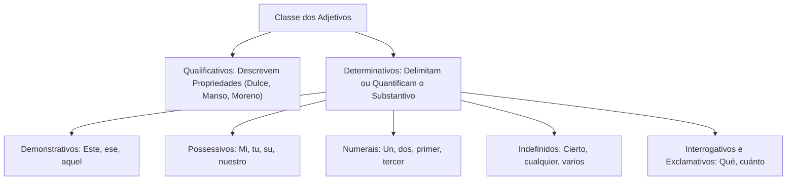
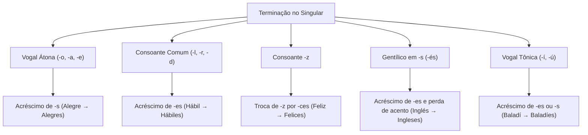
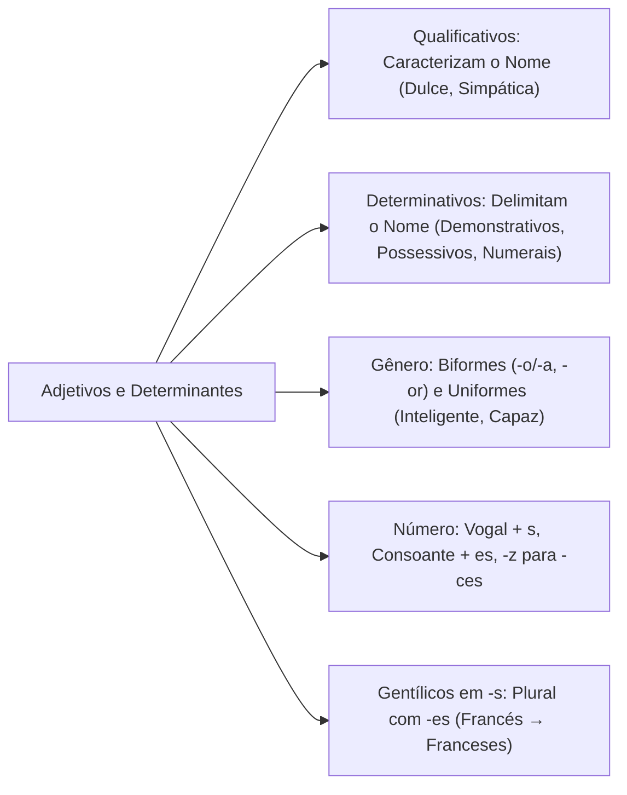

O estudo dos adjetivos e determinantes em língua espanhola constitui um dos eixos morfossintáticos mais explorados em concursos. O domínio das relações nominais permite resolver questões sobre concordância, valor semântico e funções sintáticas.

Compreender a diferença funcional entre qualificar um ser e delimitar sua extensão evita equívocos em provas objetivas. Este capítulo analisa a estrutura dos adjetivos qualificativos e determinativos. Além disso, detalha as regras de flexão de gênero e número segundo a norma culta contemporânea.

> [!objetivos]
> - Compreender a definição gramatical do adjetivo e sua função modificadora do substantivo.
> - Distinguir adjetivos qualificativos de determinativos, identificando pronomes e numerais adjacentes.
> - Diferenciar no plano semântico os conceitos lexicais de *calidad* e *cualidad*.
> - Aplicar as regras regulares e especiais de flexão de gênero e número dos adjetivos e gentílicos.

## Conceito e Divisão Funcional dos Adjetivos

A Real Academia Española define o adjetivo como a classe de palavras que modificam um substantivo. Os adjetivos expressam qualidades, propriedades, relações e delimitações. Em espanhol, essas palavras desempenham papel essencial para matizar o discurso. Elas qualificam pessoas, animais, fatos e objetos materiais em textos jornalísticos e relatórios técnicos.

Os adjetivos agrupam-se em duas grandes categorias funcionais:
- **Adjetivos qualificativos:** Atribuem características ao substantivo (*chocolate dulce, jirafa mansa, mujer simpática, hombre moreno*). Eles descrevem traços físicos, morais ou sensoriais.
- **Adjetivos determinativos:** Delimitam a abrangência do substantivo no contexto (*este libro, dos días, cualquier mujer*). Eles identificam ou quantificam o termo sem atribuir uma qualidade descritiva.

A distinção entre *calidad* e *cualidad* assume relevância crítica na língua espanhola. O vocábulo *calidad* refere-se à propriedade de um objeto, ao valor ou à excelência de algo. Dizemos, por exemplo: *este coche o carro es de buena calidad*. 

Por outro lado, o vocábulo *cualidad* designa o atributo moral ou distintivo de um ser humano. Usamos a expressão: *la joven oficial tiene cualidades de liderazgo*. Quando o candidato souber essa diferença lexical, resolverá com segurança questões de semântica vocabular.

## Adjetivos Determinativos em Detalhe

Quando acompanham o substantivo, pronomes, artigos e numerais assumem função adjetiva determinativa. Eles não substituem o nome na oração. Ao contrário, colocam-se ao seu lado para precisar seu alcance comunicativo.

Os determinantes dividem-se em grupos morfológicos específicos:

### Determinantes Demonstrativos e Possessivos

Os demonstrativos situam o substantivo no espaço, no tempo ou no discurso. Variam em gênero e número (*este/esta, ese/esa, aquel/aquella*):
- *Este informe policial* (proximidade do emissor).
- *Esa patrulla militar* (proximidade do receptor).
- *Aquel edificio antiguo* (distância de ambos).

Os possessivos indicam a quem pertence o referente do substantivo. Apresentam formas apocopadas diante do substantivo (*mi, tu, su, nuestro, vuestro, su*):
- *Mi coche* (meu carro).
- *Nuestras responsabilidades* (nossas responsabilidades).
- *Sus órdenes* (suas ordens).

### Determinantes Numerais

Os numerais expressam quantidade matemática exata ou ordenação linear em sequências:
- **Cardinais:** Quantificam unidades inteiras (*un libro, dos mujeres, diez soldados*).
- **Ordinais:** Indicam a posição relativa (*el primer día, la segunda compañía, el tercer piso*).

### Determinantes Indefinidos

Os indefinidos referem-se ao substantivo de maneira vaga, imprecisa ou generalizada:
- *Cierta mujer* (uma mulher não especificada).
- *Cualquier libro* (qualquer livro indistintamente).
- *Vários testigos* (uma pluralidade indeterminada de pessoas).
- *Ningún obstáculo* (ausência total de elementos).

### Determinantes Interrogativos e Exclamativos

Essas palavras introduzem enunciados interrogativos ou enfatizam intensidade expressiva:
- *¿Cuántos días durará la operación?*
- *¡Qué hermosa labor realizan los bomberos!*
- *¡Cuánta paciencia demuestra el comandante!*

> [!bizu]
> Observe o uso do interrogativo *cuáles* na América diante de substantivos. Em certas regiões hispânicas aceita-se *¿Cuáles ideas usted tiene?*. Contudo, na norma padrão acadêmica cobrada nos concursos brasileiros, emprega-se a forma *¿Qué ideas usted tiene?*.

## Flexão de Gênero dos Adjetivos

O adjetivo concorda obrigatoriamente em gênero com o substantivo qualificado. Essa flexão obedece a regras consolidadas na morfologia espanhola.

### Formação Regular em -o e -a

A maior parte dos adjetivos terminados em *-o* no masculino forma o feminino com a desinência *-a*:
- *Delgado* → *Delgada*
- *Rico* → *Rica*
- *Pequeño* → *Pequeña*
- *Rojo* → *Roja*
- *Bueno* → *Buena*

### Terminações em -or, -án, -ín e -ón

Adjetivos masculinos terminados nesses sufixos constroem o feminino com a desinência *-a*:
- *Encantador* → *Encantadora*
- *Trabajador* → *Trabajadora*
- *Alemán* → *Alemana* (o oficial alemão / a oficial alemã)
- *Parlanchín* → *Parlanchina* (homem tagarela / mulher tagarela)
- *Guapetón* → *Guapetona*
- *Burlón* → *Burlona*

### Adjetivos de Nacionalidade e Gentílicos

Adjetivos pátrios que expressam a nacionalidade do indivíduo e terminam em consoantes (*-l, -n, -s, -z*) recebem a terminação *-a* no feminino:
- *Español* → *Española*
- *Inglés* → *Inglesa*
- *Francés* → *Francesa*
- *Andaluz* → *Andaluza*
- *Japonés* → *Japonesa*

Note que essas palavras perdem o acento gráfico na forma feminina (*francés → francesa*), pois deixam de ser oxítonas.

### Adjetivos Uniformes e Invariáveis em Gênero

Muitos adjetivos não sofrem flexão de gênero. Eles apresentam uma única terminação para substantivos masculinos e femininos:
- Terminados na vogal *-e*: *hombre inteligente / mujer inteligente*, *coche verde / casa verde*.
- Terminados na vogal *-a*: *hombre hipócrita / mujer hipócrita*.
- Terminados em consoantes comuns não gentílicas: *concurso difícil / prueba difícil*, *hombre feliz / mujer feliz*, *resultado eficaz / medida eficaz*.
- Adjetivos invariáveis invariantes: *vino gratis / cerveza gratis*.

| Tipo de Adjetivo | Masculino | Feminino | Aplicação em Frase |
| :--- | :--- | :--- | :--- |
| **Biforme em -o / -a** | *pequeño* | *pequeña* | *el niño pequeño / la niña pequeña* |
| **Sufixo em -or** | *trabajador* | *trabajadora* | *el militar trabajador / la militar trabajadora* |
| **Gentílico em consoante** | *español* | *española* | *el cuerpo español / la tropa española* |
| **Uniforme em -e** | *valiente* | *valiente* | *el bombero valiente / la bombera valiente* |
| **Uniforme em consoante** | *difícil* | *difícil* | *el camino difícil / la ruta difícil* |
| **Uniforme em -z** | *capaz* | *capaz* | *el oficial capaz / la oficial capaz* |

> [!pegadinha]
> Em enunciados como "una versión exclusiva para móviles", o examinador pode indagar se a palavra *exclusiva* é masculina por se relacionar a *móviles*. Observe o núcleo substantivo: *exclusiva* qualifica *versión*, que é feminina pelo artigo *una*. Portanto, *exclusiva* é inequivocamente um adjetivo feminino singular!

## Flexão de Número dos Adjetivos

A flexão de número harmoniza o adjetivo com o substantivo em singular ou plural. As normas gramaticais organizam-se pelos sons finais das palavras:

### Acréscimo de -s após Vogais Átonas

Adjetivos finalizados em vogais átonas formam plural com *-s*:
- *Alegre* → *Alegres*
- *Bruto* → *Brutos*
- *Rojo* → *Rojos*
- *Feo* → *Feos*

### Acréscimo de -es após Consoantes

Adjetivos terminados em consoante comum recebem *-es*:
- *Hábil* → *Hábiles*
- *Mejor* → *Mejores*
- *Fácil* → *Fáciles*
- *Trabajador* → *Trabajadores*

### Adjetivos Terminados em -z

Nos vocábulos terminados na consoante *-z*, a letra converte-se no grupo *-ces*:
- *Feliz* → *Felices*
- *Eficaz* → *Eficaces*
- *Veloz* → *Veloces*
- *Capaz* → *Capaces*

### Adjetivos Terminados em Vogais Tônicas -í e -ú

Formas como gentílicos ou palavras específicas admitem variantes duplas de plural. A terminação em *-es* prevalece no padrão culto:
- *Baladí* (insignificante) → *Baladíes* ou *baladís* (fatos insignificantes).
- *Iraní* → *Iraníes* ou *iranís*.
- *Hindú* → *Hindúes* ou *hindús*.
- *Marroquí* → *Marroquíes* ou *marroquís*.

### Plural dos Gentílicos Terminados em -s

Gentílicos oxítonos terminados em consoante *-s* recebem a terminação *-es* no plural. Essa regra contrasta com palavras invariáveis como *gratis*:
- *Inglés* → *Ingleses*
- *Francés* → *Franceses*
- *Portugués* → *Portugueses*

## Análise de Concordância em Contextos de Concurso

Nas provas, a concordância dos adjetivos é avaliada em orações complexas. O candidato precisa atentar para estruturas com múltiplos substantivos coordenados:

1. **Substantivos de mesmo gênero:** Quando o adjetivo qualifica dois ou mais substantivos masculinos, assume a forma masculina plural (*el coche y el camión nuevos*). Se qualifica substantivos femininos, assume a forma feminina plural (*la casa y la escuela limpias*).
2. **Substantivos de gêneros diferentes:** Quando qualifica substantivos de gêneros mistos, o adjetivo vai obrigatoriamente para o masculino plural (*el perro y la perra negros, casas y coches modernos*).
3. **Adjetivo anteposto a múltiplos nomes:** Se o adjetivo antecede os substantivos coordenados, concorda habitualmente em gênero e número com o primeiro substantivo mais próximo (*su extraordinaria fuerza y valor*).

> [!atencao]
> A concordância nominal não depende da proximidade espacial do adjetivo quando este funciona como predicativo. Em estruturas com verbos de ligação (*ser, estar, parecer*), o adjetivo concorda com o sujeito composto no masculino plural (*el informe y la minuta son excelentes*).

> [!esquema]
> **Resumo Prático de Concordância Nominal:**
> - Núcleos Masculinos → Masculino Plural (*libros y cuadernos viejos*).
> - Núcleos Femininos → Feminino Plural (*mesas y sillas nuevas*).
> - Núcleos Mistos → Prevalece o Masculino Plural (*árboles y flores marchitos*).

## Mapa do capítulo

### Para fixar

- O adjetivo qualifica ou determina o substantivo, modificando-o de forma direta ou predicativa.
- O vocábulo *calidad* designa o valor intrínseco de algo, enquanto *cualidad* refere-se a virtudes e traços de personalidade.
- Determinantes possessivos, demonstrativos, numerais e indefinidos exercem função adjetiva ao delimitar o substantivo.
- Adjetivos terminados em *-o*, *-or*, *-án*, *-ín* e *-ón* constroem o feminino regular com a desinência *-a*.
- Gentílicos terminados em consoantes *-l*, *-n*, *-s* e *-z* formam o feminino adicionando a terminação *-a*.
- Adjetivos uniformes como *feliz, hipócrita, valiente, difícil* e *gratis* possuem forma única para ambos os gêneros.
- No plural, adjetivos terminados em vogal recebem *-s*, consoantes recebem *-es* e terminados em *-z* trocam por *-ces*.
- Na presença de substantivos coordenados de gêneros diferentes, a concordância do adjetivo posposto é feita no masculino plural.
