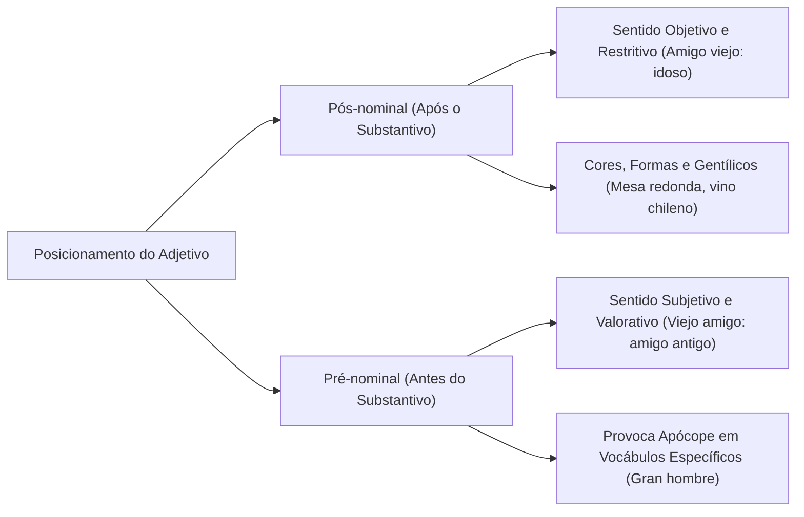
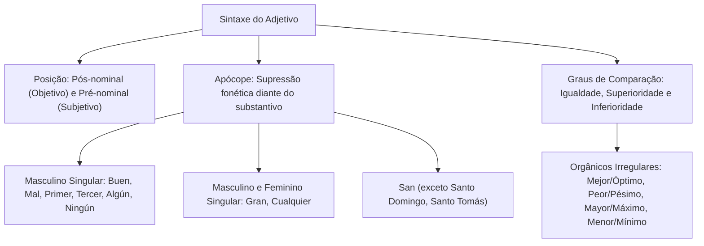

A sintaxe dos adjetivos em língua espanhola vai além da simples concordância morfológica. O posicionamento do termo na oração e as alterações fonéticas decorrentes da anteposição ao substantivo determinam o sentido das mensagens.

Compreender a dinâmica da apócope e a estruturação dos graus comparativos capacita o candidato a identificar nuances semânticas complexas. Este capítulo analisa a concordância e posição do adjetivo, as regras de apócope e o sistema dos graus de comparação.

> [!objetivos]
> - Compreender o impacto da posição pré-nominal e pós-nominal do adjetivo na construção do sentido.
> - Dominar as regras fonéticas e sintáticas que regem o fenômeno da apócope em espanhol.
> - Construir com precisão os comparativos regulares de superioridade, inferioridade e igualdade.
> - Identificar as formas comparativas e superlativas sintéticas irregulares consagradas pela norma culta.

## Concordância e Posição Sintática do Adjetivo

A regra geral determina que o adjetivo concorde em gênero e número com o substantivo (*coche bonito, silla bonita, hijos pequeños*). Quando o adjetivo qualifica múltiplos núcleos de gêneros distintos, o masculino plural prevalece na construção (*casas y coches nuevos*).

Na estrutura da oração, o adjetivo ocupa posição pós-nominal ou pré-nominal. A colocação posposta é a mais comum na linguagem informativa. Adjetivos que indicam forma, cor e nacionalidade situam-se sempre após o substantivo (*queso francés, mesa cuadrada, gato negro*).

Quando o adjetivo é anteposto ao substantivo, ele assume valor explicativo ou enfático. Em determinados vocábulos, a mudança de posição altera profundamente o significado da oração:

| Adjetivo | Posição Pós-nominal (Sentido Objetivo) | Posição Pré-nominal (Sentido Subjetivo/Figurado) |
| :--- | :--- | :--- |
| **Pobre** | *una mujer pobre* (sem recursos financeiros) | *una pobre mujer* (mulher infeliz, digna de compaixão) |
| **Viejo** | *un amigo viejo* (homem idoso em anos de vida) | *un viejo amigo* (amizade de longa data) |
| **Grande** | *un hombre grande* (homem de elevada estatura física) | *un gran hombre* (homem notável, ilustre, virtuoso) |
| **Nuevo** | *un coche nuevo* (carro recém-fabricado, zero km) | *un nuevo coche* (outro carro, mais um veículo adquirido) |
| **Simple** | *un hombre simple* (indivíduo humilde ou simplório) | *un simple hombre* (mero ser humano, homem comum) |
| **Único** | *un hijo único* (filho que não possui irmãos) | *el único hijo que vino* (o filho singular que compareceu) |

> [!bizu]
> Observe a diferença estilística: o adjetivo posposto tem função restritiva e objetiva. Já o adjetivo anteposto agrega juízo de valor afetivo ou ênfase expressiva do autor da frase.

## O Fenômeno da Apócope

Denomina-se apócope a supressão de uma ou mais letras no final de um vocábulo quando este precede determinados substantivos. Trata-se de um fenômeno fonético histórico com regras sintáticas rigorosas.

As principais regras de apócope distribuem-se nos seguintes grupos:

### Apócope Diante de Substantivos Masculinos Singulares

Os seguintes adjetivos perdem a terminação quando antecedem imediatamente um substantivo masculino no singular:
- **Bueno → Buen:** *un buen negocio, un buen día, un buen amigo*.
- **Malo → Mal:** *un mal juego, un mal momento, un mal ejemplo*.
- **Primero → Primer:** *el primer puesto, el primer oficial*.
- **Tercero → Tercer:** *el tercer piso, el tercer capítulo*.
- **Uno → Un:** *un soldado, un bombero*.
- **Alguno → Algún:** *algún motivo, algún testigo* (recebe acento gráfico por virar oxítona em -n).
- **Ninguno → Ningún:** *ningún problema, ningún indicio* (recebe acento gráfico).

### Apócope Diante de Substantivos Masculinos e Femininos

Determinados adjetivos sofrem apócope diante de qualquer substantivo no singular, independentemente do gênero gramatical:
- **Grande → Gran:** *un gran parque, una gran mujer, una gran victoria, un gran oficial*.
- **Cualquiera → Cualquier:** *cualquier hombre, cualquier mujer, cualquier situación*.

A palavra *ciento* sofre apócope e converte-se em *cien* diante de um substantivo. O mesmo ocorre diante de numeral multiplicador (*cien personas, cien bomberos, cien mil dólares*). Todavia, mantém-se a forma plena *ciento* se vier precedida por dezenas (*ciento veinte soldados*).

### Apócope do Vocábulo Santo

O adjetivo *santo* apocopa-se para *san* diante da grande maioria dos nomes próprios masculinos de santos (*San José, San Pedro, San Juan, San Francisco*). 

Exceção clássica de provas: *santo* não sofre apócope diante de nomes próprios iniciados pelas sílabas *Do-* e *To-*:
- *Santo Domingo*
- *Santo Tomás*
- *Santo Tomé*
- *Santo Toribio*

> [!pegadinha]
> O adjetivo *grande* só se transforma em *gran* no singular! No plural, a forma é sempre *grandes*, tanto para substantivos masculinos quanto femininos (*los grandes hombres, las grandes hazañas*). Jamais utilize construções inexistentes como "grans". Além disso, diante de santos masculinos em *Do-* e *To-*, mantenha *santo* (*Santo Domingo*, e nunca "San Domingo").

## Graus de Comparação dos Adjetivos

Os adjetivos flexionam-se em intensidade e estabelecem relações comparativas entre seres e propriedades.

### Grau Comparativo Regular

O comparativo divide-se em três modalidades fundamentais:

1. **Comparativo de superioridade:** Estrutura-se com o quantificador *más... que*:
   - *El oficial es más rápido que el recruta.*
   - *Esta ruta es más segura que aquella carretera.*
   - Diante de numerais afirmativos, emprega-se a preposição *de*: *la brigada rescató a más de veinte personas*.
2. **Comparativo de inferioridade:** Forma-se com o quantificador *menos... que*:
   - *Este método es menos arriesgado que el anterior.*
   - *El procedimiento es menos complejo que la norma antiga.*
3. **Comparativo de igualdade:** Constrói-se por meio de três fórmulas distintas:
   - *Tan + adjetivo/advérbio + como:* *Pablo es tan alto como José*.
   - *Tanto/tanta/tantos/tantas + substantivo + como:* *el coronel tiene tanta experiencia como el general*.
   - *Igual de + adjetivo + que:* *esta unidad es igual de eficiente que aquella*.

### Grau Superlativo

O superlativo expressa a qualidade no seu nível máximo e divide-se em:
- **Superlativo relativo:** Delimita a qualidade em relação a um grupo: *el más valiente de la tropa, la menos costosa de las opciones*.
- **Superlativo absoluto analítico:** Emprega advérbios intensificadores (*muy, sumamente, extremadamente, altamente*): *muy inteligente, sumamente cuidadoso*.
- **Superlativo absoluto sintético:** Forma-se com os sufixos *-ísimo* ou *-érrimo*: *altísimo, bellísima, amabilísimo, antiquísimo, paupérrimo, celebérrimo, libérrimo*.

### Comparativos e Superlativos Orgânicos Irregulares

Determinados adjetivos possuem formas comparativas e superlativas sintéticas próprias herdadas do latim clássico. Eles dispensam o uso de *más* ou *menos*:

| Adjetivo Positivo | Comparativo Orgânico | Superlativo Orgânico | Significado em Português |
| :--- | :--- | :--- | :--- |
| **Bueno** | *mejor* | *óptimo* | bom → melhor → ótimo |
| **Malo** | *peor* | *pésimo* | mau → pior → péssimo |
| **Grande** | *mayor* | *máximo* | grande → maior → máximo |
| **Pequeño** | *menor* | *mínimo* | pequeno → menor → mínimo |
| **Alto** | *superior* | *supremo* | alto → superior → supremo |
| **Bajo** | *inferior* | *ínfimo* | baixo → inferior → ínfimo |

> [!atencao]
> As formas orgânicas *mejor, peor, mayor* e *menor* já contêm o valor comparativo intrínseco. Constitui erro gramatical grave antepor o advérbio *más* a essas palavras (*diga "mejor", jamais "más mejor"*).

## Mapa do capítulo

### Para fixar

- O adjetivo concorda em gênero e número; diante de substantivos de gêneros mistos, prevalece o masculino plural.
- A posição do adjetivo altera o sentido: *mujer pobre* (sem recursos) versus *pobre mujer* (infeliz).
- Gentílicos, cores e formas situam-se normalmente após o substantivo.
- A apócope elimina sons finais: *bueno → buen*, *malo → mal*, *primero → primer* antes de nomes masculinos singulares.
- O adjetivo *grande* reduz-se a *gran* diante de nomes masculinos ou femininos no singular (*un gran hombre, una gran mujer*).
- O vocábulo *santo* apocopa-se em *san*, salvo diante de nomes iniciados por *Do-* ou *To-* (*Santo Domingo*).
- O comparativo de igualdade emprega *tan... como* para adjetivos e *tanto... como* para substantivos.
- Formas sintéticas orgânicas como *mejor, peor, mayor* e *menor* nunca devem vir acompanhadas de *más*.
