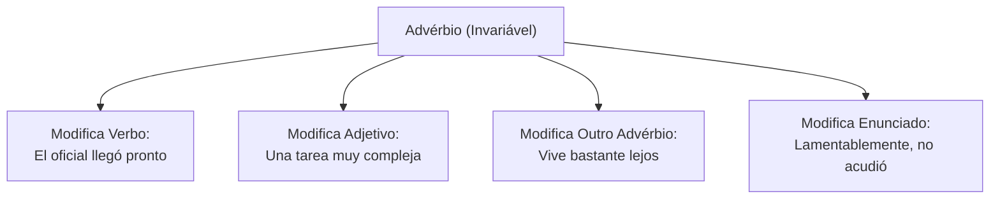
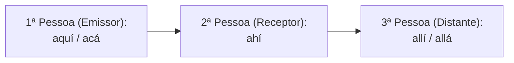
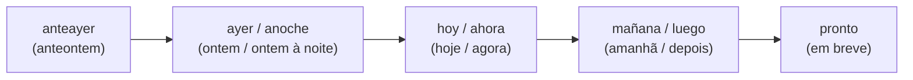
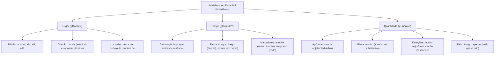

O estudo dos advérbios na língua espanhola constitui um dos pilares da compreensão textual e da precisão sintática em concursos públicos. Em textos técnicos, operacionais e jornalísticos, os advérbios delimitam circunstâncias fundamentais de espaço, tempo e intensidade das ações narradas. Compreender suas propriedades morfológicas invariáveis e dominar as divergências semânticas em relação ao português permite ao candidato resolver questões de interpretação e análise gramatical com segurança.

> [!objetivos]
> - Compreender a natureza morfológica invariável e as funções sintáticas dos advérbios em espanhol.
> - Dominar o emprego dos advérbios e locuções adverbiais de lugar, diferenciando *donde* e *adonde*.
> - Reconhecer os advérbios de tempo e identificar falsos amigos temporais como *luego*, *pronto* e *anoche*.
> - Aplicar a distinção obrigatória entre *muy* e *mucho*, além de interpretar advérbios de quantidade e grau.

## Palavras Iniciais e Conceito de Advérbio

Os advérbios formam uma classe de palavras invariáveis dotadas de significado lexical próprio e acentuação tônica. Na oração, o advérbio atua modificando diretamente um verbo, um adjetivo, outro advérbio ou mesmo um enunciado completo. Por ser invariável, o advérbio não sofre flexão de gênero (masculino/feminino) nem de número (singular/plural).

Quanto à classificação funcional, a Real Academia Española (RAE) divide os advérbios em grupos semânticos:
- Advérbios de lugar (*aquí, allí, cerca, lejos*).
- Advérbios de tempo (*hoy, ayer, mañana, luego, pronto*).
- Advérbios de quantidade ou grau (*muy, mucho, poco, bastante*).
- Advérbios de modo (*bien, mal, así, rápidamente*).
- Advérbios de afirmação (*sí, también, claro*).
- Advérbios de negação (*no, jamás, nunca, tampoco*).
- Advérbios de dúvida (*quizá, tal vez, acaso*).
- Advérbios interrogativos e exclamativos (*¿dónde?, ¿cuándo?, ¿cómo?, ¿cuánto?*).



## Advérbio de Lugar

Os advérbios e as locuções adverbiais de lugar respondem às perguntas *¿dónde?* (onde), *¿adonde?* (aonde) e *¿desde dónde?* (de onde). Eles situam no espaço as entidades e os acontecimentos narrados.

As formas mais frequentes no idioma castelhano distribuem-se conforme a distância aos interlocutores:
- **Proximidade do emissor**: *aquí* e *acá* (aqui, cá).
- **Proximidade do receptor**: *ahí* (aí).
- **Afastamento de ambos**: *allí* e *allá* (ali, lá, acolá).
- **Posições absolutas**: *arriba, abajo, delante, detrás, dentro, fuera, cerca, lejos, enfrente, junto*.



Muitos advérbios compõem **locuções adverbiais de lugar** ao receberem a preposição *de*:
- *cerca de mi casa* (perto da minha casa).
- *debajo de la mesa* (debaixo da mesa).
- *encima de la banqueta* (em cima do banco / sobre o banco).
- *al lado del cuartel* (ao lado do quartel).
- *alrededor del edificio* (ao redor do prédio).
- *a través de la ventana* (através da janela).

| Advérbio de Lugar | Sentido em Português | Exemplo Prático de Aplicação |
|---|---|---|
| *aquí* / *acá* | aqui / cá (junto ao falante) | *El documento oficial está aquí.* |
| *ahí* | aí (junto ao ouvinte) | *Deja la carpeta ahí, por favor.* |
| *allí* / *allá* | ali / lá (afastado de ambos) | *Los bomberos operan allá.* |
| *cerca* / *lejos* | perto / longe | *La base militar queda muy lejos.* |
| *delante* / *detrás* | na frente / atrás | *El comandante marcha delante.* |
| *encima* / *debajo* | em cima / debaixo | *El informe está encima de la mesa.* |

Nos textos de concursos e no cotidiano profissional, observe as construções espaciais autênticas:
- *El músico vive debajo de mi departamento*: o advérbio *debajo* situa o morador no pavimento inferior.
- *El banco y el mercado están situados cerca del teatro*: a locução *cerca de* demarca proximidade física.
- *La bicicleta quedó estacionada delante del edificio*: *delante* indica posicionamento frontal.
- *El choque de vehículos provocó un obstáculo en el tránsito*: circunstância espacial de bloqueio na via.
- *Por seguridad institucional, no fumes dentro de las instalaciones*: *dentro* delimita o espaço interior.

> [!bizu]
> Guarde a distinção entre *donde* e *adonde*:
> - *Donde* indica localização estática e responde a *onde* (*El puesto donde trabajo*).
> - *Adonde* ou *a donde* expressa movimento e direção a um destino, respondendo a *aonde* (*Voy adonde me ordenen*).

## Advérbio de Tempo

Os advérbios de tempo situam os fatos cronologicamente na linha temporal. Eles respondem às indagações *¿cuándo?* (quando), *¿cuánto tiempo?* (quanto tempo) e *¿con qué frecuencia?* (com qual frequência).

Os principais advérbios temporais do castelhano incluem: *hoy* (hoje), *ayer* (ontem), *anteayer* (anteontem), *anoche* (ontem à noite), *mañana* (amanhã), *ahora* (agora), *antes* (antes), *después* (depois), *luego* (depois), *pronto* (em breve), *tarde* (tarde), *temprano* (cedo), *siempre* (sempre), *nunca* e *jamás* (nunca), *ya* (já), *todavía* (ainda), *a menudo* (frequentemente), *entretanto* e *recién*.



> [!pegadinha]
> Cuidado com os falsos amigos temporais em questões de prova:
> 1. *Luego* não significa o "logo" imediato do português. Ele traduz "depois" ou "em seguida" (*Cenamos y luego salimos* = Jantamos e depois saímos).
> 2. *Pronto* traduz "em breve", "cedo" ou "rápido" (*Volveré pronto* = Voltarei em breve; *Llegó muy pronto* = Chegou muito cedo).
> 3. *Anoche* é uma palavra única que expressa "ontem à noite" (*Anoche hubo guardia preventiva*).
> 4. *Mañana* pode ser o advérbio "amanhã" ou o substantivo feminino "a manhã" (*por la mañana*).

| Advérbio Temporal | Tradução Precisa | Exemplo Contextualizado |
|---|---|---|
| *anoche* | ontem à noite | *Anoche el pelotón patrulló la zona.* |
| *luego* | depois, em seguida | *Leímos el informe y luego firmamos.* |
| *temprano* | cedo | *La tropa forma muy temprano.* |
| *pronto* | em breve / cedo | *El refuerzo llegará pronto al local.* |
| *a menudo* | frequentemente | *Los agentes entrenan a menudo.* |
| *todavía* | ainda | *El rescate todavía no ha concluido.* |

Analise outros exemplos temporais frequentes em enunciados de prova:
- *Anoche no pude dormir por causa del intenso ruido*: *anoche* delimita a noite imediatamente anterior.
- *Antes de comer hay que terminar de revisar la cuenta*: *antes de* expressa anterioridade temporal.
- *Fuimos al cine y luego a cenar al restaurante*: *luego* conecta ações em sucessão cronológica.
- *Pepe y Carlos deben levantar el estudio la próxima semana*: expressões de periodicidade temporal.
- *El dentista atiende a sus pacientes ocasionalmente*: *ocasionalmente* indica frequência intervalada.
- *Las labores de patrullaje continuarán eternamente*: *eternamente* denota duração ininterrupta.

## Advérbio de Quantidade e Grau

Os advérbios de quantidade respondem à pergunta *¿cuánto?* (quanto). Eles intensificam, atenuam ou mensuram predicados, adjetivos e outros modificadores.

Entre os termos mais frequentes figuram: *algo, bastante, casi, demasiado, más, menos, mucho, muy, nada, poco, solo / solamente, tanto, todo*.

### O Fenômeno da Apócope: Muy versus Mucho

O ponto gramatical mais explorado pelas bancas organizadoras diz respeito ao emprego correto de *muy* e *mucho*. Ambos traduzem o vocábulo "muito" do português, mas desempenham papéis sintáticos distintos e inconfundíveis:

1. **Emprego de *Muy* (Forma Apocopada)**:
   - *Muy* é invariável e atua exclusivamente modificando **adjetivos** ou **outros advérbios**.
   - Exemplos: *El bombero es muy valiente* (modifica o adjetivo *valiente*); *Llegaron muy tarde* (modifica o advérbio *tarde*).
2. **Emprego de *Mucho* (Forma Plena)**:
   - Modifica **verbos** na função de advérbio invariável: *El equipo entrenó mucho* (modifica o verbo *entrenó*).
   - Acompanha **substantivos** na função de determinante indefinido, sofrendo flexão de gênero e número: *mucho esfuerzo*, *mucha agua*, *muchos efectivos*, *muchas horas*.

```mermaid Regra prática de escolha entre muy e mucho
flowchart TD
    Origem["Desejo traduzir 'MUITO'"] --> Tipo{"O termo seguinte é:"}
    Tipo -->|Adjetivo ou Advérbio| UsaMuy["Use MUY:<br>muy rápido, muy bien"]
    Tipo -->|Verbo (Ação)| UsaMuchoVerbo["Use MUCHO (Invariável):<br>trabaja mucho"]
    Tipo -->|Substantivo (Coisa/Pessoa)| UsaMuchoFlex["Use MUCHO flexionado:<br>mucha calma, muchos recursos"]
```

> [!atencao]
> Existem quatro adjetivos comparativos e quatro advérbios comparativos que exigem **obrigatoriamente a forma *mucho***, constituindo a exceção clássica de prova:
> - Diante dos adjetivos comparativos: *mucho mejor*, *mucho peor*, *mucho mayor*, *mucho menor*.
> - Diante dos advérbios comparativos: *mucho más*, *mucho menos*, *mucho antes*, *mucho después*.
> É erro grave grafar "*muy mejor*" ou "*muy más*". O correto é sempre *mucho mejor* e *mucho más*.

### Particularidades de Grafia e Falsos Amigos em Quantidade

- **Acento diacrítico em *Más* versus *Mas***:
  - *Más* (com acento tilde) é advérbio de quantidade ou operador de adição (*Quiero más tiempo*).
  - *Mas* (sem acento) é conjunção adversativa sinônima de *pero* (*Quiso avanzar, mas no pudo*).
- **Falso amigo *Apenas***:
  - Em espanhol, *apenas* raramente equivale ao "apenas/somente" do português.
  - Seu significado principal é "mal, quase não" (*Apenas duerme por la guardia* = Mal dorme pela escala).
  - Pode também indicar tempo imediato: "assim que" (*Apenas sonó la alarma, salieron*).
- **Grafia de *Solo* e *Solamente***:
  - Pelas normas ortográficas vigentes da RAE, a palavra *solo* (tanto na acepção de adjetivo "sozinho" quanto de advérbio "somente") não deve levar acento tilde. A forma *solamente* é inequivocamente adverbial.

| Termo em Espanhol | Classe e Função Sintática | Significado Correto | Exemplo de Aplicação |
|---|---|---|---|
| *muy* | Advérbio apocopado (antes de adj/adv) | muito | *El rescate fue muy difícil.* |
| *mucho* | Advérbio invariável (após verbo) | muito | *El comandante dialogó mucho.* |
| *muchos / muchas* | Determinante indefinido flexionado | muitos / muitas | *Hay muitas patrullas activas.* |
| *más* (com tilde) | Advérbio de quantidade | mais | *Se necesita más combustible.* |
| *mas* (sem tilde) | Conjunção adversativa | mas, porém | *Aceleró, mas el camino cayó.* |
| *apenas* | Advérbio de intensidade/modo | mal, quase não | *Apenas se veía con el humo.* |

Examine aplicações adicionais de quantificadores e modificadores:
- *Esta comida no tiene nada de sabor*: *nada* atua como quantificador absoluto de grau nulo.
- *El oficial Joseph es muy tolerante con el equipo*: *muy* intensifica o adjetivo atributivo.
- *El universo intelectual combina disciplina y actividad lúdica en la lectura de novelas*: termos de intensidade e modo.
- *El conductor distraído e irritado provocó el siniestro vial*: qualificadores modificados em intensidade.
- *El especialista detectó miopía en el punto focal de la retina*: precisão de vocabulário temático.
- *Durante el temporal llovió a cántaros sobre la ciudad*: a locução *a cántaros* exprime quantidade e intensidade extrema (torrencialmente).

## Mapa do capítulo



### Para fixar

- O advérbio é palavra invariável e tônica que modifica verbos, adjetivos, outros advérbios ou orações inteiras.
- As formas *aquí* e *acá* marcam proximidade do emissor, *ahí* indica proximidade do receptor, e *allí* ou *allá* expressam afastamento de ambos.
- O termo *donde* denota localização estática, ao passo que *adonde* denota movimento direcionado a um destino.
- O advérbio *luego* não expressa imediatismo; seu significado exato em espanhol é "depois" ou "em seguida".
- A palavra *pronto* traduz-se contextualmente por "em breve", "cedo" ou "rapidamente".
- O termo *anoche* consiste em vocábulo simples que designa o período de ontem à noite.
- Emprega-se *muy* antes de adjetivos e advérbios, reservando-se *mucho* para modificar verbos ou atuar como pronome/determinante.
- Antes de comparativos como *mejor*, *peor*, *más* e *menos*, a norma gramatical impõe o uso estrito de *mucho* (*mucho mejor*).
- O vocábulo *más* com tilde exprime quantidade, enquanto *mas* átono atua como conjunção adversativa equivalente a "porém".
- O falso amigo *apenas* expressa "mal" ou "quase não", afastando-se do sentido corriqueiro de exclusividade do português.
