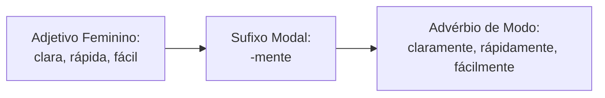
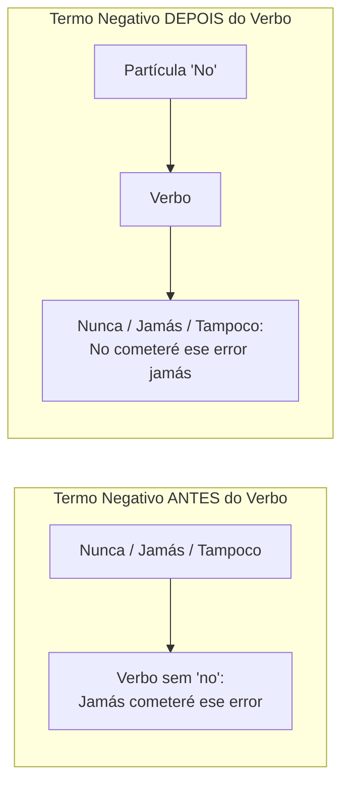
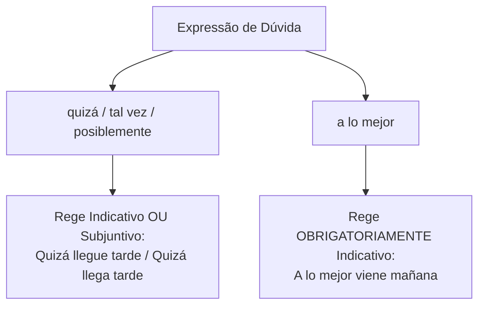
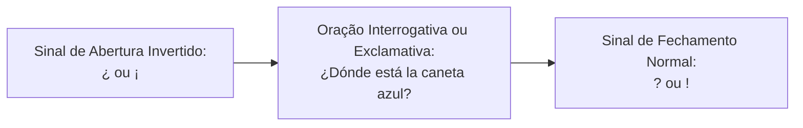
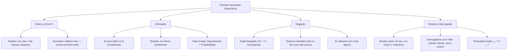

O domínio funcional das diferentes categorias adverbiais é indispensável para interpretar textos e resolver questões de morfossintaxe nas provas. Além das coordenadas de espaço e tempo, a comunicação expressa a maneira de executar ações, o grau de certeza do interlocutor e a postura afirmativa ou negativa diante dos fatos. Compreender as peculiaridades da língua espanhola, como a regra da dupla negação, a acentuação diacrítica de interrogativos e o valor semântico de locuções modais, confere precisão à resolução de prova.

> [!objetivos]
> - Identificar e empregar os advérbios de modo, dominando a formação sufixal em *-mente*.
> - Diferenciar os advérbios de afirmação e reconhecer os valores de probabilidade de *seguramente*.
> - Aplicar a regra estrutural da dupla negação com *no*, *nunca*, *jamás* e *tampoco*.
> - Analisar advérbios de dúvida e o uso de tilde diacrítica em interrogativos e exclamativos.

## Advérbio de Modo

Os advérbios de modo expressam a maneira ou a forma pela qual uma ação é realizada, respondendo à pergunta *¿cómo?* (como?). Constituem uma das classes mais produtivas do léxico espanhol.

As formas básicas simples reúnem termos de largo emprego:
- *así* (assim, dessa maneira).
- *bien* (bem) e *mal* (mal).
- *deprisa* (depressa, rapidamente).
- *despacio* (devagar, lentamente).
- *mejor* (melhor) e *peor* (pior), que atuam como comparativos irregulares de *bien* e *mal*.
- *regular* (regular, mais ou menos).



### Formação Sufixal em *-mente* e Manutenção Acentual

A derivação adverbial mais comum ocorre mediante o acréscimo do sufixo *-mente* à forma feminina do adjetivo primitivo:
- Adjetivo com duas terminações: *claro* (masculino) → *clara* (feminino) → *claramente*.
- Adjetivo uniforme: *cruel* → *cruelmente*; *feliz* → *felizmente*; *cordial* → *cordialmente*.

> [!bizu]
> Regra de ouro da acentuação: os advérbios terminados em *-mente* preservam rigorosamente o acento gráfico do adjetivo primitivo. Se o adjetivo original possuir acento tilde, o advérbio correspondente manterá esse acento:
> - *fácil* → *fácilmente*.
> - *rápido* → *rápidamente*.
> - *cómodo* → *cómodamente*.
> Caso o adjetivo não tenha tilde, o advérbio permanece sem acento (*suave* → *suavemente*; *consciente* → *conscientemente*).

### Adjetivos Adverbializados e Ortografia

Em espanhol, muitos adjetivos são utilizados diretamente com valor de advérbio, modificando o verbo sem flexão de gênero ou número:
- *La camioneta camina lento* (e não "*lenta*").
- *El oficial habla claro* (e não "*claramente*").

Atenção à grafia padronizada de vocábulos frequentes: *deprisa* e *despacio* são grafados em palavra única. O advérbio correspondente a cuidado escreve-se *cuidadosamente* (e nunca "*cuidosamente*").

| Advérbio de Modo | Significado Exato | Aplicação em Frase Contextualizada |
|---|---|---|
| *así* | assim | *Las cosas sucedieron así durante la guardia.* |
| *deprisa* | depressa | *La ambulancia avanzó deprisa hacia el hospital.* |
| *despacio* | devagar | *El conductor manejó despacio por la niebla.* |
| *fácilmente* | facilmente | *El perito resolvió el caso fácilmente.* |
| *mejor* | melhor | *Los agentes entrenados operan mucho mejor.* |
| *peor* | pior | *El cuadro empeoró y reaccionó peor.* |

Examine outros exemplos de uso em enunciados de concursos:
- *Silvia descansó cómodamente en el sofá tras la guardia*: *cómodamente* qualifica o repouso.
- *El paciente sentía dolor en el músculo y meniscos*: descrição fática de perícia clínica.
- *El testigo relató tristemente el incidente*: *tristemente* expressa o modo afetivo do depoimento.
- *Roberto examinó las fotografías profundamente*: modo detalhado de análise pericial.
- *El médico veterinario revisó las patas del animal*: contexto descritivo.
- *La pluma cayó suavemente sobre la mesa*: modo leve.
- *Caminaron despacio para entrar en orden al edificio*: deslocamento coordenado.
- *El bombero avanzó velozmente para salvar vidas*: modo tático rápido.
- *El rescatista actuó con calma para que la cuerda no se rompa*: modo preventivo.

## Advérbio de Afirmação

Os advérbios de afirmação reforçam a veracidade de uma proposição, confirmam uma declaração ou manifestam adesão categórica do emissor.

Os principais termos afirmativos compreendem:
- *sí* (sim, com acento tilde obrigatório).
- *también* (também, somando elemento afirmativo).
- *claro* (claro, certamente).
- *cierto* e *ciertamente* (certo, com certeza).
- *exacto* e *exactamente* (exato, perfeitamente).
- *obviamente* e *obvio* (obviamente).
- *verdaderamente* (verdadeiramente).
- *efectivamente* e a locução *en efecto* (de fato, efetivamente).

```mermaid Distinção fonética e gráfica entre sí afirmativo e si condicional
flowchart TD
    Origem["Vocábulo SI"] --> Tilde["Com Tilde: SÍ"]
    Origem --> SemTilde["Sem Tilde: SI"]
    Tilde --> Uso1["Advérbio de Afirmação:<br>Sí, iremos al cuartel"]
    Tilde --> Uso2["Pronome Reflexivo Tônico:<br>Pensó para sí mismo"]
    SemTilde --> Cond["Conjunção Condicional:<br>Si llueve, nos quedamos"]
    SemTilde --> Nota["Nota Musical:<br>Tocar en si menor"]
```

> [!atencao]
> Cuidado com o falso amigo afirmativo *seguramente*. Em língua espanhola, *seguramente* não exprime certeza categórica absoluta, mas sim **probabilidade ou forte presunção**:
> - *Seguramente llegará antes del mediodía* = "Provavelmente chegará antes do meio-dia".

| Advérbio Afirmativo | Função Principal | Exemplo Prático |
|---|---|---|
| *sí* (com tilde) | Afirmação direta | *Sí, la camioneta azul fue reparada.* |
| *también* | Adição afirmativa | *Los bomberos también fueron convocados.* |
| *en efecto* | Confirmação fática | *En efecto, el edificio superó la inspección.* |
| *ciertamente* | Validação factual | *Ciertamente el informe reveló la verdad.* |
| *exacto* | Concordância plena | *Exacto, la independencia exige orden.* |

Exemplos adicionais em orações declarativas:
- *Es una declaración absurda fundada en ideas equivocadas*: refutação argumentativa em textos oficiais.
- *Las instituciones no toleran la tortura ni fraudes en absoluto*: negação categórica reforçada.
- *Si comes carne, pescado o verduras, mantén una dieta balanceada*: condicional afirmativa.
- *Efectivamente, el aumento fue aprobado en Colombia*: validação factual.
- *Por favor, el equipo resolverá el problema difícilmente sin recursos*: modalização e cortesia.
- *El grupo no cometerá faltas durante la misión*: negação no futuro.

## Advérbio de Negação

Os advérbios de negação contestam a veracidade do predicado, rejeitam afirmações ou invalidam a proposição oracional.

O quadro das negativas reúne termos simples e locuções:
- *no* (não).
- *nunca* e *jamás* (nunca, jamais).
- *tampoco* (tampouco, "também não").
- *en absoluto* (de modo algum, de jeito nenhum).
- *negativamente* (negativamente).

### A Regra da Dupla Negação Sintática

A colocação dos advérbios negativos obedece a uma regra posicional estrita no castelhano, frequentemente cobrada em concursos:

1. **Termo Negativo Antes do Verbo**:
   - Quando vocábulos como *nunca*, *jamás* ou *tampoco* antecedem o verbo, a partícula *no* é **dispensada**.
   - Exemplos: *Nunca vi tanta lluvia*; *Jamás faltó a su deber*; *Tampoco asistió a la ceremonia*.
2. **Termo Negativo Depois do Verbo**:
   - Quando o termo negativo posiciona-se após o verbo, a presença da partícula *no* antes do verbo torna-se **obrigatória**.
   - Exemplos: *No vi nunca tanta lluvia*; *No faltó jamás a su deber*; *No asistió tampoco a la reunión*.



> [!pegadinha]
> Em espanhol, a dupla negação **não se anula nem gera sentido afirmativo**. Ela serve exclusivamente para intensificar e enfatizar a declaração negativa. A frase *No vino nadie nunca* significa com ênfase total: "Não veio ninguém nunca".

### Tampoco versus Tan Poco

- ***Tampoco*** (em uma só palavra): advérbio de negação que expressa inclusão negativa, correspondendo a "também não": *Él no come carne ni tampoco pescado* (Ele não come carne nem tampouco peixe).
- ***Tan poco*** (em duas palavras): combinação do advérbio comparativo de intensidade *tan* com o quantificador *poco*, significando "tão pouco": *Gana tan poco que apenas le alcanza* (Ganha tão pouco que mal lhe basta).

| Expressão Negativa | Papel Estrutural | Exemplo de Aplicação |
|---|---|---|
| *no* | Negação neutra elementar | *El comandante no autorizó la salida.* |
| *tampoco* | Negação aditiva ("também não") | *Ella no fue y él tampoco asistió.* |
| *en absoluto* | Negação categórica reforçada | *No me molesta en absoluto el cambio.* |
| *nunca jamás* | Combinação enfática máxima | *Nunca jamás toleraremos fraudes.* |
| *todavía no* | Negação temporal ("ainda não") | *La ambulancia todavía no ha llegado.* |

## Advérbios de Dúvida

Os advérbios de dúvida (*adverbios de duda*) modalizam o discurso, exprimindo incerteza, hesitação ou probabilidade sobre a realização dos acontecimentos.

Os termos mais representativos reúnem:
- *quizá* e *quizás* (talvez, ambas as formas plenamente corretas e sinônimas).
- *tal vez* (talvez, grafado sempre em duas palavras separadas).
- *acaso* (porventura, acaso, talvez).
- *posiblemente* e *probablemente* (possivelmente, provavelmente).
- *a lo mejor* (talvez, locução adverbial de probabilidade).
- *puede ser* (pode ser).



> [!bizu]
> Guarde a locução *a lo melhor*:
> 1. Traduz-se por "talvez" ou "quem sabe", e não por "*na melhor das hipóteses*".
> 2. Na norma culta oficial da RAE, exige **obrigatoriamente o verbo no modo indicativo** (*A lo mejor vamos a festejar el aniversario*, e nunca com subjuntivo).

Aplicações práticas em orações de dúvida:
- *Quizá viajemos a Europa si no perderemos el vuelo*: probabilidade de viagem.
- *Nos casaremos pronto tras festejar el aniversario*: expectativa temporal com *pronto*.
- *Tal vez compremos la camioneta si no falta presupuesto*: estimativa financeira.
- *¿Cuándo sentiste los primeros síntomas musculares?*: interrogativa temporal direta.

## Advérbio Interrogativo e Exclamativo

Os advérbios interrogativos e exclamativos servem para inquirir sobre circunstâncias ou manifestar emoção e ênfase expressiva na oração.

As formas fundamentais distinguem-se pelo tipo de circunstância solicitada:
- *¿cuándo?* e *¡cuándo!*: questiona ou enfatiza o **tempo**.
- *¿dónde?* e *¡dónde!*: interroga ou enfatiza o **lugar estático**.
- *¿adónde?* e *¡adónde!*: indaga sobre a **direção e destino**.
- *¿cómo?* e *¡cómo!*: interroga sobre o **modo ou causa**.
- *¿cuánto?* e *¡cuánto!*: questiona a **quantidade ou grau**.
- *¿cuán?* e *¿qué tan?*: expressam "quão" diante de adjetivos e advérbios (*¿Qué tan complicado es el examen?*).



> [!atencao]
> Acentuação diacrítica obrigatória: os advérbios interrogativos e exclamativos recebem **sempre acento tilde**, tanto em perguntas diretas (*¿Dónde vives?*) quanto em perguntas indiretas (*No sé dónde vives*).
> Quando exercem a função de pronomes ou advérbios relativos conectivos, são grafados **sem tilde** (*La casa donde nací*; *Llegó cuando pudo*).

Exemplos de provas:
- *¿Cuándo empieza la prueba en el colegio?*: interrogativa temporal direta.
- *¡Cuánto cuesta esta camioneta!*: exclamação de quantidade.
- *Dime cómo resolviste el ejercicio*: pergunta indireta com *cómo* acentuado.
- *¡Cuán injusta fue la decisión empresarial!*: intensidade enfática.

| Forma com Tilde (Interrogativa/Exclamativa) | Forma sem Tilde (Relativa/Conectiva) | Exemplo Comparativo |
|---|---|---|
| *¿Dónde?* (Onde?) | *donde* (onde, relativo) | *¿Dónde estás? / La ciudad donde vivo.* |
| *¿Cuándo?* (Quando?) | *cuando* (quando, conjunção) | *¿Cuándo vuelves? / Salí cuando llovía.* |
| *¿Cómo?* (Como?) | *como* (como, comparativo) | *¿Cómo lo hiciste? / Es fuerte como un roble.* |
| *¿Cuánto?* (Quanto?) | *cuanto* (quanto, relativo) | *¿Cuánto vale? / Hizo cuanto pudo.* |

## Mapa do capítulo



### Para fixar

- Advérbios de modo respondem a *¿cómo?* e compreendem termos como *así*, *bien*, *mal*, *deprisa* e *despacio*.
- Formas sufixais em *-mente* derivam da forma feminina do adjetivo primitivo e conservam intacto seu acento tilde.
- O advérbio *sí* afirmativo leva tilde, diferenciando-se da conjunção condicional átona *si*.
- O vocábulo *seguramente* não exprime certeza absoluta em espanhol, atuando como marcador de probabilidade ("provavelmente").
- Termos negativos antepostos dispensam o *no* (*Jamás volveré*); pospostos ao verbo, exigem o *no* antecedente (*No volveré jamás*).
- A dupla negação em língua espanhola reforça categoricamente a negação, sem anular o sentido negativo da oração.
- O advérbio *tampoco* significa "também não", enquanto *tan poco* indica quantidade reduzida ("tão pouco").
- A locução de dúvida *a lo mejor* traduz-se por "talvez" e rege obrigatoriamente verbos no modo indicativo.
- Advérbios interrogativos e exclamativos recebem acento tilde diacrítico em orações diretas e indiretas.
- O idioma espanhol exige pontuação dupla com sinais invertidos de abertura (`¿` e `¡`) em orações interrogativas e exclamativas.
