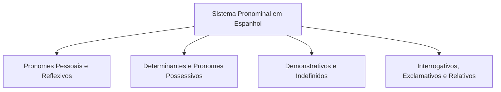
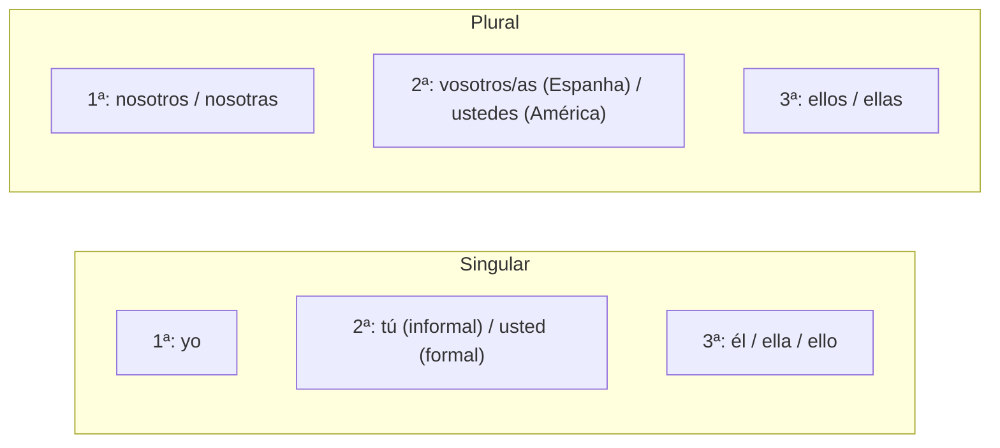
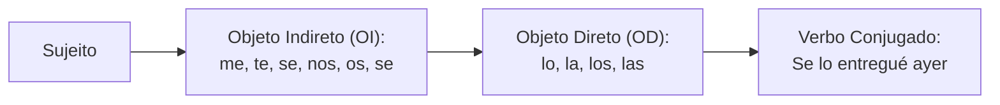
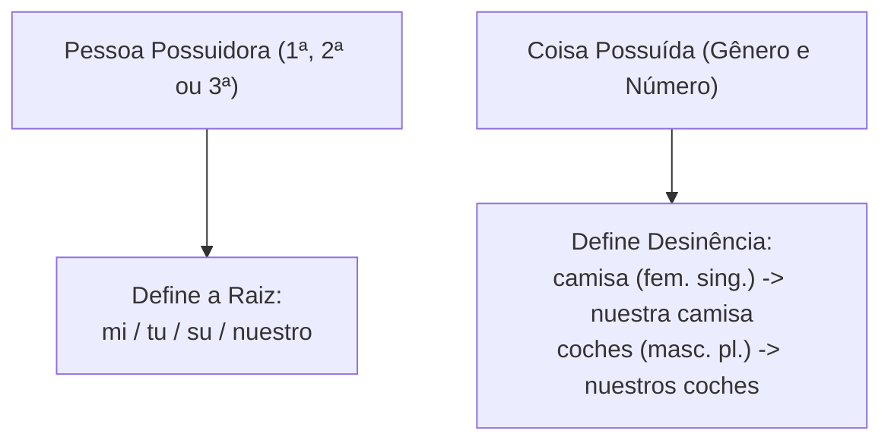
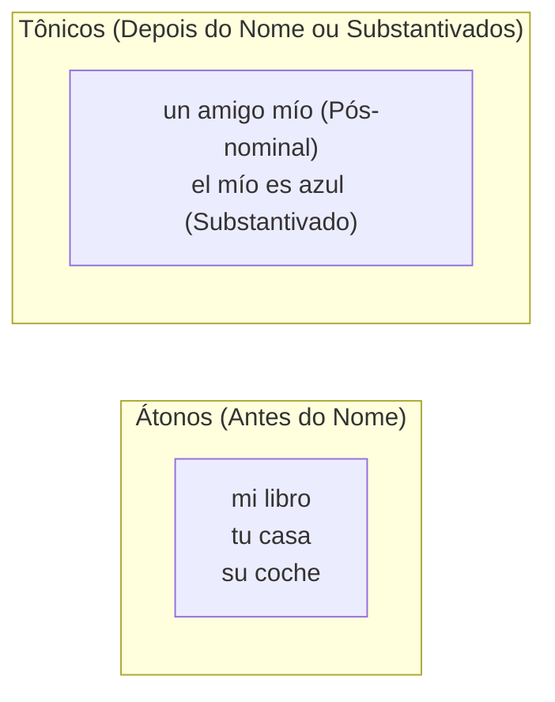
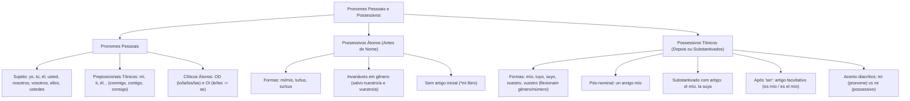

O estudo dos pronomes e determinantes na língua espanhola constitui um dos temas mais recorrentes e decisivos em provas de concursos públicos. No discurso formal, militar e jurídico, os pronomes asseguram a coesão referencial, identificam com clareza os participantes da interlocução e evitam repetições desnecessárias. Compreender as formas de tratamento, a mecânica dos pronomes de complemento direto e indireto e a distinção precisa entre possessivos átonos e tônicos capacita o candidato a interpretar textos complexos e solucionar questões morfossintáticas com segurança.

> [!objetivos]
> - Compreender a classificação geral dos pronomes e suas funções de substituição e determinação nominal.
> - Dominar os pronomes pessoais sujeitos, tônicos preposicionais e clíticos átonos de objeto direto e indireto.
> - Aplicar a regra da conversão de *le/les* em *se* diante dos pronomes acusativos de terceira pessoa.
> - Diferenciar determinantes possessivos átonos (antepostos) de formas possessivas tônicas (pospostas e substantivadas).

## Palavras Iniciais e Conceito de Pronomes

Segundo a doutrina gramatical e os preceitos da Real Academia Española (RAE), os pronomes são palavras que fazem as vezes do substantivo ou do sintagma nominal. Eles desempenham a função de referir-se a pessoas, animais ou objetos sem nomeá-los diretamente, recuperando elementos já expressos no texto ou apontando para os participantes da conversa.

No idioma espanhol, a tradição gramatical organiza os pronomes em oito classes funcionais:
1. **Pronomes Pessoais (*personales*)**: representam as pessoas gramaticais do discurso (*yo, tú, él, nosotros*).
2. **Pronomes Possessivos (*posesivos*)**: indicam a posse de algo em relação aos interlocutores (*mío, tuyo, suyo*).
3. **Pronomes Reflexivos (*reflexivos*)**: expressam ações que recaem sobre o próprio agente (*me, te, se, nos, os*).
4. **Pronomes Interrogativos (*interrogativos*)**: introduzem perguntas diretas ou indiretas (*¿quién?, ¿cuál?*).
5. **Pronomes Exclamativos (*exclamativos*)**: exprimem emoção, ênfase ou admiração (*¡qué!, ¡cuánto!*).
6. **Pronomes Indefinidos (*indefinidos*)**: referem-se a seres de modo vago ou impreciso (*alguien, nadie, algo*).
7. **Pronomes Demonstrativos (*demostrativos*)**: situam objetos no espaço e no tempo (*este, ese, aquel*).
8. **Pronomes Relativos (*relativos*)**: conectam orações subordinadas resgatando um antecedente (*que, quien, cuyo*).

## Pronomes Pessoais

Os pronomes pessoais identificam os participantes do ato de comunicação. A morfologia do espanhol distingue claramente os papéis de quem fala (primeira pessoa), com quem se fala (segunda pessoa) e de quem se fala (terceira pessoa).

### Pronomes Sujeito e Peculiaridades de Tratamento

Os pronomes pessoais retos exercem primordialmente a função sintática de sujeito da oração:
- **1ª Pessoa**: *yo* (singular); *nosotros* / *nosotras* (plural).
- **2ª Pessoa**: *tú*, *vos*, *usted* (singular); *vosotros* / *vosotras*, *ustedes* (plural).
- **3ª Pessoa**: *él*, *ella*, *ello* (singular); *ellos*, *ellas* (plural).

Em espanhol, o pronome sujeito é frequentemente omitido porque as desinências verbais indicam a pessoa com clareza (*Trabajamos en Barcelona* = Trabalhamos em Barcelona). O pronome expresso é empregado para marcar ênfase, contraste ou evitar ambiguidades entre a primeira e a terceira pessoas do singular nos tempos pretéritos e no condicional.

> [!atencao]
> As formas de tratamento demandam extrema cautela em provas:
> 1. ***Tú*** representa o tratamento informal no singular e conjuga o verbo na 2ª pessoa (*Tú tienes el libro*).
> 2. ***Usted*** é a forma de cortesia e respeito formal no singular, mas concorda **obrigatoriamente com o verbo na 3ª pessoa do singular** (*Usted tiene la palabra*).
> 3. ***Vosotros / vosotras*** é o tratamento informal plural típico da Espanha e rege verbo na 2ª pessoa do plural (*Vosotros tenéis tiempo*).
> 4. ***Ustedes*** é a forma de cortesia no plural na Espanha e o tratamento plural generalizado (formal e informal) em toda a América Latina, exigindo **verbo na 3ª pessoa do plural** (*Ustedes tienen la misión*).

### Pronomes Tônicos Preposicionais

Quando os pronomes pessoais aparecem antecedidos por preposições (*a, de, en, para, por, con*), o espanhol utiliza a série tônica:
- *mí* (com tilde diacrítica obrigatória): *Este informe es para mí*.
- *ti* (sempre sem tilde): *Esto es para ti*.
- *él, ella, usted*: *Habló de él*; *Confiamos en usted*.
- *nosotros / nosotras, vosotros / vosotras, ellos / ellas, ustedes*.

Quando a preposição utilizada for *con* (com), ocorrem aglutinações especiais com formas exclusivas:
- *con + mí* → ***conmigo*** (comigo).
- *con + ti* → ***contigo*** (contigo).
- *con + sí* (reflexivo de 3ª pessoa) → ***consigo*** (consigo mesmo).

Exceções: após as preposições *entre, excepto, incluso, menos, salvo* e *según*, utilizam-se os pronomes sujeito (*entre tú y yo*; *según él*; *salvo tú*).

### Pronomes Átonos: Objeto Direto e Objeto Indireto

Os pronomes átonos (*clíticos*) desempenham as funções sintáticas de complemento direto (acusativo) e complemento indireto (dativo).

| Pessoa Gramatical | Pronome Objeto Direto (OD) | Pronome Objeto Indireto (OI) | Pronome Reflexivo |
|---|---|---|---|
| 1ª Singular (*yo*) | *me* | *me* | *me* |
| 2ª Singular (*tú*) | *te* | *te* | *te* |
| 3ª Singular (*él, ella, usted*) | *lo* (masculino) / *la* (feminino) | *le* (ou *se*) | *se* |
| 1ª Plural (*nosotros/as*) | *nos* | *nos* | *nos* |
| 2ª Plural (*vosotros/as*) | *os* | *os* | *os* |
| 3ª Plural (*ellos, ellas, ustedes*) | *los* (masculino) / *las* (feminino) | *les* (ou *se*) | *se* |

> [!pegadinha]
> Regra da transformação cacofônica (*le/les* → *se*):
> Quando um pronome de objeto indireto de terceira pessoa (*le* ou *les*) antecede imediatamente um pronome de objeto direto de terceira pessoa (*lo, la, los, las*), o pronome indireto converte-se obrigatoriamente em ***se*** para evitar a dissonância fonética.
> - Construção incorreta: "*Le lo di*" ou "*Les los entregué*".
> - Construção correta: ***Se lo di*** (Eu dei isso a ele); ***Se los entregué*** (Eu entreguei eles a eles).

## Determinantes e Pronomes Possessivos

A morfossintaxe do espanhol diferencia com rigor duas categorias funcionais no universo das relações de posse:
1. **Determinantes Possessivos (*adjetivos posesivos*)**: acompanham diretamente o substantivo, limitando e qualificando sua referência dentro da oração. Eles não possuem independência sintática própria e subordinam-se ao núcleo nominal da estrutura.
2. **Pronomes Possessivos (*pronombres posesivos*)**: substituem integralmente o substantivo já mencionado ou inferido pelo contexto discursivo, assumindo com plenitude as funções sintáticas de núcleo do sintagma nominal.

Essa separação funcional é fundamental na resolução de provas. Enquanto os determinantes especificam uma entidade concreta presente na superfície do enunciado, os pronomes evitam repetições desnecessárias e estabelecem vínculos coesivos anafóricos de grande elegância estilística.

A concordância dos possessivos no idioma castelhano obedece a um princípio fundamental de gramática: **a flexão de gênero e número concorda sempre com o objeto possuído**, ao passo que a pessoa gramatical reflete quem é o possuidor. Uma única pessoa pode possuir múltiplos bens, assim como vários indivíduos podem partilhar a posse de um único objeto.

## Determinantes Possessivos Átonos

Os determinantes possessivos átonos são formas apocopadas que se posicionam **obrigatoriamente antes do substantivo** que determinam (posição proclítica ou pré-nominal).

As formas átonas distribuem-se conforme o número de possuidores:
- **Um possuidor**:
  - 1ª Pessoa (*yo*): ***mi*** (singular) / ***mis*** (plural). Exemplo: *mi coche*, *mis camisas*.
  - 2ª Pessoa (*tú*): ***tu*** (singular) / ***tus*** (plural). Exemplo: *tu casa*, *tus anotaciones*.
  - 3ª Pessoa (*él, ella, usted*): ***su*** (singular) / ***sus*** (plural). Exemplo: *su computador*, *sus compras*.
- **Vários possuidores**:
  - 1ª Pessoa (*nosotros/as*): ***nuestro***, ***nuestra*** (singular) / ***nuestros***, ***nuestras*** (plural).
  - 2ª Pessoa (*vosotros/as*): ***vuestro***, ***vuestra*** (singular) / ***vuestros***, ***vuestras*** (plural).
  - 3ª Pessoa (*ellos, ellas, ustedes*): ***su*** (singular) / ***sus*** (plural).

| Pessoa do Possuidor | Singular Masculino | Singular Feminino | Plural Masculino | Plural Feminino |
|---|---|---|---|---|
| 1ª Singular (*yo*) | *mi coche* | *mi casa* | *mis coches* | *mis casas* |
| 2ª Singular (*tú*) | *tu libro* | *tu pluma* | *tus libros* | *tus plumas* |
| 3ª Singular (*él/ella/usted*) | *su informe* | *su orden* | *sus informes* | *sus órdenes* |
| 1ª Plural (*nosotros/as*) | *nuestro deber* | *nuestra misión* | *nuestros deberes* | *nuestras misiones* |
| 2ª Plural (*vosotros/as*) | *vuestro plan* | *vuestra ley* | *vuestros planes* | *vuestras leyes* |
| 3ª Plural (*ellos/ellas/ustedes*) | *su cuartel* | *su tropa* | *sus cuarteles* | *sus tropas* |

> [!bizu]
> Observe a particularidade mórfica de gênero: as formas átonas *mi*, *tu* e *su* variam **apenas em número** (*mi/mis, tu/tus, su/sus*), sendo invariáveis quanto ao gênero masculino e feminino (*mi padre*, *mi madre*).
> Em contraste, as formas *nuestro* e *vuestro* flexionam-se tanto em **gênero quanto em número** (*nuestro amigo*, *nuestra amiga*, *nuestros amigos*, *nuestras amigas*).

A ambiguidade de *su* e *sus* decorre da pluralidade de referentes de terceira pessoa. A expressão *su carro* pode significar o carro dele, dela, de você, deles, delas ou de vocês. Quando a clareza textual exigir, a língua espanhola substitui a forma átona pela locução preposicionada: *el carro de él*, *el carro de usted*.

## Determinantes e Pronomes Possessivos Tônicos

Os possessivos tônicos são formas plenas que recebem acento tônico próprio. Eles operam em duas posições sintáticas distintas na oração:
1. **Determinantes Tônicos Pós-nominais**: posicionam-se **depois do substantivo**, exercendo valor enfático ou estilístico (*un amigo mío*, *unas palabras tuyas*).
2. **Pronomes Possessivos Substantivados**: substituem o substantivo omitido, sendo habitualmente antecedidos por artigo definido (*el mío, la tuya, los suyos, las nuestras*).

O paradigma completo das formas tônicas abrange:
- 1ª Pessoa Singular (*yo*): ***mío, mía, míos, mías***.
- 2ª Pessoa Singular (*tú*): ***tuyo, tuya, tuyos, tuyas***.
- 3ª Pessoa Singular (*él, ella, usted*): ***suyo, suya, suyos, suyas***.
- 1ª Pessoa Plural (*nosotros/as*): ***nuestro, nuestra, nuestros, nuestras***.
- 2ª Pessoa Plural (*vosotros/as*): ***vuestro, vuestra, vuestros, vuestras***.
- 3ª Pessoa Plural (*ellos, ellas, ustedes*): ***suyo, suya, suyos, suyas***.

| Possuidor | Pronome Possessivo Masculino | Pronome Possessivo Feminino | Exemplo Substantivado | Exemplo Pós-nominal |
|---|---|---|---|---|
| *yo* | *el mío / los míos* | *la mía / las mías* | *Tu auto es rojo; el mío es blanco.* | *Es un colega mío.* |
| *tú* | *el tuyo / los tuyos* | *la tuya / las tuyas* | *No encuentro mi libreta, dame la tuya.* | *Habló con una tía tuya.* |
| *él / ella / usted* | *el suyo / los suyos* | *la suya / las suyas* | *Mi informe está listo; falta el suyo.* | *Vimos un perro suyo.* |
| *nosotros / nosotras* | *el nuestro / los nuestros* | *la nuestra / las nuestras* | *Vuestra guardia terminó; empieza la nuestra.* | *Son compatriotas nuestros.* |
| *vosotros / vosotras* | *el vuestro / los vuestros* | *la vuestra / las vuestras* | *Mi plan difiere; prefiero el vuestro.* | *Leí una propuesta vuestra.* |
| *ellos / ellas / ustedes* | *el suyo / los suyos* | *la suya / las suyas* | *Nuestra base es fija; la suya es móvil.* | *Escuchamos órdenes suyas.* |

> [!bizu]
> Macete mnemônico para não confundir:
> - **A**tonos vêm **A**ntes do substantivo (*mi despacho*).
> - **T**ónicos vêm **T**rás (depois) do substantivo (*un despacho mío*).

### Omissão do Artigo com o Verbo Ser

Quando o pronome possessivo tônico posiciona-se após o verbo copulativo *ser*, a norma gramatical do espanhol autoriza a **omissão facultativa do artigo definido**:
- Com artigo: *Este computador es el mío* (destaca a seleção entre vários aparelhos).
- Sem artigo: *Este computador es mío* (enfatiza a posse pura do objeto).
Ambas as formulações são corretas, mas as bancas costumam explorar a versão sem artigo para testar se o estudante reconhece a função predicativa do possessivo tônico.

### Acento Diacrítico: Mí versus Mi

Um dos erros mais comuns entre lusófonos envolve a confusão ortográfica entre o pronome pessoal preposicional e o determinante possessivo:
- ***Mí*** (com acento tilde): é o pronome pessoal oblíquo tônico, sempre regido por preposição (*El comandante me llamó a mí*; *Este encargo es para mí*).
- ***Mi*** (sem acento tilde): é o determinante possessivo átono anteposto ao nome (*Mi cuartel está ubicado en la ciudad*; *Estoy buscando mi coche*).

> [!exemplo]
> Analise a oração clássica de prova:
> "*Para mí, mi vocación de servicio es la mayor honra.*"
> O primeiro termo (*mí*) leva acento tilde por ser pronome pessoal tônico após a preposição *para*. O segundo termo (*mi*) é grafado sem tilde por tratar-se de determinante possessivo átono que antecede o substantivo *vocación*.

Examine outras construções de textos oficiais e literários:
- *El estudiante presentó sus anotaciones sobre los estatutos de la institución*: possessivo átono *sus*.
- *La novia de Carlos conversó con amigos nuestros en Barcelona*: possessivo tônico pós-nominal *nuestros*.
- *El curandero tradicional ofreció su ayuda a la comunidad*: possessivo átono *su*.
- *Compramos camisas bonitas para los mejores alumnos del curso*: concordância contextual.
- *Los canes adiestrados reconocieron a su guía de inmediato*: possessivo de 3ª pessoa.

## Mapa do capítulo

### Para fixar

- Os pronomes pessoais sujeitos incluem *yo, tú, él, ella, usted, nosotros/as, vosotros/as, ellos/as* e *ustedes*.
- As formas de cortesia *usted* e *ustedes* dirigem-se à segunda pessoa, mas exigem flexão verbal e pronominal de terceira pessoa.
- Após preposição, empregam-se formas tônicas (*mí, ti, él*); a preposição *con* funde-se em *conmigo, contigo* e *consigo*.
- Diante dos clíticos acusativos *lo, la, los* e *las*, os pronomes dativos *le* e *les* transformam-se obrigatoriamente em *se*.
- Determinantes possessivos átonos posicionam-se antes do substantivo (*mi, tu, su, nuestro, vuestro, su*) e não admitem artigo anteposto.
- As formas *mi, tu* e *su* variam unicamente em número (*mis, tus, sus*), enquanto *nuestro* e *vuestro* variam em gênero e número.
- O pronome possessivo tônico substitui o substantivo e recebe artigo definido (*el mío, la tuya*), facultativo após o verbo *ser*.
- Como determinante enfático pós-nominal, a forma tônica posiciona-se após o substantivo (*un colega mío*).
- O vocábulo *mí* acentuado exerce papel de pronome pessoal tônico, distinguindo-se de *mi* átono, que expressa posse.
- A flexão de gênero e número dos possessivos harmoniza-se com a coisa possuída, ao passo que a pessoa gramatical reflete o possuidor.
