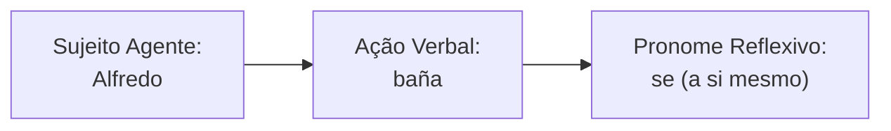
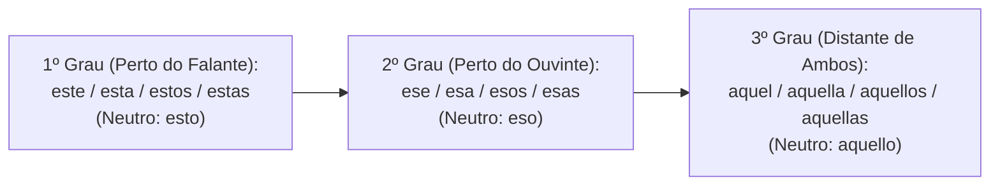
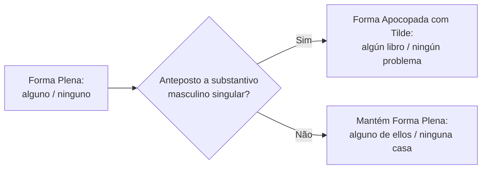
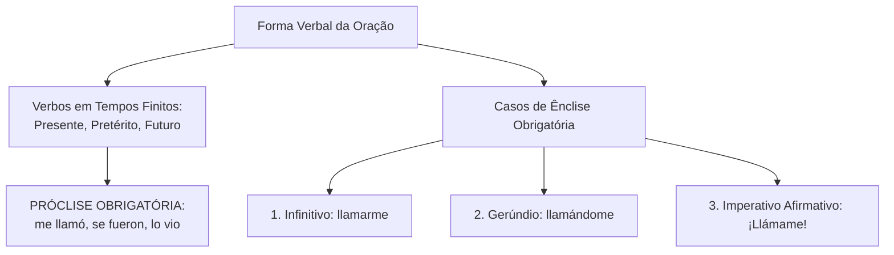
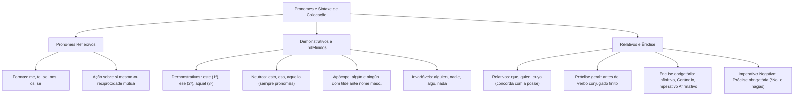

O domínio aprofundado das diversas categorias pronominais e das regras rígidas de colocação dos clíticos constitui um diferencial decisivo nas provas de língua espanhola. Nas estruturas oracionais, pronomes demonstrativos, indefinidos e relativos desempenham papéis indispensáveis na coesão textual, enquanto os pronomes reflexivos e os mecanismos de ênclise definem a correção gramatical da frase. Compreender quando o pronome deve soldar-se ao verbo e reconhecer os valores espaciais e semânticos de cada forma assegura alto rendimento no concurso.

> [!objetivos]
> - Identificar as formas e o valor semântico dos pronomes reflexivos e verbos pronominais.
> - Dominar o emprego dos demonstrativos nos três graus de distância e diferenciar formas neutras.
> - Aplicar as regras de concordância e apócope dos pronomes e determinantes indefinidos.
> - Compreender a sintaxe dos relativos e dominar a colocação pronominal em próclise e ênclise verbal.

## Pronomes Reflexivos

Os pronomes reflexivos indicam que a ação verbal praticada pelo sujeito recai sobre o próprio sujeito que a executa. O agente e o paciente da oração coincidem na mesma pessoa gramatical.

O paradigma dos reflexivos átonos reúne as seguintes formas:
- 1ª Pessoa do Singular: ***me*** (*yo me cuido*).
- 2ª Pessoa do Singular (informal): ***te*** (*tú te bañas*).
- 3ª Pessoa do Singular e tratamento formal: ***se*** (*él se lava*, *usted se sienta*).
- 1ª Pessoa do Plural: ***nos*** (*nosotros nos respetamos*).
- 2ª Pessoa do Plural (informal): ***os*** (*vosotros os vestís*).
- 3ª Pessoa do Plural e tratamento formal: ***se*** (*ellos se defienden*, *ustedes se levantan*).



> [!bizu]
> Distinga a reflexividade da reciprocidade:
> - Valor reflexivo: o sujeito pratica a ação sobre si mesmo (*Alfredo se baña*).
> - Valor recíproco: dois ou mais agentes praticam a ação mutuamente um sobre o outro (*Los oficiales se saludaron cortésmente*).

Além disso, o espanhol conta com verbos pronominais inerentes que não expressam ação reflexiva real, mas exigem o pronome reflexivo para existir na língua, tais como *quejarse* (queixar-se), *arrepentirse* (arrepender-se) e *atreverse* (atrever-se).

## Pronomes Interrogativos e Exclamativos

Os pronomes interrogativos e exclamativos desempenham a função de inquirir sobre a identidade de seres ou expressar admiração e ênfase no discurso.

As formas fundamentais abrangem:
- ***qué***: identifica coisas, conceitos ou ações (*¿Qué compraste?*, *¡Qué hermosa casa!*).
- ***quién / quiénes***: indaga sobre pessoas, flexionando-se em número (*¿Quién llamó?*, *¿Quiénes vinieron?*).
- ***cuál / cuáles***: solicita seleção dentro de um conjunto conhecido (*¿Cuál prefieres?*, *¿Cuáles son los tuyos?*).
- ***cuánto / cuánta / cuántos / cuántas***: interroga quantidade e concorda em gênero e número (*¿Cuánta agua hay?*).
- Advérbios interrogativos correlatos: *cómo* (modo), *cuándo* (tempo) e *dónde* (lugar).

```mermaid Pontuação e acentuação diacrítica em interrogativas e exclamativas
flowchart TD
    Origem["Orações com Interrogativos e Exclamativos"] --> Pontuacao["Pontuação Dupla Obrigatória:<br>¿ ... ? e ¡ ... !"]
    Origem --> Acentuacao["Tilde Diacrítica Obrigatória:<br>qué, quién, cuál, cuánto, cómo, dónde"]
    Acentuacao --> Direta["Interrogativa Direta:<br>¿Quién es el candidato?"]
    Acentuacao --> Indireta["Interrogativa Indireta:<br>No sé quién es el candidato"]
```

> [!atencao]
> A acentuação gráfica é **obrigatória em interrogativas diretas e indiretas**:
> - Pergunta direta: *¿Dónde está el informe policial?*
> - Pergunta indireta: *El comandante preguntó dónde estaba el informe.*
> Em ambos os casos, a palavra mantém a tilde. A ausência de tilde converte o vocábulo em pronome ou advérbio relativo (*El lugar donde ocurrió el hecho*).

## Pronomes e Determinantes Demonstrativos

Os demonstrativos situam as entidades referidas no espaço, no tempo ou no contexto discursivo em relação aos interlocutores. Eles podem atuar como **determinantes demonstrativos** (quando acompanham um substantivo explícito) ou como **pronomes demonstrativos** (quando substituem o substantivo omitido).

### Os Três Graus de Distância Espacial e Temporal

O castelhano estrutura os demonstrativos em três patamares de proximidade:
1. **1º Grau (Proximidade do Emissor)**: refere-se ao que está junto a quem fala ou no presente imediato (*este, esta, estos, estas*).
2. **2º Grau (Proximidade do Receptor / Distância Intermediária)**: refere-se ao que está junto a quem ouve ou em tempo recente (*ese, esa, esos, esas*).
3. **3º Grau (Afastamento Total / Tempo Remoto)**: refere-se ao que está distante de ambos os interlocutores ou em passado longínquo (*aquel, aquella, aquellos, aquellas*).

| Grau de Distância | Singular Masculino | Singular Feminino | Plural Masculino | Plural Feminino | Forma Neutra (Pronome) |
|---|---|---|---|---|---|
| 1º Grau (Aqui / Presente) | *este* | *esta* | *estos* | *estas* | *esto* |
| 2º Grau (Aí / Médio) | *ese* | *esa* | *esos* | *esas* | *eso* |
| 3º Grau (Lá / Remoto) | *aquel* | *aquella* | *aquellos* | *aquellas* | *aquello* |



> [!bizu]
> Particularidades decisivas das formas neutras (*esto, eso, aquello*):
> 1. São **exclusivamente pronomes**, jamais determinantes. Nunca acompanham um substantivo (é erro grave escrever "*esto libro*").
> 2. Não possuem plural nem variação de gênero.
> 3. Referem-se a conceitos abstratos, fatos complexos ou objetos indeterminados (*Eso es inaceptable*; *¿Qué es esto?*).
> 4. Conforme as normas ortográficas vigentes da RAE, **nenhum demonstrativo leva acento gráfico**, mesmo quando houver ambiguidade funcional.

## Pronomes Indefinidos

Os indefinidos referem-se a pessoas, objetos ou quantidades de maneira indeterminada, vaga ou imprecisa. Podem exercer a função de determinantes adjetivos ou de pronomes substantivos.

Classificam-se em duas categorias morfológicas:
1. **Indefinidos Invariáveis**: não admitem flexão de gênero nem de número:
   - Para pessoas: ***alguien*** (alguém) e ***nadie*** (ninguém).
   - Para coisas: ***algo*** (algo, alguma coisa) e ***nada*** (nada).
2. **Indefinidos Variáveis**: flexionam-se em gênero e número para concordar com o substantivo:
   - *alguno/a/os/as* (algum/a/ns/as).
   - *ninguno/a/os/as* (nenhum/a/ns/as).
   - *poco/a/os/as* (pouco/a/os/as).
   - *mucho/a/os/as* (muito/a/os/as).
   - *todo/a/os/as* (todo/a/os/as).
   - *otro/a/os/as* (outro/a/os/as).
   - *mismo/a/os/as* (mesmo/a/os/as).
   - *tanto/a/os/as* (tanto/a/os/as).
   - *varios/as* (vários/as).
   - *cualquiera* (singular) / *cualesquiera* (plural irregular).



> [!pegadinha]
> Apócope de *alguno* e *ninguno*:
> Quando posicionados imediatamente antes de um substantivo masculino singular, *alguno* e *ninguno* sofrem apócope e **ganham acento gráfico tilde obrigatório**:
> - *alguno* → ***algún*** (*algún candidato*, *algún día*).
> - *ninguno* → ***ningún*** (*ningún obstáculo*, *ningún policía*).
> Diante de substantivos femininos, a apócope não ocorre (*alguna camisa*, *ninguna dificultad*).

## Pronomes Relativos

Os pronomes relativos conectam orações subordinadas adjetivas à oração principal, substituindo um termo antecedente explícito.

O repertório dos relativos castelhanos inclui:
- ***que***: o relativo universal mais frequente, invariável, aplicável a pessoas ou coisas (*El bombero que llegó*; *La carta que leí*).
- ***quien / quienes***: refere-se exclusivamente a pessoas e flexiona-se apenas em número (*Los agentes a quienes felicitamos*).
- ***el cual / la cual / los cuales / las cuales***: relativo composto que especifica com clareza o gênero e o número do antecedente, muito usado em contextos formais ou após preposições compostas (*El informe sobre el cual debatimos*).
- ***cuyo / cuya / cuyos / cuyas***: expressa posse e equivale a "cujo/cuja" do português.
- ***cuanto / cuanta / cuantos / cuantas***: expressa quantidade totalizante equivalente a "tudo quanto" (*Entregó cuantas pruebas tenía*).
- ***donde***: retoma antecedentes de lugar (*El cuartel donde prestamos servicio*).

| Pronome Relativo | Flexão Mórfica | Tipo de Referente | Exemplo de Aplicação |
|---|---|---|---|
| *que* | Invariável | Pessoas ou coisas | *La camioneta que compramos es rápida.* |
| *quien / quienes* | Variação de número | Exclusivo para pessoas | *El albañil a quien llamaron es famoso.* |
| *el cual / la cual* | Gênero e número | Pessoas ou coisas formais | *Las leyes según las cuales operamos.* |
| *cuyo / cuya* | Gênero e número | Posse (concorda com a coisa) | *El esposo cuya esposa es médica.* |
| *donde* | Invariável | Exclusivo para lugar | *La ciudad donde nací es hermosa.* |

> [!atencao]
> A regra de ouro do relativo *cuyo*:
> 1. *Cuyo* concorda em gênero e número **com o substantivo posterior (a coisa possuída)**, e não com o possuidor antecedente (*El oficial cuyos hijos estudian*; *La empresa cuya sede cerró*).
> 2. Em língua espanhola, **nunca se usa artigo definido após *cuyo***. É erro gravíssimo escrever "*cuyo el hijo*" ou "*cuya la casa*". A construção correta é direta: *cuyo hijo*, *cuya casa*.

## Posição dos Pronomes: Próclise e Ênclise

A colocação dos pronomes clíticos átonos (*me, te, se, nos, os, lo, la, le, los, las, les*) obedece a preceitos rígidos da sintaxe espanhola. Diferentemente do português brasileiro, que tolera ampla flexibilidade no uso cotidiano, o espanhol prescreve posições fixas obrigatórias.

### Regra Geral: Próclise Verbal

Diante de **verbos em tempos finitos conjugados** (no presente, pretérito, futuro ou condicional do indicativo e do subjuntivo), o pronome posiciona-se **obrigatoriamente antes do verbo** (próclise), grafado como palavra independente:
- *Te visito mañana.*
- *Se lo entregué ayer al comandante.*
- *Me dijo la verdad sobre el caso.*
- *No le temas a la oscuridad.*



### Os Três Casos de Ênclise Obrigatória

O pronome clítico solda-se obrigatoriamente **ao final do verbo**, formando uma única palavra fonética e gráfica (ênclise), em apenas três estruturas:

1. **Verbo no Infinitivo**:
   - *Voy a llamarte esta noche.*
   - *Deseo comprarlo en la tienda.*
   - *Al verlos correr, se alarmó.*
2. **Verbo no Gerúndio**:
   - *Están buscándolo por toda la ciudad.*
   - *Siguió mirándome fijamente.*
   - *Corriendo hacia la meta, se cayó.*
3. **Verbo no Modo Imperativo Afirmativo**:
   - *¡Dime la verdad ahora mismo!*
   - *¡Tráigame los documentos solicitados!*
   - *¡Levántense temprano mañana!*

> [!pegadinha]
> Cuidado com o imperativo negativo:
> - No imperativo afirmativo, a ênclise é obrigatória (*¡Hazlo!*, *¡Dígamelo!*).
> - No **imperativo negativo**, o pronome fica **obrigatoriamente em próclise** (*¡No lo hagas!*, *¡No me digas mentiras!*).

### Acentuação Gráfica na Ênclise e Locuções Verbais

Ao anexar um ou dois pronomes ao final de uma forma verbal, a contagem de sílabas desloca a sílaba tônica para a antepenúltima posição (palavra esdrúxula) ou posição anterior (sobresdrúxula). Todas as palavras esdrúxulas e sobresdrúxulas levam acento gráfico tilde em espanhol:
- *da* (monossílabo) → *dame* (grave sem tilde) → ***dámelo*** (esdrúxula com tilde).
- *comprando* (grave sem tilde) → ***comprándolo*** (esdrúxula com tilde).
- *comunicar* (oxítona sem tilde) → ***comunicárselo*** (sobresdrúxula com tilde).

> [!bizu]
> Ponto de atenção em locuções verbais:
> Quando há verbo auxiliar combinado com infinitivo ou gerúndio (*ir a + infinitivo*, *estar + gerúndio*), o pronome admite **dupla colocação facultativa**, com idêntica correção gramatical:
> 1. Próclise ao verbo auxiliar: *Te voy a llamar* / *Lo estoy buscando*.
> 2. Ênclise ao verbo principal: *Voy a llamarte* / *Estoy buscándolo*.
> Ambas as formulações são perfeitas na norma culta e recorrentes nas provas.

Exemplos contextualizados adicionais nos exames de língua espanhola:
- *Em castelhano, a classe designa-se como demostrativo (singular) e demostrativos (plural)*: nomenclatura oficial da RAE.
- *Yo me protejo de las amenazas climáticas*: pronome reflexivo de 1ª pessoa.
- *El agente se vistió con el uniforme reglamentario*: pronome reflexivo em pretérito.
- *¡Cuánta gente asistió a la ceremonia oficial!*: exclamativo de quantidade.
- *La comisión aceptará cualesquiera propuestas válidas*: plural irregular de *cualquiera*.
- *Te visitamos temprano en la base*: próclise regular em tempo finito.
- *Continuaremos llamando a los equipos de apoyo*: locução de gerúndio.
- *Alfredo compró una deliciosa comida para su familia*: substantivo qualificado.
- *La noche fría obligó a encender la estufa*: qualificação física.
- *Deme una oportunidad para construir el proyecto*: ênclise no imperativo formal com *usted*.
- *El candidato al concurso público resolvió la prueba con serenidad*: vocabulário oficial.
- *Vimos a los muchachos jugando con la pelota en la plaza*: gerúndio contextual.

## Mapa do capítulo



### Para fixar

- Os pronomes reflexivos (*me, te, se, nos, os, se*) assinalam que o sujeito realiza e sofre a ação verbal.
- Pronomes interrogativos e exclamativos recebem acento gráfico diacrítico obrigatório em perguntas diretas e indiretas.
- Os demonstrativos distribuem-se em três graus de distância: *este* (aqui), *ese* (aí) e *aquel* (lá).
- As formas neutras *esto, eso* e *aquello* atuam exclusivamente como pronomes e jamais acompanham substantivos.
- Os indefinidos *alguien, nadie, algo* e *nada* são rigorosamente invariáveis na língua espanhola.
- As formas *alguno* e *ninguno* apocopam-se diante de substantivos masculinos singulares, gerando *algún* e *ningún* com tilde.
- O relativo possessivo *cuyo* concorda com o substantivo posterior que expressa a coisa possuída e proíbe artigo subsequente.
- A regra geral de colocação pronominal em tempos verbais finitos determina a próclise obrigatória.
- A ênclise ao verbo é obrigatória em apenas três formas: verbos no infinitivo, gerúndio e imperativo afirmativo.
- O imperativo negativo exige próclise obrigatória (*¡No me digas!*), e locuções verbais admitem dupla colocação facultativa.
