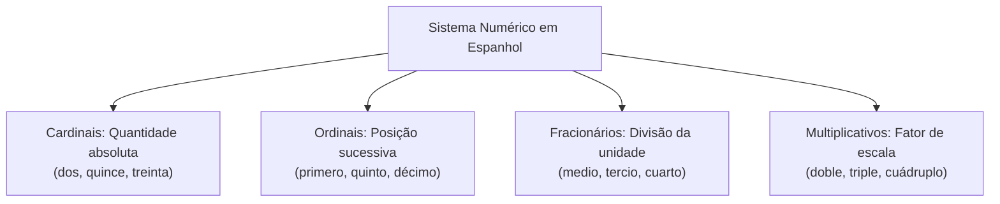
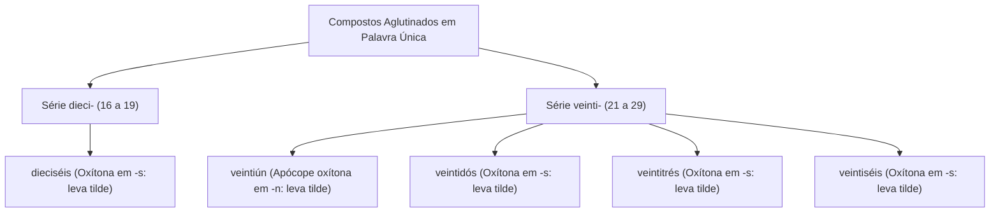
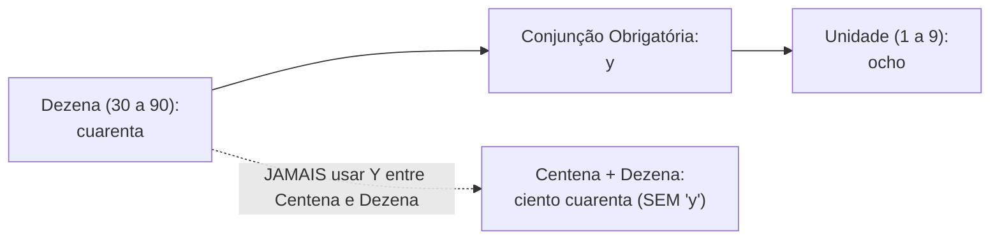
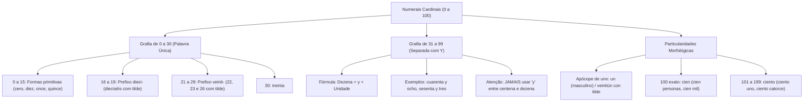

O conhecimento sistemático dos numerais na língua espanhola constitui requisito fundamental para a interpretação de dados estatísticos, orçamentários e normativos em concursos públicos. Nas corporações militares e órgãos de defesa civil, documentos oficiais registram efetivos, datas, prazos legais e quantitativos patrimoniais frequentemente grafados por extenso. Dominar as regras ortográficas de aglutinação, o emprego estrito da conjunção coordenativa e os casos de apócope assegura precisão absoluta na resolução da prova.

> [!objetivos]
> - Compreender a classificação dos numerais e a função quantificadora dos cardinais.
> - Dominar a regra da grafia contínua em palavra única de zero até trinta (*dieci-* e *veinti-*).
> - Aplicar o emprego da conjunção *y* exclusivamente entre dezenas e unidades a partir de trinta e um.
> - Reconhecer as regras de apócope do numeral *uno* (*un*) e a distinção obrigatória entre *cien* e *ciento*.

## Palavras Iniciais e Conceito de Numerais

Os numerais formam a classe gramatical responsável por indicar quantidades numéricas exatas ou assinalar a posição ocupada por seres e objetos em uma sequência organizada. No idioma espanhol, a doutrina divide os numerais em quatro famílias funcionais bem delimitadas:

1. **Cardinais (*cardinales*)**: nomeiam as grandezas absolutas e expressam a quantidade precisa de seres (*uno, diez, cuarenta y ocho*).
2. **Ordinais (*ordinales*)**: indicam a ordem, sucessão ou posição em uma série hierárquica (*primero, segundo, décimo*).
3. **Fracionários (*fraccionarios*)**: designam partes fracionadas ou divisões de uma unidade inteira (*medio, tercio, cuarto*).
4. **Multiplicativos (*multiplicativos*)**: expressam o produto da multiplicação de uma grandeza (*doble, triple, cuádruple*).

O domínio da escrita por extenso dos numerais é fundamental para a leitura analítica de editais, leis, acordos internacionais e laudos de perícia técnica. Enquanto os algarismos arábicos representam o dado de forma sintética em tabelas, os textos formais priorizam a grafia completa para prevenir adulterações documentais e assegurar a solenidade dos atos administrativos.

> [!exemplo]
> Observe a distinção prática entre as categorias numéricas em um mesmo contexto operacional:
> - Cardinal: *El destacamento rescató a diez personas durante el operativo.*
> - Ordinal: *Esta fue la décima intervención exitosa del pelotón en el mes.*
> - Fracionário: *El fuego consumió un tercio de la reserva forestal.*
> - Multiplicativo: *El riesgo actual representa el triple del nivel ordinario.*



## Números: As Classes Funcionais e os Cardinais

O estudo dos numerais cardinais concentra-se nas matrizes primitivas que compõem a base do sistema decimal. Os cardinais atuam habitualmente como determinantes adjetivos antepostos ao substantivo (*veinte bomberos*, *ocho vehículos*), mas também exercem papel de substantivo pleno quando nomeiam o próprio algarismo (*el número ocho*, *el diez de la suerte*).

A imensa maioria dos cardinais em língua espanhola é invariável quanto ao gênero gramatical, mantendo a mesma terminação para substantivos masculinos e femininos (*dos hombres*, *dos mujeres*; *diez días*, *diez noches*). A única exceção elementar no bloco das unidades básicas recai sobre o numeral *uno*, que flexiona em gênero (*uno / una*) e sofre apócope diante de nomes masculinos.

A base primária do sistema compreende as unidades simples de zero a nove:
- `0`: ***cero***
- `1`: ***uno*** (flexiona em *una* no feminino)
- `2`: ***dos***
- `3`: ***tres***
- `4`: ***cuatro***
- `5`: ***cinco***
- `6`: ***seis***
- `7`: ***siete***
- `8`: ***ocho***
- `9`: ***nueve***

Entre dez e quinze, a morfologia do castelhano consagra formas sintéticas herdadas diretamente do latim imperial, dispensando prefixos analíticos:
- `10`: ***diez***
- `11`: ***once***
- `12`: ***doce***
- `13`: ***trece***
- `14`: ***catorce***
- `15`: ***quince***

## Números Cardinais: Grafia de 0 a 30 e o Princípio da Aglutinação

Uma das regras ortográficas mais cobradas em provas de concursos públicos refere-se à representação textual dos numerais inferiores a trinta e um. Em espanhol, **todos os números cardinais de 0 a 30 são grafados obrigatoriamente em uma única palavra contínua** (*en una sola palabra*).

### Compostos de 16 a 19: Aglutinação com *Dieci-*

Do número 16 ao 19, a dezena *diez* funde-se à unidade mediante a substituição da consoante z pelo prefixo aglutinante ***dieci-***:
- `16`: ***dieciséis*** (leva tilde por ser palavra oxítona terminada em -s).
- `17`: ***diecisiete***
- `18`: ***dieciocho***
- `19`: ***diecinueve***

### A Dezena 20 e os Compostos de 21 a 29: Aglutinação com *Veinti-*

O número vinte escreve-se ***veinte***. Ao unir-se às unidades subsequentes (de 21 a 29), a vogal final converte-se no elemento de ligação ***veinti-***, gerando compostos unificados:
- `21`: ***veintiuno*** (apocopa-se em ***veintiún*** diante de substantivo masculino).
- `22`: ***veintidós*** (leva tilde por ser oxítona terminada em -s).
- `23`: ***veintitrés*** (leva tilde por ser oxítona terminada em -s).
- `24`: ***veinticuatro***
- `25`: ***veinticinco***
- `26`: ***veintiséis*** (leva tilde por ser oxítona terminada em -s).
- `27`: ***veintisiete***
- `28`: ***veintiocho***
- `29`: ***veintinueve***
- `30`: ***treinta***



> [!bizu]
> Memorize as quatro formas fundamentais que levam acento gráfico tilde entre 16 e 29:
> ***dieciséis*** (16), ***veintidós*** (22), ***veintitrés*** (23) e ***veintiséis*** (26).
> Todas são palavras oxítonas terminadas na consoante -s e obedecem à regra geral de acentuação ortográfica da língua espanhola.

| Numeral | Grafia em Espanhol | Particularidade Ortográfica | Exemplo de Aplicação |
|---|---|---|---|
| `11` | *once* | Vocábulo simples primitivo | *Once agentes acudieron al siniestro.* |
| `14` | *catorce* | Vocábulo simples primitivo | *La brigada tardó catorce minutos.* |
| `16` | *dieciséis* | Aglutinado com tilde | *Rescataron a dieciséis personas.* |
| `20` | *veinte* | Dezena simples | *El cuartel cuenta con veinte plazas.* |
| `22` | *veintidós* | Aglutinado com tilde | *Veintidós vehículos forman la fila.* |
| `26` | *veintiséis* | Aglutinado com tilde | *Inspeccionaron veintiséis locales.* |
| `30` | *treinta* | Dezena simples | *El plazo legal vence en treinta días.* |

## Dezenas de 30 a 90 e a Composição com a Conjunção Y

A partir do número 31 até o número 99, a estrutura mórfica do idioma espanhol abandona a aglutinação e adota a **grafia separada por palavras independentes**, conectadas pela conjunção coordenativa aditiva ***y***.

As dezenas cheias primitivas são:
- `30`: ***treinta***
- `40`: ***cuarenta***
- `50`: ***cincuenta***
- `60`: ***sesenta***
- `70`: ***setenta***
- `80`: ***ochenta***
- `90`: ***noventa***

A regra de montagem obedece à equação rígida: **Dezena + *y* + Unidade**.

Exemplos de decomposição e escrita:
- `31`: *treinta y uno*
- `42`: *cuarenta y dos*
- `48`: *cuarenta y ocho*
- `55`: *cincuenta y cinco*
- `59`: *cincuenta y nueve*
- `63`: *sesenta y tres*
- `74`: *setenta y cuatro*
- `87`: *ochenta y siete*
- `99`: *noventa y nueve*



> [!pegadinha]
> A conjunção ***y*** é utilizada **exclusivamente para conectar a dezena à unidade** (de 31 a 99).
> É erro gravíssimo inserir a conjunção *y* entre a centena e a dezena:
> - Correto: *ciento cuarenta y ocho* (148); *quinientos sesenta y tres* (563).
> - Incorreto: "*ciento y cuarenta y ocho*"; "*quinientos y sesenta y tres*".
> Do mesmo modo, números redondos com zero na dezena não recebem a conjunção *y*: *ciento cinco* (105), e jamais "*ciento y cinco*".

## Fenômeno da Apócope em Uno e o Uso de Cien versus Ciento

A terminação do numeral cardinal *uno* e a representação da centena cem encerram particularidades morfológicas de alta incidência em concursos.

### Apócope de *Uno* (*Un*)

O numeral cardinal *uno* sofre **apócope obrigatória** (perda da vogal final -o), convertendo-se em ***un***, quando posicionado imediatamente antes de um **substantivo masculino**:
- *un bombero* (1 bombeiro).
- *veintiún días* (21 dias: ganha acento tilde por tornar-se oxítona terminada em -n).
- *cuarenta y un soldados* (41 soldados).
- *treinta y un casos* (31 casos).

Diante de substantivos femininos, utiliza-se a forma feminina regular ***una*** (*una patrulla*, *veintiuna víctimas*, *treinta y una personas*). Quando o substantivo feminino seguinte inicia-se pela vogal *a-* ou *ha-* tônica no singular, a norma culta contemporânea da RAE aceita tanto a forma apocopada *un* quanto a forma plena *una* (*un águila* ou *una águila*).

### Ponto de Atenção: Distinção entre *Cien* e *Ciento*

O numeral correspondente ao algarismo 100 apresenta duas formas morfológicas concorrentes:

1. **Emprego de *Cien***:
   - Constitui a forma apocopada de *ciento*.
   - Utiliza-se com exclusividade para designar a **centena exata 100**, tanto de forma isolada quanto anteposta imediatamente a substantivos de qualquer gênero ou multiplicadores de milhar e milhão:
   - Exemplos: *Tengo cien libros*; *Cien mujeres marcharon*; *Cien mil personas acudieron*.
2. **Emprego de *Ciento***:
   - Utiliza-se a forma plena *ciento* quando o número 100 vier **seguido de dezenas ou unidades**, integrando numerais compostos de 101 a 199:
   - Exemplos: *ciento uno* (101); *ciento catorce* (114); *ciento veinticinco* (125); *ciento ochenta* (180).

```mermaid Critério de escolha entre cien e ciento
flowchart TD
    Cem["Número 100"] --> Exato{"É a centena exata (100)?"}
    Exato -->|Sim| Cien["Use CIEN:<br>cien soldados, cien casas, cien mil"]
    Exato -->|Não (101 a 199)| Ciento["Use CIENTO:<br>ciento dos, ciento catorce, ciento cincuenta"]
```

| Valor Numérico | Grafia Extensa Correta | Regra Gramatical Subjacente |
|---|---|---|
| `21` carros | *veintiún carros* | Apócope de *veintiuno* com tilde anteposto a substantivo masculino |
| `21` casas | *veintiuna casas* | Concordância regular no gênero feminino |
| `48` | *cuarenta y ocho* | Separação por *y* entre dezena e unidade |
| `100` soldados | *cien soldados* | Apócope da centena exata antes de substantivo |
| `100.000` | *cien mil* | Centena exata multiplicando milhar |
| `114` | *ciento catorce* | Forma plena *ciento* seguida de unidade/dezena |
| `126` | *ciento veintiséis* | *Ciento* seguido de número aglutinado com tilde |

## Mapa do capítulo



### Para fixar

- Os numerais cardinais expressam quantidades absolutas e funcionam habitualmente como determinantes antepostos.
- Todos os numerais de 0 até 30 são escritos em uma única palavra contínua (*una sola palabra*).
- O número 16 (*dieciséis*) recebe acento gráfico tilde por ser vocábulo oxítono terminado na consoante -s.
- Os numerais 22 (*veintidós*), 23 (*veintitrés*) e 26 (*veintiséis*) levam tilde obrigatória pela regra das oxítonas.
- A partir de 31 até 99, os numerais cardinais são grafados separadamente por meio da conjunção aditiva *y*.
- A conjunção *y* liga exclusivamente a dezena à unidade, sendo proibido inseri-la entre centenas e dezenas (*ciento cuarenta*).
- O numeral *uno* apocopa-se em *un* diante de substantivo masculino singular, gerando a forma acentuada *veintiún*.
- A forma *cien* é reservada para a centena exata 100, mesmo quando multiplicada por milhar (*cien mil*).
- A forma plena *ciento* é utilizada na composição dos numerais de 101 a 199 (*ciento dos, ciento quince*).
- Dezenas completas não levam conjunção quando seguidas de zero na unidade (*cincuenta, ochenta, noventa*).
