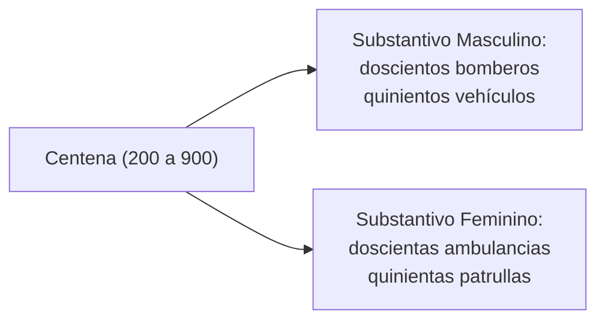
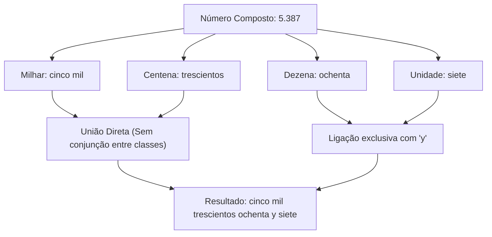
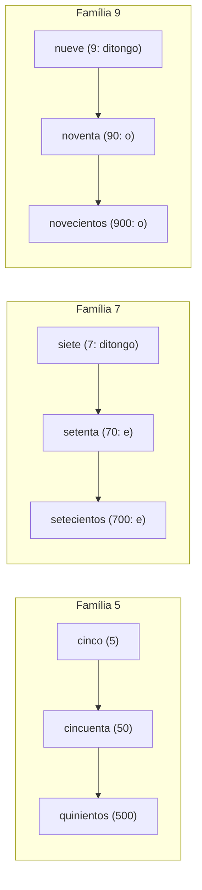
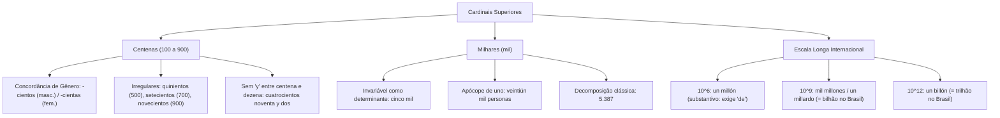

A correta representação e leitura dos números cardinais superiores é indispensável para interpretar dados orçamentários, balanços patrimoniais e relatórios estatísticos na administração pública. Na língua espanhola, a composição de centenas, milhares e grandes magnitudes numéricas combina regras rígidas de concordância de gênero com a convenção matemática da escala longa internacional. Compreender essas estruturas impede equívocos interpretativos graves em provas de concurso.

> [!objetivos]
> - Dominar a grafia e a concordância de gênero das centenas de 100 até 900 em espanhol.
> - Aplicar o princípio de decomposição por classes para a escrita de numerais com milhares.
> - Compreender o sistema da escala longa internacional e diferenciar *millón*, *millardo* e *billón*.
> - Identificar as variações de radicais entre unidades, dezenas e centenas nas famílias do 5, do 7 e do 9.

## Números Cardinais: As Centenas de 100 a 900 e a Concordância de Gênero

A classe das centenas no idioma castelhano inicia-se na distinção fundamental entre a forma apocopada *cien* e a forma plena *ciento*. Enquanto *cien* expressa a centena redonda cem, os números de 101 a 199 utilizam obrigatoriamente a base *ciento*, unindo-se aos termos seguintes sem nenhuma conjunção (*ciento uno, ciento catorce, ciento veintidós, ciento cuarenta*).

A partir de 200 até 900, as centenas assumem terminações plurais em *-cientos* ou formas históricas próprias. O aspecto morfossintático mais relevante para o estudante reside na **concordância obrigatória de gênero gramatical**:
- Quando acompanham substantivos masculinos, as centenas terminam em ***-cientos*** (*doscientos libros, quinientos soldados*).
- Quando acompanham substantivos femininos, as centenas flexionam-se obrigatoriamente para ***-cientas*** (*doscientas páginas, quinientas mujeres*).



### Formas Especiais e Irregulares de Centenas

Três centenas merecem atenção redobrada devido a alterações radicais em suas matrizes etimológicas:
1. `500`: escreve-se ***quinientos / quinientas*** (e nunca "*cincocientos*").
2. `700`: grafa-se ***setecientos / setecientas*** (apresenta monotongo *e* no radical, e não o ditongo de *siete*).
3. `900`: escreve-se ***novecientos / novecientas*** (apresenta vogal *o* no radical, e não o ditongo de *nueve*).

| Valor Numérico | Centena Masculina | Centena Feminina | Particularidade Mórfica |
|---|---|---|---|
| `100` | *cien* (exata) / *ciento* | *cien* (exata) / *ciento* | Apócope diante de substantivo |
| `200` | *doscientos* | *doscientas* | Flexão regular de gênero |
| `300` | *trescientos* | *trescientas* | Flexão regular de gênero |
| `400` | *cuatrocientos* | *cuatrocientas* | Flexão regular de gênero |
| `500` | *quinientos* | *quinientas* | Forma irregular própria |
| `600` | *seiscientos* | *seiscientas* | Derivado direto de *seis* |
| `700` | *setecientos* | *setecientas* | Radical *sete-* sem ditongo |
| `800` | *ochocientos* | *ochocientas* | Derivado direto de *ocho* |
| `900` | *novecientos* | *novecientas* | Radical *nove-* sem ditongo |

> [!bizu]
> Guarde a regra da conjunção: em língua espanhola, a conjunção *y* **nunca é empregada entre a centena e a dezena**.
> Escreve-se diretamente:
> - `492`: *cuatrocientos noventa y dos*.
> - `888`: *ochocientos ochenta y ocho*.
> A conjunção *y* surge exclusivamente entre a dezena (*noventa*, *ochenta*) e a unidade (*dos*, *ocho*).

## Estrutura dos Milhares e Regras de Decomposição Numérica

O numeral cardinal correspondente a 1.000 é ***mil***. Trata-se de uma palavra gramaticalmente invariável quando funciona como determinante numérico multiplicador.

Ao compor grandezas na casa dos milhares, basta antepor o numeral multiplicativo simples antes do vocábulo *mil*:
- `2.000`: *dos mil*
- `5.000`: *cinco mil*
- `10.000`: *diez mil*
- `100.000`: *cien mil*
- `500.000`: *quinientos mil*

### Decomposição de Numerais Compostos

Para escrever qualquer número em espanhol, o procedimento analítico consiste em decompor o valor em suas classes posicionais (milhares, centenas, dezenas e unidades), conectando as palavras segundo suas regras específicas.

Analise a montagem de números complexos:
- `5.387`:
  - 5.000: *cinco mil*
  - 300: *trescientos*
  - 80: *ochenta*
  - 7: *siete*
  - Forma final por extenso: ***cinco mil trescientos ochenta y siete***.
- `888`:
  - 800: *ochocientos*
  - 80: *ochenta*
  - 8: *ocho*
  - Forma final: ***ochocientos ochenta y ocho***.
- `1.129`:
  - 1.000: *mil*
  - 100: *ciento*
  - 29: *veintinueve* (palavra única aglutinada)
  - Forma final: ***mil ciento veintinueve***.



> [!atencao]
> Apócope antes de *mil*:
> Quando o numeral *uno* ou termos compostos em *veintiuno, treinta y uno* antecedem o milhar, ocorre a **apócope obrigatória**:
> - *veintiún mil personas* (e não "*veintiuno mil*").
> - *treinta y un mil soldados*.
> - *cuarenta y un mil reales*.

## A Escala Longa Internacional: Millón, Millardo e Billón

O tratamento de grandezas superiores a um milhão encerra a maior armadilha de equivalência entre o espanhol e o português brasileiro. A maioria esmagadora dos países hispanofalantes e da Europa continental adota oficialmente a **escala longa internacional** (*escala larga*), enquanto o Brasil e os Estados Unidos utilizam a **escala curta** (*escala corta*).

### Un Millón e a Exigência da Preposição De

O numeral 1.000.000 escreve-se ***un millón***. Seu plural formal é ***millones***.
Diferentemente de *mil* (que é determinante adjetivo direto), a palavra *millón* é morfologicamente um **substantivo masculino**. Por esse motivo, quando *millón* ou *millones* antecedem diretamente um substantivo, exigem a inserção da **preposição *de***:
- *un millón de ciudadanos* (1 milhão de cidadãos).
- *cinco millones de euros* (5 milhões de euros).
- *veintiún millones de dólares* (21 milhões de dólares).

Contudo, se houver qualquer número menor intercalado após a palavra milhão, a preposição *de* é suprimida:
- *un millón doscientas personas* (1.000.200 pessoas).

### A Divergência Crítica entre Escala Longa e Escala Curta

Na escala curta adotada no Brasil, cada nova classe nominal avança a cada fator de mil (10³). Na escala longa hispânica, a denominação com sufixo *-ón* (*billón, trillón*) avança a cada fator de um milhão (10⁶).

Analise o confronto exato entre as duas escalas:

1. **A Magnitude de 10⁹ (1.000.000.000)**:
   - No Brasil (Escala Curta): chama-se ***um bilhão***.
   - No Espanhol Oficial (Escala Longa): denomina-se ***mil millones*** ou o termo técnico consagrado ***un millardo***.
2. **A Magnitude de 10¹² (1.000.000.000.000)**:
   - No Brasil (Escala Curta): chama-se ***um trilhão***.
   - No Espanhol Oficial (Escala Longa): denomina-se ***un billón*** (um milhão de milhões).

```mermaid Comparativo entre Escala Curta (Brasil) e Escala Longa (Espanhol)
flowchart LR
    subgraph Curta ["Escala Curta (Brasil / EUA)"]
        B1["1.000.000 = 1 milhão (10^6)"]
        B2["1.000.000.000 = 1 bilhão (10^9)"]
        B3["1.000.000.000.000 = 1 trilhão (10^12)"]
    end
    subgraph Longa ["Escala Longa (Espanhol / RAE)"]
        E1["1.000.000 = un millón (10^6)"]
        E2["1.000.000.000 = mil millones / millardo (10^9)"]
        E3["1.000.000.000.000 = un billón (10^12)"]
    end
```

> [!pegadinha]
> Cuidado supremo em questões de interpretação econômica:
> Se um texto em espanhol afirmar que a dívida de um país é de "*dos billones de dólares*", o candidato desavisado traduzirá apressadamente por "dois bilhões de dólares". O valor correto na convenção brasileira é de **dois trilhões de dólares**!
> O vocábulo *billón* em castelhano expressa *un millón de millones* (10¹²). Para expressar um bilhão brasileiro (10⁹), o espanhol diz invariavelmente *mil millones*.

| Notação Numérica | Escala Curta (Português do Brasil) | Escala Longa (Espanhol Oficial) | Forma Textual Espanhola |
|---|---|---|---|
| `1.000.000` | 1 milhão (10⁶) | *un millón* (10⁶) | *un millón de euros* |
| `1.000.000.000` | 1 bilhão (10⁹) | *mil millones* ou *un millardo* (10⁹) | *mil millones de dólares* |
| `1.000.000.000.000` | 1 trilhão (10¹²) | *un billón* (10¹²) | *un billón de pesos* |
| `10¹⁵` | 1 quatrilhão | *mil billones* | *mil billones de unidades* |
| `10¹⁸` | 1 quintilhão | *un trillón* | *un trillón de partículas* |

## Famílias de Radicais Numéricos e Paralelos Ortográficos

Um método pedagógico eficaz para consolidar a escrita por extenso consiste em analisar as famílias de derivação decimal. Em espanhol, a passagem da unidade simples para a dezena e a centena sofre variações fonéticas históricas que devem ser dominadas em conjunto.

Analise as três famílias que apresentam alternâncias de radicais:
- **Família do 5**:
  - Unidade: ***cinco*** (5).
  - Dezena: ***cincuenta*** (50).
  - Centena: ***quinientos*** (500).
- **Família do 7**:
  - Unidade: ***siete*** (7, com ditongo *ie*).
  - Dezena: ***setenta*** (70, com vogal simples *e*).
  - Centena: ***setecientos*** (700, com vogal simples *e*).
- **Família do 9**:
  - Unidade: ***nueve*** (9, com ditongo *ue*).
  - Dezena: ***noventa*** (90, com vogal simples *o*).
  - Centena: ***novecientos*** (900, com vogal simples *o*).

As demais famílias apresentam radicais regulares:
- Família do 2: *dos* (2), *veinte* (20), *doscientos* (200).
- Família do 3: *tres* (3), *treinta* (30), *trescientos* (300).
- Família do 4: *cuatro* (4), *cuarenta* (40), *cuatrocientos* (400).
- Família do 6: *seis* (6), *sesenta* (60), *seiscientos* (600).
- Família do 8: *ocho* (8), *ochenta* (80), *ochocientos* (800).



## Mapa do capítulo



### Para fixar

- As centenas de 200 a 900 flexionam-se obrigatoriamente em gênero concordando com o substantivo (*doscientas casas*).
- As formas irregulares de centenas consagram *quinientos* (500), *setecientos* (700) e *novecientos* (900).
- A conjunção coordenativa *y* nunca é intercalada entre a centena e a dezena (*ciento cincuenta*).
- O numeral *mil* é palavra invariável quando atua como determinante multiplicador de quantidades.
- Diante de *mil*, o numeral *uno* sofre apócope obrigatória (*treinta y un mil soldados*).
- O vocábulo *millón* é um substantivo e requer a preposição *de* antes de nomes (*un millón de personas*).
- Na escala longa hispânica, a quantia de 1.000.000.000 (um bilhão no Brasil) expressa-se como *mil millones* ou *millardo*.
- O vocábulo *billón* em língua espanhola corresponde a um trilhão (10¹²) na convenção brasileira.
- O numeral 7 ditonga em *siete*, mas simplifica a vogal radical em *setenta* e *setecientos*.
- O numeral 9 ditonga em *nueve*, mas adota a vogal simples *o* em *noventa* e *novecientos*.
