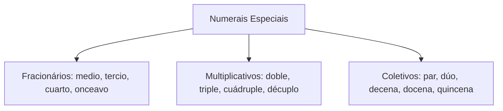
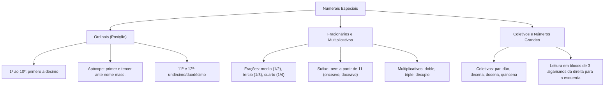

O domínio das categorias numéricas especializadas complementa o aprendizado dos cardinais e consolida a capacidade de interpretação de normas, hierarquias e percentuais em concursos públicos. Na redação oficial e na rotina operacional, os numerais ordinais estabelecem a precedência de postos e graduações, enquanto os termos fracionários, multiplicativos e coletivos quantificam recursos, proporções e agrupamentos de tropa. Compreender a apócope dos ordinais e o método analítico de leitura de números extensos garante segurança total na prova.

> [!objetivos]
> - Reconhecer as formas dos numerais ordinais e aplicar a apócope de *primero* e *tercero*.
> - Diferenciar numerais fracionários partitivos de multiplicativos e substantivos coletivos.
> - Evitar a confusão entre o sufixo fracionário *-avo* e a numeração ordinal de posição.
> - Dominar a leitura e a escrita por extenso de números longos divididos em classes ternárias.

## Números Ordinais: Hierarquia, Concordância e Apócope

Os numerais ordinais indicam a posição, a sucessão ordenada ou a hierarquia ocupada por um elemento em uma série delimitada. Eles exercem função adjetiva e **concordam obrigatoriamente em gênero e número** com o substantivo determinado (*el segundo puesto, la segunda compañía*).

A série básica do 1º ao 10º consagra as seguintes formas:
- `1º / 1ª`: ***primero / primera***
- `2º / 2ª`: ***segundo / segunda***
- `3º / 3ª`: ***tercero / tercera***
- `4º / 4ª`: ***cuarto / cuarta***
- `5º / 5ª`: ***quinto / quinta***
- `6º / 6ª`: ***sexto / sexta***
- `7º / 7ª`: ***séptimo / séptima***
- `8º / 8ª`: ***octavo / octava***
- `9º / 9ª`: ***noveno / novena***
- `10º / 10ª`: ***décimo / décima***

```mermaid Apócope dos ordinais primeiro e terceiro
flowchart LR
    Ord["primero / tercero"] --> Cond{"Anteposto a substantivo<br>masculino singular?"}
    Cond -->|Sim| Apocope["Apócope Obrigatória:<br>primer puesto / tercer piso"]
    Cond -->|Não (Feminino ou Plural)| Plena["Forma Plena Mantida:<br>primera vez / terceros lugares"]
```

> [!bizu]
> Apócope de *primero* e *tercero*:
> Quando posicionados imediatamente antes de um substantivo masculino singular, os ordinais *primero* e *tercero* perdem a vogal final -o, convertendo-se em ***primer*** e ***tercer***:
> - *el primer bombero en llegar*; *el tercer piso del edificio*.
> Diante de substantivos femininos, mantêm-se as formas regulares completas: *la primera brigada*; *la tercera compañía*.

### Ordinais Compostos e Dezenas Superiores

Para o 11º e o 12º, o espanhol admite duas matrizes corretas:
- Formas simples cultas: ***undécimo / undécima*** (11º) e ***duodécimo / duodécima*** (12º).
- Formas compostas aglutinadas: ***decimoprimero / decimoprimera*** (11º) e ***decimosegundo / decimosegunda*** (12º).

As dezenas ordinais reúnem vocábulos específicos: *vigésimo* (20º), *trigésimo* (30º), *cuadragésimo* (40º), *quincuagésimo* (50º), *sexagésimo* (60º), *septuagésimo* (70º), *octogésimo* (80º), *nonagésimo* (90º), *centésimo* (100º) e *milésimo* (1.000º).

| Valor Ordinal | Masculino Singular | Feminino Singular | Exemplo Prático |
|---|---|---|---|
| `1º` | *primer* (apocopado) / *primero* | *primera* | *El primer oficial asumió el mando.* |
| `3º` | *tercer* (apocopado) / *tercero* | *tercera* | *El tercer pelotón inició el rescate.* |
| `11º` | *undécimo* / *decimoprimero* | *undécima* / *decimoprimera* | *La undécima edición de la orden.* |
| `20º` | *vigésimo* | *vigésima* | *Conmemoraron el vigésimo aniversario.* |
| `30º` | *trigésimo* | *trigésima* | *El trigésimo aniversario del cuartel.* |
| `100º` | *centésimo* | *centésima* | *El centésimo desfile conmemorativo.* |

## Números Fracionários, Multiplicativos e Coletivos

Além da quantidade e da ordem, a linguagem matemática contempla a partição de grandezas, fatores multiplicadores e conjuntos numéricos delimitados.

### Numerais Fracionários ou Partitivos

Os fracionários designam frações ou partes divididas de uma unidade inteira:
- `1/2`: ***medio / media*** ou a locução substantiva ***la mitad*** (*media pizza, la mitad del salario*).
- `1/3`: ***un tercio*** ou *la tercera parte*.
- `1/4`: ***un cuarto*** ou *la cuarta parte*.
- `1/5`: ***un quinto*** ou *la quinta parte*.
- `1/10`: ***un décimo*** ou *la décima parte*.
- Frações com numerador plural: *dos quintas partes* (2/5); *tres cuartos* (3/4).

A partir do denominador 11, a língua espanhola adota a derivação cardinal acrescida do sufixo ***-avo / -ava***:
- `1/11`: *un onceavo*
- `1/12`: *un doceavo*
- `1/32`: *un treintaidosavo*

> [!pegadinha]
> Distinção fundamental entre ordinal e fracionário:
> Os termos com terminação ***-avo*** são **estritamente fracionários** (partitivos), nunca ordinais. É erro grosseiro utilizar termos em *-avo* para indicar posição ou sucessão:
> - Incorreto: "*El onceavo piso*"; "*El doceavo aniversario*".
> - Correto: *El undécimo piso*; *El duodécimo aniversario*.

### Numerais Multiplicativos e Coletivos

Os multiplicativos exprimem a quantidade multiplicada de uma grandeza:
- x2: ***doble*** ou ***duplo***
- x3: ***triple*** ou ***triplo***
- x4: ***cuádruple***
- x5: ***quíntuple***
- x6: ***séxtuple***
- x10: ***décuplo***
- x11: ***undécuplo***
- x100: ***céntuplo***

Os substantivos coletivos nomeiam conjuntos com quantidades determinadas de seres:
- Agrupamentos pequenos: ***par***, ***pareja***, ***dúo*** ou ***dueto*** (2 seres); ***trío*** ou ***terceto*** (3 seres); ***cuarteto*** (4 seres); ***quinteto*** (5 seres); ***sexteto*** (6 componentes).
- Agrupamentos de base decimal: ***decena*** (10), ***docena*** (12), ***quincena*** (15), ***veintena*** (20), ***cuarentena*** (40), ***centena*** (100) e ***milenio*** (1.000). Frações dividem um todo em pedaços ou partes.



## Dúvida Comum entre Nossos Alunos: A Leitura Estruturada de Números Extensos

Uma dúvida frequente dos candidatos refere-se à escrita e leitura de números extensos com múltiplos algarismos. O segredo metodológico consiste em **agrupar os algarismos em blocos de três em três, da direita para a esquerda**, associando cada terno à sua respectiva classe:

1. **1º Bloco**: Classe das unidades simples (centenas, dezenas e unidades).
2. **2º Bloco**: Classe dos milhares (*mil*).
3. **3º Bloco**: Classe dos milhões (*millones*).
4. **4º Bloco**: Classe dos milhares de milhões (*mil millones* ou *millardos*).
5. **5º Bloco**: Classe dos bilhões na escala longa (*billones*).

Analise a decomposição de grandezas complexas:
- Número `7.050.300`:
  - 7 | 050 | 300
  - 7 milhões + 50 mil + 300 unidades.
  - Leitura oficial: ***siete millones cincuenta mil trescientos***.
- Número `645.302.078.540`:
  - 645 | 302 | 078 | 540
  - 645 mil + 302 milhões + 78 mil + 540 unidades.
  - Leitura oficial: ***seiscientos cuarenta y cinco mil trescientos dos millones setenta y ocho mil quinientos cuarenta***.

> [!bizu]
> Observe rigorosamente as conexões sintáticas:
> 1. Os blocos de classes conectam-se diretamente sem a conjunção *y*.
> 2. A conjunção ***y*** surge **exclusivamente no interior do terno**, entre a dezena e a unidade (como em *cuarenta y cinco* e *setenta y ocho*).

## Mapa do capítulo



### Para fixar

- Numerais ordinais indicam ordem e sucessão hierárquica, flexionando-se em gênero e número (*séptima compañía*).
- As formas *primero* e *tercero* apocopam-se para *primer* e *tercer* diante de substantivo masculino singular.
- O 11º e o 12º admitem as formas simples cultas *undécimo* e *duodécimo*, além das formas compostas aglutinadas.
- Numerais fracionários representam partes de um inteiro, abrangendo termos como *medio, tercio, cuarto* e *quinto*.
- A partir do denominador 11, as frações recebem o sufixo *-avo* (*un onceavo, un quinceavo*).
- Termos terminados em *-avo* indicam estritamente divisão fracionária e nunca devem ser usados como ordinais.
- Numerais multiplicativos indicam fatores de escala e repetição, como *doble, triple, cuádruple* e *décuplo*.
- Substantivos coletivos delimitam conjuntos exatos, como *par, dúo, docena, quincena, veintena* e *milenio*.
- A leitura de números grandes processa-se em blocos ternários da direita para a esquerda, ligando classes sem conjunção.
- A conjunção *y* intervém exclusivamente entre a dezena e a unidade na faixa de 31 a 99 (*cuarenta y cinco*).
