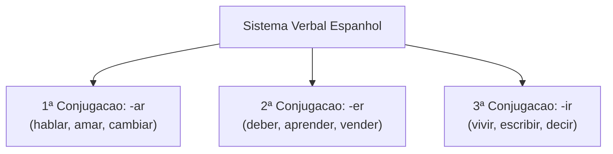
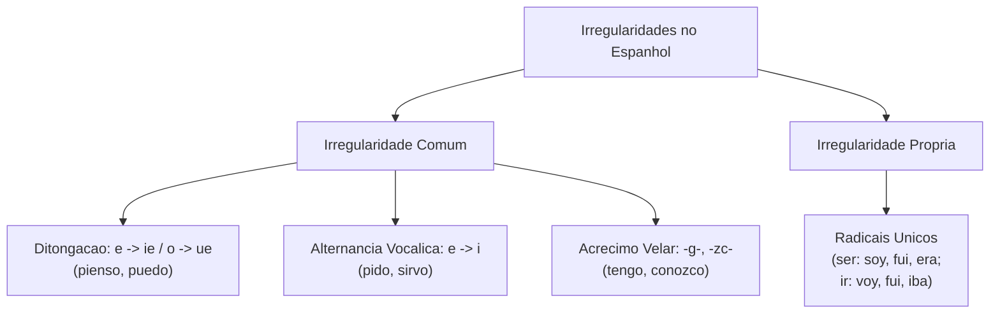
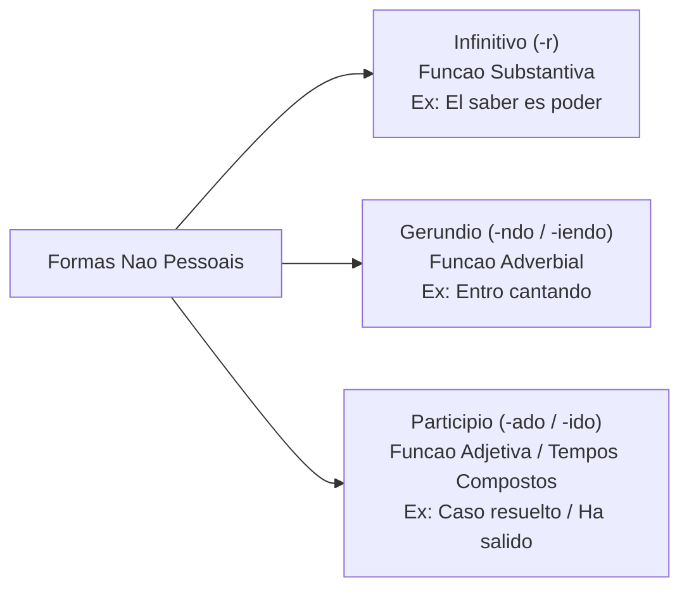
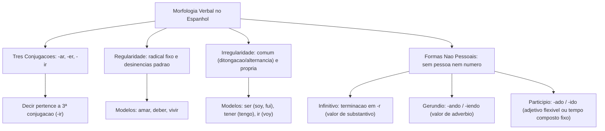

O estudo dos verbos em língua espanhola é essencial para a interpretação textual e análise gramatical nos concursos. Reconhecer tempos verbais, desinências e irregularidades permite identificar relações temporais de causa e efeito com exatidão.

Neste capítulo inicial, examinaremos o conceito de verbo, as três conjugações do castelhano, a distinção entre verbos regulares e irregulares e a estrutura das formas não pessoais: infinitivo, gerúndio e particípio.

> [!objetivos]
> - Compreender a estrutura das três conjugações verbais da língua espanhola.
> - Distinguir verbos regulares de irregulares pela estabilidade do radical e das desinências.
> - Identificar as formas não pessoais (infinitivo, gerúndio e particípio) e suas funções sintáticas.
> - Reconhecer as particularidades mórficas do particípio e do gerúndio em textos de concursos.

---

## O Conceito de Verbo e as Três Conjugações

Na gramática normativa da língua espanhola, o verbo é definido como a classe gramatical variável que expressa ações, estados, processos ou fenômenos naturais situados no tempo. Segundo a Real Academia Española (RAE), o verbo se caracteriza por flexionar em pessoa, número, tempo, modo e aspecto, constituindo o núcleo predicativo da oração.

A conjugação é o conjunto ordenado de todas as formas que um verbo assume ao flexionar-se. Em espanhol, assim como no português, os verbos agrupam-se em três conjugações com base na terminação do seu infinitivo:

1. **Primeira conjugação (-ar)**: compreende verbos terminados em *-ar*, como *hablar*, *amar*, *cantar*, *cambiar* e *rebajar*. É a classe mais numerosa e produtiva do idioma.
2. **Segunda conjugação (-er)**: reúne verbos terminados em *-er*, como *deber*, *aprender*, *caber*, *caer* e *vender*.
3. **Terceira conjugação (-ir)**: engloba verbos terminados em *-ir*, como *vivir*, *escribir*, *partir*, *decir*, *dormir* e *construir*.



> [!pegadinha]
> A conjugação baseia-se na terminação do verbo **em espanhol**, e não na tradução para o português. O verbo *decir* traduz-se por "dizer" (-er no português), mas pertence à terceira conjugação porque termina em -ir.

---

## Verbos Regulares: Radical Estável e Desinências Previsíveis

Diz-se que um verbo é **regular** quando preserva integralmente o seu radical ao longo de toda a conjugação e recebe as desinências padronizadas do seu modelo flexivo em todos os modos e tempos.

O radical (ou raiz lexical) é a parte do verbo que contém o núcleo de significado básico. Obtém-se o radical retirando-se a terminação do infinitivo (*-ar*, *-er* ou *-ir*):
- No verbo *amar*, o radical é *am-*.
- No verbo *deber*, o radical é *deb-*.
- No verbo *vivir*, o radical é *viv-*.

As desinências são os morfemas flexivos que se acoplam ao radical para indicar pessoa gramatical, número, tempo e modo.

```mermaid Estrutura Morfologica do Verbo Regular
flowchart LR
    R["Radical Fixo: am-"] + D["Desinencia Pessoal: -amos"] --> F["Forma Verbal: amamos"]
```

A tabela abaixo ilustra o comportamento de um verbo regular da primeira conjugação (*amar*) em tempos verbais fundamentais:

| Tempo Verbal | Desinências do Modelo (-ar) | Formas Conjugadas (*amar*) |
|---|---|---|
| Presente do Indicativo | -o, -as, -a, -amos, -áis, -an | amo, amas, ama, amamos, amáis, aman |
| Pretérito Perfeito Simples | -é, -aste, -ó, -amos, -asteis, -aron | amé, amaste, amó, amamos, amasteis, amaron |
| Futuro Imperfeito Simples | -é, -ás, -á, -emos, -éis, -án | amaré, amarás, amará, amaremos, amaréis, amarán |
| Pretérito Imperfeito | -aba, -abas, -aba, -ábamos, -abais, -aban | amaba, amabas, amaba, amábamos, amabais, amaban |

Observe que, no futuro imperfeito simples, as desinências somam-se diretamente ao infinitivo completo (*amar-é*, *amar-ás*). No pretérito imperfeito da primeira conjugação, nota-se a terminação com a letra *b* (*-aba*), traço morfológico que diferencia o espanhol do português (*amava*).

Entre os verbos regulares frequentes em concursos, destacam-se: *comprar*, *escribir*, *partir*, *practicar*, *recibir*, *subir* e *viajar*.

---

## Verbos Irregulares: Alterações Mórficas e Tipologia

Um verbo é classificado como **irregular** quando sofre alterações em seu radical, quando recebe desinências distintas do modelo padrão da sua conjugação, ou quando apresenta ambas as anomalias de forma simultânea.

As irregularidades no espanhol distribuem-se em dois grandes grupos:
1. **Irregularidade comum (vocálica ou consonantal)**: afeta grupos extensos de verbos que compartilham o mesmo tipo de mutação fonética previsível. Exemplos: ditongação de *e* para *ie* (*pensar* -> *pienso*; *querer* -> *quiero*) ou de *o* para *ue* (*contar* -> *cuento*; *dormir* -> *duermo*); alternância vocálica de *e* para *i* (*pedir* -> *pido*); e acréscimo de consoante velar *g* (*poner* -> *pongo*; *salir* -> *salgo*).
2. **Irregularidade própria**: atinge verbos específicos que possuem flexões únicas e radicais completamente transformados, como ocorre com os verbos *ser*, *ir*, *haber* e *saber*.



O verbo *ser* exemplifica a irregularidade própria máxima, transformando seu radical nas diferentes formas: *soy*, *eres*, *es* (presente); *era*, *éramos* (imperfeito); e *fui*, *fuiste*, *fue* (pretérito perfeito simples).

> [!bizu]
> Para identificar em uma prova de concurso se um verbo é regular ou irregular, compare a forma conjugada com o modelo padrão da conjugação. Se houver ditongação na raiz (*volver* -> *vuelvo*), troca de vogal (*seguir* -> *sigo*) ou alteração na desinência (*dar* -> *doy*), o verbo é classificado como irregular.

A tabela contrastiva sintetiza verbos regulares e irregulares em certames:

| Verbo no Infinitivo | Tipo de Conjugação | 1ª Pessoa do Presente | Classificação Morfológica |
|---|---|---|---|
| *hablar* | 1ª conjugação (-ar) | *hablo* | Regular (radical *habl-* preservado) |
| *conocer* | 2ª conjugação (-er) | *conozco* | Irregular (acréscimo da consoante *z*) |
| *vivir* | 3ª conjugação (-ir) | *vivo* | Regular (radical *viv-* preservado) |
| *tener* | 2ª conjugação (-er) | *tengo* | Irregular (velarização em *g* e ditongação *tienes*) |
| *decir* | 3ª conjugação (-ir) | *digo* | Irregular (alternância *e* -> *i* e velarização) |
| *escribir* | 3ª conjugação (-ir) | *escribo* | Regular (radical *escrib-* preservado) |

---

## Formas Não Pessoais do Verbo

As **formas não pessoais** (*formas no personales*), denominadas formas nominais na tradição gramatical brasileira, caracterizam-se pela ausência de marcas flexivas de pessoa gramatical e de número. Elas expressam o processo verbal em seu estado puro e desempenham funções sintáticas híbridas, atuando como verbo e assumindo simultaneamente papeis típicos de substantivos, advérbios ou adjetivos.

São três as formas não pessoais: **infinitivo**, **gerúndio** e **particípio**.



### O Infinitivo

O infinitivo nomeia a ação de modo genérico, terminando na desinência **-r** (*amar*, *deber*, *partir*). Além de integrar perífrases verbais, exerce funções substantivas puras na oração, podendo atuar como sujeito ou complemento:
- *Estudiar es construir el futuro.* (Sujeito da oração).
- *El saber es importante para la vida.* (Substantivado com artigo).
- *Ayudar a los amigos es siempre un placer.* (Função subjetiva).

Apresenta-se na forma simples (*trabajar*) ou composta com o auxiliar *haber* (*haber estudiado*).

### O Gerúndio

O gerúndio expressa um processo em andamento ou simultâneo. Forma-se com **-ando** na 1ª conjugação (*amando*) e **-iendo** na 2ª e 3ª conjugações (*debiendo*, *viviendo*). Sintaticamente, atua como advérbio circunstancial:
- *Saliendo del estadio, nos encontramos con Miguel.* (Tempo).
- *Conseguimos ganar luchando vigorosamente.* (Modo).
- *Corremos vigorosamente, ganando así el partido.* (Modo e resultado).

> [!atencao]
> Em espanhol, verbos com encontro vocálico no radical ou com alternância fonética apresentam gerúndios particulares com a letra *y* ou mudança vocálica: *leer* -> *leyendo*; *caer* -> *cayendo*; *dormir* -> *durmiendo*; *pedir* -> *pidiendo*. As bancas adoram explorar essas grafias em questões ortográficas.

### O Particípio

O particípio expressa o resultado concluído da ação. Forma-se regularmente com **-ado** na 1ª conjugação (*amado*) e **-ido** na 2ª e 3ª conjugações (*debido*, *vivido*).

Seu comportamento varia conforme a função sintática:
1. **Valor adjetivo**: flexiona em gênero e número (*-ado/a/os/as*, *-ido/a/os/as*), concordando com o substantivo (*las brigadas enviadas*, *el proyecto conocido*).
2. **Tempos compostos com *haber***: permanece estritamente **invariável** no masculino singular (*ellos han hablado*, *nosotras hemos debido*).

> [!exemplo]
> Há particípios com formas irregulares clássicas na língua espanhola que não utilizam *-ado* ou *-ido*:
> - *abrir* -> *abierto*
> - *decir* -> *dicho*
> - *escribir* -> *escrito*
> - *hacer* -> *hecho*
> - *morir* -> *muerto*
> - *poner* -> *puesto*
> - *ver* -> *visto*
> - *volver* -> *vuelto*

A tabela a seguir sistematiza as formas não pessoais e suas particularidades:

| Forma Não Pessoal | Desinência Regular | Função Primária | Exemplo no Discurso |
|---|---|---|---|
| Infinitivo Simples | -ar, -er, -ir | Nominal (Substantivo) | *El deber de proteger a la sociedad.* |
| Infinitivo Composto | *haber* + particípio | Anterioridade Temporal | *Por haber actuado con rapidez, salvaron vidas.* |
| Gerúndio Simples | -ando, -iendo | Circunstancial (Advérbio) | *Estudiando con método, alcanzarás el éxito.* |
| Particípio (Adjetivo) | -ado/-ada, -ido/-ida | Qualificadora (Adjetivo) | *La misión cumplida con honor.* |
| Particípio (Composto) | -ado, -ido (Invariável) | Tempo Verbal Composto | *Las oficiales han dirigido la operación.* |

---

## Questões Comentadas

### Questão 1 (Adaptada)
No trecho "La incapacidad de **lograr** decisiones de consenso terminó **afectando** a las instituciones, dejando un saldo de proyectos no **concluidos**", os vocábulos destacados classificam-se, respectivamente, nas seguintes formas não pessoais do verbo:
A) Gerúndio, particípio e infinitivo.
B) Infinitivo, particípio e particípio.
C) Infinitivo, gerúndio e particípio.
D) Particípio, gerúndio e infinitivo.
E) Infinitivo, gerúndio e infinitivo.

**Gabarito: C**

**Comentário detalhado:**
A questão exige o reconhecimento das três formas não pessoais do verbo no espanhol:
1. *lograr*: apresenta a terminação *-ar* característica do infinitivo da 1ª conjugação, atuando como complemento de um nome abstrato.
2. *afectando*: apresenta a desinência *-ando*, marcando o gerúndio de um verbo da 1ª conjugação que indica um processo em curso.
3. *concluidos*: apresenta a terminação *-idos*, configurando o particípio regular plural com função adjetiva qualificando o substantivo "proyectos".
Portanto, a sequência correta é infinitivo, gerúndio e particípio, correspondendo exatamente à alternativa C.

---

### Questão 2 (Adaptada)
Analise as afirmações abaixo a respeito da classificação morfológica dos verbos na língua espanhola:
I. O verbo *decir* pertence à terceira conjugação, embora sua tradução em português seja "dizer".
II. O verbo *ser* é classificado como regular, pois mantém o radical *s-* em todos os tempos do indicativo.
III. O infinitivo pode desempenhar função sintática de sujeito em orações como "Estudiar es construir el futuro".

Está correto o que se afirma em:
A) I, apenas.
B) I e II, apenas.
C) I e III, apenas.
D) II e III, apenas.
E) I, II e III.

**Gabarito: C**

**Comentário detalhado:**
A análise de cada assertiva evidencia:
I. Correta: a conjugação é definida pela terminação do infinitivo em castelhano (*-ir*), classificando *decir* na 3ª conjugação.
II. Incorreta: o verbo *ser* é o exemplo clássico de irregularidade própria máxima, variando seu radical radicalmente (*soy*, *era*, *fui*).
III. Correta: o infinitivo atua como forma nominal, exercendo função substantiva de núcleo do sujeito da oração principal.
Logo, apenas as assertivas I e III estão corretas.

---

### Questão 3 (Inédita)
Em relação ao emprego do particípio na língua espanhola, assinale a opção gramaticalmente correta:
A) Nos tempos verbais compostos com o auxiliar *haber*, o particípio concorda obrigatoriamente em gênero e número com o sujeito.
B) O particípio do verbo *escribir* é regular e grafa-se como *escribido* em todas as variantes formais.
C) Em funções adjetivas e em orações absolutas, o particípio flexiona-se em gênero e número concordando com o substantivo.
D) Os verbos da primeira conjugação recebem a desinência *-ido* na formação do seu particípio regular.
E) O verbo *hacer* forma particípio regular com a desinência *-ado*, resultando na forma *hacado*.

**Gabarito: C**

**Comentário detalhado:**
A flexão do particípio em espanhol distingue dois domínios: quando atua com função adjetiva ou em orações subordinadas absolutas, ele concorda obrigatoriamente em gênero e número com o substantivo que modifica (*la misión cumplida*, *los casos resueltos*), o que valida a alternativa C. A alternativa A erra porque nos tempos compostos com *haber* o particípio é estritamente invariável no masculino singular (*han salido*). As alternativas B e E trazem particípios irregulares autênticos (*escrito* e *hecho*). A alternativa D inverte a regra: a 1ª conjugação recebe *-ado*.

---

## Mapa do Capítulo



---

### Para fixar

- **Critério de conjugação**: a conjugação é definida pela terminação do infinitivo em espanhol (-ar, -er ou -ir); *decir* é de 3ª conjugação.
- **Verbo regular**: mantém o radical intacto e adota desinências flexivas padronizadas em todos os tempos (*amar*, *deber*, *vivir*).
- **Verbo irregular**: sofre mutação no radical, na desinência ou em ambos (*ser*, *ir*, *tener*, *poner*, *conocer*).
- **Irregularidades comuns**: compreendem ditongações (*e* -> *ie*, *o* -> *ue*), alternâncias vocálicas (*e* -> *i*) e acréscimos consonantais velares (*-g-*, *-zc-*).
- **Formas não pessoais**: não flexionam em pessoa nem número gramatical; englobam infinitivo, gerúndio e particípio.
- **Função do infinitivo**: termina em *-r* e atua frequentemente como substantivo, exercendo função de sujeito na oração.
- **Formação do gerúndio**: termina em *-ando* para a 1ª conjugação e em *-iendo* para a 2ª e 3ª conjugações, indicando ação em desenvolvimento.
- **Particularidades do particípio**: flexiona em gênero e número como adjetivo (*misión cumplida*), mas permanece invariável nos tempos compostos com *haber* (*han cumplido*).
- **Particípios irregulares**: formas consagradas que não adotam desinência padrão, tais como *abierto*, *dicho*, *escrito*, *hecho*, *puesto* e *visto*.
- **Vogal temática do pretérito imperfeito**: a 1ª conjugação utiliza a consoante *b* (*amaba*), ao passo que a 2ª e 3ª conjugações recebem a terminação acentuada *-ía* (*debía*, *vivía*).
