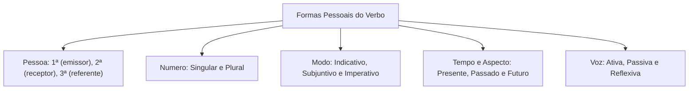
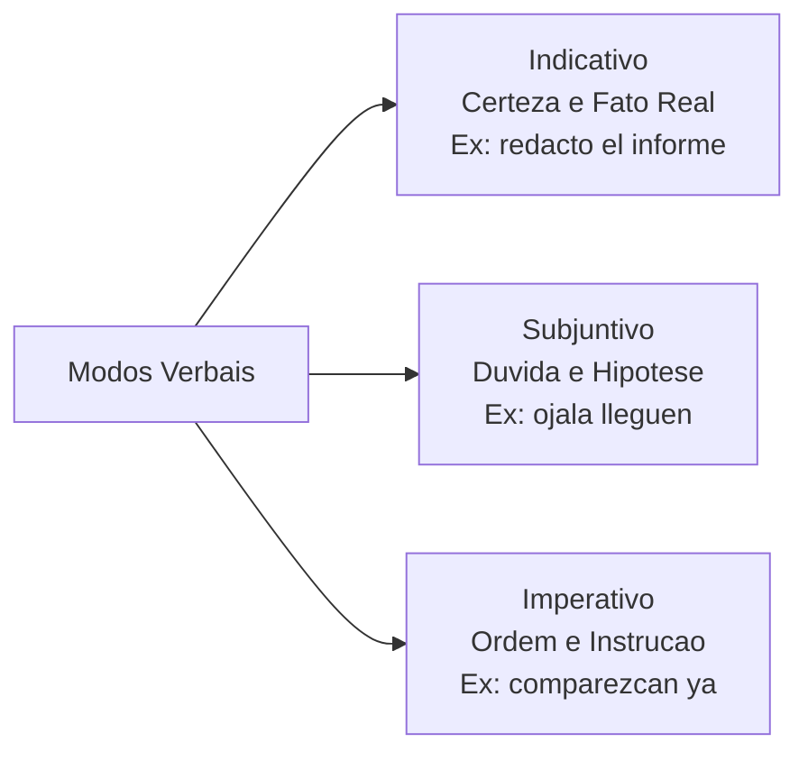
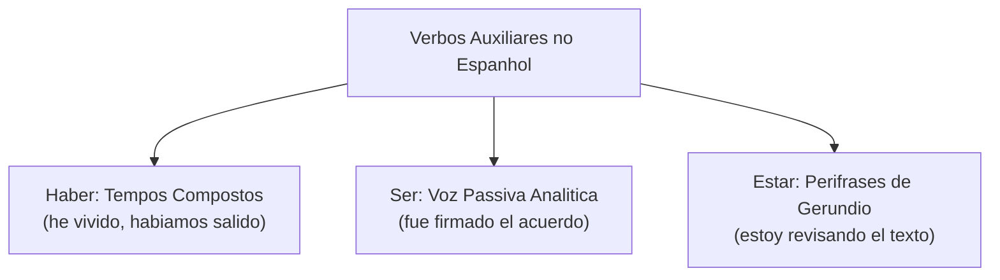
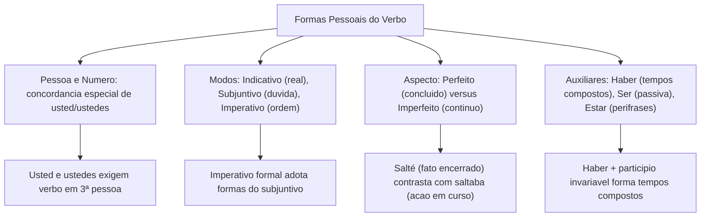

As formas pessoais do verbo flexionam para indicar pessoa, número, tempo, modo e voz. Reconhecer essas marcas permite identificar os sujeitos da ação, mesmo quando ocultos no texto.

Neste capítulo, estudaremos as categorias de número e pessoa, os pronomes de tratamento *usted* e *ustedes*, os três modos verbais, o aspecto perfeito versus imperfeito e o papel dos verbos auxiliares.

> [!objetivos]
> - Distinguir as formas pessoais do verbo conforme as categorias de pessoa, número e modo.
> - Compreender a concordância especial de terceira pessoa com os pronomes *usted* e *ustedes*.
> - Diferenciar o aspecto concluído dos tempos perfeitos da continuidade dos tempos imperfeitos.
> - Reconhecer as funções do verbo auxiliar *haber* na composição dos tempos verbais compostos.

---

## Categorias das Formas Pessoais: Pessoa, Número e Voz

As **formas pessoais** flexionam para situar o fato em relação aos interlocutores:
- **Pessoa**: 1ª pessoa (*yo*, *nosotros*), 2ª pessoa (*tú*, *vosotros*) e 3ª pessoa (*él*, *ellos*).
- **Número**: singular (um agente) ou plural (múltiplos agentes).
- **Voz**: ativa (*el bombero rescató a la víctima*), passiva (*la víctima fue rescatada*) ou reflexiva (*el oficial se preparó*).

### O Tratamento Formal: *Usted* e *Ustedes*

Um ponto de atenção indispensável nos concursos diz respeito aos pronomes de tratamento de cortesia e respeito formal: *usted* (singular) e *ustedes* (plural).

Embora façam referência direta ao interlocutor (segunda pessoa do discurso), esses pronomes exigem obrigatoriamente a concordância do verbo em **terceira pessoa gramatical**:
- *¿Usted conoce los protocolos de seguridad?* (Verbo *conoce* em 3ª pessoa do singular).
- *Ustedes deben presentarse en el cuartel.* (Verbo *deben* em 3ª pessoa do plural).

> [!pegadinha]
> Na Espanha, *vosotros* é a 2ª pessoa informal (*vosotros habláis*), enquanto *ustedes* é formal. Na América Hispânica, *ustedes* é universal para o plural, exigindo verbo em 3ª pessoa.

---

## Os Três Modos Verbais no Espanhol

O modo verbal expressa a atitude do falante diante do fato anunciado no discurso. Em língua espanhola, a atitude comunicativa reparte-se em três modalidades bem definidas: indicativo, subjuntivo e imperativo.

O **modo indicativo** retrata os acontecimentos como reais, objetivos e seguros. Ele predomina em relatórios periciais, boletins de ocorrência e narrativas históricas, onde os fatos são apresentados como verdades consumadas (*compré un libro*; *el agente redactó el documento*).

O **modo subjuntivo** expressa a dimensão da incerteza, do desejo, da probabilidade e da hipótese condicional. Ele introduz fatos cuja realização depende de fatores externos incertos (*espero que lleguen a tiempo*; *si tuviéramos apoyo, actuaríamos antes*).

O **modo imperativo** atua na função apelativa ou conativa da linguagem. Seu objetivo direto é influenciar o comportamento do destinatário por meio de ordens, instruções, advertências e conselhos operacionais (*comparezcan inmediatamente*; *no utilicen el elevador*).

---

## Classificação dos Tempos e Oposição de Aspecto

Os tempos verbais organizam-se segundo a sua estrutura morfológica e o seu valor aspectual:

- **Tempos Simples**: formados por um único vocábulo verbal, constituído pela junção de radical e desinência (*hablo*, *escribí*, *viviremos*).
- **Tempos Compostos**: estruturados pela combinação do verbo auxiliar **haber** conjugado seguido do particípio invariável do verbo principal (*he hablado*, *había escrito*, *habremos vivido*).

| Critério de Classificação | Categoria Morfológica | Descrição Estrutural | Exemplo em Castelhano |
|---|---|---|---|
| Composição | Tempo Simples | Apenas o verbo principal flexionado | *El militar viajó a la capital.* |
| Composição | Tempo Composto | Auxiliar *haber* + particípio fixo | *El militar ha viajado hoy.* |
| Aspecto | Tempo Perfeito | Ação totalmente concluída e delimitada | *Ayer concluí la investigación.* |
| Aspecto | Tempo Imperfeito | Ação em curso, contínua ou habitual | *Antes investigaba todos los días.* |

### Oposição Aspectual: Perfeito versus Imperfeito

O aspecto indica se a ação é acabada ou contínua:
- **Aspecto Perfeito**: retrata a ação como encerrada. O pretérito perfeito simples (*viajó*, *salté*) marca término pontual.
- **Aspecto Imperfeito**: retrata o fato em curso ou habitual. O pretérito imperfeito (*viajaba*, *saltaba*) descreve ações contínuas no passado.

> [!exemplo]
> Compare os valores discursivos:
> - *El bombero subió la escalera y rescató al niño.* (Ações pontuais sucessivas e perfeitas).
> - *El bombero subía la escalera cuando sonó la alarma.* (Ação em curso, imperfeita, interrompida por outro fato).

---

## Paradigma dos Tempos Verbais e o Papel dos Auxiliares

A divisão dos tempos verbais na língua espanhola organiza-se pela correlação estrutural entre formas simples e compostas. Na fala e na escrita culta, as formas não pessoais como o infinitivo (*saltar*, *haber saltado*) servem de base para a construção dos paradigmas morfológicos.

Os verbos auxiliares desprovêm-se de sentido pleno para indicar tempo, modo, voz e aspecto:
1. **Haber**: é o verbo auxiliar por excelência nos tempos compostos (*tiempo compuesto*), como em *ha llegado* ou *habíamos concluido*. Em castelhano, não se admite o verbo *tener* para compor tempos perfeitos.
2. **Ser**: atua na formação da voz passiva analítica, exigindo particípio que concorda com o sujeito (*la orden fue emitida*).
3. **Estar**: compõe perífrases durativas acompanhado de gerúndio (*estamos verificando los accesos*).

> [!bizu]
> Guarde para a prova: o verbo *haber* é o único auxiliar legítimo dos tempos compostos no espanhol. Construções como *tengo comprado* não constituem tempo verbal composto, indicando apenas posse de algo concluído.

A estrutura temporal correlaciona cada tempo simples com o seu respectivo tempo composto (*tiempo compuesto*). No modo indicativo e no modo subjuntivo, as formas flexionadas do auxiliar *haber* combinam-se com o particípio invariável para estruturar o quadro da conjugação.

| Modo Gramatical | Tempo Simples | Exemplo Simples | Tempo Composto (*haber* + particípio) | Exemplo Composto |
|---|---|---|---|---|
| Indicativo | Presente | *salto* | Pretérito Perfeito Composto | *he saltado* |
| Indicativo | Pretérito Imperfeito | *saltaba* | Pretérito Mais-que-Perfeito | *había saltado* |
| Indicativo | Pretérito Perfeito Simples | *salté* | Pretérito Anterior | *hube saltado* |
| Indicativo | Futuro Simples | *saltaré* | Futuro Composto | *habré saltado* |
| Indicativo | Condicional Simples | *saltaría* | Condicional Composto | *habría saltado* |
| Subjuntivo | Presente | *salte* | Pretérito Perfeito Composto | *haya saltado* |
| Subjuntivo | Pretérito Imperfeito | *saltara / saltase* | Pretérito Mais-que-Perfeito | *hubiera / hubiese saltado* |
| Subjuntivo | Futuro Simples | *saltare* | Futuro Composto | *hubiere saltado* |

O futuro do subjuntivo (*saltare*, *hubiere saltado*) é arcaico, restrito a textos jurídicos.

---

## Questões Comentadas

### Questão 1 (Adaptada)
Na oração "Señores oficiales, **presenten** sus credenciales en la mesa de entrada", a forma verbal destacada encontra-se conjugada no:
A) Presente do indicativo, 2ª pessoa do plural.
B) Pretérito imperfeito do indicativo, 3ª pessoa do plural.
C) Modo imperativo afirmativo, concordando com *ustedes*.
D) Futuro do subjuntivo, 1ª pessoa do plural.
E) Modo condicional composto, concordando com *vosotros*.

**Gabarito: C**

**Comentário detalhado:**
A frase expressa ordem formal a oficiais. A forma verbal *presenten* pertence ao imperativo concordando com *ustedes*. No espanhol, o imperativo formal para *usted* e *ustedes* toma de empréstimo as formas do presente do subjuntivo (*presente usted* / *presenten ustedes*). A alternativa C define com rigor gramatical a função e o modo da palavra.

---

### Questão 2 (Adaptada)
Assinale a alternativa que apresenta uma oração estruturada com tempo verbal composto da língua espanhola:
A) Los rescatistas tenían mucho trabajo durante la noche.
B) El equipo de peritos ha examinado minuciosamente el vehículo.
C) Los soldados marchaban en dirección a la frontera oriental.
D) El comandante fue recibido con honores por las autoridades.
E) Estudiando diariamente conseguiremos la aprobación esperada.

**Gabarito: B**

**Comentário detalhado:**
O tempo composto no espanhol exige o auxiliar *haber* com o particípio. Na opção B, *ha examinado* é pretérito perfeito composto do indicativo. Na alternativa A, *tenían* é pretérito imperfeito simples; na C, *marchaban* é imperfeito simples; na D, *fue recibido* é voz passiva analítica com o auxiliar *ser*; e na E, temos o gerúndio *estudiando*.

---

### Questão 3 (Inédita)
No que tange à oposição aspectual entre o pretérito perfeito simples e o pretérito imperfeito do indicativo, assinale a opção correta:
A) O pretérito imperfeito focaliza ações concluídas pontualmente sem duração temporal.
B) O pretérito perfeito simples expressa hábitos rotineiros e descrições de cenários de fundo no passado.
C) A forma *viajó* expressa um fato consumado e encerrado, ao passo que *viajaba* destaca a continuidade ou habitualidade da ação.
D) Ambas as formas são intercambiáveis sem provocar qualquer alteração no sentido discursivo da mensagem.
E) O pretérito perfeito simples é construído com o auxiliar *haber*, enquanto o imperfeito dispensa desinências.

**Gabarito: C**

**Comentário detalhado:**
A diferença central entre os pretéritos reside no aspecto verbal: o pretérito perfeito simples (*viajó*) possui aspecto perfectivo, apresentando a ação como acabada e pontual no passado. O pretérito imperfeito (*viajaba*) possui aspecto imperfectivo, evidenciando processos contínuos, simultâneos ou habituais no tempo pretérito, validando a alternativa C. As alternativas A e B invertem os conceitos. A alternativa D é falsa porque a troca de aspecto altera a perspectiva temporal, e a E erra na morfologia de formação dos tempos.

---

## Mapa do Capítulo

---

### Para fixar

- **Categorias flexivas**: as formas pessoais flexionam em número, pessoa, modo, tempo e voz.
- **Concordância formal**: *usted* e *ustedes* referem-se à 2ª pessoa do discurso, mas exigem verbo flexionado em 3ª pessoa.
- **Modo indicativo**: expressa fatos certos, objetivos e reais no presente, passado ou futuro (*compré un libro*).
- **Modo subjuntivo**: expressa hipóteses, probabilidades, desejos e condições irreais (*espero que lleguen*).
- **Modo imperativo**: expressa ordens, instruções diretas, conselhos e pedidos operacionais (*comparezcan*).
- **Tempos simples e compostos**: formas simples possuem uma única palavra verbal; formas compostas usam o auxiliar *haber* com particípio fixo.
- **Aspecto perfeito**: apresenta o acontecimento como concluído e delimitado (*salté*, *viajó*).
- **Aspecto imperfeito**: destaca a continuidade, habitualidade ou duração indeterminada da ação no passado (*saltaba*, *viajaba*).
- **Verbo auxiliar *haber***: único auxiliar admitido para a composição de tempos compostos regulares no espanhol.
- **Futuro do subjuntivo**: formas como *saltare* e *hubiere saltado* persistem na atualidade em textos legislativos e jurídicos formais.
