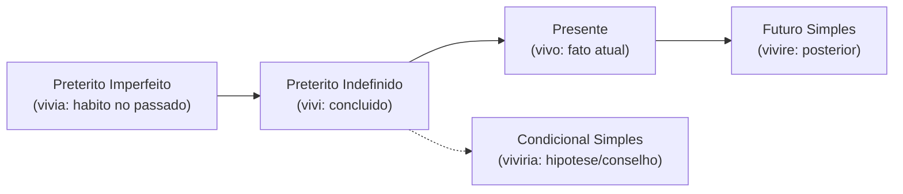
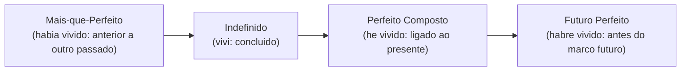
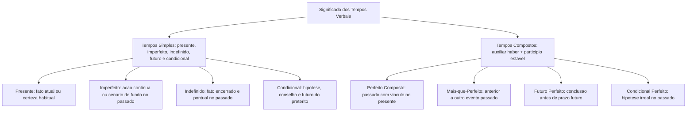

Os tempos verbais situam a ação no presente, passado ou futuro e acrescentam informação de conclusão, continuidade, hipótese ou anterioridade. Em formas compostas, o auxiliar *haber* localiza a ação; o particípio indica o evento.

Compreender o valor semântico de cada tempo verbal é indispensável para interpretar textos informativos e normativos em concursos. As desinências revelam se o fato foi concluído, se era rotineiro ou se representa mera conjectura discursiva.

Neste capítulo, estudaremos a carga de significado dos tempos do indicativo, contrastando as formas simples e compostas dos verbos modelos *amar*, *deber* e *vivir*.

> [!objetivos]
> - Compreender a função semântica dos tempos verbais simples e compostos no modo indicativo.
> - Diferenciar o pretérito perfeito composto do pretérito indefinido conforme o vínculo com o presente.
> - Interpretar os valores de hipótese, cortesia e futuro do passado expressos pelo condicional.
> - Mapear a anterioridade cronológica do pretérito mais-que-perfeito e do pretérito anterior.

---

## Semântica dos Tempos Simples no Modo Indicativo

Os tempos simples expressam ações sem o auxílio de outro verbo conjugado. Cada tempo veicula um valor comunicativo específico no discurso:

- **Presente do Indicativo**: expressa ações simultâneas ao momento da fala (*amo*, *debo*, *vivo*). Também enuncia verdades gerais ou hábitos quotidianos (*nosotros vivimos aquí*).
- **Pretérito Imperfeito**: relata ações habituais ou contínuas no passado, sem delimitar início ou fim (*amaba*, *debía*, *vivía*). Descreve cenários de fundo na narrativa (*en aquella época vosotros vivíais lejos*).
- **Pretérito Perfeito Simples (Indefinido)**: relata ações pontuais iniciadas e concluídas no passado (*amé*, *debí*, *viví*). Marca eventos históricos encerrados.
- **Futuro Simples**: situa a ação após o momento da fala (*amaré*, *deberé*, *viviré*). Pode expressar probabilidade presente.
- **Condicional Simples**: funciona como futuro do pretérito, indicando hipóteses possíveis, conselhos ou cortesia (*debería estudiar*; *viviríamos mejor*).

> [!bizu]
> O pretérito indefinido (*amé*, *debí*) conclui a ação no passado. O pretérito imperfeito (*amaba*, *debía*) apresenta o fato em andamento ou habitual, sem limites temporais fechados.

---

## Semântica dos Tempos Compostos e a Linha do Tempo

Os tempos compostos combinam o auxiliar **haber** conjugado com o particípio estável (*amado*, *debido*, *vivido*). A forma de *haber* situa a ação no tempo:

- **Pretérito Perfeito Composto**: combina o presente de *haber* com o particípio (*he amado*, *hemos debido*, *han vivido*). Expressa ações passadas que mantêm vínculo com o presente ou inseridas em período de tempo não encerrado (*hoy*, *esta semana*).
- **Pretérito Mais-que-Perfeito (*Pluscuamperfecto*)**: associa o imperfeito de *haber* ao particípio (*había amado*, *habíamos vivido*). Indica ação passada anterior a outro fato pretérito (*ya habíamos salido cuando llegaron*).
- **Pretérito Anterior**: formado por *hube*, *hubiste*, *hubo*, *hubimos*, *hubisteis*, *hubieron* mais particípio (*hube debido*). Situa anterioridade imediata no passado; é forma rara e literária.
- **Futuro Perfeito**: associa o futuro de *haber* (*habré*, *habrás*, *habrá*, *habremos*, *habréis*, *habrán*) ao particípio (*habrán vivido*). Indica fato concluído antes de um marco futuro.
- **Condicional Perfeito**: associa o condicional de *haber* ao particípio (*habría amado*, *habríamos vivido*). Expressa hipóteses não realizadas no passado.

> [!pegadinha]
> Usamos o perfeito composto (*he vivido*) com marcadores de período aberto (*este año*, *hoy*). Usamos o pretérito indefinido (*viví*) com marcadores de tempo fechado e extinto (*ayer*, *en 2010*).

| Tempo Verbal | Modelo com *Vivir* | Valor Semântico Central | Marcador Típico |
|---|---|---|---|
| Presente | *vivo, vivimos* | Fato atual ou hábito | *hoy, siempre* |
| Imperfeito | *vivía, vivíamos* | Ação contínua no passado | *antes, mientras* |
| Indefinido | *viví, vivimos* | Fato encerrado no passado | *ayer, anoche* |
| Futuro Simples | *viviré, vivirán* | Ação posterior à fala | *mañana, después* |
| Condicional | *viviría, vivirían* | Hipótese, conselho ou cortesia | *si pudiera, tal vez* |
| Perfeito Composto | *he vivido, han vivido* | Passado ligado ao presente | *esta semana, hoy* |
| Mais-que-Perfeito | *había vivido* | Anterior a outro passado | *ya, antes de que* |
| Futuro Perfeito | *habré vivido, habrán vivido* | Conclusão antes de marco futuro | *para el lunes* |
| Condicional Perfeito | *habría vivido* | Hipótese passada não realizada | *habríamos ganado* |

---

## Questões Comentadas

### Questão 1 (Adaptada)
Considere a frase: "Esta mañana el destacamento **ha recibido** las directivas para el operativo". O emprego da forma verbal composta justifica-se porque:
A) Descreve ação iniciada no passado remoto sem reflexos no presente.
B) Situa um fato concluído dentro de uma unidade temporal ainda aberta ("esta mañana").
C) Trata-se de hipótese irreal condicionada a uma decisão governamental futura.
D) Expressa uma ação simultânea que ocorre no exato momento da fala.
E) Substitui o futuro do pretérito em orações declarativas de cortesia militar.

**Gabarito: B**

**Comentário detalhado:**
O pretérito perfeito composto do indicativo (*ha recibido*) expressa ações ocorridas em período temporal que inclui o momento da fala ou permanece aberto ("esta mañana"), justificando a alternativa B. A opção A descreve o pretérito indefinido e a C descreve o modo condicional.

---

### Questão 2 (Inédita)
Na sentença "Cuando los peritos llegaron al local, los sospechosos ya **habían huido**", a forma destacada exprime:
A) Um fato futuro condicionado à conclusão do laudo técnico pericial.
B) Uma ação presente habitual praticada com regularidade pelos envolvidos.
C) Uma ação pretérita que ocorreu com anterioridade a outro evento passado.
D) Uma ordem direta emitida pela autoridade de segurança aos fugitivos.
E) Uma hipótese improvável que depende de confirmação judicial definitiva.

**Gabarito: C**

**Comentário detalhado:**
A forma verbal *habían huido* é pretérito mais-que-perfeito do indicativo, composto pelo imperfeito do auxiliar *haber* e o particípio de *huir*. Sua função semântica é expressar anterioridade relativa no passado, confirmando o acerto da alternativa C.

---

## Mapa do Capítulo

---

### Para fixar

- **Presente**: enuncia ações atuais e rotinas cotidianas (*amo*, *debo*, *vivo*).
- **Pretérito imperfeito**: descreve hábitos passados e processos contínuos (*amaba*, *debía*, *vivía*).
- **Pretérito indefinido**: relata eventos pontuais integralmente concluídos (*amé*, *debí*, *viví*).
- **Futuro simples**: projeta fatos posteriores ao momento da fala (*amaré*, *deberé*, *viviré*).
- **Condicional simples**: funciona como futuro do passado e formula conselhos ou cortesia (*debería*).
- **Pretérito perfeito composto**: expressa fatos passados em períodos abertos (*he vivido*).
- **Pretérito mais-que-perfeito**: indica fato anterior a outro evento pretérito (*había vivido*).
- **Pretérito anterior**: marca anterioridade imediata no passado com *hube* (*hube amado*).
- **Futuro perfeito**: antecipa conclusão antes de marco futuro (*habrán vivido*).
- **Condicional perfeito**: representa hipótese irreal no passado (*habríamos vivido*).
