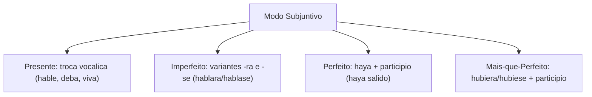
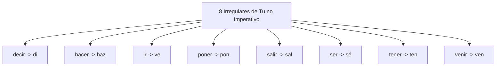
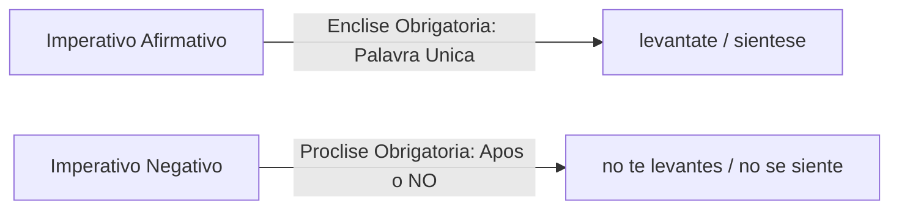
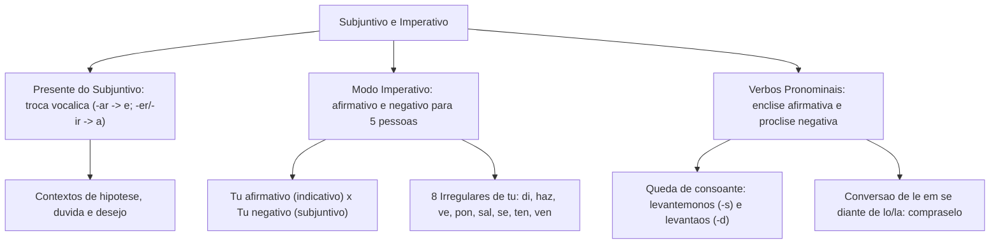

O modo subjuntivo e o imperativo são muito cobrados em concursos. O subjuntivo expressa hipóteses e dúvidas. O imperativo veicula ordens diretas e instruções operacionais.

A formação do imperativo relaciona-se diretamente com o presente do subjuntivo. O uso de verbos pronominais impõe regras de colocação e alterações fonéticas.

Neste capítulo, estudaremos o presente do subjuntivo, o imperativo afirmativo e negativo e a colocação dos pronomes clíticos.

> [!objetivos]
> - Dominar a conjugação e o valor semântico do presente e do imperfeito do subjuntivo.
> - Compreender as regras de formação do modo imperativo afirmativo e negativo.
> - Memorizar as oito formas irregulares do imperativo afirmativo na segunda pessoa (*tú*).
> - Aplicar a colocação pronominal enclítica e as adaptações fonéticas em verbos pronominais.

---

## O Modo Subjuntivo: Presente e Tempos Derivados

O modo subjuntivo apresenta fatos incertos ou hipotéticos. Ele subordina o verbo a expressões de vontade (*desear*), dúvida (*quizás*) ou avaliação:

- **Presente do Subjuntivo**: forma-se trocando a vogal temática característica. Na primeira conjugação (-ar), a vogal temática passa a ser **e** (*hable*, *hables*, *hable*, *hablemos*, *habléis*, *hablen*). Na segunda e terceira conjugações (-er e -ir), a vogal temática converte-se em **a** (*deba*, *debas*; *viva*, *vivas*).
- **Pretérito Imperfeito do Subjuntivo**: apresenta duas variantes morfológicas totalmente equivalentes em *-ra* e *-se* (*amara/amase*, *debiera/debiese*, *viviera/viviese*). É empregado em orações condicionais de hipótese improvável e no discurso de cortesia.
- **Pretérito Perfeito do Subjuntivo**: combina o presente do subjuntivo de *haber* com o particípio (*haya amado*), situando uma hipótese concluída em relação ao presente.
- **Pretérito Mais-que-Perfeito do Subjuntivo**: utiliza *hubiera* ou *hubiese* com o particípio (*hubiera amado*), expressando condições não concretizadas no passado.

---

## O Modo Imperativo: Formação Afirmativa e Negativa

O imperativo destina-se a influenciar diretamente a conduta do interlocutor, emitindo ordens, comandos de salvamento, pedidos ou instruções técnicas.

A sua estruturação depende da pessoa gramatical e da polaridade da oração (afirmativa ou negativa):

1. **Segunda pessoa singular (*tú*)**:
   - *Afirmativo*: coincide formalmente com a 3ª pessoa do singular do presente do indicativo (*habla tú*, *debe tú*, *vive tú*).
   - *Negativo*: utiliza rigorosamente a 2ª pessoa do singular do presente do subjuntivo precedida de *no* (*no hables*, *no debas*, *no vivas*).
2. **Pessoas formais (*usted* e *ustedes*)**:
   - Empregam diretamente as formas correspondentes do presente do subjuntivo, tanto no afirmativo quanto no negativo (*hable usted* / *no hable usted*; *hablen ustedes* / *no hablen ustedes*).
3. **Primeira pessoa plural (*nosotros/nosotras*)**:
   - Utiliza a 1ª pessoa do plural do presente do subjuntivo (*hablemos*, *no hablemos*).
4. **Segunda pessoa plural (*vosotros/vosotras*)**:
   - *Afirmativo*: troca a consoante final *-r* do infinitivo pela letra **-d** (*hablad*, *debed*, *vivid*).
   - *Negativo*: emprega a 2ª pessoa do plural do presente do subjuntivo (*no habléis*, *no debáis*, *no viváis*).

| Pessoa Gramatical | Imperativo Afirmativo | Origem da Forma | Imperativo Negativo | Origem da Forma |
|---|---|---|---|---|
| *Tú* | *habla / vive* | 3ª do Presente do Indicativo | *no hables / no vivas* | 2ª do Presente do Subjuntivo |
| *Usted* | *hable / viva* | 3ª do Presente do Subjuntivo | *no hable / no viva* | 3ª do Presente do Subjuntivo |
| *Nosotros* | *hablemos / vivamos* | 1ª do Presente do Subjuntivo | *no hablemos / no vivamos* | 1ª do Presente do Subjuntivo |
| *Vosotros* | *hablad / vivid* | Infinitivo sem *-r* + *-d* | *no habléis / no viváis* | 2ª do Presente do Subjuntivo |
| *Ustedes* | *hablen / vivan* | 3ª do Presente do Subjuntivo | *no hablen / no vivan* | 3ª do Presente do Subjuntivo |

### As Oito Formas Irregulares de *Tú*

No imperativo afirmativo de *tú*, oito verbos têm formas irregulares próprias:

> [!bizu]
> Memorize os oito irregulares de *tú* com o mnemônico discursivo: *di, haz, ve, pon, sal, sé, ten, ven*. No imperativo negativo, todos eles retomam regularmente o presente do subjuntivo: *no digas, no hagas, no vayas, no pongas, no salgas, no seas, no tengas, no vengas*.

---

## Verbos Pronominais e Colocação dos Pronomes

Os **verbos pronominais** conjugam-se com pronomes reflexivos (*me*, *te*, *se*, *nos*, *os*, *se*), denotando ação reflexiva ou mudança de estado (*levantarse*).

A colocação dos pronomes no imperativo segue regra fixa:

1. **Imperativo Afirmativo**: o pronome reflexivo ou complemento é anexado obrigatoriamente ao final do verbo em posição **enclítica**, formando uma única palavra gráfica (*levántate*, *siéntese*, *cómpralo*). Em caso de acentuação prosódica deslocada, a palavra recebe acento gráfico.
2. **Imperativo Negativo**: os pronomes situam-se em posição **proclítica**, imediatamente antes do verbo e depois do advérbio *no* (*no te levantes*, *no se siente*, *no lo compres*).

### Alterações Fonéticas na Ênclise

Ao unir pronomes reflexivos às formas do imperativo afirmativo, ocorrem duas quedas consonantais obrigatórias:
- Na 1ª pessoa do plural (*nosotros*), elimina-se a consoante **-s** final antes do pronome *nos*: *levantemos* + *nos* -> **levantémonos** (e nunca *levantémosnos*).
- Na 2ª pessoa do plural (*vosotros*), elimina-se a consoante **-d** antes do pronome *os*: *levantad* + *os* -> **levantaos**; *amad* + *os* -> **amaos**. A única exceção na língua é o verbo *ir*, que conserva o *d*: *idos*.

Quando há dois pronomes juntos (objeto indireto e objeto direto), o indireto antecede o direto. Se ambos forem de terceira pessoa, *le* ou *les* converte-se compulsoriamente em **se**: *compra* + *le* + *lo* -> **cómpraselo**; no negativo: **no se lo compres**.

> [!pegadinha]
> O pronome nunca se funde como sufixo no imperativo negativo. A forma *no levántate* é incorreta; o padrão culto exige próclise: *no te levantes*.

---

## Questões Comentadas

### Questão 1 (Adaptada)
Assinale a alternativa que apresenta a forma verbal correta para o imperativo afirmativo e negativo da segunda pessoa do singular (*tú*) do verbo *hacer*:
A) *Hace tú* / *no haces tú*.
B) *Haz tú* / *no hagas tú*.
C) *Haga tú* / *no haga tú*.
D) *Haz tú* / *no haz tú*.
E) *Haced tú* / *no hagáis tú*.

**Gabarito: B**

**Comentário detalhado:**
O verbo *hacer* adota o irregular *haz* em *tú* afirmativo. No negativo, adota o presente do subjuntivo *no hagas*, validando a alternativa B.

---

### Questão 2 (Inédita)
Em relação aos verbos pronominais e à colocação de pronomes no modo imperativo, assinale a opção correta:
A) No imperativo negativo, os pronomes reflexivos anexam-se obrigatoriamente ao final do verbo.
B) A união de *levantemos* com o pronome *nos* no imperativo afirmativo resulta na forma *levantémonos*, com queda do *-s*.
C) A construção *no te vayas* está gramaticalmente incorreta, devendo ser grafada como *no váyaste*.
D) Os pronomes *le* e *les* mantêm sua grafia inalterada quando combinados com os pronomes *lo* ou *la*.
E) O imperativo afirmativo do verbo *poner* para *tú* grafa-se regularmente como *pone*.

**Gabarito: B**

**Comentário detalhado:**
No imperativo afirmativo da primeira pessoa do plural (*nosotros*), ocorre a elisão fonética obrigatória da consoante final *-s* antes do pronome *nos*, gerando a forma acentuada *levantémonos*, o que torna a alternativa B impecável. A alternativa A erra porque o imperativo negativo exige próclise (*no te levantes*); a C condena erroneamente a próclise legítima; a D ignora a conversão de *le* em *se*; e a E traz *pone* em vez do irregular monossilábico *pon*.

---

## Mapa do Capítulo

---

### Para fixar

- **Presente do subjuntivo**: inverte as vogais temáticas (-ar vira -e; -er e -ir viram -a).
- **Valores do subjuntivo**: expressa hipóteses, probabilidades, desejos e dúvidas operacionais (*espero que lleguen*).
- **Imperativo afirmativo de *tú***: adota a 3ª pessoa do singular do presente do indicativo (*habla*, *vive*).
- **Imperativo negativo de *tú***: adota a 2ª pessoa do singular do presente do subjuntivo (*no hables*, *no vivas*).
- **Pessoas *usted* e *ustedes***: usam uniformemente as formas do presente do subjuntivo (*hable*, *hablen*).
- **Irregulares de *tú***: oito formas monossilábicas (*di, haz, ve, pon, sal, sé, ten, ven*).
- **Ênclise afirmativa**: pronomes anexam-se ao término do verbo formando palavra única (*levántate*, *cómpraselo*).
- **Próclise negativa**: pronomes posicionam-se entre o advérbio *no* e o verbo (*no te levantes*).
- **Queda de consoantes**: supressão de *-s* em *nosotros* (*levantémonos*) e de *-d* em *vosotros* (*levantaos*).
- **Transformação de *le/les***: o pronome indireto converte-se em *se* antes de *lo*, *la*, *los*, *las* (*cómpraselo*).
