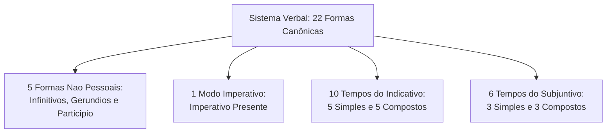
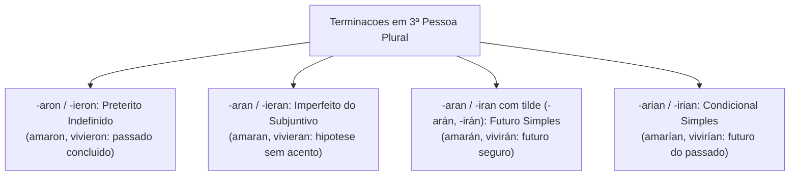
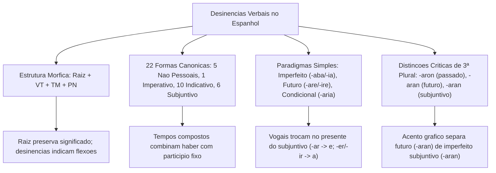

Uma forma verbal espanhola combina uma base lexical com terminações flexivas. Identificar essas partes ajuda a reconhecer conjugação, pessoa, número, tempo, aspecto e modo, inclusive ao traduzir.

Em concursos, a banca examinadora explora frequentemente a identificação de tempos verbais por meio de suas desinências flexivas. O candidato precisa decompor o vocábulo com precisão para distinguir se a terminação assinala um fato pretérito, uma projeção futura ou uma hipótese condicional.

Neste capítulo, estudaremos a estrutura mórfica do verbo, o quadro das 22 formas verbais do castelhano, os padrões de desinências dos tempos simples e as regras práticas de tradução livre e análise contrastiva.

> [!objetivos]
> - Decompor formas verbais em raiz, vogal temática e desinências modo-temporais e número-pessoais.
> - Compreender a organização do sistema verbal castelhano em suas vinte e duas formas canônicas.
> - Dominar as desinências dos tempos simples regulares do modo indicativo e do subjuntivo.
> - Distinguir grafias semelhantes na terceira pessoa do plural, evitando armadilhas de acentuação.

---

## Morfologia Estrutural: Raiz, Vogal Temática e Desinências

A análise estrutural de um verbo regular revela que cada vocábulo é constituído pela junção ordenada de morfemas. A sequência analítica padrão obedece à seguinte cadeia: **Raiz + Vogal Temática (VT) + Desinência de Tempo e Modo (TM) + Desinência de Número e Pessoa (PN)**.

- **Raiz (Radical Lexical)**: concentra o significado semântico primário da palavra. Para identificá-la em um verbo regular, basta retirar a terminação do infinitivo (*-ar*, *-er* ou *-ir*). Exemplos: *am-ar* (raiz *am-*); *beb-er* (raiz *beb-*); *part-ir* (raiz *part-*).
- **Vogal Temática**: conecta a raiz às desinências posteriores e indica a qual das três conjugações o verbo pertence. A vogal *a* identifica a primeira conjugação; a vogal *e*, a segunda conjugação; e a vogal *i*, a terceira conjugação.
- **Tema Verbal**: corresponde à união da raiz com a vogal temática (*ama-*, *bebe-*, *parti-*), preparando a base lexical para receber os sufixos flexivos.
- **Desinências Flexivas**: são os afixos terminais que expressam as categorias gramaticais de tempo, aspecto, modo, número e pessoa. Em muitas formas temporais do espanhol, os morfemas de tempo/modo e número/pessoa encontram-se fundidos em uma única terminação indissociável (amálgama mórfico).

```mermaid Estrutura Morfica do Verbo Regular Espanhol
flowchart LR
    R["Raiz Lexical:<br>cant-"] + VT["Vogal Tematica:<br>-a-"] + TM["Tempo e Modo:<br>-ba-"] + PN["Pessoa e Numero:<br>-mos"] --> F["cantabamos"]
```

> [!bizu]
> Nem sempre todos os quatro elementos mórficos aparecem separados de maneira visível. Na forma *canto*, a terminação *-o* acumula simultaneamente o papel de desinência de primeira pessoa do singular e de presente do indicativo, absorvendo a vogal temática.

> [!exemplo]
> Na forma verbal *amábamos*, a segmentação analítica revela: *am-* (raiz que expressa o sentimento de amar), *-a-* (vogal temática da 1ª conjugação), *-ba-* (desinência de tempo pretérito imperfeito do modo indicativo) e *-mos* (desinência de 1ª pessoa do plural). O acento na vogal temática assinala a proparoxítona.

---

## O Quadro das Vinte e Duas Formas do Sistema Verbal Espanhol

A gramática descritiva da língua espanhola estrutura o sistema verbal em um conjunto canônico de **vinte e duas formas**, agrupadas conforme a presença de flexão pessoal e o modo de enunciação:

1. **Formas Não Pessoais (5 formas)**:
   - Infinitivo simples (*amar*) e Infinitivo composto (*haber amado*).
   - Gerúndio simples (*amando*) e Gerúndio composto (*habiendo amado*).
   - Particípio (*amado*).
2. **Modo Imperativo (1 forma)**:
   - Imperativo presente (*ama tú*, *amad vosotros*).
3. **Modo Indicativo (10 tempos)**:
   - Cinco tempos simples: Presente (*amo*), Pretérito Imperfeito (*amaba*), Pretérito Perfeito Simples ou Indefinido (*amé*), Futuro Simples (*amaré*) e Condicional Simples (*amaría*).
   - Cinco tempos compostos: Pretérito Perfeito Composto (*he amado*), Pretérito Mais-que-Perfeito (*había amado*), Pretérito Anterior (*hube amado*), Futuro Composto (*habré amado*) e Condicional Composto (*habría amado*).
4. **Modo Subjuntivo (6 tempos)**:
   - Três tempos simples: Presente (*ame*), Pretérito Imperfeito (*amara / amase*) e Futuro Simples (*amare*).
   - Três tempos compostos: Pretérito Perfeito Composto (*haya amado*), Pretérito Mais-que-Perfeito (*hubiera / hubiese amado*) e Futuro Composto (*hubiere amado*).



---

## Desinências dos Tempos Simples Regulares

O domínio dos paradigmas de conjugação regular apoia-se no conhecimento sistemático das terminações dos verbos modelos da primeira (*amar*), segunda (*beber*) e terceira (*partir*) conjugações.

| Tempo Verbal do Modo Indicativo | Primeira Conjugação (-ar) | Segunda Conjugação (-er) | Terceira Conjugação (-ir) |
|---|---|---|---|
| Presente | -o, -as, -a, -amos, -áis, -an | -o, -es, -e, -emos, -éis, -en | -o, -es, -e, -imos, -ís, -en |
| Pretérito Imperfeito | -aba, -abas, -aba, -ábamos, -abais, -aban | -ía, -ías, -ía, -íamos, -íais, -ían | -ía, -ías, -ía, -íamos, -íais, -ían |
| Pretérito Indefinido | -é, -aste, -ó, -amos, -asteis, -aron | -í, -iste, -ió, -imos, -isteis, -ieron | -í, -iste, -ió, -imos, -isteis, -ieron |
| Futuro Simples | -aré, -arás, -ará, -aremos, -aréis, -arán | -eré, -erás, -erá, -eremos, -eréis, -erán | -iré, -irás, -irá, -iremos, -iréis, -irán |
| Condicional Simples | -aría, -arías, -aría, -aríamos, -aríais, -arían | -ería, -erías, -ería, -eríamos, -eríais, -erían | -iría, -irías, -iría, -iríamos, -iríais, -irían |

No pretérito imperfeito do indicativo, a primeira conjugação adota obrigatoriamente a consoante bilabial **b** (*-aba*), enquanto a segunda e terceira conjugações utilizam a terminação vocálica acentuada **-ía** (*bebía*, *partía*).

No futuro simples e no condicional simples, as desinências ligam-se ao infinitivo completo sem perda de letras (*amar-é*, *beber-ía*). Todas as pessoas do futuro simples recebem acento gráfico, exceto a primeira pessoa do plural (*amaremos*).

No modo subjuntivo, os tempos simples organizam-se segundo as seguintes terminações:

| Tempo Verbal do Modo Subjuntivo | Primeira Conjugação (-ar) | Segunda e Terceira Conjugações (-er / -ir) |
|---|---|---|
| Presente do Subjuntivo | -e, -es, -e, -emos, -éis, -en | -a, -as, -a, -amos, -áis, -an |
| Imperfeito (Série em -ra) | -ara, -aras, -ara, -áramos, -arais, -aran | -iera, -ieras, -iera, -iéramos, -ierais, -ieran |
| Imperfeito (Série em -se) | -ase, -ases, -ase, -ásemos, -aseis, -asen | -iese, -ieses, -iese, -iésemos, -ieseis, -iesen |
| Futuro Simples (Arcaico) | -are, -ares, -are, -áremos, -areis, -aren | -iere, -ieres, -iere, -iéremos, -iereis, -ieren |

> [!atencao]
> No presente do subjuntivo, as vogais temáticas invertem-se: verbos em *-ar* flexionam com a vogal **e** (*ame, hable*), enquanto verbos em *-er* e *-ir* flexionam com a vogal **a** (*beba, parta*). A confusão entre indicativo e subjuntivo é uma armadilha frequente em questões de múltipla escolha.

---

## Distinções Morfofonéticas Críticas em Concursos

A semelhança gráfica entre terminações verbais no espanhol gera frequentes erros de interpretação em candidatos desatentos. Na terceira pessoa do plural, a presença de acento diacrítico e a variação vocálica determinam tempos e modos completamente distintos:



Observe com extremo rigor:
- **-aron / -ieron**: marca o pretérito indefinido (passado perfeito). Indica ação totalmente concluída (*los bomberos rescataron a las víctimas*).
- **-arán / -erán / -irán**: marca o futuro simples do indicativo com acento agudo (*tilde*) na vogal final (*los bomberos rescatarán a las víctimas*).
- **-aran / -ieran**: marca o pretérito imperfeito do subjuntivo sem acento na terminação (*si rescataran a las víctimas*). A presença ou ausência da tilde separa o futuro do indicativo do passado do subjuntivo.
- **-arían / -erían / -irían**: marca o condicional simples com acento na letra *i* (*rescatarían a las víctimas*).
- **-ó (com tilde)**: marca a terceira pessoa do singular do pretérito indefinido (*él habló*, *ella partió*). Não confundir com a terminação *-o* átona da primeira pessoa do presente (*yo hablo*).
- **-d**: identifica com exclusividade o imperativo afirmativo plural de *vosotros* (*hablad*, *bebed*, *partid*).

> [!pegadinha]
> A terminação *-ía* é polissêmica na morfologia verbal: em verbos da 2ª e 3ª conjugações, ela pode indicar o pretérito imperfeito do indicativo (*él comía*, *ella vivía*); em contrapartida, quando agregada ao infinitivo completo de qualquer verbo, indica o condicional simples (*él comería*, *ella viviría*, *nosotros hablaríamos*). É preciso analisar se a desinência une-se à raiz ou ao infinitivo.

---

## Desinências Verbais e Tradução Livre para o Português

A comparação contrastiva entre as desinências do espanhol e do português é uma ferramenta indispensável para a tradução rápida e precisa de textos de concursos.

A tabela abaixo sintetiza as equivalências discursivas mais relevantes para a prova:

| Forma Verbal no Espanhol | Desinência em Castelhano | Equivalência Gramatical | Tradução Livre em Português |
|---|---|---|---|
| *Cantaba* | -aba (1ª conjugação) | Pretérito Imperfeito Indicativo | Cantava (com 'v' em português) |
| *Comía* | -ía (2ª conjugação) | Pretérito Imperfeito Indicativo | Comia |
| *Canté* | -é (1ª conjugação) | Pretérito Indefinido (1ª singular) | Cantei |
| *Cantó* | -ó (com tilde) | Pretérito Indefinido (3ª singular) | Cantou |
| *Cantaré* | -aré (sobre infinitivo) | Futuro do Presente | Cantarei |
| *Cantaría* | -aría (sobre infinitivo) | Condicional / Futuro do Pretérito | Cantaria |
| *Cante* | -e (inversão vocálica) | Presente do Subjuntivo | Cante (que ele cante) |
| *Cantara / Cantase* | -ara / -ase | Pretérito Imperfeito Subjuntivo | Cantasse |
| *Ha cantado* | *ha* + particípio fixo | Pretérito Perfeito Composto | Tem cantado / cantou (recentemente) |
| *Había cantado* | *había* + particípio fixo | Pretérito Mais-que-Perfeito | Havia cantado / cantara |

---

## Questões Comentadas

### Questão 1 (Adaptada)
No fragmento "Las autoridades **anunciaron** que los contingentes **arribarán** mañana a la región afectada", as formas verbais destacadas expressam, respectivamente:
A) Ação habitual no passado e hipótese condicional de salvamento.
B) Fato passado pontual e concluído e ação futura em relação ao momento da fala.
C) Ordem imperativa direta e condição subordinada no modo subjuntivo.
D) Ação passada imperfeita e pretérito mais-que-perfeito composto.
E) Processo verbal simultâneo e ação continuada em desenvolvimento.

**Gabarito: B**

**Comentário detalhado:**
A forma *anunciaron* traz a desinência *-aron*, característica indiscutível da 3ª pessoa do plural do pretérito perfeito simples (indefinido), expressando um fato concluído no passado. A forma *arribarán* contém a desinência *-án* com acento gráfico agregada ao infinitivo, caracterizando a 3ª pessoa do plural do futuro simples do indicativo, referindo-se a um evento que ocorrerá após a fala ("mañana"). Logo, a alternativa B é a única correta.

---

### Questão 2 (Adaptada)
A terminação verbal com acento agudo **-ó** (como em *habló*, *decidió*, *rescató*) indica invariavelmente no castelhano:
A) Primeira pessoa do singular do presente do indicativo.
B) Segunda pessoa do singular do imperativo afirmativo.
C) Terceira pessoa do singular do pretérito perfeito simples (indefinido).
D) Primeira pessoa do plural do pretérito imperfeito do indicativo.
E) Terceira pessoa do plural do futuro do pretérito.

**Gabarito: C**

**Comentário detalhado:**
No sistema verbal espanhol, a desinência oxítona *-ó* identifica de forma categórica a terceira pessoa do singular (*él*, *ella*, *usted*) do pretérito perfeito simples do indicativo em verbos da 1ª conjugação (*habló*, *rescató*) e em formas irregulares acentuadas. A primeira pessoa do presente utiliza a terminação átona *-o* (*hablo*). Portanto, o gabarito correto é a alternativa C.

---

### Questão 3 (Inédita)
Em relação às desinências da terceira pessoa do plural na língua espanhola, assinale a opção correta:
A) As formas *cantaran* e *cantarían* expressam exatamente o mesmo tempo e modo verbal.
B) A desinência *-aron* expressa uma hipótese improvável situada no futuro do indicativo.
C) A forma *partirán* difere de *partieran* pelo fato de a primeira indicar futuro do indicativo e a segunda indicar pretérito imperfeito do subjuntivo.
D) A presença da tilde em *cantaréis* identifica a terceira pessoa do plural do modo imperativo.
E) Todas as formas verbais terminadas em *-ieron* correspondem ao gerúndio composto da língua espanhola.

**Gabarito: C**

**Comentário detalhado:**
A distinção morfológica entre *partirán* (futuro simples do indicativo, marcado pela desinência oxítona *-án*) e *partieran* (pretérito imperfeito do subjuntivo na série em *-ra*, sem acento gráfico) confirma a exatidão da alternativa C. A alternativa A erra porque *cantaran* é subjuntivo e *cantarían* é condicional; a B erra ao classificar *-aron* como futuro; a D erra na pessoa gramatical (*vosotros* e não 3ª do plural); e a E confunde o pretérito indefinido com gerúndio.

---

## Mapa do Capítulo



---

### Para fixar

- **Componentes morfológicos**: a palavra verbal decompõe-se em raiz lexical, vogal temática, desinência de tempo/modo e desinência de número/pessoa.
- **As 22 formas**: distribuem-se em cinco formas nominais não pessoais, um imperativo, dez tempos do indicativo e seis tempos do subjuntivo.
- **Pretérito imperfeito**: primeira conjugação adota a consoante *b* (*-aba*); segunda e terceira conjugações adotam *-ía*.
- **Futuro e condicional simples**: agregam desinências diretamente ao infinitivo completo sem perda de letras (*amaré*, *amaría*).
- **Subjuntivo presente**: inverte vogais temáticas (-ar flexiona em -e; -er e -ir flexionam em -a).
- **Passado da 3ª plural**: terminações *-aron* e *-ieron* caracterizam o pretérito perfeito simples (*rescataron*).
- **Futuro da 3ª plural**: terminações *-arán*, *-erán*, *-irán* com tilde indicam futuro simples do indicativo (*rescatarán*).
- **Subjuntivo da 3ª plural**: terminações *-aran* e *-ieran* sem acento assinalam o pretérito imperfeito do subjuntivo (*rescataran*).
- **Desinência *-ó***: marca a terceira pessoa do singular do pretérito perfeito simples do indicativo (*habló*).
- **Desinência *-d***: marca com exclusividade o imperativo afirmativo plural da segunda pessoa *vosotros* (*hablad*).
