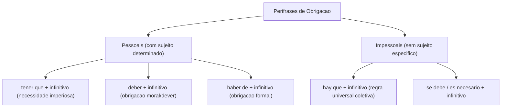
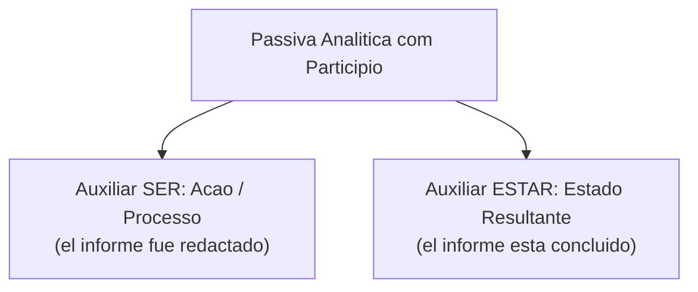
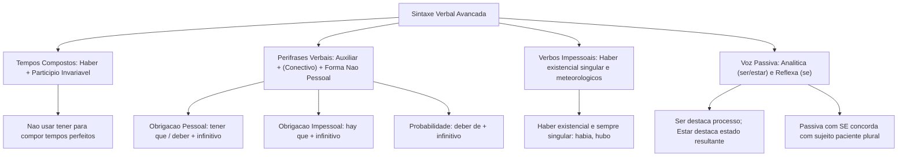

Construções com dois ou mais verbos permitem formar tempos compostos, perífrases e voz passiva. Em leitura, o auxiliar carrega marcas gramaticais importantes; o verbo principal conserva o conteúdo da ação.

Nos concursos, a compreensão dessas estruturas pluriverbais é determinante para interpretar normas administrativas, instruções de salvamento e relatórios de ocorrências. Identificar se uma locução expressa dever moral, obrigação impessoal ou probabilidade orienta a resolução correta dos enunciados.

Neste capítulo de encerramento do volume, estudaremos a formação dos tempos compostos com o verbo *haber*, as regras de tradução discursiva, a tipologia das perífrases verbais, o comportamento dos verbos impessoais e as duas modalidades de voz passiva no castelhano.

> [!objetivos]
> - Compreender a estrutura morfossintática e as regras de tradução dos tempos compostos.
> - Diferenciar as perífrases de obrigação pessoal das construções de necessidade impessoal.
> - Distinguir o valor de probabilidade de *deber de + infinitivo* do dever moral expresso por *deber*.
> - Reconhecer as particularidades da voz passiva analítica com *ser* e *estar* e da passiva reflexa com *se*.

---

## Verbos Compostos e Diretrizes de Tradução

Um tempo verbal composto no castelhano resulta da união indissociável de dois elementos: o verbo auxiliar **haber** devidamente conjugado e o particípio do verbo principal.

A regra fundamental que rege essa estrutura determina que o verbo auxiliar *haber* assume a flexão de pessoa, número, tempo e modo, enquanto o particípio permanece rigorosamente **invariável no masculino singular** (*-ado* ou *-ido*):
- *He amado* (Presente de *haber* + particípio).
- *Habíamos salido* (Pretérito imperfeito de *haber* + particípio).
- *Habrán concluido* (Futuro simples de *haber* + particípio).
- *Habrían evacuado* (Condicional simples de *haber* + particípio).

O sistema contempla tempos compostos no modo indicativo, no modo subjuntivo e nas formas não pessoais: o **infinitivo composto** (*haber estudiado*) e o **gerúndio composto** (*habiendo estudiado*), que indicam ações concluídas antes de um marco de referência.

```mermaid Estrutura dos Tempos Compostos no Espanhol
flowchart LR
    A["Auxiliar Haber Conjugado<br>(pessoa, numero, tempo, modo)"] + B["Participio Invariavel<br>(conteudo lexical fixo: -ado/-ido)"] --> C["Tempo Composto<br>(he vivido, habiamos salido)"]
```

### Como Traduzir os Verbos Compostos

A tradução de verbos compostos em provas de concurso não deve ficar presa à correspondência literal de etiquetas gramaticais. O objetivo principal do leitor é decodificar a relação temporal entre os fatos no texto:

- **Pretérito Perfeito Composto (*he amado*, *ha decidido*)**: traduz-se pelo pretérito perfeito do indicativo em português (*amei*, *decidiu*) ou pelo tempo composto com *ter* quando houver ideia de repetição recente (*tenho amado*). O essencial é compreender que a ação repercute no presente.
- **Pretérito Mais-que-Perfeito (*había amado*, *habían estudiado*)**: traduz-se perfeitamente pelo mais-que-perfeito composto do português (*havia amado*, *tinham estudado*), expressando fato passado anterior a outro evento pretérito.
- **Futuro Composto (*habré amado*, *habrán salido*)**: expressa que a ação estará finalizada antes de um prazo futuro (*para el viernes habrán concluido el informe* -> *terão concluído o relatório*).
- **Condicional Composto (*habría amado*, *habríamos evitado*)**: traduz-se pelo condicional composto do português (*teria amado*, *teríamos evitado*), expressando hipótese não consumada no passado.

> [!bizu]
> Na tradução livre para concursos, preserve o sentido contextual da anterioridade. O mais-que-perfeito *habían evacuado* pode traduzir-se por *haviam evacuado*, *tinham evacuado* ou pela forma simples arcaica *evacuaram*. Todas indicam anterioridade passada.

---

## Perífrases Verbais: Estrutura e Classificação Semântica

A **perífrase verbal** é uma estrutura sintática formada por dois ou mais verbos que funcionam como um único núcleo predicativo. Ela combina um verbo auxiliar conjugado, que perde parte de seu significado lexical para carregar valores modais ou aspectuais, com um verbo principal em forma não pessoal (infinitivo, gerúndio ou particípio), podendo haver ou não um conectivo intermediário (*preposição* ou *conjunção*).

A fórmula geral da perífrase organiza-se da seguinte forma: **Verbo Auxiliar Conjugado + (Preposição ou Conjunção) + Verbo Principal (Infinitivo / Gerúndio / Particípio)**. Exemplos: *tengo que estudiar*; *iba a llover*; *está patrullando*; *acabó por reconocer*.

```mermaid Estrutura Geral das Perifrases Verbais
flowchart LR
    AUX["Verbo Auxiliar Flexionado<br>(tengo, iba, esta)"] + CON["Conectivo Opcional<br>(que, a, de, por)"] + PRN["Forma Nao Pessoal<br>(infinitivo, gerundio, participio)"] --> PER["Unidade Perifrastica Integrada"]
```

### Perífrases de Obrigação e Necessidade: Pessoais e Impessoais

Uma das classificações mais cobradas pelas bancas examinadoras divide as perífrases de obrigação entre modalidades pessoais e impessoais:

1. **Perífrases de Obrigação Pessoal**: possuem sujeito gramatical determinado, recaindo a responsabilidade do ato sobre uma pessoa específica:
   - **Tener que + infinitivo**: expressa necessidade imperiosa, urgência ou determinação operacional (*tenemos que asegurar el perímetro*). É a forma mais frequente na linguagem corrente.
   - **Deber + infinitivo**: denota obrigação moral, dever funcional ou prescrição de normas regulamentares (*el militar debe cumplir la orden*).
   - **Haber de + infinitivo**: formula obrigação com tom formal, culto ou solene (*hemos de mantener la calma*).
   - **Necesitar + infinitivo**: aponta necessidade indispensável de recursos ou condutas (*necesitamos reforzar la guardia*).
2. **Perífrases de Obrigação Impessoal**: não possuem sujeito gramatical determinado, estabelecendo uma diretriz universal direcionada à coletividade:
   - **Hay que + infinitivo**: expressa necessidade geral e impessoal (*hay que evacuar el edificio inmediatamente*). Não admite sujeito explícito.
   - **Fórmulas equivalentes de necessidade impessoal**: *se debe + infinitivo* (*se debe proteger a los civiles*); *es necesario + infinitivo* (*es necesario aguardar instrucciones*); *es conveniente + infinitivo*; *es aconsejable + infinitivo*.



> [!pegadinha]
> Distinção clássica de concurso: **Deber + infinitivo** expressa obrigação categórica (*debes estudiar* = você tem a obrigação de estudar). Por outro lado, **Deber de + infinitivo** (com a preposição *de*) expressa probabilidade, suposição ou dúvida (*deben de ser las tres* = devem ser aproximadamente três horas). A simples inserção da preposição *de* altera radicalmente o sentido da oração.

### Perífrases Aspectuais

As perífrases aspectuais informam a fase de desenvolvimento da ação verbal:
- **Incoativas (início da ação)**: *empezar a + infinitivo* (*empezó a llover*); *comenzar a + infinitivo*; *ponerse a + infinitivo* (*se puso a trabajar*).
- **Durativas (ação em curso contínuo)**: *estar + gerúndio* (*el agente está investigando*); *seguir + gerúndio* (*siguen buscando a los desaparecidos*); *ir + gerúndio* (*vamos avanzando en la misión*).
- **Terminativas (conclusão da ação)**: *terminar de + infinitivo* (*terminó de redactar el informe*); *dejar de + infinitivo* (*dejó de fumar*); *acabar por + infinitivo* (*acabó por admitir su culpa*).

---

## Verbos Impessoais na Língua Espanhola

Os **verbos impessoais** caracterizam-se por não possuírem um sujeito gramatical ativo, sendo conjugados obrigatoriamente na terceira pessoa do singular.

Na língua espanhola, destacam-se três grupos principais de construções impessoais:
1. **Verbos que expressam fenômenos meteorológicos**: verbos como *llover* (chover), *nevar* (nevar), *tronar* (trovejar) e *amanecer* (amanhecer) são estritamente impessoais (*ayer llovió intensamente en la capital*).
2. **O Verbo *Haber* com sentido existencial**: quando empregado para indicar existência ou presença de seres e objetos, o verbo *haber* é impessoal e permanece invariavelmente na **terceira pessoa do singular**, mesmo quando o termo subsequente estiver no plural:
   - *Hay una víctima en el local.* (Singular).
   - *Hay varias víctimas en el local.* (E nunca *habían* ou *hubieron*).
   - *Había muchos manifestantes.* (E nunca *habían muchos manifestantes*).
   - *Hubo disturbios nocturnos.* (E nunca *hubieron disturbios*).
3. **Construções Impessoais com o Pronome *Se***: utiliza-se a partícula *se* acompanhada de verbo na 3ª pessoa do singular para generalizar a ação sem nomear o agente (*se vive con tranquilidad aquí*; *se busca a los responsables*).

> [!atencao]
> A concordância do verbo impessoal *haber* é uma das armadilhas mais repetidas em certames públicos. As formas *habían problemas* ou *hubieron accidentes* são erros gramaticais crassos em castelhano culto. O correto é *había problemas* e *hubo accidentes*, mantendo o verbo rigorosamente no singular.

---

## A Voz Passiva no Castelhano: Analítica e Reflexa

A língua espanhola contempla duas modalidades de voz passiva para colocar em evidência o paciente do processo verbal:

### A Passiva Analítica com *Ser* e *Estar*

A **voz passiva analítica** estrutura-se pela clássica fórmula: **Sujeito Paciente + Verbo Auxiliar (*ser* ou *estar*) + Particípio Concordante (+ Agente da Passiva com *por*)**.

O particípio concorda obrigatoriamente em gênero e número com o sujeito paciente. A escolha do verbo auxiliar define a perspectiva semântica do enunciado:
- **Passiva de Ação ou Processo com *Ser***: focaliza o processo dinâmico realizado pelo agente (*el herido fue conducido al hospital por la ambulancia*; *el acuerdo es firmado*). Na voz ativa correspondente, o sujeito pratica a ação: *la ambulancia conduce al herido*.
- **Passiva de Estado com *Estar***: focaliza o estado final resultante da ação concluída (*el herido está atendido en el hospital*; *la puerta está cerrada*).

> [!exemplo]
> Observe o contraste clássico entre processo e estado na voz passiva:
> - *El herido fue conducido al hospital.* (Processo dinâmico de condução executado pelo socorro).
> - *El herido está ingresado en el hospital.* (Estado resultante da internação médica).



### A Passiva Reflexa (Passiva com *Se*)

A **voz passiva reflexa** é a modalidade passiva mais comum e natural da língua espanhola, superando amplamente o emprego da passiva analítica na comunicação cotidiana e jornalística.

Constrói-se com a partícula **se** associada a um verbo transitivo direto na terceira pessoa do singular ou do plural, concordando obrigatoriamente com o sujeito paciente:
- *Se firmó el acuerdo de paz.* (Sujeito paciente no singular -> verbo no singular).
- *Se firmaron los acuerdos de paz.* (Sujeito paciente no plural -> verbo no plural).
- *Se construyeron nuevos refugios.* (Sujeito plural -> verbo *construyeron*).

Na passiva reflexa, o agente da passiva não costuma ser mencionado, conferindo neutralidade e impessoalidade formal ao texto.

| Estrutura Verbal | Fórmula Morfossintática | Exemplo Típico | Efeito Semântico |
|---|---|---|---|
| Passiva Analítica (*Ser*) | Sujeito + *ser* + particípio | *La ley fue promulgada ayer.* | Destaca a ação e o processo histórico |
| Passiva de Estado (*Estar*) | Sujeito + *estar* + particípio | *El informe está concluido.* | Destaca a condição e o resultado final |
| Passiva Reflexa (*Se*) | *Se* + verbo 3ª pessoa + sujeito | *Se aprobaron las directivas.* | Impessoalidade; foco no sujeito paciente |
| Tempo Composto | *Haber* + particípio invariável | *Hemos verificado los datos.* | Anterioridade temporal ligada à fala |
| Perífrase de Obrigação | *Tener que / Hay que* + infinitivo | *Hay que mantener el orden.* | Comando de conduta pessoal ou impessoal |

---

## Questões Comentadas

### Questão 1 (Adaptada)
No enunciado "Para garantizar la seguridad de la población, **hay que implementar** medidas de contingencia", a locução verbal em destaque classifica-se como:
A) Tempo composto do indicativo, indicando ação passada ligada ao presente.
B) Perífrase verbal de obrigação com valor estritamente impessoal.
C) Perífrase aspectual incoativa, indicando início iminente de um processo.
D) Voz passiva analítica de estado com o particípio concordante.
E) Modo imperativo negativo, direcionado à segunda pessoa do plural.

**Gabarito: B**

**Comentário detalhado:**
A estrutura *hay que implementar* é constituída pela forma impessoal do verbo *haber* (*hay*) seguida da conjunção *que* e do infinitivo *implementar*. Trata-se de uma perífrase verbal modal de necessidade e obrigação impessoal pois enuncia um dever geral aplicável à coletividade sem determinar um sujeito agente específico. Logo, a alternativa B é a única correta.

---

### Questão 2 (Adaptada)
Assinale a alternativa que apresenta oração redigida na voz passiva reflexa com concordância gramatical correta:
A) Se rescataron a todos los sobrevivientes durante el temporal.
B) Se publicaron las nuevas directivas de seguridad en el boletín.
C) Habían muchos bomberos trabajando en el rescate de las víctimas.
D) Hubieron grandes dificultades operativas en la contención del incendio.
E) Los soldados fueron alertando a los vecinos sobre el desastre.

**Gabarito: B**

**Comentário detalhado:**
A voz passiva reflexa constrói-se com a partícula *se* e verbo transitivo direto concordando com o sujeito paciente. Na alternativa B, o sujeito paciente é "las nuevas directivas de seguridad" (substantivo no plural), exigindo a flexão do verbo no plural (*se publicaron*), o que torna a frase irrepreensível. A alternativa A erra na regência de objeto pessoal preposicionado com passiva reflexa; as alternativas C e D erram grosseiramente ao pluralizar o verbo impessoal *haber*; e a E traz perífrase durativa.

---

### Questão 3 (Inédita)
Examine as seguintes orações:
1. *El oficial debe presentarse ante el tribunal.*
2. *El oficial debe de estar en su oficina ahora.*

A respeito das locuções verbais sublinhadas, assinale a opção correta:
A) Ambas expressam exatamente a mesma noção semântica de obrigação militar.
B) A oração 1 expressa obrigação moral ou dever, enquanto a oração 2 expressa suposição ou probabilidade.
C) A presença da preposição *de* na oração 2 torna a construção gramaticalmente incorreta em castelhano.
D) A oração 1 expressa uma ação já concluída no passado, enquanto a 2 expressa futuro perfeito.
E) Trata-se de construções reflexivas em que o pronome *se* atua como objeto direto.

**Gabarito: B**

**Comentário detalhado:**
A distinção semântica entre as perífrases modais com o verbo *deber* é clássica: *deber + infinitivo* (oração 1) veicula obrigação categórica ou dever normativo funcional. Já a estrutura *deber de + infinitivo* (oração 2), com a presença da preposição *de*, exprime probabilidade, conjectura ou suposição lógica de que o oficial provavelmente se encontra em seu gabinete, validando com exatidão a opção B.

---

## Mapa do Capítulo



---

### Para fixar

- **Estrutura dos tempos compostos**: formam-se exclusivamente com *haber* conjugado acompanhado de particípio invariável (*he vivido*).
- **Invariabilidade do particípio composto**: nos tempos compostos, o particípio permanece no masculino singular independentemente do sujeito.
- **Conceito de perífrase verbal**: conjunto de verbos que atua como unidade funcional, unindo auxiliar flexionado a infinitivo, gerúndio ou particípio.
- **Obrigação pessoal**: *tener que*, *deber* e *haber de* exigem sujeito determinado (*tenemos que salir*).
- **Obrigação impessoal**: *hay que* e *es necesario* prescrevem necessidades coletivas sem sujeito explícito (*hay que ayudar*).
- **Diferença entre *deber* e *deber de***: *deber* indica obrigação; *deber de* expressa suposição e probabilidade.
- **Impossibilidade de pluralizar *haber* existencial**: formas como *habían personas* ou *hubieron casos* são erros; use sempre *había* e *hubo*.
- **Passiva analítica com *ser***: expressa o processo da ação e flexiona particípio concordante (*el acuerdo fue firmado*).
- **Passiva de estado com *estar***: enfatiza o resultado concluído da ação (*el acuerdo está firmado*).
- **Passiva reflexa com *se***: antepõe a partícula *se* ao verbo concordando obrigatoriamente com o sujeito paciente (*se aprobaron las leyes*).
