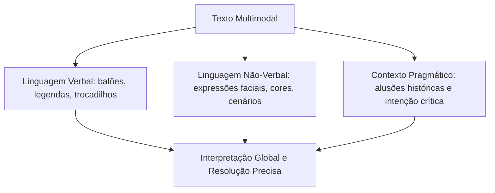

A interpretação de textos híbridos que combinam linguagem verbal e elementos visuais é um dos temas mais frequentes nas provas de concurso. As bancas utilizam charges, tirinhas e infográficos para avaliar a competência leitora em níveis sofisticados de inferência e pragmática. O candidato deve articular a leitura de imagens com o texto escrito para captar nuances de ironia e crítica social.

> [!objetivos]
> - Decodificar a interação entre elementos verbais e não-verbais em tirinhas, charges e infográficos.
> - Compreender o papel dos fatores pragmáticos, da intencionalidade do autor e do contexto sócio-histórico.
> - Identificar recursos de humor, trocadilhos (*puns*), ironia e polissemia em textos sincréticos.
> - Aplicar técnicas de leitura para resolver questões que envolvem linguagem mista em certames públicos.

## A Dinâmica da Linguagem Não-Verbal e Multimodal

Os textos multimodais articulam dois ou mais sistemas de signos para construir sentido. Em provas de língua inglesa, a linguagem não-verbal não atua como mera ilustração decorativa. Ela desempenha papel semântico ativo, confirmando, contradizendo ou ampliando aquilo que o texto escrito expressa.

Nas charges editoriais (*political cartoons*) e tirinhas cômicas (*comic strips*), a postura corporal dos personagens, a expressão facial, os símbolos visuais e o tamanho das fontes são pistas indispensáveis. Se o candidato ler apenas os balões de fala sem observar o cenário ou os gestos dos interlocutores, cometerá erros graves de interpretação.

O leitor militar deve observar a relação de complementaridade entre a imagem e a palavra. Em situações de perigo ou crítica política, a ironia nasce justamente do contraste evidente entre o discurso formal de um personagem e a realidade caótica desenhada ao seu redor.

| Gênero Multimodal | Elementos Visuais Chave | Propósito Comunicativo Central | Desafio Interpretativo Típico |
|---|---|---|---|
| **Tirinha (Comic Strip)** | Expressões faciais, balões de fala, requadros | Narrativa sequencial, reflexão ou humor cotidiano | Captar o duplo sentido (*pun*) no último requadro |
| **Charge (Cartoon)** | Caricatura, símbolos universais, metáforas visuais | Crítica pontual a evento político ou social recente | Identificar a ironia e a posição ideológica do autor |
| **Infográfico** | Gráficos, mapas, setas, ícones quantitativos | Síntese de dados estatísticos e técnicos complexos | Cruzar dados numéricos com as legendas explicativas |
| **Placa de Sinalização** | Cores normativas, pictogramas internacionais | Orientação rápida e imperativa de conduta e segurança | Compreender advertências imediatas em emergências |

## Fatores Pragmáticos na Interpretação: Contexto, Ironia e Duplo Sentido

A pragmática é o ramo da linguística que estuda o uso efetivo da linguagem em contextos reais de comunicação. Enquanto a semântica analisa o significado literal das palavras, a pragmática investiga o que o emissor realmente pretendeu dizer (*speaker meaning*) em determinada circunstância.

Três fatores pragmáticos norteiam a interpretação em provas de concurso:

1. **Contexto Sócio-Histórico**: O conhecimento de acontecimentos mundiais recentes, conflitos armados, catástrofes climáticas e inovações tecnológicas permite compreender a quem ou a que o autor faz alusão.
2. **Ironia e Sarcasmo**: A ironia ocorre quando a linguagem verbal afirma exatamente o oposto daquilo que a situação visual revela. O candidato deve desconfiar de afirmações literais quando a imagem sugerir fracasso, hipocrisia ou absurdo.
3. **Trocadilhos (*Puns*) e Polissemia**: O idioma inglês é rico em palavras polissêmicas e homófonas. Autores utilizam o duplo sentido para gerar impacto cômico ou retórico. Compreender os dois sentidos simultâneos do vocábulo desvenda a mensagem central da questão.

> [!atencao]
> Ao analisar tirinhas com personagens clássicos como Calvin & Hobbes ou Garfield, atente para a quebra de expectativa no último quadro. O humor reside na ruptura lógica do diálogo. Jamais escolha alternativas que interpretem a piada de forma puramente literal.

> [!pegadinha]
> Em infográficos e charges sobre segurança e meio ambiente, o termo *critical* pode significar "fundamental / decisivo" ou "em estado de risco grave". Analise as cores do gráfico e a legenda visual antes de assinalar a resposta.

## Exercícios e Análise de Casos Multimodais

Examinemos três casos representativos de charges e infográficos explorados em provas de concurso:

Primeiramente, considere um infográfico sobre mudanças climáticas e impacto na produção de alimentos (*food security*). O infográfico mostra que secas severas e inundações devastadoras (*floods*) afetam mais de 70% dos pequenos agricultores (*farmers*). A imagem combina gráficos de barras com ícones de plantações secas e campos inundados. O candidato deve cruzar o número 70 com a legenda para responder qual setor econômico sofreu maior impacto.

Em segundo lugar, analise uma tirinha humorística que constrói uma paródia de peças clássicas do dramaturgo William Shakespeare. O personagem usa óculos escuros (sunglasses) e anéis (rings), enquanto um palestrante profere paráfrases solenes sobre a existência humana. A estilização visual das figuras e a expressão triste do animal tornam evidente o tom cômico, tornando impossível considerar errado o sentido satírico pretendido pelo cartunista.

Em terceiro lugar, examine uma charge sobre a indústria cosmética testando produtos (*testing on animals*). O desenho retrata animais de laboratório em gaiolas diante de frascos químicos, satirizando o discurso corporativo de sustentabilidade. O leitor decodifica a crítica social direcionada aos testes cruéis em animais.

| Caso Pragmático Analisado | Imagem e Elemento Visual | Texto Verbal Associado | Sentido Crítico Revelado |
|---|---|---|---|
| **Infográfico Climático** | Gráfico de 70%, campos com inundações (*floods*) | Farmers facing extreme droughts and floods | Impacto das secas na produção de alimentos |
| **Paródia Literária** | Personagem de óculos e gato com ar triste | Citações solenes de peças de Shakespeare | Paródia irônica de tragédias clássicas |
| **Testes em Animais** | Laboratório de cosméticos e animais enjaulados | Product safety testing for beauty standards | Denúncia contra a exploração de cobaias |

## Exercício Resolvido

A resolução de questões multimodais consolida a capacidade analítica do estudante.

> [!resolvido]
> **(Adaptada)**
> In an infographic regarding global climate challenges, the headline reads: *"Over 70% of family farmers face severe crop losses due to alternating droughts and floods."*. Beneath the title, a visual chart depicts submerged tractors alongside parched, cracked soil.
> The primary purpose of combining these visual elements with the numerical data is to:
> 
> A) demonstrate that industrial agriculture has completely eliminated environmental risks.
> B) highlight the vulnerability of small food producers to extreme weather phenomena.
> C) criticize farmers for failing to modernize their irrigation equipment.
> D) suggest that droughts are far more destructive to the economy than massive floods.
> E) prove that international food production will double in the upcoming decade.
> 
> **Resolução passo a passo:**
> 1. Analisemos os dados verbais: o título informa que mais de 70% dos agricultores familiares (*farmers*) sofrem perdas severas de safras devido a secas e inundações (*droughts and floods*).
> 2. Analisemos os dados não-verbais: a imagem contrapõe tratores submersos pela água de inundações a solos áridos e rachados pela seca.
> 3. Síntese pragmática: O infográfico evidencia a vulnerabilidade extrema dos produtores rurais de alimentos frente aos eventos climáticos extremos.
> 4. Conclusão: A alternativa B traduz com exatidão esse propósito (*highlight the vulnerability of small food producers to extreme weather phenomena*).
> 
> **Gabarito definitivo: Alternativa B.**

## Mapa do capítulo

| Elemento de Análise | Papel na Compreensão Textual | Técnica de Leitura Recomendada |
|---|---|---|
| **Linguagem Mista** | Integração entre palavras e imagens | Cruzar o conteúdo dos balões com as expressões faciais |
| **Pragmática** | Interpretação do sentido pretendido no contexto | Considerar o interlocutor, a intenção e o cenário social |
| **Ironia e Paródia** | Afirmação verbal contrária à evidência visual | Desconfiar de interpretações puramente literais |
| **Trocadilhos (*Puns*)** | Duplo sentido explorado para efeito cômico | Identificar os dois significados possíveis da palavra |
| **Infográficos** | Exibição visual de estatísticas e dados técnicos | Analisar títulos, eixos de gráficos e notas de rodapé |

### Para fixar

- Em textos multimodais, a imagem não é mero enfeite: ela complementa ou contradiz o texto escrito.
- A pragmática investiga o sentido intencional do autor a partir das circunstâncias sociais do enunciado.
- Em tirinhas e charges, a ironia decorre do contraste entre o que é dito e o que é ilustrado.
- O último quadro de uma tirinha frequentemente concentra a quebra de expectativa lógica (*punchline*).
- Expressões faciais e gestos corporais são índices semânticos obrigatórios para decodificar o humor.
- Trocadilhos (*puns*) utilizam a polissemia de palavras para criar duplo sentido proposital.
- Em infográficos, a leitura precisa articular dados numéricos com as legendas explicativas da ilustração.
- Paródias de textos clássicos exigem reconhecer a referência original para captar a sátira pretendida.
