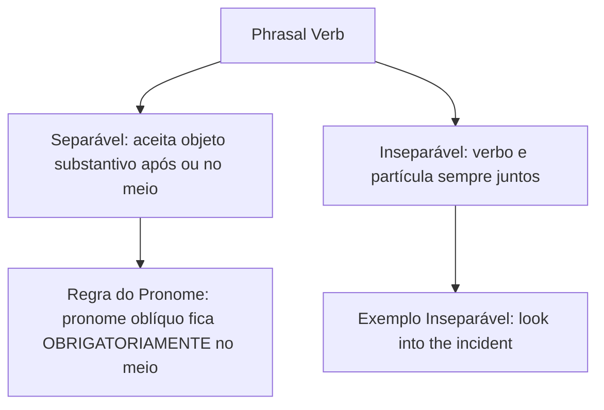

Os verbos frasais (*phrasal verbs*) e os verbos *TO BE* e *TO DO* são estruturas basilares da língua inglesa. Nas provas, esses tópicos aparecem tanto em questões gramaticais quanto na interpretação de textos operacionais. A união de um verbo com partículas preposicionais altera o significado literal, exigindo atenção do candidato.

> [!objetivos]
> - Compreender a estrutura morfológica e o valor idiomático dos *phrasal verbs*.
> - Diferenciar verbos frasais separáveis (*separable*) e inseparáveis (*inseparable*).
> - Dominar a colocação pronominal obrigatória com pronomes oblíquos.
> - Analisar as funções sintáticas dos verbos estruturais *TO BE* e *TO DO*.

## Natureza e Classificação dos Verbos Frasais

Um *phrasal verb* é uma unidade semântica formada por um verbo de base associado a uma partícula adverbial ou preposicional. O significado do conjunto não resulta da soma dos termos literais isolados.

Por exemplo, *give* significa dar, mas **give up** traduz-se por desistir ou render-se. O verbo *put* significa colocar, mas **put out** significa extinguir chamas. No cotidiano e no meio militar, esses verbos expressam ações dinâmicas:
- *get away*: fugir, escapar (*the suspect tried to get away and escape*);
- *look forward to*: aguardar com grande expectativa (*look forward to the promotion*);
- *take off*: decolar, ou tirar uma peça de roupa como blusa (*blouse*), saia ou vestido;
- *fill in / fill out*: completar formulários e relatórios mantidos na pasta do destacamento;
- *wake up*: acordar cedo e levantar da cama sem demora;
- *break up / broke up*: encerrar um relacionamento que acabou ou desiludiu os parceiros;
- *take off*: tirar (tire) uma peça de roupa como vestido (dress) preto ou blue, saia ou blusa branca (white blouse); decidir a compra ou venda; sit down (sentar); levar as crianças (kids) ao cinema;
- *give back*: devolver um objeto ou deixar de volta na mesa do oficial;
- *blow up*: explodir um artefato tático ou destruir uma ponte;
- *put away*: guardar ou arrumar equipamentos após a exibição pública de viaturas.

| Phrasal Verb | Sentido Idiomático | Exemplo de Aplicação | Regra Sintática |
|---|---|---|---|
| **put out** | extinguir fogo, apagar | Firefighters worked hard to **put out** the flames. | Separável (*put it out*) |
| **call off** | cancelar evento | The chief **called off** the operation. | Separável (*call it off*) |
| **get away** | fugir, escapar (*escape*) | The thief tried to **get away** from police. | Intransitivo / Inseparável |
| **take off** | tirar blusa (*blouse*), decolar | He had to **take off** his wet uniform. | Separável (*take it off*) |
| **look into** | investigar, averiguar | Detectives will **look into** the causes to find out the truth. | Inseparável (*look into it*) |
| **fill in** | completar documento | Please **fill in** the form in this folder. | Separável (*fill it in*) |
| **look forward to**| aguardar com expectativa | We **look forward to** hearing the verdict. | Preposicionado inseparável |

> [!pegadinha]
> Com pronomes oblíquos (*it*, *them*, *him*), o pronome fica **obrigatoriamente entre o verbo e a partícula** em verbos separáveis:
> - Correto: *The fire was dangerous, but they **put it out**.*
> - Incorreto: *\*The fire was dangerous, but they put out it.*
> As bancas exploram essa colocação para induzir candidatos ao erro.

## Funções Estruturais dos Verbos TO BE e TO DO

Os verbos **TO BE** e **TO DO** exercem múltiplos papéis na sintaxe inglesa, atuando como verbos plenos ou auxiliares fundamentais.

O verbo **TO BE** atua como:
1. **Verbo de Ligação (*Linking Verb*)**: Expressa estado, qualidade ou localização (*the officer is ready*; *the troops are at the post*).
2. **Auxiliar Contínuo**: Forma tempos progressivos com gerúndio (*the squad was inspecting the area*).
3. **Auxiliar Passivo**: Estrutura a voz passiva com o particípio (*the victims were rescued*).

O verbo **TO DO** atua como:
1. **Verbo Principal**: Indica ação de fazer ou executar (*do your duty*).
2. **Operador Auxiliar**: Estrutura frases negativas e interrogativas no presente (*do/does*) e passado (*did*):
   - *Did the commander authorize the patrol?*
   - *They did not panic during the evacuation.*
3. **Auxiliar Enfático**: Reforça afirmações categóricas (*I do believe in justice* = eu realmente acredito).

| Verbo | Função Gramatical | Exemplo Operacional | Valor Sintático |
|---|---|---|---|
| **TO BE** | Ligação / Localização | The captain **is** in the room. | Indica estado ou posição física |
| **TO BE** | Auxiliar Progressivo | We **are monitoring** the radio. | Ação em andamento no tempo |
| **TO BE** | Auxiliar da Voz Passiva | The area **was secured** promptly. | Sujeito paciente da ação |
| **TO DO** | Verbo Principal de Ação | The team will **do** the job. | Executar tarefa determinada |
| **TO DO** | Operador Negativo/Pergunta | They **did not fail** the test. | Auxiliar de tempo verbal |
| **TO DO** | Operador de Ênfase | The squad **did complete** the task. | Reforço afirmativo categórico |

> [!bizu]
> O auxiliar *do/did* antes de outro verbo afirmativo (*she did warn them*) expressa ênfase ("ela realmente os avisou"), e não ação de fabricar ou fazer.

## Exercício Resolvido

A correta aplicação de verbos frasais consolida o aprendizado do candidato.

> [!resolvido]
> **(Adaptada)**
> In the sentence: *"The tactical squad had to _____ the rescue operation because the suspects managed to _____ across the border."*, the blanks are correctly filled by:
> 
> A) call off — get away
> B) put out — take off
> C) carry out — look forward to
> D) break out — fill in
> E) hold on — put away
> 
> **Resolução passo a passo:**
> 1. Na primeira lacuna, o sentido exige o verbo cancelar ou suspender (*had to call off the operation*).
> 2. Na segunda lacuna, o contexto expressa que os suspeitos conseguiram fugir ou escapar (*get away* / *escape*).
> 3. Conclusão: A alternativa que reúne os dois verbos adequados é a opção A.
> 
> **Gabarito definitivo: Alternativa A.**

## Mapa do capítulo

| Estrutura Verbal | Regra Sintática Central | Exemplo Correto | Ponto Crítico de Prova |
|---|---|---|---|
| **Phrasal Verbs** | Verbo + partícula com sentido novo | put out (extinguir) | Não traduzir termos isolados |
| **Pronome Objeto** | Pronome obrigatório no meio | put it out / take it off | Proibido pronome após partícula |
| **TO BE Auxiliar** | Forma tempos contínuos e voz passiva | was inspecting / was saved | Obrigatório na voz passiva |
| **TO DO Auxiliar** | Auxiliar de negações, perguntas e ênfase | did not go / I do know | Did exige verbo no infinitivo |

### Para fixar

- Os *phrasal verbs* combinam verbo e partícula, criando sentido idiomático próprio.
- *Put out* significa extinguir fogo, e *call off* traduz-se por cancelar.
- *Get away* significa fugir ou escapar (*escape*), sendo intransitivo.
- Com pronomes oblíquos (*it*, *them*), o pronome fica sempre no meio em verbos separáveis (*put it out*).
- O verbo *TO BE* atua como verbo de ligação, auxiliar de tempos contínuos e formador da passiva.
- O verbo *TO DO* funciona como auxiliar em perguntas e negações no presente e no passado.
- O uso de *do/did* afirmativo expressa reforço enfático categórico (*I do believe*).
- O domínio desses conectivos verbais assegura agilidade na leitura das provas.
