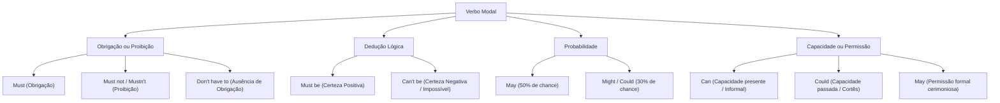

O estudo dos verbos auxiliares e modais constitui um dos temas de maior peso nos concursos. Os verbos modais qualificam a ação verbal. Eles expressam obrigação, dedução lógica, probabilidade, permissão, habilidade e conselho. Um modal não expressa um mero palpite sem base. Compreender as sutilezas entre esses operadores é essencial. Dominar verbos com uso semimodal (*semi-modal*) como *need* e *dare* garante pontos decisivos na prova. Quem se atreve a ignorar essas regras perde questões preciosas. Não me lembro de concurso que não cobre esse tema. Eu soube de candidatos que viriam a ser aprovados apenas dominando essa distinção.

> [!objetivos]
> - Compreender o papel sintático dos auxiliares primários (*did*, *have*, *be*) e da forma coloquial *ain't*.
> - Analisar as regras morfológicas universais dos verbos modais (*modal verbs*).
> - Diferenciar os valores semânticos de *must*, *mustn't*, *can't*, *may*, *might*, *could* e *should*.
> - Dominar a dupla natureza gramatical dos verbos semimodais *need* e *dare*.

## O Sistema dos Verbos Auxiliares Primários: Did, Have e a Forma Coloquial Ain't

Na morfossintaxe inglesa, os verbos auxiliares primários combinam-se com verbos principais. Eles formam tempos compostos, perguntas e sentenças negativas. Enquanto os verbos modais agregam atitude ou julgamento subjetivo, os auxiliares primários estabelecem relações temporais objetivas.

### O Auxiliar Did no Passado Simples

O operador **did** atua no passado simples (*Simple Past*). Sua função principal é viabilizar interrogações e negações. Ele é empregado com verbos regulares e irregulares, exceto o verbo *to be*.

No passado afirmativo, o verbo recebe a terminação regular ou usa forma irregular:
- *I danced all night.* (Eu dancei a noite inteira).
- *I phoned my neighbor yesterday.* (Eu liguei para meu vizinho ontem).

Nas perguntas e negações, o verbo principal volta para o infinitivo sem a partícula *to*:
- *Interrogação*: ***Did** the fire brigade arrive in time?* (A guarnição chegou a tempo?).
- *Interrogação coloquial*: ***Did** you call the neighbor?* (Você telefonou para o vizinho?).
- *Negação*: *The patrol **did not observe** any suspicious movement.* (A patrulha não observou movimento suspeito).
- *Negação enfática*: *I **did call** you, but you were away.* (Eu de fato liguei para você, demonstrando tom enfático).

O uso enfático de *did* em orações afirmativas serve para reforçar a veracidade da ação. O falante sublinha o fato contra uma dúvida prévia, demonstrando certeza absoluta.

> [!atencao]
> Quando o auxiliar *did* está presente, o verbo principal deve permanecer no infinitivo sem *to*. Construções como *\*did went* ou *\*did phoned* constituem erros gramaticais graves.

### O Auxiliar Have no Present Perfect e Past Perfect

O verbo **have** funciona como auxiliar na composição dos tempos perfeitos. Ele se combina com o particípio passado do verbo principal:
- *The rescue team **has inspected** the sector.* (A equipe inspecionou o setor).
- *He has left the key with the neighbor.* (Ele havia deixado a chave com o vizinho).
- *By midnight, they **had cleared** the road.* (À meia-noite, eles haviam liberado a via).

No tempo perfeito, a ação pode ter sido iniciada no passado e continuar no presente. Em outras frases, indica um fato passado com reflexo no momento atual.

### A Contração Coloquial Ain't

A forma **ain't** é uma contração popular típica da linguagem oral e informal. Na fala coloquial diária, ela substitui indiferentemente *am not*, *is not*, *are not*, *has not* e *have not*:
- *He **ain't** here.* (= *He is not here*).
- *They **ain't** got any food left.* (= *They have not got any food left* / Não sobrou comida).
- *I ain't going anywhere.* (= *I am not going anywhere*).

Embora muito comum na cultura popular, a forma *ain't* não pertence à norma culta padrão. Nas provas, ela aparece em textos literários ou tirinhas de humor. O examinador costuma cobrar o reconhecimento do seu caráter não padrão.

| Verbo Auxiliar | Função Sintática Primária | Exemplo Operacional | Registro Gramatical |
|---|---|---|---|
| **did** | Operador de passado (*Simple Past*) | Did the officers secure the perimeter? | Norma culta padrão |
| **have / has** | Formador do *Present Perfect* | The brigade has extinguished the fire. | Norma culta padrão |
| **had** | Formador do *Past Perfect* | They had completed the mission earlier. | Norma culta padrão |
| **ain't** | Contração informal múltipla | They ain't ready for deployment. | Linguagem coloquial / Não padrão |

## Características Morfológicas Universais dos Verbos Modais

Os verbos modais (*can*, *could*, *may*, *might*, *must*, *shall*, *should*, *will*, *would*, *ought to*) possuem comportamento singular. Eles não se conjugam como os verbos comuns da língua inglesa. Quatro regras morfológicas fundamentais orientam seu emprego:

1. **Invariabilidade na Terceira Pessoa**: Os modais não admitem *-s*, *-es* ou *-ies* no presente da terceira pessoa (*he must*, *she can*, *it may*).
2. **Infinitivo Sem TO**: São seguidos imediatamente por infinitivo sem *to* (*bare infinitive*). As exceções são *ought to* e a locução *have to*:
   - Correto: *The officer **must report** the incident.*
   - Incorreto: *\*The officer must to report the incident.*
3. **Ausência de Formas Nominais**: Verbos modais não têm particípio passado, gerúndio em *-ing* nem infinitivo pleno precedido de *to*.
4. **Auto-Suficiência em Perguntas e Negações**: Dispensam os operadores *do*, *does* e *did*. Formam a negação adicionando *not* ao modal (*cannot*, *must not*). Formam interrogações invertendo a ordem do sujeito com o modal (*Can I leave?*).

| Regra Universal dos Modais | Forma Correta no Espanhol/Inglês | Forma Proibida / Agamastical | Justificativa Gramatical |
|---|---|---|---|
| Ausência de -s na 3ª pessoa | She can operate the drone. | \*She cans operate the drone. | Modais são invariáveis na flexão de pessoa |
| Infinitivo sem TO | He should wear a helmet. | \*He should to wear a helmet. | Exigem verbo em *bare infinitive* |
| Auto-suficiência negativa | They must not enter the room. | \*They do not must enter. | Rejeitam o uso de auxiliares externos |
| Auto-suficiência interrogativa | Could you confirm the location? | \*Do you could confirm? | Inversão direta entre modal e sujeito |

## O Verbo Modal MUST: Obrigação versus Dedução Lógica Afirmativa

O verbo modal **must** possui dois sentidos primordiais nas provas de concurso:

### Must Expressando Obrigação ou Dever Inescapável

Nesse sentido, *must* expressa uma obrigação legal, dever moral ou regra institucional compulsória:
- *Firefighters **must wear** protective gear before entering the building.* (Bombeiros devem usar equipamento de proteção).
- *Soldiers **must follow** standard tactical procedures.* (Militares devem seguir procedimentos táticos).

A forma negativa contraída **mustn't** (ou *must not*) expressa proibição expressa. Ela não indica mera dispensa de ação:
- *You **mustn't smoke** near flammable materials.* (É terminantemente proibido fumar perto de materiais inflamáveis).
- *Civilians **must not cross** the security line.* (Os civis estão proibidos de ultrapassar a faixa de isolamento).

### Must Expressando Dedução Lógica ou Certeza Subjetiva

Neste segundo emprego, *must* manifesta uma conclusão lógica forte baseada em evidências claras:
- *The lights are on and music is playing; the neighbor **must be** home.* (As luzes estão acesas; o vizinho com certeza está em casa).
- *The officers worked sixteen hours without rest; they **must be** exhausted.* (Eles certamente estão exaustos).

Para deduções lógicas sobre eventos passados, recorre-se à estrutura modal perfeita (*must + have + particípio*):
- *The road was flooded; it **must have rained** heavily last night.* (Certamente choveu muito na noite passada).
- *Digamos que o veículo sumiu do pátio; alguém **must have taken** the car.* (Alguém com certeza levou o carro).

> [!pegadinha]
> A negação lógica de *must* **NÃO É** *must not* nem *mustn't*. Para expressar dedução lógica negativa ou impossibilidade absoluta, a língua inglesa exige o modal **can't** (ou *cannot*):
> - Dedução positiva: *The man **must be** the commander.* (Ele certamente é o comandante).
> - Dedução negativa: *The man **can't be** the commander; he is too young!* (Ele com certeza não é o comandante; é impossível!).
> O modal *mustn't* significa unicamente proibição categórica.

## Modais de Capacidade e Permissão: Can e Could

Os modais **can** e **could** apresentam grande frequência nos certames. Eles operam principalmente nos domínios da habilidade física, capacidade intelectual e pedidos de permissão.

### Capacidade e Habilidade Física ou Intelectual

O verbo **can** expressa capacidade ou habilidade no presente. Ele traduz a ideia de poder ou saber executar uma tarefa:
- *The rescue diver **can swim** in high-velocity ocean currents.* (O mergulhador consegue nadar em correntes fortes).
- *The lieutenant **can speak** three foreign languages fluentemente.* (O tenente sabe falar três línguas estrangeiras).

O verbo **could** funciona como a forma de pretérito ou condicional de *can*. Ele indica capacidade passada habitual:
- *In his youth, the veteran officer **could run** fifteen miles without resting.* (Podia correr quinze milhas).
- *She **could dance** like a professional before her knee injury.* (Ela sabia dançar como profissional antes da lesão).

Na forma negativa, **can't** denota incapacidade no tempo presente. A forma **couldn't** indica incapacidade no passado:
- *I **can't** lift this heavy beam alone; I need assistance.* (Não consigo levantar esta viga sozinho).
- *The team **couldn't** reach the summit due to dense fog.* (A equipe não conseguiu atingir o cume).

### Permissão e Formulação de Pedidos Educados

A solicitação e concessão de permissão envolve diferentes níveis de formalidade discursiva:
- **Can**: Expressa pedido informal entre conhecidos ou colegas de mesma hierarquia:
  - *Posso pedir um favor? — **Can** I ask you for a favor?*
  - *Can I borrow your helmet for a minute?* (Posso pegar seu capacete emprestado?).
- **Could**: Expressa pedido mais cortês, polido e educado em ambiente corporativo:
  - *Could you give me a ride to the police station?* (Você poderia me dar uma carona até a delegacia?).
  - *Could you please lend me your flashlight during the blackout?* (Poderia por favor me emprestar sua lanterna?).
- *Could you please give me a clue about the missing radio imported from Taiwan?* (Por favor, você poderia me dar uma pista sobre o rádio de Taiwan?).
- *They play music and listen to música instrumental no alojamento.*
- As bancas cobram formas contraídas como *didnt*, *wouldnt*, *neednt*, *cant* e *mustnt* em múltiplos exams militares.
- O aluno gostaria de ver explicações para exprimir cada nuance semântica feita pelo examinador. Nesses casos, lembre da regra. Suponhamos uma dedução lógica; remember que a norma se aplica diretamente.
- **May**: Representa o grau máximo de deferência, protocolo e formalidade:
  - *May the applicant inspect the official report?* (Pode o candidato examinar o relatório?).
  - *May I leave the command room now, sir?* (Posso me retirar da sala de comando agora, senhor?).

Para responder a um pedido concedendo permissão, usa-se a forma afirmativa direta:
- *Yes, you **can**.* (Sim, você pode).
- *Yes, you **may**.* (Sim, tem permissão).

## Modais de Possibilidade e Probabilidade: May, Might e Could

Para expressar incerteza factual, hipóteses e graus de probabilidade futura, utilizam-se os operadores **may**, **might** e **could**:

1. **MAY (Probabilidade Média / Alta)**:
   Expressa probabilidade factual de realização concreta no presente ou futuro (em torno de 50% de chance):
   - *The hurricane **may hit** the coast before dawn.* (O furacão pode atingir a costa antes do amanhecer).
   - *We may receive new instructions from the central command.* (Podemos receber novas instruções).

2. **MIGHT (Probabilidade Baixa ou Remota)**:
   Expressa possibilidade hipotética mais frágil e improvável do que *may* (cerca de 30% a 35% de chance):
   - *We **might locate** survivors, but the building collapsed hours ago.* (Talvez encontremos sobreviventes, embora as chances sejam baixas).
   - *The suspect **might hide** in that abandoned warehouse.* (O suspeito talvez se esconda naquele armazém).

3. **COULD (Possibilidade Teórica ou Circunstancial)**:
   Denota potencialidade teórica em situações propícias:
   - *A gas leak **could cause** a major fire in this industrial zone.* (Um vazamento de gás poderia causar um incêndio grave).

| Verbo Modal | Grau de Certeza | Valor Semântico Central | Exemplo de Aplicação Prática |
|---|---|---|---|
| **must** | 95% a 99% | Dedução lógica positiva fundada em evidências | The alarm sounds; there **must be** a fire. |
| **may** | 50% | Possibilidade factual concreta no presente/futuro | Rain **may delay** the helicopter flight. |
| **might** | 30% a 35% | Hipótese remota de baixa probabilidade | We **might find** the lost equipment in the woods. |
| **could** | 40% a 50% | Capacidade potencial ou possibilidade teórica | Overloading the circuit **could cause** a spark. |
| **can't** | 0% a 5% | Dedução lógica negativa categórica | He **can't be** the burglar; he was with us. |

## Modais de Conselho e Obrigação Externa: Should e Have To

Os modais **should** e o semimodal **have to** completam a base temática das bancas de concurso:

### Should e Ought To: Conselho e Recomendação

O modal **should** (e sua variante formal **ought to**) manifesta sugestão técnica, conselho ético ou expectativa razoável:
- *Every officer **should inspect** his radio before the shift starts.* (Todo oficial deveria inspecionar seu rádio).
- *Drivers **ought to respect** the emergency corridor on highways.* (Motoristas deveriam respeitar a faixa de emergência).

### Have To: Obrigação Externa Imposta por Regra

A locução **have to** atua funcionalmente como modal de obrigação objetiva imposta por lei, regulamento ou circunstância externa:
- *Cadets **have to attend** every physical training session.* (Cadetes têm a obrigação de comparecer).
- *She **has to renew** her driver's license this month.* (Ela tem que renovar a carteira).

Nas formas negativas e interrogativas, *have to* exige os auxiliares normais *do*, *does* e *did*:
- *The witness **does not have to answer** intrusive personal questions.* (A testemunha não precisa responder).
- *Did you **have to pay** any additional fee?* (Você teve de pagar alguma taxa extra?).

> [!bizu]
> Observe o contraste radical na negativa:
> - *You **must not enter**.* = É estritamente proibido entrar.
> - *You **don't have to enter**.* = Você não tem a obrigação de entrar, mas pode se desejar.
> Essa distinção entre proibição e dispensa de obrigação é uma das cobranças mais clássicas das bancas.

## Os Verbos Semimodais NEED e DARE: Comportamento Duplo

Os verbos **need** e **dare** são classificados pela gramática inglesa como semimodais (*marginal modal auxiliaries*). Eles podem funcionar de duas formas distintas: como verbos plenos regulares ou como auxiliares modais puros.

### Need como Verbo Principal Regular

Quando empregado como verbo principal, *need* expressa necessidade pessoal e obedece às regras sintáticas gerais:
- Recebe a desinência *-s* na terceira pessoa do presente: *The officer **needs** fresh water.*
- Exige infinitivo com a partícula *to*: *He **needs to sleep** after the mission.*
- Emprega auxiliares comuns em negações e perguntas: *He **does not need to stay**; Do you **need to leave**?*

### Need como Auxiliar Modal

Quando atua como auxiliar modal, *need* segue os mandamentos universais dos modais:
- Rejeita o *-s* na terceira pessoa: *He **need not go**.* (E jamais *\*He needs not go*).
- É acompanhado de infinitivo sem *to*: *You **need not worry** about the procedure.*
- Dispensa operadores externos: sua forma negativa padrão é **needn't**:
  - *You **needn't bring** any food; lunch is provided.* (Você não precisa trazer comida; o almoço é fornecido).
  - ***Need** we submit the report right now?* (Precisamos entregar o relatório agora mesmo?).

No passado, a construção modal perfeita **needn't have + particípio** indica que uma ação foi realizada, mas era inteiramente desnecessária:
- *He **needn't have hurried**; the meeting was delayed.* (Ele se apressou desnecessariamente; a reunião foi adiada).
- Já a forma regular *He **didn't need to hurry*** indica que a ação não era necessária e, portanto, não foi executada.

### O Semimodal Dare: Desafio e Coragem

O verbo **dare** (ousar, ter coragem de) apresenta comportamento idêntico ao de *need*:
- Como verbo principal: *She **dares to challenge** the decision.* / *He **did not dare to speak**.*
- Como auxiliar modal: *He **dare not speak**.* / ***Dare** she enter that dark room alone?*
- Expressão consagrada: *How **dare** you say that!* (Como você ousa dizer isso!).

| Estrutura Sintática | Need como Verbo Principal | Need como Auxiliar Modal | Significado Equivalente |
|---|---|---|---|
| Afirmação na 3ª pessoa | He **needs to** report the facts. | (Inexistente na afirmativa modal) | Ele precisa relatar os fatos ocorridos |
| Negação na 3ª pessoa | He **does not need to** hurry. | He **needn't** hurry. | Ele não precisa se apressar |
| Interrogação formal | **Does** he **need to** attend? | **Need** he attend? | É necessário que ele compareça? |
| Passado com ação inútil | He didn't need to call. (Não ligou) | He **needn't have called**. (Ligou em vão) | Ligou desnecessariamente |

> [!exemplo]
> Compare as duas frases negativas equivalentes:
> - *The officer **does not need to declare** his vote.* (Uso regular com auxiliar *does* e partícula *to*).
> - *The officer **need not declare** his vote.* (Uso modal sem *does* e sem a partícula *to*).
> Ambas as construções são plenamente corretas e compartilham o mesmo valor semântico.

## Exercício Resolvido

A correta identificação dos valores semânticos dos verbos modais prepara o candidato para gabaritar a prova.

> [!resolvido]
> **(Inédita)**
> Analyze the modal verbs in the following tactical report:
> *"The emergency corridor _____ be kept clear at all times so that rescue units _____ reach the hospital without delays. Civilians _____ park vehicles in front of the gates, but they _____ show badges if they are only picking up relatives."*
> 
> Choose the alternative that correctly completes the blanks:
> A) may — should — must — need to
> B) must — can — must not — don't have to
> C) might — could — shouldn't — have to
> D) can — must — ought not to — must
> E) should — may — don't have to — must not
> 
> **Resolução detalhada:**
> 1. Primeira lacuna (*corridor _____ be kept clear*): Trata-se de uma obrigação regulamentar inescapável na área médica. Exige-se o modal de dever obrigatório **must**.
> 2. Segunda lacuna (*so that units _____ reach*): Trata-se de viabilizar a capacidade de trânsito dos veículos de resgate. Emprega-se o modal de capacidade **can**.
> 3. Terceira lacuna (*Civilians _____ park vehicles*): Trata-se de uma proibição expressa de estacionar. A proibição exige o modal negativo **must not**.
> 4. Quarta lacuna (*they _____ show badges if only picking up*): Trata-se de uma dispensa de obrigação em desembarque rápido. Exige-se o semimodal negativo **don't have to**.
> 5. A sequência correta é *must — can — must not — don't have to*, localizada na alternativa B.
> 
> **Gabarito definitivo: Alternativa B.**

## Mapa do capítulo

| Verbo Modal / Operador | Função Semântica Central | Exemplo Operacional | Ponto Crítico de Prova |
|---|---|---|---|
| **must** | Obrigação ou dedução lógica positiva | You must report / He must be tired | Must not = proibição expressa |
| **can't** | Impossibilidade / Dedução lógica negativa | It can't be true | Negação lógica correta de *must* |
| **may / might** | Possibilidade factual ou remota | Rain may delay / We might succeed | Might indica menor probabilidade |
| **should** | Conselho, recomendação técnica | Citizens should evacuate | Traduz-se por "deveria" |
| **have to** | Obrigação externa regulamentar | Officers have to train daily | Don't have to = ausência de obrigação |
| **modal need** | Necessidade sem *to* e sem *-s* | You needn't worry about the cost | Usado em negativas e perguntas |
| **ain't** | Contração coloquial múltipla | He ain't here | Registro informal não padrão |

### Para fixar

- Verbos modais são invariáveis na terceira pessoa do singular e não aceitam infinitivo com *to*.
- *Must* expressa obrigação institucional categórica ou dedução lógica positiva baseada em evidências.
- A negação de uma dedução lógica positiva constrói-se com *can't*, e jamais com *must not*.
- O operador negativo *must not* (ou *mustn't*) sinaliza proibição estrita e inderrogável.
- *May* denota probabilidade factual em torno de 50%, enquanto *might* expressa possibilidade remota de 30%.
- *Should* transmite conselho, recomendação moral ou expectativa razoável de ocorrência.
- *Don't have to* expressa dispensa de obrigação, diferenciando-se da proibição imperativa de *must not*.
- O verbo *need* pode atuar como modal anômalo (*needn't*), dispensando operadores auxiliares externos e a partícula *to*.
- O verbo *dare* opera como semimodal de coragem ou desafio, dispensando auxiliares no registro modal negativo.
