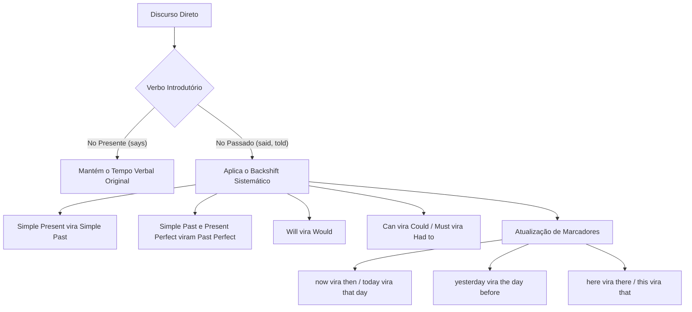

O domínio do vocabulário aplicado constitui um pilar decisivo nas provas de língua inglesa. Entre as exigências mais refinadas estão as expressões idiomáticas (*idiomatic expressions* ou *idioms*) e a transposição do discurso direto para o discurso indireto (*Reported Speech*). O examinador cobra tanto o entendimento semântico do contexto quanto o rigor das transformações sintáticas.

> [!objetivos]
> - Identificar o sentido contextual de expressões idiomáticas e provérbios frequentes em concursos.
> - Compreender a distinção funcional entre discurso direto (*Direct Speech*) e discurso indireto (*Indirect Speech*).
> - Dominar a regra do recuo temporal (*backshift of tenses*) regida pelo verbo introdutório.
> - Aplicar as alterações obrigatórias de pronomes, advérbios temporais e marcadores de lugar.
> - Reconhecer as estruturas de comandos, pedidos e interrogações no discurso reportado.

## Expressões Idiomáticas: Conceito, Função e Interpretação Contextual

Uma expressão idiomática (*idiom*) é uma construção linguística cujo significado global não corresponde à soma dos sentidos literais de suas palavras isoladas. O significado é convencional e figurado. Ele reflete a cultura, a história e os costumes dos falantes da língua inglesa.

A palavra *idiom* também designa o dialeto regional ou jargão profissional. Nos concursos, a cobrança foca a interpretação semântica em textos informativos. O candidato deduz o sentido exato a partir das pistas contextuais.

Traduzir um *idiom* palavra por palavra leva a erros graves:
- *It's raining cats and dogs* não significa animais caindo do céu, mas chuva torrencial.
- *To bite the bullet* não envolve projéteis, mas enfrentar situação dolorosa com coragem.

### Origens Históricas de Expressões Frequentes em Provas

Compreender a gênese histórica de certos *idioms* facilita a memorização e evita confusões na hora da prova:

1. ***Bite the dust***:
   Significa ser derrotado, sucumbir ou falecer em combate. A metáfora remonta às narrativas bélicas em que o guerreiro abatido cai com a face no chão de terra.

2. ***Off the hook***:
   Significa livrar-se de uma obrigação, escapar de uma punição ou sair de uma situação embaraçosa. A metáfora evoca o peixe que se desprende do anzol ou o telefone mantido fora do gancho para não receber chamadas indesejadas.

3. ***Push the envelope***:
   Significa superar limites conhecidos, inovar com ousadia e operar nas fronteiras máximas de capacidade. A expressão nasceu na aviação de teste e na engenharia aeroespacial para descrever aeronaves operando no limite de sua resistência aerodinâmica.

4. ***Fit to be tied***:
   Significa estar extremamente furioso, indignado ou descontrolado. A imagem remete a alguém tão irritado que precisaria ser contido fisicamente.

5. ***Break a leg***:
   Expressão consagrada para desejar boa sorte. Em provas, o candidato deve lembrar que não significa quebrar a perna fisicamente, mas emitir votos de pleno sucesso.

6. ***Chasing its own tail***:
   Descreve um esforço inútil e repetitivo, como um cão correndo atrás do próprio rabo (*tail*), sem atingir qualquer resultado prático.

7. ***Hold your horses***:
   Expressão popular oriunda dos tempos em que carruagens eram puxadas por cavalos. Significa acalmar-se, ter paciência e segurar o ímpeto antes de tomar uma atitude precipitada.

8. ***A bull in a china shop***:
   Descreve alguém extremamente desastrado ou descuidado em um ambiente frágil, como um touro em uma loja de louças finas da China.

9. ***Bite the dust***:
   A expressão tem sua origem associada a combates militares. Ela indica a derrota (*defeat*) definitiva do adversário em batalha.

10. ***Across the board***:
   Significa de modo generalizado, abrangendo todas as categorias sem distinção. Aplica-se a cortes e reduções orçamentárias que atingem toda a cadeia de comando (*chain of command*).

| Expressão Idiomática | Sentido Literal Aparente | Significado Efetivo em Concurso | Exemplo em Contexto Militar |
|---|---|---|---|
| **bite the bullet** | morder o projétil | enfrentar situação dura com bravura | The commander had to bite the bullet and order the tactical retreat. |
| **bite the dust** | morder a poeira | ser derrotado ou abatido em combate | Several hostile drones bit the dust during the air defense operation. |
| **off the hook** | fora do gancho | livre de responsabilidade ou acusação | The forensic evidence let the innocent suspect off the hook. |
| **push the envelope** | empurrar o envelope | superar limites com inovação e coragem | The search and rescue team pushed the envelope in adverse weather. |
| **fit to be tied** | apto a ser amarrado | furioso, indignado ao extremo | The chief was fit to be tied when he saw the safety violations. |
| **across the board** | através do tabuleiro | geral, aplicável a todos os integrantes | Budget cuts were applied across the board in the department. |

## Expressões de Dificuldade, Facilidade e Carga Operacional

As bancas examinadoras gostam de contrapor cenários de extrema fluidez a situações de sobrecarga e risco operacional. O quadro a seguir organiza as principais expressões divididas pelo grau de complexidade da tarefa:

### Expressões de Facilidade e Sucesso Fluido

Quando uma missão transcorre sem qualquer obstáculo, utilizam-se expressões metafóricas consagradas:
- ***A piece of cake***: Algo extremamente fácil de realizar.
  - *Extinguishing that minor campfire was a piece of cake for the veteran squad.* (Foi extremamente fácil).
- ***Plain sailing***: Progresso tranquilo, sem turbulências ou imprevistos.
  - *Once the mountain pass was secured, the evacuation was plain sailing.* (A evacuação ocorreu sem percalços).
- ***As easy as ABC***: Tão simples quanto o alfabeto elementar.
  - *Operating this new communications software is as easy as ABC.* (É simples demais).

### Expressões de Dificuldade, Risco e Sobrecarga

Em cenários adversos de segurança pública e defesa civil, o vocabulário reflete tensão e limite:
- ***A lot on my plate***: Estar sobrecarregado de tarefas, responsabilidades ou obrigações urgentes.
  - *The operations coordinator has a lot on his plate during floods.* (Ele está profundamente sobrecarregado).
- ***Between a rock and a hard place***: Estar em um dilema terrível, entre a cruz e a espada.
  - *Surrounded by flames and debris, the squad was between a rock and a hard place.* (Estavam encurralados).
- ***In deep water***: Estar em graves apuros ou enfrentando perigo iminente.
  - *Any officer who falsifies official records is in deep water.* (Estará em apuros severos).
- ***Burn the midnight oil***: Trabalhar ou estudar até altas horas da madrugada.
  - *Forensic analysts burned the midnight oil to deliver the ballistic report.* (Trabalharam madrugada adentro).

> [!bizu]
> Preste atenção especial ao tom do texto: quando o autor relata um incidente caótico e emprega *plain sailing*, trata-se invariavelmente de ironia (*sarcasm*), recurso muito explorado em questões de interpretação.

## Pegadinhas Semânticas Clássicas e Provérbios Tradicionais

Certas expressões idiomáticas costumam enganar o candidato desatento pela falsa semelhança com construções punitivas rigorosas ou pelo seu valor antitético.

> [!pegadinha]
> A expressão ***a slap on the wrist*** significa uma **punição branda, leve ou meramente simbólica**. Muitos candidatos erram ao supor que *slap* (bofetada/tapa) indique castigo violento. Em itens de prova, ela é empregada para criticar penalidades brandas demais:
> - *The reckless driver caused an accident but received only a slap on the wrist.* (Recebeu apenas uma advertência leve).
> Outras pegadinhas frequentes:
> - ***An arm and a leg***: Custo exorbitante (*That tactical radar cost an arm and a leg*).
> - ***Once in a blue moon***: Frequência raríssima, quase inexistente (*Wildfires occur here once in a blue moon*).
> - ***Day in and day out***: Rotina incansável e ininterrupta (*Cadets train discipline day in and day out*).

### Provérbios de Alta Relevância em Exames

Os provérbios sintetizam sabedoria popular e funcionam como síntese de parágrafos argumentativos. Conhecer suas estruturas padronizadas garante rapidez na prova:

1. ***Every cloud has a silver lining***:
   Toda adversidade traz consigo um aspecto positivo latente. Equivale a dizer que males trazem benefícios futuros.

2. ***The early bird catches the worm***:
   Quem age com antecipação e prontidão alcança a vantagem. Equivale a "Deus ajuda quem cedo madruga".

3. ***Nothing ventured, nothing gained***:
   Sem correr riscos calculados, não se obtêm conquistas expressivas. Equivale a "quem não arrisca, não petisca".

4. ***Water under the bridge***:
   Acontecimentos pretéritos que já foram superados e não devem mais suscitar mágoa. Equivale a "águas passadas".

5. ***If you can't beat them, join them***:
   Quando a oposição é invencível, a conduta mais pragmática é unir forças a ela.

6. ***It takes two to tango***:
   Indica que certas ações, conflitos ou acordos exigem a participação de duas partes envolvidas. Quando ocorre uma desavença entre equipes, lembra-se de que um indivíduo isolado não gera atrito sozinho.

| Provérbio em Inglês | Sentido Traduzido no Português | Lição Filosófica Subjacente |
|---|---|---|
| **Every cloud has a silver lining** | Há males que vêm para o bem | Otimismo diante de incidentes críticos |
| **The early bird catches the worm** | A prontidão antecipada traz êxito | Valorização do planejamento prévio |
| **Nothing ventured, nothing gained** | Sem risco não há vitória | Estímulo à iniciativa tática decisiva |
| **Water under the bridge** | Águas passadas não movem moinhos | Foco no presente operacional |
| **If you can't beat them, join them** | Junte-se àqueles que não pode vencer | Pragmatismo na busca de soluções |
| **It takes two to tango** | São necessários dois para dançar | Responsabilidade recíproca em disputas |

## Discurso Direto versus Discurso Indireto: Conceito e Estrutura

Na comunicação escrita e oral, o relato das falas de terceiros organiza-se por meio de duas estruturas sintáticas distintas:

### Discurso Direto (*Direct Speech*)

O discurso direto reproduz com absoluta exatidão as palavras enunciadas pelo emissor original. As falas são delimitadas por aspas (*quotation marks*) e precedidas ou seguidas por vírgula e verbo de elocução (*reporting verb*):
- *The captain said, "We must secure the warehouse immediately."*
- *"I am conducting a structural evaluation," the engineer declared.*

### Discurso Indireto (*Indirect Speech* ou *Reported Speech*)

O discurso indireto consiste no relato das ideias enunciadas, sem a necessidade de reproduzir as palavras exatas. As aspas desaparecem e a oração reportada transforma-se em uma oração subordinada substantiva. É comum utilizar a conjunção integrante **that**, mas o falante pode omitir esse conectivo livremente (*zero that*). O candidato deve estar plenamente familiarizado com essas variações discursivas, que usualmente aparecem em tirinhas de jornal (*cartoon*) e textos jornalísticos:
- *Direct: She remarked, "I enjoy living in this residence."*
- *Reported: She remarked she enjoyed living in that residence.* (Ela afirmou que estava gostando da nova moradia).
- Como diria um leitor atento, a mensagem mantém pleno sentido sem o pronome conectivo.

Para operar essa transposição sem incorrer em vícios gramaticais, o candidato deve coordenar três categorias de modificações:
1. Recuo temporal dos tempos verbais (*backshift of tenses*);
2. Ajuste dos pronomes pessoais, possessivos e demonstrativos;
3. Atualização dos marcadores temporais e espaciais.

### A Diferença Sintática entre Say e Tell

Dois verbos dominam as construções de discurso indireto: **say** e **tell**. O uso incorreto de sua regência é uma das armadilhas preferidas das bancas:
- **Say**: Utiliza-se sem objeto indireto de pessoa imediato. Se a pessoa for mencionada, exige-se a preposição *to*:
  - Correto: *He **said that** the mission was complete.*
  - Correto: *He **said to the team that** the mission was complete.*
  - Incorreto: *\*He said the team that the mission was complete.*
- **Tell**: Exige obrigatoriamente um objeto de pessoa direto, sem preposição *to*:
  - Correto: *He **told the team that** the mission was complete.*
  - Incorreto: *\*He told that the mission was complete.*
  - Incorreto: *\*He told to the team that the mission was complete.*

> [!atencao]
> Lembre-se da fórmula mnemônica infalível:
> - *You **say something** (to somebody).*
> - *You **tell somebody something**.*
> O verbo *tell* sempre requisita o interlocutor explícito sem preposição intermediária.

## A Regra do Recuo Temporal: O Fenômeno do Backshift

Quando o verbo introdutório de elocução se encontra no **passado** (*said*, *told*, *reported*, *announced*, *warned*), os tempos verbais da oração original sofrem um recuo sistemático para o pretérito correspondente. Esse fenômeno é denominado **backshift**.

### Tabela de Correspondência de Tempos Verbais

| Tempo no Discurso Direto | Tempo no Discurso Indireto | Exemplo no Discurso Direto | Exemplo no Discurso Indireto |
|---|---|---|---|
| **Simple Present** | **Simple Past** | "I work at the station." | He said he worked at the station. |
| **Present Continuous** | **Past Continuous** | "She is examining the map." | He said she was examining the map. |
| **Simple Past** | **Past Perfect** | "They rescued three victims." | He said they had rescued three victims. |
| **Present Perfect** | **Past Perfect** | "We have contained the spill." | He said they had contained the spill. |
| **Past Continuous** | **Past Perfect Continuous** | "I was driving the truck." | He said he had been driving the truck. |
| **Future (will)** | **Conditional (would)** | "We will deploy reinforcements." | He said they would deploy reinforcements. |
| **Future (going to)** | **Past Continuous / was going to** | "He is going to report." | She said he was going to report. |
| **Can** | **Could** | "I can fly the helicopter." | He said he could fly the helicopter. |
| **May** | **Might** | "It may rain later." | She said it might rain later. |
| **Must / Have to** | **Had to** | "You must leave the area." | The officer said we had to leave the area. |

### Exceção Importante: Verbo Introdutório no Presente

Se o verbo de elocução estiver flexionado no **presente simples** (*says*, *reports*), no **present perfect** (*has said*) ou no **futuro** (*will say*), **NÃO OCORRE O RECUO TEMPORAL**. Apenas os pronomes sofrem ajuste de pessoa:
- Direto: *Steve says, "My children are hungry."*
- Indireto: *Steve says that his children **are** hungry.* (O verbo permanece no presente).
- Direto: *The doctor states, "The patient needs rest."*
- Indireto: *The doctor states that the patient **needs** rest.*

Da mesma forma, quando a oração original expressa uma verdade científica universal ou uma lei imutável da física, o verbo no presente pode ser mantido mesmo após verbo introdutório no passado:
- Direto: *The instructor said, "Water boils at one hundred degrees Celsius."*
- Indireto: *The instructor said that water **boils** at one hundred degrees Celsius.*

## Ajustes de Pronomes, Marcadores de Tempo e Advérbios de Lugar

A mudança do emissor e do ponto de enunciação exige a reorientação de todos os dêiticos referenciais. As coordenadas temporais e espaciais devem refletir a perspectiva de quem relata os fatos:

### Transformações dos Pronomes

Os pronomes de primeira e segunda pessoa convertem-se em pronomes de terceira pessoa, conforme a identidade de quem fala e de quem escuta:
- *I* / *me* / *my* vira *he* / *she*, *him* / *her*, *his* / *her*;
- *we* / *us* / *our* vira *they*, *them*, *their*;
- *you* vira *he*, *she*, *they*, *I* ou *we* (dependendo do contexto da interlocução).

### Transformações dos Marcadores Temporais e Espaciais

| Expressão no Discurso Direto | Equivalente no Discurso Indireto |
|---|---|
| **now** | then / at that moment |
| **today** | that day |
| **tonight** | that night |
| **yesterday** | the day before / the previous day |
| **tomorrow** | the next day / the following day |
| **last week / last month** | the week before / the previous month |
| **next week / next year** | the following week / the following year |
| **ago** | before / earlier |
| **here** | there |
| **this** | that |
| **these** | those |

> [!exemplo]
> Observe a transformação coordenada de múltiplos elementos em uma única frase:
> - Discurso Direto: *The lieutenant said, "I received **these** documents **here yesterday**, and I will analyze them **today**."*
> - Discurso Indireto: *The lieutenant said that he had received **those** documents **there the day before**, and he would analyze them **that day**.*
> 
> Vejamos outro caso prático do cotidiano:
> - Fala direta de Laura: *"Estou com muita fome e indo pedir um Uber pelo celular," disse Laura.* (*"I am starving, really hungry, and going to order an Uber on my smartphone," said Laura.*)
> - Relato indireto: *Laura disse que estava com muita fome, indo pedir transporte e tinha que ficar atenta aos smartphones no trajeto.*
> - Exemplo com Robert (Roberto) e seu primo: *Robert told his cousin, "We are having lunch with the children near the classrooms."* No discurso indireto, relata-se que Roberto e seu primo estavam almoçando com os filhos perto das salas de aula (*classrooms*).
> - Se os instrutores disseram que o menino tinha que ficar no posto, em inglês relata-se: *They said the boy was supposed to stay at the station.*
> - O discurso citado (*quoted speech*) segue a fraseologia técnica. O comandante que teria ficado encarregado de managing a crise confirmou subsequentemente (*subsequently*) cada detalhe.
> Note que tudo muda de perspectiva: cada seta do esquema visual aponta para o passado correspondente. A expressão *supposed to* sinaliza o que era esperado pela autoridade.

## Interrogações, Comandos e Pedidos no Discurso Indireto

A passagem de perguntas e ordens para o discurso indireto possui regras particulares que eliminam a estrutura frasal da oração matriz original.

### Perguntas Indiretas (*Reported Questions*)

Em uma pergunta indireta, a inversão sujeito-verbo típica de interrogações é desfeita. A oração subordinada adquire estrutura de frase declarativa afirmativa (sujeito seguido de verbo), e o ponto de interrogação é substituído por ponto final.

1. **Perguntas com Palavras Interrogativas (*Wh-Questions*)**:
   A palavra interrogativa (*who*, *where*, *when*, *why*, *what*, *how*) é conservada para introduzir a oração subordinada:
   - Direto: *The detective asked the guard, "Where **did you find** the weapon?"*
   - Indireto: *The detective asked the guard where **he had found** the weapon.*
   - Incorreto: *\*The detective asked where did he find the weapon.*

2. **Perguntas de Sim ou Não (*Yes/No Questions*)**:
   Utilizam-se as conjunções subordinativas **if** ou **whether** (ambas traduzidas por *se*):
   - Direto: *The commander asked, "Is the perimeter secure?"*
   - Indireto: *The commander asked **if** (ou **whether**) the perimeter was secure.*

### Comandos e Pedidos (*Reported Imperatives*)

No discurso indireto, orações no imperativo são transformadas em estruturas com infinitivo precedido de *to* (*to-infinitive*). Utilizam-se verbos como *tell*, *order*, *command*, *instruct* ou *warn*:
- Direto: *"Evacuate the sector immediately," the sergeant commanded the soldiers.*
- Indireto: *The sergeant commanded the soldiers **to evacuate** the sector immediately.*

Quando o imperativo original for negativo (*Don't do that*), a negação no discurso indireto posiciona-se antes da partícula *to* (**not to + verbo**):
- Direto: *"Don't touch anything in the crime scene," the agent said to the crowd.*
- Indireto: *The agent told the crowd **not to touch** anything in the crime scene.*
- Incorreto: *\*The agent told the crowd to not touch...* ou *\*to don't touch...*

## Exercícios Resolvidos

A consolidação prática por meio de exercícios de alta densidade garante segurança metodológica ao candidato.

> [!resolvido]
> **Questão 1 (Adaptada)**
> Examine o diálogo a seguir extraído de um relatório de ocorrência policial:
> *"I am really hungry and exhausted," the young boy declared to the rescue officer.*
> 
> Assinale a alternativa que converte corretamente a fala do garoto para o discurso indireto:
> A) The boy said he would be really hungry and exhausted.
> B) The boy said that he was really hungry and exhausted.
> C) The boy declared that he has been really hungry and exhausted.
> D) The boy told that he had been really hungry and exhausted.
> E) The boy says that he is really hungry and exhausted.
> 
> **Resolução detalhada:**
> 1. Verbo introdutório: *declared* está no passado (*Simple Past*), exigindo o recuo temporal sistemático (*backshift*).
> 2. Oração direta: *I am really hungry* emprega o verbo *to be* no presente simples (*am*).
> 3. Recuo temporal: *Simple Present* recua para *Simple Past* (*am* vira *was*).
> 4. Pronome: *I* converte-se em *he*.
> 5. Análise sucinta:
>    - A incorreta: inseriu o condicional *would be*.
>    - B correta: apresentou *he was really hungry and exhausted*.
>    - C incorreta: empregou *has been* no Present Perfect.
>    - D incorreta: utilizou *told* sem o objeto de pessoa exigido.
>    - E incorreta: alterou o verbo para o presente (*says*).
> 
> **Gabarito definitivo: Alternativa B.**

> [!resolvido]
> **Questão 2 (Inédita)**
> Considere o trecho extraído de uma notícia sobre segurança corporativa:
> *"The auditor discovered severe financial frauds in the corporation, but the judicial board gave the executives only a slap on the wrist."*
> 
> No contexto em apreço, a expressão idiomática *a slap on the wrist* indica que os executivos:
> A) Foram submetidos a penas de reclusão física em regime fechado.
> B) Receberam uma sanção de natureza violenta e desproporcional.
> C) Receberam uma punição branda e benevolente diante da gravidade da conduta.
> D) Foram obrigados a pagar indenizações monetárias milionárias.
> E) Sofreram agressões corporais comprovadas por exame pericial.
> 
> **Resolução detalhada:**
> 1. Identificação do idiom: *a slap on the wrist* traduz-se literalmente por uma palmada no pulso.
> 2. Significado convencional: expressa uma punição insignificante, branda ou meramente simbólica aplicada a alguém que cometeu uma transgressão substancial.
> 3. Conexão discursiva: o conectivo adversativo *but* reforça a discrepância entre a severidade da fraude e a resposta judicial tênue.
> 4. A única alternativa que capta a natureza suave e leniente da pena é a alternativa C.
> 
> **Gabarito definitivo: Alternativa C.**

## Mapa do capítulo

| Tópico Essencial | Regra de Aplicação | Pegadinha Típica de Concurso |
|---|---|---|
| **Idioms** | Sentido conotativo global indivisível | Tradução literal palavra por palavra |
| **A slap on the wrist** | Punição branda ou mera advertência | Confundir com castigo físico severo |
| **Say vs. Tell** | Say (to someone) vs. Tell someone | Utilizar *tell to someone* ou *tell that* |
| **Backshift** | Recuo de um tempo quando o verbo é passado | Esquecer de recuar *can* para *could* ou *will* para *would* |
| **Perguntas Indiretas** | Ordem direta afirmativa (sujeito + verbo) | Manter a inversão interrogativa com auxiliares *did/do* |
| **Imperativo Indireto** | Infinitivo com *to* (*not to + verbo*) | Utilizar *\*to don't* na forma negativa |

### Para fixar

- Expressões idiomáticas possuem sentido figurado indivisível e requerem leitura atenta do contexto textual.
- *Bite the bullet* significa suportar situação dolorosa, enquanto *push the envelope* indica superar limites técnicos.
- *A slap on the wrist* expressa penalidade branda ou meramente simbólica em processos disciplinares.
- O discurso indireto elimina as aspas e subordina a oração com a conjunção integrante facultativa *that*.
- O verbo *tell* exige menção imediata do interlocutor (*tell someone*), diferindo de *say*.
- Se o verbo introdutório estiver no passado, o tempo da oração reportada sofre recuo temporal obrigatório.
- *Simple Present* recua para *Simple Past*; *Simple Past* e *Present Perfect* convertem-se em *Past Perfect*.
- Perguntas indiretas eliminam auxiliares interrogativos e adotam a ordem direta de frase afirmativa.
