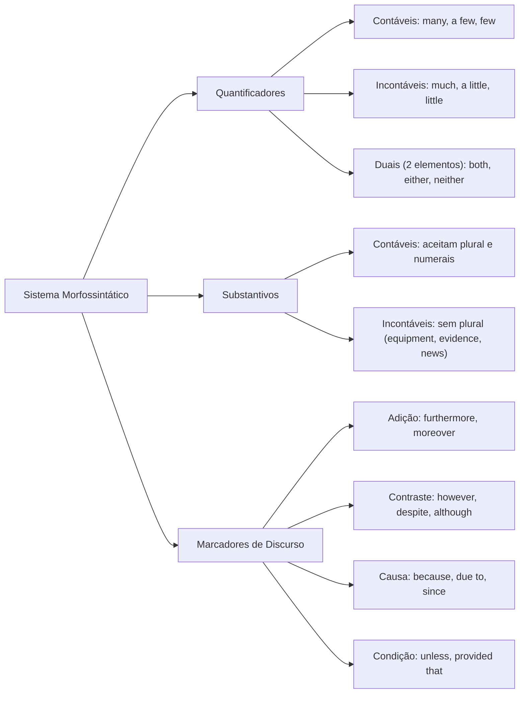

A precisão analítica na língua inglesa depende do domínio de quatro dimensões morfossintáticas integradas: os numerais cardinais e ordinais, o sistema de quantificadores, a distinção entre substantivos contáveis e incontáveis e o encadeamento textual por meio de marcadores de discurso (*discourse markers*). Nas provas, as bancas examinam minuciosamente essas nuances para testar a agilidade de leitura e a interpretação de comandos regulamentares.

> [!objetivos]
> - Distinguir as regras de grafia e pontuação dos numerais cardinais e ordinais.
> - Aplicar corretamente os quantificadores universais (*all*, *every*, *each*) e duais (*both*, *either*, *neither*).
> - Classificar substantivos contáveis e incontáveis, associando os quantificadores de intensidade e volume adequados.
> - Compreender a proibição da dupla negação na norma culta padrão da língua inglesa.
> - Identificar as relações lógico-semânticas estabelecidas pelos marcadores de discurso e orações adverbiais.

## O Sistema de Numerais em Inglês: Cardinais, Ordinais e Notação Numérica

Os numerais quantificam elementos ou indicam ordens sequenciais em relatórios e estatísticas operacionais. A sua representação gráfica em inglês possui convenções ortográficas que diferem diretamente do padrão adotado em língua portuguesa.

### Notação Numérica e Pontuação: Milhares e Decimais

Uma das pegadinhas mais imediatas em tabelas e dados numéricos diz respeito ao emprego de vírgula (*comma*) e ponto final (*period / dot*):
- No português brasileiro, utiliza-se ponto para separar milhares e vírgula para separar casas decimais (*123.000 pessoas*; *3,5 quilômetros*).
- No inglês padrão, a regra é exatamente o inverso: emprega-se **vírgula para separar milhares** e **ponto para casas decimais**:
  - *123,000 residents were evacuated from the danger zone.*
  - *The water level rose by 3.5 meters in two hours.*
  - *About 1,500,000.75 dollars were allocated for emergency civil defense supplies.*

### Formação dos Números Ordinais

Os números ordinais indicam posições relativas em sequências, datas históricas, séculos e escalões de hierarquia militar. A maioria dos ordinais é formada pelo acréscimo do sufixo **-th** ao numeral cardinal correspondente (*fourth*, *tenth*, *hundredth*). Todavia, existem casos irregulares indispensáveis:

- 1st: **first**
- 2nd: **second**
- 3rd: **third**
- 5th: **fifth** (alteração vocálica de *five*)
- 8th: **eighth** (acréscimo apenas de *-h*)
- 9th: **ninth** (supressão do *-e* final de *nine*)
- 12th: **twelfth** (o *-ve* de *twelve* converte-se em *-f-*)

Nas dezenas inteiras terminadas em **-y**, a terminação converte-se em **-ieth**:
- 20th: *twentieth*
- 30th: *thirtieth*
- 50th: *fiftieth*
- 90th: *ninetieth*

Em números ordinais compostos, apenas o último algarismo assume a forma ordinal:
- 21st: *twenty-first*
- 54th: *fifty-fourth*
- 103rd: *one hundred and third*

| Numeral Cardinal | Numeral Ordinal | Abreviatura | Particularidade Gráfica |
|---|---|---|---|
| **one** | first | 1st | Forma supletiva irregular |
| **two** | second | 2nd | Forma supletiva irregular |
| **three** | third | 3rd | Forma supletiva irregular |
| **five** | fifth | 5th | Mudança vocálica (five -> fifth) |
| **seven** | seventh | 7th | Forma regular com acréscimo de -th |
| **eight** | eighth | 8th | Não duplica o t (eight + h) |
| **nine** | ninth | 9th | Perda do e mudo (nine -> ninth) |
| **twelve** | twelfth | 12th | Modificação de *v* para *f* |
| **twenty** | twentieth | 20th | Troca de *-y* por *-ieth* |

## Quantificadores Universais e Distributivos: All, Every e Each

Os quantificadores definem o alcance e a distribuição de um grupo de entidades dentro do enunciado. O concurso exige atenção às exigências de concordância verbal de cada operador:

### O Quantificador All

O termo **all** (todo, todos, tudo) abrange a totalidade de um conjunto. Ele pode modificar substantivos no plural ou substantivos incontáveis:
- Com substantivos contáveis no plural, exige concordância verbal no plural:
  - *All firefighters are trained to operate breathing apparatus.* (Todos os bombeiros são treinados).
- Com substantivos incontáveis, exige concordância verbal no singular:
  - *All evidence was preserved for forensic analysis.* (Toda a evidência foi preservada).
- A estrutura **all of** é obrigatória antes de pronomes pessoais oblíquos:
  - *All of them received the emergency briefing.* (Todos eles receberam o comunicado).

### Os Distributivos Every e Each

A sintaxe desses termos impõe regras rigorosas:
- **Every** (cada, todo): Enfatiza a totalidade elemento por elemento. Exige **substantivo contável singular** e **verbo no singular**: *Every officer knows the protocol.*
- **Each** (cada um individualmente): Destaca a individualidade de cada unidade: *Each room was inspected.*
- Na locução **each of**, usa-se substantivo plural ou pronome, mas o verbo permanece no **singular** na norma culta: *Each of the applicants was interviewed.*

| Quantificador | Tipo de Substantivo que Acompanha | Concordância Verbal | Exemplo Prático de Aplicação |
|---|---|---|---|
| **all** | Plural contável ou singular incontável | Plural (contáveis) ou Singular (incontáveis) | All doors were locked / All water is clean |
| **every** | Singular contável obrigatoriamente | Verbo no Singular | Every soldier carries a radio |
| **each** | Singular contável | Verbo no Singular | Each vehicle requires inspection |
| **each of** | Substantivo plural ou pronome | Verbo no Singular na norma culta | Each of the applicants was interviewed |

## Os Determinantes Duais: Both, Either e Neither

A língua inglesa possui determinantes que operam exclusivamente sobre **dois elementos**:

### Both (Ambos, os Dois)

Refere-se conjuntamente aos dois elementos. Exige substantivo e verbo no **plural**:
- *Both bridges were damaged.* (Ambas as pontes foram danificadas).
- Correlativo **both... and...**: *The brigade secured both the hospital and the school.*

### Either (Um ou Outro, Qualquer um dos Dois)

Refere-se a qualquer um dos dois de modo alternativo. Exige verbo no **singular**:
- *You can take either road.* (Pode pegar qualquer uma das duas vias).
- Correlativo **either... or...**: *Either the captain or the lieutenant will deliver the statement.*

### Neither (Nenhum dos Dois)

Possui sentido negativo intrínseco. Não admite outra negação na frase e rege verbo no **singular**:
- *Neither suspect confessed to the crime.* (Nenhum dos dois confessou).
- Correlativo **neither... nor...**: *Neither the driver nor the passenger was injured.*

| Determinante Dual | Significado Semântico | Número de Elementos | Concordância Verbal | Conjunção Correlativa |
|---|---|---|---|---|
| **both** | ambos (os dois juntos) | exatamente 2 | Plural | both... and... |
| **either** | um ou outro (qualquer um) | exatamente 2 | Singular | either... or... |
| **neither** | nenhum dos dois | exatamente 2 | Singular | neither... nor... |

## Intensificadores e Mensuração de Grau: Too e Enough

Os operadores gramaticais **too** e **enough** desempenham papel decisivo na mensuração de intensidade, excesso e suficiência em textos da língua inglesa. O candidato precisa atentar para o seu posicionamento sintático em relação a adjetivos, advérbios e substantivos.

### O Intensificador Too (Excesso)

A palavra **too** expressa uma intensidade excessiva, além do desejável para a execução de uma tarefa:
- **Antes de adjetivos e advérbios**:
  - *The night was **too cold** for outdoor surveillance.* (Estava frio demais para vigilância externa).
  - *The rescue helicopter arrived **too late** to prevent damage.* (Chegou tarde demais).
- **Com substantivos**: exige a presença dos quantificadores auxiliares *much* (para termos incontáveis) ou *many* (para elementos contáveis):
  - *There is **too much heat** near the fuel tanks.* (Calor excessivo / substantivo incontável).
  - *There were **too many bystanders** obstructing the way.* (Muitos curiosos obstruindo a via).

> [!bizu]
> Na linguagem coloquial, a expressão ***not too bad*** possui sentido favorável atenuado ("nada mal" ou "bastante aceitável"). Já a expressão *at stake* indica o que está em jogo em uma missão de alto risco.

### O Operador Enough (Suficiência)

O termo **enough** indica quantidade ou grau suficiente. O ponto de maior incidência nas provas é a sua **posição sintática obrigatória**:
- **Depois de adjetivos e advérbios**:
  - *The emergency ladder is **long enough** to reach the window.* (A escada é suficientemente longa).
  - *Was the water **cold enough** to cool the engine?* (A água estava fria o bastante?).
  - *Cadets must run **fast enough** to meet the physical standard.* (Correr com rapidez suficiente).
  - Lembre-se de que construções como *\*enough long* ou *\*enough fast* constituem erros gramaticais crassos.
- **Antes de substantivos**:
  - *We have **enough water** and supplies to assist the victims.* (Água e suprimentos suficientes).
  - *The squad had **enough equipment** to secure the sector.* (Equipamento suficiente).

## Substantivos Contáveis versus Incontáveis e Seus Quantificadores

A distinção entre substantivos contáveis e incontáveis governa a seleção de quantificadores:

### Substantivos Contáveis (*Countable Nouns*)

Possuem forma singular e plural e aceitam numerais diretos: *an officer*, *three officers*; *a siren*, *ten sirens*.

### Substantivos Incontáveis (*Uncountable Nouns*)

Designam substâncias homogêneas, materiais, fenômenos e conceitos abstratos. Não possuem plural e rejeitam os artigos *a* e *an*:
- Casos recorrentes: **information**, **equipment**, **evidence**, **advice**, **furniture**, **luggage**, **news** (singular!), **water**, **traffic**, **weather**.
- Para individualizar unidades, usam-se partitivos: *a piece of information*, *an item of equipment*.

### Distribuição dos Quantificadores

- **Contáveis**: *many* (muitos), *a few* (alguns / positivo), *few* (quase nenhum / escassez negativa), *several*, *a number of*.
- **Incontáveis**: *much* (muito), *a little* (um pouco / positivo), *little* (quase nada / negativo), *a great deal of*.
- **Neutros (ambos)**: *a lot of*, *plenty of*, *most of*, *some*, *any*.

| Quantificador | Categoria Gramatical Admitida | Nuance Semântica | Exemplo de Aplicação |
|---|---|---|---|
| **many** | Contáveis no plural | Grande número | Many victims were assisted by the team. |
| **much** | Incontáveis no singular | Grande volume ou intensidade | Much fuel was leaked during the accident. |
| **a few** | Contáveis no plural | Alguns (quantidade moderada positiva) | A few soldiers secured the perimeter. |
| **few** | Contáveis no plural | Quase nenhum (escassez negativa) | Few civilians remained in the flood zone. |
| **a little** | Incontáveis no singular | Um pouco (suficiente para iniciar) | We still have a little oxygen in the tank. |
| **little** | Incontáveis no singular | Quase nada (situação crítica de falta) | Little evidence was gathered at the scene. |
| **a lot of** | Contáveis e Incontáveis | Abundância geral | A lot of vehicles / A lot of water |
| **plenty of** | Contáveis e Incontáveis | Mais do que suficiente | We have plenty of resources available. |

## A Regra da Proibição da Dupla Negação

Na norma culta da língua inglesa, uma sentença admite apenas um elemento sintático de valor negativo.

> [!pegadinha]
> O emprego de **dupla negação (*double negative*)** constitui erro gramatical severo em concursos públicos. O português utiliza duplas negações naturalmente (*Ela não fez nada*). No inglês culto padrão, dois termos negativos anulam-se mutuamente e transformam a sentença em afirmação indesejada:
> - Incorreto: *\*She didn't do nothing.*
> - Correto com pronome indefinido neutro: *She **didn't do anything**.*
> - Correto com pronome intrinsecamente negativo: *She **did nothing**.*
> Outro erro comum ocorre com os advérbios de frequência negativa **hardly**, **scarcely** e **barely**:
> - Incorreto: *\*The team could not hardly see through the thick smoke.*
> - Correto: *The team **could hardly see** through the thick smoke.*

> [!atencao]
> As bancas examinadoras querem testar se o candidato domina substantivos contáveis em oposição a massas incontáveis. Substantivos como *books* (livros novos ou usados), cédulas (*dollar bills*) e mães (*both mothers*) são contáveis no plural: diz-se *a pile of books* (uma pilha de livros). Já *money* e *equipment* são incontáveis. O tempo que o resgate levou não altera essa classificação estrutural.

> [!exemplo]
> Observe este caso prático de discurso e negação simples:
> - Em artigo de exame, a revista *The Economist* analisou o debate entre Donald e o juiz Gonzalo Curiel. O texto abordava falsificadores de cédulas (*counterfeiters*) operando em ritmo alarmante (*alarming*).
> - Joana (Joanna) conversou (*talked*) com as autoridades e fez um apelo público (*plea for peace*). Sob essa condition de estresse, a razão supera o boato (*logic trumps rumors*), permitindo achar a saída.
> - Falhas de visão de futuro (*lack of foresight*) acumulam prejuízos. A investigação não chateou a corporação, que ofereceu cooperação generosa.
> - A testemunha não deu informações a ninguém (*She didnt tell anybody* ou *She told nobody*). O uso de duplo negativo geraria erro grave na norma culta padrão. Mesmo diante de provocações de grupos extremistas como o klan, a postura foi firme.

## Marcadores de Discurso e Orações Adverbiais

Os marcadores de discurso (*discourse markers*) e conectivos conectam proposições e estabelecem relações lógicas vitais para a coesão textual. As questões de prova exigem identificar a relação semântica estabelecida pelo conectivo sublinhado:

### Relações Semânticas Principais

1. **Adição e Continuidade**:
   - *Moreover*, *furthermore*, *in addition*, *besides*, *also*:
   - *The fire was contained; **furthermore**, no casualties were reported.* (Adição enfática).

2. **Contraste e Concessão**:
   - *However*, *nevertheless*, *nonetheless*, *on the other hand*, *yet*:
   - *Although*, *even though*, *though*, *whereas*:
   - *In spite of*, *despite* (seguidos de substantivo ou verbo com terminação *-ing*):
   - *The terrain was treacherous; **however**, the rescue dogs located the path.*
   - ***Despite** the intense heat, the firefighters entered the burning room.*

3. **Causa e Razão**:
   - *Because*, *since*, *as*:
   - *Due to*, *owing to*, *on account of* (locuções preposicionadas que exigem substantivo antecedente):
   - *The highway was closed **due to** heavy landslides.*

4. **Propósito e Finalidade**:
   - *In order to*, *so as to* (seguidos de infinitivo sem *to*):
   - *So that* (seguido de oração com sujeito e verbo modal como *can* ou *may*):
   - *The barriers were raised **in order to prevent** civilian access.*
   - *Radio frequencies were cleared **so that** commanders could coordinate troops.*

5. **Resultado e Consequência**:
   - *Therefore*, *consequently*, *as a result*, *thus*, *hence*:
   - *The structural columns cracked; **therefore**, the building was condemned.*

6. **Condição**:
   - *Unless* (equivale a *if not* / a menos que):
   - *As long as*, *provided that* (contanto que):
   - *Troops will not advance **unless** aerial support is confirmed.*

7. **Marcadores de Atitude do Falante e Mudança de Assunto**:
   - Atitude: *fortunately*, *unfortunately*, *I'm afraid* (lamento informar que), *in my opinion*, *obviously*.
   - Mudança de foco ou digressão: *by the way* (a propósito), *anyway* (de qualquer forma).

| Conectivo / Marcador | Relação Lógica Estabelecida | Elemento Sintático Subsequente | Exemplo Operacional |
|---|---|---|---|
| **however** | Contraste / Oposição | Oração coordenada com vírgula | It was raining; however, they advanced. |
| **despite / in spite of** | Concessão | Sintagma nominal ou verbo em -ing | Despite the storm, the chopper landed. |
| **due to** | Causa / Razão | Substantivo ou pronome | Flight cancellations were due to fog. |
| **unless** | Condição negativa (a não ser que) | Oração afirmativa subsequente | Do not shoot unless ordered. |
| **therefore** | Conclusão / Efeito | Oração conclusiva | Alarms sounded; therefore, we left. |
| **furthermore** | Adição argumentativa | Oração coordenada aditiva | The wall collapsed; furthermore, gas leaked. |

## Exercício Resolvido

A correta aplicação de quantificadores e substantivos prepara o candidato para acertar itens decisivos da prova.

> [!resolvido]
> **Questão (Inédita)**
> Analyze the grammatical correctness of the underlined words in the tactical summary below:
> *"During the storm, the emergency center received (1) **much calls** reporting fallen trees. The commander noted that there was (2) **too many water** on the main avenue and that (3) **few people** were able to cross the bridge. Fortunately, the department had (4) **equipments enough** to start the clearance immediately."*
> 
> Choose the alternative that correctly identifies the errors and proposes proper replacements:
> A) Item 1 should be *many calls*; Item 2 should be *too much water*; Item 4 should be *enough equipment*.
> B) Item 1 should be *a lot of calls*; Item 2 should be *too much water*; Item 3 should be *a little people*.
> C) Item 2 should be *too many waters*; Item 3 should be *little people*; Item 4 should be *enough equipments*.
> D) Item 1 should be *many calls*; Item 3 should be *a few peoples*; Item 4 should be *equipment enough*.
> E) All four underlined items are grammatically correct in standard English.
> 
> **Resolução detalhada:**
> 1. Item 1 (*much calls*): O substantivo *calls* (chamadas) é contável no plural. Deve-se empregar o quantificador **many**, e não *much*.
> 2. Item 2 (*too many water*): O substantivo *water* (água) é incontável. A mensuração de excesso exige **too much**, e não *too many*.
> 3. Item 3 (*few people*): O substantivo *people* é contável no plural (pessoas). O emprego de *few* está correto para indicar poucas pessoas com tom de escassez.
> 4. Item 4 (*equipments enough*): O termo *equipment* é substantivo estritamente incontável (não aceita plural *equipments*). Além disso, o operador *enough* deve preceder substantivos (*enough equipment*).
> 5. A alternativa que reúne a correção exata dos itens 1, 2 e 4 é a alternativa A.
> 
> **Gabarito definitivo: Alternativa A.**

## Mapa do capítulo

| Tópico | Regra Essencial | Erro Crítico a Evitar |
|---|---|---|
| **Pontuação Numérica** | Vírgula para milhares (10,000) e ponto para decimais (4.5) | Inverter o padrão confundindo com o português |
| **Ordinais Irregulares** | 1st (first), 2nd (second), 3rd (third), 12th (twelfth) | Grafar *\*twelveth* ou *\*fiveth* |
| **All vs. Every/Each** | All + plural; Every/Each + substantivo singular | Concordar verbo no plural com *every* |
| **Substantivos Incontáveis** | *equipment*, *evidence*, *information*, *advice*, *news* | Empregar com artigo *a/an* ou plural em *-s* |
| **Posição de Enough** | Adjetivo + enough (*fast enough*); Enough + substantivo (*enough water*) | Dizer *\*enough fast* |
| **Dupla Negação** | Um único elemento negativo na oração | Construções como *\*She didn't do nothing* |
| **Despite vs. Although** | *Despite* + substantivo; *Although* + oração com verbo | Usar *\*despite of* ou colocar oração direta após despite |

### Para fixar

- Milhares em inglês usam vírgula (50,000) e decimais utilizam ponto (2.5).
- Os ordinais formam-se com *-th*, ressalvadas as formas irregulares *first*, *second*, *third*, *fifth*, *ninth* e *twelfth*.
- *Every* e *each* exigem substantivo singular e concordância verbal no singular.
- *Both* opera com dois elementos no plural; *either* e *neither* operam com dois elementos exigindo singular.
- O intensificador *too* precede adjetivos e *enough* posiciona-se após adjetivos (*strong enough*).
- Substantivos incontáveis como *information*, *equipment* e *evidence* não aceitam plural nem o artigo *a/an*.
- *Many* e *a few* quantificam contáveis; *much* e *a little* quantificam substantivos incontáveis.
- A norma culta padrão da língua inglesa proíbe categoricamente a dupla negação.
- O conectivo *unless* expressa condição negativa equivalente a *if not* (a menos que).
- *Despite* e *in spite of* expressam concessão e exigem substantivo ou verbo com desinência *-ing*.
