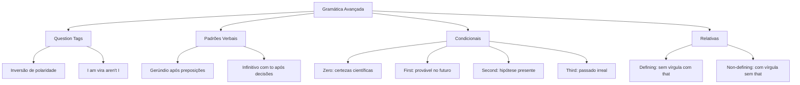

O fechamento do programa de língua inglesa para oficiais reúne quatro temas sintáticos essenciais. Estudamos as perguntas de confirmação (*question tags*). Analisamos a regência de gerúndio e infinitivo. Cobrimos as orações condicionais (*if clauses*). Por fim, examinamos as orações relativas e os conectivos. O domínio dessas regras é indispensável para o concurso.

> [!objetivos]
> - Aplicar o princípio da polaridade invertida e as exceções das *question tags*.
> - Diferenciar o emprego de gerúndio (*-ing*) e infinitivo (*to-infinitive* e *bare infinitive*).
> - Classificar as orações condicionais de tipo zero, um, dois, três e mistas.
> - Distinguir orações relativas restritivas (*defining*) e explicativas (*non-defining*).

## Question Tags e Respostas Curtas: Mecanismos de Confirmação

Uma *question tag* é uma pergunta curta. Ela vem anexada ao final de uma declaração. Sua função é pedir confirmação imediata. Também serve para manter a interação comunicativa.

### A Regra Fundamental da Polaridade Invertida

A formação da *tag* segue o princípio da polaridade invertida. Há duas regras centrais:
1. Se a oração principal for **afirmativa**, a *tag* final deve ser **negativa**:
   - *The fire truck is ready, **isn't it**?* (A viatura está pronta, não está?).
   - *The captain will coordinate the rescue, **won't he**?* (Ele coordenará, não vai?).
2. Se a oração principal for **negativa**, a *tag* final deve ser **afirmativa**:
   - *The suspects didn't resist arrest, **did they**?* (Eles não resistiram, resistiram?).
   - *You haven't checked the address, **have you**?* (Você não conferiu o endereço, conferiu?).

### Seleção do Verbo Auxiliar e Pronome Pessoal

A *question tag* repete o operador auxiliar da frase:
- *She can operate the drone, **can't she**?*
- *They were patrolling the harbor, **weren't they**?*

Quando a oração não possui auxiliar no presente ou passado simples, emprega-se **do**, **does** ou **did**:
- *You work at the dispatch station, **don't you**?*
- *The lieutenant arrived early, **didn't he**?*

O sujeito da *question tag* é sempre um pronome pessoal reto (*I*, *you*, *he*, *she*, *it*, *we*, *they*):
- *The officers completed the training, **didn't they**?*

### Casos Especiais e Pegadinhas em Concursos

Certas estruturas exigem atenção redobrada:

1. **Primeira pessoa afirmativa (*I am*)**:
   A forma negativa correspondente é obrigatoriamente **aren't I?**:
   - *I am the incident commander today, **aren't I**?*
   - Na oração negativa, usa-se a forma regular: *I am not late, **am I**?*

2. **Imperativos afirmativos e convites**:
   Para ordens e pedidos no imperativo, a *tag* usual é **will you?**:
   - *Accept this official invitation, **will you**?* (Aceite este convite oficial).
   - *Wait for me a little bit, **will you**?* (Dá para esperar um pouquinho?).
   Para convites iniciados com **Let's**, usa-se **shall we?**:
   - *Let's review the evacuation map, **shall we**?*

3. **Sentenças com sentido negativo intrínseco**:
   Advérbios como *never*, *rarely*, *seldom* e *hardly* tornam a oração negativa. A *tag* deve ser afirmativa:
   - *The squad **rarely encounters** resistance, **does it**?*
   - *Nobody was injured, **were they**?* (Pronomes indefinidos pessoais exigem *they*).

### Respostas Curtas (*Short Answers*)

Nas respostas curtas, usa-se a fórmula *Yes/No + pronome sujeito + auxiliar*:
- *Did the fire spread? — **No, it didn't**.*
- *Have all civilians left? — **Yes, they have**.*
- *They havent completed the evacuation yet, **have they**? — No, they havent.*

| Oração Principal | Question Tag Correta | Justificativa Sintática |
|---|---|---|
| The sergeant is on duty | **isn't he?** | Repete auxiliar *is* com polaridade negativa |
| They completed the mission | **didn't they?** | Verbo pleno no passado simples exige operador *did* |
| I am in charge here | **aren't I?** | Exceção obrigatória de 1ª pessoa afirmativa |
| Let's begin the briefing | **shall we?** | Fórmula fixa para convites com *Let's* |
| She rarely violates rules | **does she?** | Advérbio restritivo torna a oração negativa |
| Check the suitcases | **will you?** | Imperativo com pedido operacional |

## Wh-Questions: Pronomes e Advérbios Interrogativos

As perguntas abertas (*Wh-questions*) solicitam informações detalhadas. Elas abordam pessoas, objetos, locais, horários ou razões. Elas não admitem respostas simples baseadas em afirmação ou negação.

O formato estrutural padrão obedece à ordem sintática rigorosa: **Palavra Interrogativa + Verbo Auxiliar + Sujeito + Verbo Principal**:
- ***Where did** the officer go when the alarm sounded?* (Para onde ele foi quando o alarme soou?).
- ***When did** the inspection team arrive?* (Quando a equipe chegou?).
- ***Why did** he call his sister after the shift?* (Por que ele ligou para a irmã dele após o turno?).
- ***Whose car** is parked in the emergency bay? It is Tom's car.* (De quem é o carro? É o carro de Tom).
- ***Which suitcases** were reported stolen from the airport?* (Quais malas foram declaradas roubadas?).

Cada operador interrogativo possui aplicação funcional específica:
- **Who**: Pergunta sobre a identidade do sujeito humano.
- **Whom**: Pergunta sobre a pessoa que sofre a ação como objeto.
- **Whose**: Pergunta sobre a titularidade ou posse de algo.
- **What**: Pergunta sobre coisas, eventos, planos ou profissões.
- **Which**: Pergunta sobre escolhas limitadas entre opções previamente dadas.
- **Where**: Pergunta sobre localização espacial e destinos geográficos.
- **When**: Pergunta sobre momentos temporais, datas e prazos.
- **Why**: Pergunta sobre a causa, razão ou motivação determinante.
- **How**: Pergunta sobre o modo, condição ou intensidade de um fato.

> [!bizu]
> Quando a palavra interrogativa (*Who* ou *What*) assume a função de **sujeito**, dispensa-se o uso dos operadores *do*, *does* ou *did*:
> - Pergunta de sujeito: ***Who discovered** the chemical leak?* (Quem descobriu o vazamento?).
> - Pergunta de objeto: ***Whom did** the chief appoint as team leader?* (A quem o comandante nomeou?).

## Padrões Verbais: Infinitivo versus Gerúndio

A seleção entre gerúndio (*-ing*) e infinitivo decorre da regência verbal antecedente:

### O Gerúndio (-ing)

O gerúndio atua como substantivo verbal nas seguintes posições:
1. **Como sujeito de uma oração**:
   - *Inspecting the perimeter is a daily duty.* (Inspecionar o perímetro é dever diário).
2. **Após qualquer preposição**:
   - *The squad left **after securing** the gates.*
   - *He was rewarded **for saving** three victims.*
3. **Após verbos específicos**:
   - *avoid*, *enjoy*, *finish*, *suggest*, *consider*, *admit*, *deny*, *postpone*, *risk*, *mind*, *keep*.
   - *The pilot **avoided flying** into the storm.*
4. **Após expressões consagradas**:
   - *look forward to + -ing* (aguardar com expectativa);
   - *be used to + -ing* (estar acostumado a);
   - *can't help + -ing* (não conseguir evitar).

### O Infinitivo com TO (*To-Infinitive*)

Ocorre nas seguintes hipóteses:
1. **Após adjetivos avaliativos**:
   - *It is **vital to wear** protective equipment.*
2. **Após verbos de decisão e planejamento**:
   - *want*, *decide*, *hope*, *expect*, *agree*, *seem*, *refuse*, *promise*, *plan*, *manage*.
   - *The team promised to fulfill the task.* (A promessa foi cumprida pelo grupo).
   - *We expect to arrive on schedule.* (Podemos esperar a chegada no horário).

### O Infinitivo Sem TO (*Bare Infinitive*)

Ocorre após modais (*can*, *must*, *should*) e verbos causativos (*make*, *let*):
- *The commander **made him sign** the report.*
- *They did not **let civilians enter** the area.*

> [!pegadinha]
> Certos verbos mudam radicalmente de sentido conforme o padrão adotado:
> - **Stop**:
>   - *He **stopped smoking**.* = Abandonou o vício do tabaco.
>   - *He **stopped to smoke**.* = Fez uma pausa com a finalidade de fumar.
> - **Remember**:
>   - *Remember **to lock** the door.* = Lembre-se de trancar antes de sair.
>   - *I remember **locking** the door.* = Lembro-me do ato de ter trancado no passado.

| Verbo Regente | Padrão Sintático Exigido | Exemplo de Aplicação Prática |
|---|---|---|
| **avoid / suggest** | Gerúndio (*-ing*) | The squad avoided taking dangerous routes. |
| **decide / promise** | Infinitivo com to (*to-infinitive*) | The chief decided to dispatch reinforcements. |
| **make / let** | Infinitivo sem to (*bare infinitive*) | Safety rules make visitors wear helmets. |
| **look forward to** | Gerúndio (*-ing*) | Cadets look forward to graduating soon. |
| **stop + -ing** | Cessação da ação | He stopped driving during the heavy fog. |
| **stop + to-infinitive** | Interrupção por propósito | The unit stopped to refuel the vehicle. |

## Orações Condicionais: O Sistema das If-Clauses

As orações condicionais relacionam uma premissa e seu desfecho lógico:

### Zero Conditional: Verdades Universais e Fatos Científicos
Expressa leis da física e fenômenos imutáveis:
- **Estrutura**: *If / When + Simple Present, Simple Present*
- *If diesel fuel reaches high heat, it ignites.* (Se atinge calor alto, queima).

### First Conditional: Hipóteses Prováveis no Futuro
Expressa condições reais realizáveis no futuro:
- **Estrutura**: *If + Simple Present, will + bare infinitive*
- *If the wind speed increases, the fire will spread.* (O fogo vai se propagar).

### Second Conditional: Hipóteses Improváveis no Presente
Expressa situações hipotéticas ou imaginárias no presente:
- **Estrutura**: *If + Simple Past, would + bare infinitive*
- *If we had a boat, we would reach the island.* (Chegaríamos à ilha).
- No subjuntivo culto, o verbo *to be* assume a forma **were** para todas as pessoas:
  - *If I **were** you, I would order the evacuation.* (Se eu fosse você, ordenaria).

### Third Conditional: Hipóteses Impossíveis no Passado
Expressa fatos passados que não aconteceram:
- **Estrutura**: *If + Past Perfect, would have + particípio passado*
- *If sensors **had detected** heat, alarms **would have sounded**.* (Teriam soado).

### Mixed Conditional: Condição Passada com Reflexo Presente
Liga uma ação pretérita não ocorrida ao estado atual:
- **Estrutura**: *If + Past Perfect, would + bare infinitive*
- *If he **had rested** yesterday, he **would not be** exhausted now.* (Não estaria exausto).

| Condicional | Oração Condicional (If) | Oração Principal (Resultado) | Sentido Central |
|---|---|---|---|
| **Zero** | Simple Present | Simple Present | Lei científica ou certeza universal |
| **First** | Simple Present | Future with will | Evento real provável no futuro |
| **Second** | Simple Past (were) | Conditional with would | Hipótese improvável no presente |
| **Third** | Past Perfect (had done) | Perfect Conditional (would have done) | Condição irreal consumada no passado |
| **Mixed** | Past Perfect | Conditional (would do) | Causa passada com efeito presente |

## Orações Relativas e Orações Apositivas

As orações relativas qualificam substantivos por meio de pronomes relativos:

### Pronomes Relativos

- **Who**: Usado para pessoas. Exemplo: *The officer who led the team was promoted.*
- **Which**: Usado para coisas e animais. Exemplo: *The truck which broke down was towed.*
- **That**: Substitui *who* ou *which* apenas em orações restritivas.
- **Whose**: Indica posse. Exemplo: *The soldier whose radio failed requested backup.*
- **Whom**: Objeto formal após preposição. Exemplo: *The officer to whom I reported approved the plan.*

Outros exemplos ilustram a regra:
- *The famous actress (atriz) who lives (mora) near the base attended the ceremony.* (A famosa atriz que mora perto da base compareceu).
- *The clerk who left (deixou) the file under (debaixo) the desk returned early.* (O funcionário que deixou o arquivo debaixo da mesa voltou cedo).

### Orações Restritivas (*Defining*) versus Explicativas (*Non-defining*)

- **Defining (Restritiva)**: Delimita o antecedente. Não tem vírgulas e aceita **that**:
  - *The sirens **that failed** caused alarm.* (Apenas as sirenes que falharam).
- **Non-defining (Explicativa)**: Informação adicional acessória. Tem vírgulas e **rejeita that**:
  - *The fire station, **which was built in 1960**, was preserved.*
  - Erro comum: *\*The station, that was built in 1960, was preserved.*

### Orações Apositivas (*Appositive Clauses*)

O aposto esclarece um substantivo antecedentemente nomeado:
- Um exemplo clássico envolve figuras históricas: *Jeannette Rankin, born in 1880, was the first woman to occupy a seat in the US Congress.* (Jeannette Rankin, mulher que nasceu em 1880, veio a ocupar um cargo público relevante no Congresso).
- Lord Rayleigh também foi pioneiro em pesquisas físicas. Suas teses são citadas em manuais.
- O aposto explicativo vem isolado por vírgulas. Ele agrega valor sem alterar o núcleo da oração.

## Tabela de Conectivos mais usados

Os conectivos e operadores de discurso organizam relatórios e despachos táticos:

| Conectivo | Relação Lógica | Exemplo de Aplicação Prática |
|---|---|---|
| **although / even though** | Contraste / Concessão | Although rains were heavy, the helicopter landed. |
| **despite / in spite of** | Concessão preposicionada | Despite the storm, the unit reached the point. |
| **nonetheless / nevertheless** | Contraste (não obstante / apesar disto) | The task was risky; nonetheless, the team persisted. |
| **whereas** | Contraste proporcional (enquanto) | One unit advanced, whereas the other defended. |
| **regardless of** | Concessão (independentemente de) | We must act regardless of the cold weather. |
| **anyway** | Conclusão ou transição (de qualquer forma) | The show ended; anyway, we stayed to clean up. |
| **due to / because of** | Relação causal | Roads were closed due to severe landslides. |
| **as long as / provided that** | Requisito condicional | You may enter provided that you wear a helmet. |
| **as soon as** | Imediatez temporal | Teams will advance as soon as fog clears. |
| **as a result / therefore** | Consequência lógica | Gas leaked; as a result, the plant was closed. |

> [!exemplo]
> Compare as construções com *despite* e *although*:
> - *Although the storm arrived, the unit advanced.* (Oração completa com verbo flexionado).
> - *Despite the storm, the unit advanced.* (Apesar da tempestade; sintagma nominal direto).
> Dadas as exigências da prova, lembre-se de que *despite* nunca aceita a preposição *of*. The weather was quite pleasant during the physical training (treino). Quem estuda com atenção não cai em armadilhas de dança semântica.

## Exercício Resolvido

A aplicação prática dos conceitos reforça o aprendizado do candidato.

> [!resolvido]
> **Questão (Inédita)**
> Examine as sentenças extraídas de um relatório de bombeiros:
> 1. *"If the alarm _____ earlier, the crew _____ the collapse."*
> 2. *"The squad rarely ignores emergency calls, _____?"*
> 
> Escolha a alternativa correta:
> A) had sounded — would have prevented — does it
> B) sounded — will prevent — doesn't it
> C) had sounded — would prevent — didn't it
> D) sounds — would have prevented — is it
> E) has sounded — will prevent — does it
> 
> **Resolução detalhada:**
> 1. Na primeira sentença, trata-se de um evento passado não concretizado (Third Conditional).
> 2. A estrutura exige *If + had sounded* e *would have prevented*.
> 3. Na segunda sentença, o advérbio *rarely* dá sentido negativo à frase.
> 4. O sujeito coletivo *squad* com verbo no presente *ignores* forma a tag afirmativa *does it?*.
> 5. A resposta correta é a alternativa A.
> 
> **Gabarito definitivo: Alternativa A.**

## Mapa do capítulo

| Tópico | Regra Essencial | Erro Crítico |
|---|---|---|
| **Question Tags** | Polaridade invertida com auxiliar | Esquecer que *rarely* exige tag afirmativa |
| **I am tag** | Forma obrigatória *aren't I?* | Dizer *\*amn't I?* |
| **Gerúndio** | Obrigatório após qualquer preposição | Usar infinitivo com *to* após preposição |
| **Stop** | *Stop smoking* (cessar) vs. *Stop to smoke* (propósito) | Confundir abandono da ação com interrupção para finalidade |
| **Second Conditional** | Uso de *were* para todas as pessoas | Dizer *\*If I was you* na norma culta |
| **Third Conditional** | *If + had done, would have done* | Misturar com futuro simples *will* |
| **Non-defining** | Exige vírgulas e rejeita pronome *that* | Usar *that* entre vírgulas |

### Para fixar

- *Question tags* invertem a polaridade e repetem o verbo auxiliar ou o operador *do/does/did*.
- Frases afirmativas com *I am* formam a tag *aren't I?*, e convites com *Let's* exigem *shall we?*.
- Advérbios de sentido negativo como *rarely* e *never* exigem *tag* afirmativa.
- O gerúndio (*-ing*) é obrigatório após preposições e como sujeito oracional.
- Verbos como *avoid*, *enjoy*, *finish* e *suggest* exigem gerúndio subsequente.
- A Third Conditional expressa hipótese passada irreal por meio de *If + Past Perfect, would have + particípio*.
- Na Second Conditional, a norma culta adota *were* para todas as pessoas gramaticais.
- Orações relativas explicativas vêm entre vírgulas e rejeitam o pronome *that*.
- O pronome relativo *whose* indica posse e antecede substantivo sem artigo.
- O conectivo *despite* rege substantivo ou gerúndio, enquanto *although* rege oração com verbo flexionado.
