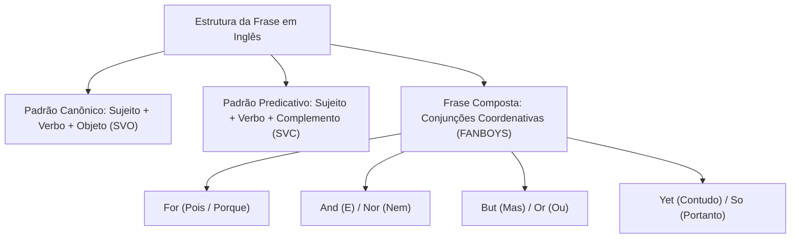
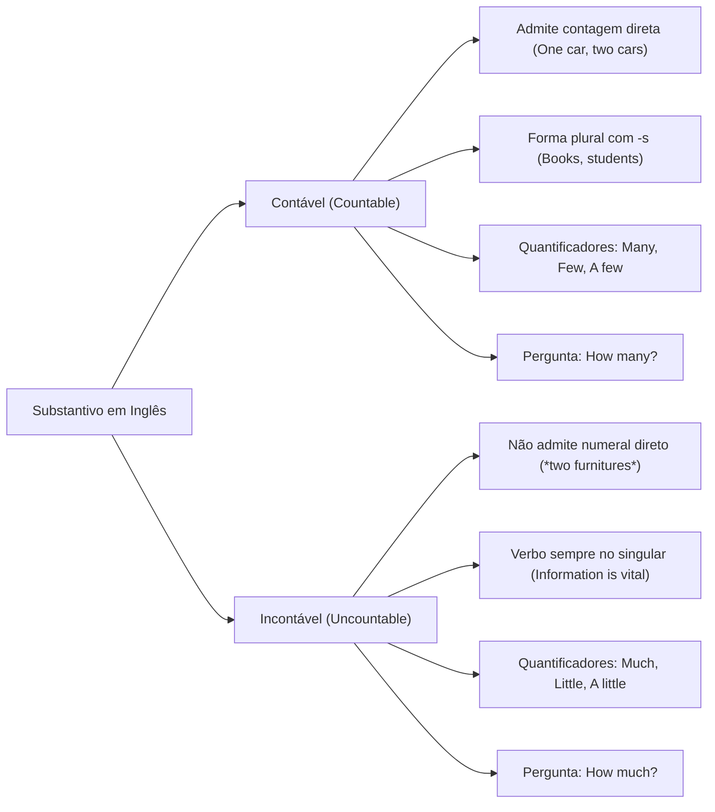
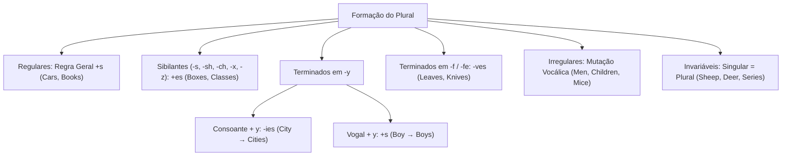
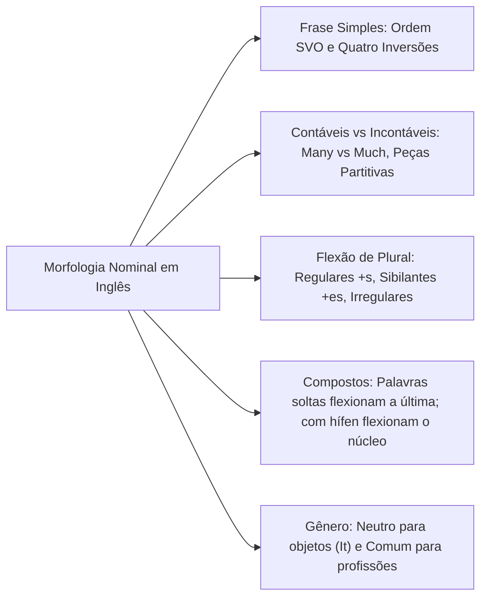

A compreensão de textos em língua inglesa nos concursos exige domínio sólido da organização oracional. As questões de prova exploram a identificação de funções sintáticas e a flexão de plural. Além disso, avaliam a distinção entre termos contáveis e incontáveis.

Reconhecer como as frases se estruturam confere velocidade à leitura. Este capítulo disseca a ordem canônica dos elementos na frase e a classificação dos substantivos. Também examina as regras de plural e a flexão de gênero nominal na língua inglesa.

> [!objetivos]
> - Compreender a organização canônica da frase simples e identificar os quatro casos de inversão sintática.
> - Diferenciar substantivos contáveis e incontáveis, dominando os quantificadores adequados.
> - Aplicar com precisão as regras gerais, exceções e formas irregulares do plural dos substantivos.
> - Reconhecer as distinções de gênero nominal e identificar termos com forma única para ambos os sexos.

## Formação de Frases na Língua Inglesa

A língua inglesa organiza suas sentenças a partir de oito classes gramaticais fundamentais. Essas classes incluem substantivo (*noun*), pronome (*pronoun*), verbo (*verb*) e adjetivo (*adjective*). Incluem ainda advérbio (*adverb*), preposição (*preposition*), artigo (*article*) e conjunção (*conjunction*). Cada classe desempenha papel específico na articulação lógica do pensamento.

A frase simples (*simple sentence*) consiste em uma única oração independente. Ela possui sujeito e predicado com verbo conjugado. A ordem canônica padrão em inglês é a estrutura SVO (Sujeito + Verbo + Objeto). A frase pode assumir também o formato SVC (Sujeito + Verbo + Complemento do Sujeito):

- **Estrutura SVO direta:** *The officer inspected the equipment.* O sujeito é *The officer*, o verbo é *inspected* e o objeto direto é *the equipment*.
- **Estrutura SVO com dois objetos:** *He gave the box to the woman.* O termo *the box* funciona como objeto direto. Já *to the woman* atua como objeto indireto.
- **Estrutura SVC predicativa:** *My students are friendly.* O adjetivo *friendly* funciona como predicativo do sujeito. O mesmo vale para *The student is intelligent*.

A ordem direta pode sofrer alterações pela anteposição de complementos adverbiais. Veja o exemplo: *At noon, my grandma wants BBQ (churrasco) for lunch*. O advérbio antecipado não altera a estrutura verbal básica. 

Em frases compostas (*compound sentences*), duas orações independentes unem-se por ponto e vírgula. Também podem unir-se pelas conjunções coordenativas **FANBOYS**: *for, and, nor, but, or, yet, so*. Observe o exemplo: *He works at the fire station; his wife works nearby*. O conectivo *so* indica conclusão, enquanto *yet* introduz ressalva.

## Os Quatro Casos de Inversão em Relação ao Português

O estudante brasileiro depara-se com quatro padrões sintáticos ingleses. Esses padrões invertem a ordem habitual do português:

1. **Perguntas com verbos auxiliares ou to be:** O verbo auxiliar antecede o sujeito na interrogativa: *Are you a police officer?*.
2. **Negações com partículas pós-verbais:** A partícula negativa *not* posiciona-se após o verbo auxiliar: *I am not Brazilian*. Não se diz "I not am".
3. **Anteposição do adjetivo modificador:** O adjetivo atributivo posiciona-se antes do substantivo que qualifica: *an American lawyer*, *a brave firefighter*.
4. **O caso genitivo (*'s*):** A estrutura de posse inverte o possuidor e a coisa possuída: *John's computer* (o computador de John), *the captain's orders*.

> [!bizu]
> Ao traduzir orações com adjetivos antepostos ou caso genitivo, faça a leitura visual de trás para frente. Em *the new commander's official car*, leia primeiro o núcleo substantivo final (*o carro oficial*). Depois, leia o possuidor com seus atributos (*do novo comandante*).

Como esses fatores podem afetar (*affect*) a interpretação textual? As inversões podem gerar confusão quando dispersas entre outros elementos (*amongst other elements*). Manter a atenção na ordem sintática garante leitura segura.

## Conceito, Funções e Tipos de Substantivos

O substantivo (*noun*) nomeia pessoas, animais, lugares, coisas concretas e instituições. Também nomeia estados morais (*moral values*) e conceitos abstratos. Dentro da oração, o substantivo exerce funções variadas. Pode atuar como sujeito, objeto direto ou objeto indireto. Pode atuar ainda como predicativo, aposto ou modificador de outro substantivo (*noun adjunct*).

Os substantivos dividem-se morfologicamente em simples e compostos:
- **Substantivos simples (*simple nouns*):** Apresentam uma única raiz lexical (*government, student, house, water*).
- **Substantivos compostos (*compound nouns*):** Reúnem duas ou mais palavras em uma unidade semântica. Podem ser grafados juntos (*sunrise, haircut, toothpaste*). Podem ser grafados separados (*ice cream, fire truck, police station*). Podem ainda ser ligados por hífen (*mother-in-law, passer-by*).

Em textos de provas, palavras terminadas no sufixo *-ing* podem atuar como substantivos plenos. Quando uma forma em *-ing* vem precedida de artigo e seguida de preposição, trata-se de um substantivo (*noun*): *there isn't yet an understanding of the legal framework*.

| Categoria | Definição Morfossintática | Exemplos em Inglês | Tradução ao Português |
| :--- | :--- | :--- | :--- |
| **Próprio (*proper*)** | Nomeia seres ou lugares individualizados | *Brazil, London, Mary, Peter* | Brasil, Londres, Maria, Pedro |
| **Comum (*common*)** | Nomeia categorias genéricas de seres | *city, soldier, river, animal* | cidade, soldado, rio, animal |
| **Concreto (*concrete*)** | Designa seres com existência física própria | *table, helmet, dog, book* | mesa, capacete, cachorro, livro |
| **Abstrato (*abstract*)** | Designa sensações, ideias e virtudes | *courage, justice, motivation* | coragem, justiça, motivação |
| **Composto (*compound*)**| Une dois ou mais radicais em um único termo| *ice cream, firefighter, haircut*| sorvete, bombeiro, corte de cabelo |

## Substantivos Contáveis e Incontáveis

A distinção entre substantivos contáveis (*countable nouns*) e incontáveis (*uncountable nouns*) representa um dos temas mais recorrentes nos concursos públicos.

### Substantivos Contáveis (*Countable*)

Substantivos contáveis designam seres e objetos que existem em unidades individualizadas. Eles admitem contagem numérica direta. Aceitam artigos indefinidos (*a/an*) no singular e possuem forma plural regular ou irregular:
- *One book, two books, three books*.
- *A firefighter, two firefighters*.
- Duas garrafas de vinho: *two bottles of wine*. O vinho em si é incontável, mas as garrafas (*bottles*) são contáveis.
- Quantificadores típicos: *many* (muitos/muitas), *few* (poucos/poucas), *a few* (alguns/algumas), *a number of*.
- Pergunta quantitativa associada: *How many?* (*How many soldiers are on duty?*).

### Substantivos Incontáveis (*Uncountable*)

Substantivos incontáveis designam massas contínuas, matérias, fluidos ou noções abstratas. Eles não podem ser divididos em unidades numéricas isoladas. Não admitem numerais diretos (*não existe "two musics"*). Não aceitam plural e não recebem *a/an*:
- **Líquidos e gases:** *water, milk, wine (vinho), coffee, oil, air, oxygen*.
- **Materiais em pó e grãos:** *sugar, salt, rice, wheat, sand, flour*.
- **Substâncias e materiais:** *wood, gold, silver, iron, glass, plastic*.
- **Fenômenos meteorológicos:** *weather, rain, snow, thunder, fog*.
- **Sentimentos e estados:** *courage, patience, stress, childhood, anger, happiness*.
- **Grandezas e massas genéricas:** *information, advice, furniture, luggage, baggage, news, bread, money, work, research, homework, traffic, equipment*.

Quantificadores típicos para termos incontáveis incluem *much* (muito/muita), *little* (pouco/pouca), *a little* (um pouco de) e *a great deal of*. A pergunta quantitativa associada é obrigatoriamente *How much?* (*How much equipment was lost?*).

> [!pegadinha]
> Palavras como *information, advice, furniture, luggage* e *news* são incontáveis em inglês! Dizer "two informations" ou "an advice" é erro gravíssimo. A palavra *news* termina na letra -s, mas é singular incontável (*The news is encouraging*). Para individualizar uma unidade, usam-se expressões partitivas: *a piece of information, a piece of advice, a piece of furniture, a loaf of bread, a bar of soap*.

## Plural dos Substantivos

A formação do plural em língua inglesa distribui-se entre processos regulares, adaptações fonéticas e mutações históricas irregulares.

### Regra Geral de Plural

A grande maioria dos substantivos forma o plural adicionando (*adicionando*) a desinência *-s* à forma singular:
- *Book* → *Books*
- *Car* → *Cars*
- *Officer* → *Officers*
- *Student* → *Students*

### Substantivos Terminados em Sons Sibilantes

Palavras terminadas em sons sibilantes (*-s, -ss, -sh, -ch, -x, -z*) recebem a terminação *-es* no plural. Esse acréscimo facilita a pronúncia:
- *Bus* → *Buses*
- *Class* → *Classes*
- *Wish* → *Wishes*
- *Watch* → *Watches*
- *Box* → *Boxes*
- *Quiz* → *Quizzes* (com duplicação da consoante final)
- *Sandwich* → *Sandwiches*

### Substantivos Terminados em -o

Os substantivos terminados na vogal *-o* dividem-se em dois grupos morfológicos:
- **Precedidos de consoante que recebem -es:** Vocábulos consolidados pelo uso tradicional: *tomato → tomatoes, potato → potatoes, hero → heroes, echo → echoes, mosquito → mosquitoes, cargo → cargoes*.
- **Termos técnicos, musicais e abreviações que recebem apenas -s:** *photo → photos, piano → pianos, radio → radios, kilo → kilos, studio → studios, video → videos, solo → solos*.
- **Termos com formas duplas aceitas:** *volcano → volcanos* ou *volcanoes*.

### Substantivos Terminados em -y

A regra do plural depende da letra que antecede a consoante *-y*:
- **Consoante + y:** Elimina-se a letra *-y* e acrescenta-se a terminação *-ies*: *duty → duties, city → cities, country → countries, party → parties*.
- **Vogal + y:** Mantém-se o *-y* inalterado e acrescenta-se apenas *-s*: *boy → boys, day → days, key → keys, guy → guys*.

### Substantivos Terminados em -f ou -fe

Um grupo expressivo de substantivos transforma o fonema final em *-ves* no plural:
- *Leaf* → *Leaves*
- *Wolf* → *Wolves*
- *Life* → *Lives*
- *Knife* → *Knives*
- *Wife* → *Wives*
- *Half* → *Halves*
- *Thief* → *Thieves*

Por outro lado, substantivos com raízes históricas distintas recebem apenas a desinência regular *-s*: *roof → roofs, chief → chiefs, cliff → cliffs, belief → beliefs*.

### Plurais Irregulares por Mutação Vocálica e Formas Especiais

Determinados substantivos herdam processos do inglês antigo. Eles formam o plural por mutação da vogal interna:
- *Man* → *Men*
- *Woman* → *Women*
- *Child* → *Children*
- *Tooth* → *Teeth*
- *Foot* → *Feet*
- *Goose* → *Geese*
- *Mouse* → *Mice*
- *Louse* → *Lice*
- *Ox* → *Oxen*
- *Person* → *People*

### Plurais Invariáveis e Palavras Estrangeiras

Certos nomes mantêm a mesma forma gráfica no singular e no plural. O contexto oracional revela o número gramatical:
- *Sheep* → *Sheep* (*one sheep / five sheep*)
- *Deer* → *Deer*
- *Fish* → *Fish* (a forma *fishes* restringe-se a diferentes espécies biológicas)
- *Species* → *Species*
- *Series* → *Series*
- *Aircraft* → *Aircraft*

Palavras de raiz grega e latina conservam suas terminações clássicas:
- *Crisis* → *Crises*
- *Phenomenon* → *Phenomena*
- *Criterion* → *Criteria*
- *Analysis* → *Analyses*
- *Datum* → *Data*

## Plural de Substantivos Compostos

A formação do plural em substantivos compostos depende da estrutura gráfica das palavras combinadas. A regra geral varia conforme o uso de palavras separadas ou elementos ligados por hífen.

Nos compostos formados por duas palavras soltas, apenas o último vocábulo flexiona-se para marcar o plural. Observe o caso clássico das latas de refrigerante (*soda cans* ou *sodas*): no singular dizemos *soda can*, e no plural flexionamos exclusivamente o termo final *soda cans*. O mesmo princípio aplica-se a termos militares e urbanos cotidianos:
- *Police officer* → *Police officers*
- *Fire truck* → *Fire trucks*
- *Toothbrush* → *Toothbrushes*
- *Gas station* → *Gas stations*

Nos compostos com hífen formados por preposições ou advérbios, a flexão ocorre no substantivo principal. O elemento que atua como núcleo semântico recebe a terminação plural:
- *Mother-in-law* → *Mothers-in-law* (sogras)
- *Commander-in-chief* → *Commanders-in-chief* (comandantes em chefe)
- *Passer-by* → *Passers-by* (transeuntes)

> [!atencao]
> Quando o composto hifenizado não contiver nenhum substantivo em sua estrutura, a marca de plural é transferida para o elemento final: *grown-up → grown-ups* (adultos).

## Gênero dos Substantivos (*Nouns Gender*)

Diferentemente do português, a língua inglesa não atribui gênero gramatical arbitrário a objetos e conceitos abstratos. Todos os seres inanimados pertencem ao gênero neutro (*neuter gender*) e são representados pelo pronome singular *it*.

O gênero biológico manifesta-se nos seres sexuados por meio de três sistemas lexicais:

### Substantivos Comuns de Dois Gêneros (*Common Gender*)

A grande maioria das profissões e designações humanas possui uma forma única invariável para ambos os sexos:
- *Teacher* (docente ou educador, homem ou mulher)
- *Doctor* (médico ou médica)
- *Student* (estudante de qualquer sexo)
- *Lawyer* (advogado ou advogada)
- *Police officer* (policial masculino ou feminino)
- *Firefighter* (bombeiro ou bombeira militar)
- *Engineer* (engenheiro ou engenheira)
- *Accountant* (contador ou contadora)
- *Nurse* (enfermeiro ou enfermeira)
- *Janitor* (zelador ou zeladora)

### Substantivos com Formas Lexicais Distintas

Determinados seres humanos e animais expressam o sexo biológico por pares heterônimos ou sufixos derivacionais (*-ess*):

| Masculino (*Male*) | Feminino (*Female*) | Tradução ao Português |
| :--- | :--- | :--- |
| *actor* | *actress* | ator / atriz |
| *waiter* | *waitress* | garçom / garçonete |
| *prince* | *princess* | príncipe / princesa |
| *king* | *queen* | rei / rainha |
| *emperor* | *empress* | imperador / imperatriz |
| *man* | *woman* | homem / mulher |
| *boy* | *girl* | menino / menina |
| *father* | *mother* | pai / mãe |
| *son* | *daughter* | filho / filha |
| *brother* | *sister* | irmão / irmã |
| *uncle* | *aunt* | tio / tia |
| *nephew* | *niece* | sobrinho / sobrinha |
| *husband* | *wife* | marido / esposa |
| *monk* | *nun* | monge / freira |
| *policeman* | *policewoman* | policial homem / policial mulher |
| *bull* | *cow* | touro / vaca |
| *rooster* | *hen* | galo / galinha |
| *lion* | *lioness* | leão / leoa |

> [!esquema]
> **Padrões de Gênero em Inglês:**
> - Objetos e Ideias Inanimadas → Gênero Neutro (*It*).
> - Profissões Modernas → Gênero Comum (*Doctor, Lawyer, Firefighter*).
> - Pessoas e Animais Específicos → Pares Lexicais (*Nephew / Niece, Waiter / Waitress*).

## Mapa do capítulo

### Para fixar

- A frase simples organiza-se na ordem SVO ou SVC, e orações coordenadas unem-se pelas conjunções FANBOYS.
- As quatro inversões estruturais ocorrem em perguntas, negações com *not*, adjetivo anteposto e caso genitivo.
- Substantivos contáveis aceitam numerais diretos e plural, quantificados por *many* e indagados por *how many*.
- Substantivos incontáveis (*water, advice, information, news*) não admitem plural direto e usam quantificadores como *much*.
- A regra geral de plural acrescenta *-s*, sibilantes recebem *-es* e consoante + *y* converte-se em *-ies*.
- Terminados em *-f/-fe* transformam-se com frequência em *-ves* (*leaves, knives, lives*), com exceções como *roofs*.
- Plurais irregulares essenciais incluem *men, women, children, teeth, feet, mice* e a forma invariável *sheep*.
- Seres inanimados pertencem ao gênero neutro (*it*), e designações profissionais possuem forma única para ambos os sexos.
