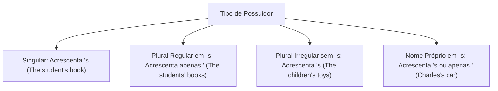
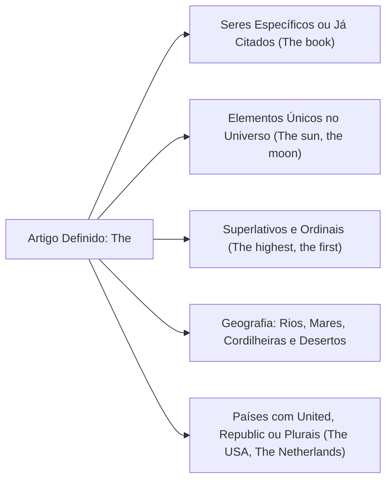
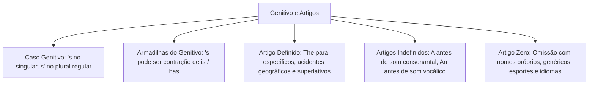

O estudo das relações de posse e dos artigos determinantes constitui ponto alto nos exames de proficiência em língua inglesa. O candidato precisa interpretar com exatidão construções sintáticas compactas que condensam informações essenciais.

Compreender o funcionamento do caso genitivo e o emprego dos artigos definidos e indefinidos evita armadilhas em enunciados analíticos. Este capítulo sistematiza as regras do caso genitivo, o emprego do artigo definido *the*, as particularidades fonéticas de *a* e *an* e as hipóteses de artigo zero.

> [!objetivos]
> - Aplicar as regras de posse do caso genitivo (*'s* e *s'*), diferenciando posse singular, plural, compartilhada e individual.
> - Distinguir o apóstrofo genitivo das contrações verbais dos verbos *is* e *has*.
> - Dominar os usos e restrições geográficas do artigo definido *the*.
> - Empregar os artigos indefinidos *a* e *an* com base no critério estritamente fonético do som inicial.
> - Reconhecer os contextos de omissão obrigatória do artigo (*zero article*) na norma culta.

## O Caso Genitivo e a Expressão de Posse (*The Genitive Case*)

O caso genitivo (*the genitive case* ou *possessive case*) expressa relações de posse, parentesco, autoria ou características associadas a seres animados. Em língua inglesa, essa relação constrói-se preferencialmente por meio do apóstrofo acompanhado da letra *-s* (*'s*).

A estrutura sintática inverte a ordem em relação ao português: o elemento possuidor antecede obrigatoriamente a coisa possuída. Observe os exemplos fundamentais:
- *The student's notebook* (o caderno do estudante).
- *The Queen's palaces* (os palácios da rainha).
- *Tesla's interest in electrical invention* (o interesse de Tesla pela invenção elétrica).

Na tradução para o português, a leitura processa-se de trás para frente. Primeiramente identifica-se o objeto ou conceito possuído. Em seguida, lê-se o possuidor introduzido pela preposição "de".

### Regras Gerais de Formação do Genitivo

A aplicação do apóstrofo varia conforme o número gramatical e a terminação do possuidor:

1. **Possuidor singular:** Acrescenta-se *'s* à forma singular, mesmo que o substantivo termine na letra -s:
   - *The officer's badge* (o distintivo do policial).
   - *The girl's uniform* (o uniforme da garota).
   - *James's book* ou *James' book* (o livro de James). No padrão culto acadêmico, a forma *James's* é recomendada por registrar a pronúncia completa da sílaba.

2. **Possuidor plural terminado em -s:** Acrescenta-se apenas o apóstrofo após a consoante *-s*:
   - *The students' notebooks* (os cadernos dos estudantes).
   - *The teachers' lounge* (a sala dos docentes).
   - *The Queens' palaces* (os palácios das rainhas).

3. **Possuidor plural irregular (não terminado em -s):** Acrescenta-se *'s* normalmente:
   - *The children's toys* (os brinquedos das crianças).
   - *Women's rights* (os direitos das mulheres).
   - *The men's room* (o banheiro dos homens).
   - *People's opinions* (a opinião das pessoas).

## Casos Especiais e Armadilhas do Caso Genitivo

O caso genitivo envolve sutilezas semânticas frequentes em textos jornalísticos e jurídicos.

### Posse Compartilhada versus Posse Separada

A posição do apóstrofo define se o bem pertence conjuntamente aos envolvidos ou se cada um possui um elemento independente:
- **Posse conjunta (compartilhada):** O apóstrofo incide unicamente sobre o último possuidor mencionado:
  - *James and Mary's house* (uma única casa pertencente a ambos os cônjuges).
  - *Tom and Jerry's room* (um quarto compartilhado pelos dois).
- **Posse separada (individual):** O apóstrofo é adicionado a cada um dos possuidores:
  - *James's and Mary's houses* (duas casas distintas, pertencendo uma a James e outra a Mary).
  - *Bob's and Mary's children* (filhos de casamentos anteriores de cada um).

### Posse com Seres Inanimados e Expressões Temporais

Com coisas inanimadas e objetos físicos, a regra geral emprega a preposição *of*:
- *The door of the fire station* (a porta do quartel de bombeiros).
- *The roof of the building* (o telhado do edifício).
- *The leg of the table* (o pé da mesa).

Todavia, o caso genitivo é plenamente aceito com entidades inanimadas nos seguintes contextos consagrados:
- **Expressões de tempo e medida:** *today's news, yesterday's briefing, a week's delay, two hours' drive*.
- **Lugares geográficos, cidades e nações:** *Brazil's economy, London's public transport, the city's population*.
- **Planetas e corpos celestes:** *the Earth's atmosphere, the Sun's rays*.
- **Organizações e coletivos humanos:** *the company's policy, the government's decision, the team's victory*.

### Omissão do Substantivo Possuído

Quando a coisa possuída é evidente ou já foi mencionada, o substantivo pode ser omitido:
- *The blue car is James's* (o carro azul é o [carro] de James).
- *I am going to the doctor's* (ao consultório do médico).
- *She bought bread at the baker's* (na padaria).
- *We celebrated at St. Paul's* (na Catedral de São Paulo).

> [!pegadinha]
> A grafia *'s* possui três funções completamente distintas na língua inglesa:
> 1. **Marca de posse (caso genitivo):** *The officer's gun was inspected; The instructor's PowerPoint presentation was clear.*
> 2. **Contração do verbo is:** *It's better now* (*It is better*); *There's a way* (*There is a way*); *That's storing data* (*That is storing data*).
> 3. **Contração do verbo auxiliar has:** *He's gone home* (*He has gone home*); *Richard's arrived* (*Richard has arrived*).
> Em provas, verifique se a palavra seguinte é um substantivo possuído. Exemplos como *Emmett's car*, *Johnson's office* e *Mary's book* indicam posse genuína. Por outro lado, construções como *He's spurred by ambition* ou *The commander intends to analyze what's happening* contêm contrações verbais!

| Exemplo na Frase | Função Morfossintática do 's | Explicação Gramatical |
| :--- | :--- | :--- |
| *The commander's office is closed.* | Caso Genitivo de Posse | Indica que o escritório pertence ao comandante |
| *He's working at the hospital today.* | Contração do Verbo *is* | Equivale a *He is working* (presente contínuo) |
| *She's already finished the report.* | Contração do Auxiliar *has* | Equivale a *She has finished* (present perfect) |
| *There's a meeting scheduled for noon.*| Contração de *there is* | Indica existência de uma reunião (*meeting*) |
| *Brazil's exports grew this quarter.* | Caso Genitivo de Posse | Aplicação com nação indicando as exportações do país |

## O Artigo Definido (*The Definite Article*)

O artigo definido na língua inglesa é uma palavra invariável: *the*. Ele corresponde aos artigos portugueses o, a, os e as. Não sofre flexão de gênero nem de número (*the boy, the girl, the boys, the girls*).

A pronúncia da palavra *the* altera-se conforme o som da palavra seguinte:
- Diante de sons consonantais, pronuncia-se com vogal reduzida: /ðə/ (*the car, the book, the police*).
- Diante de sons vocálicos, pronuncia-se de forma alongada: /ðiː/ (*the apple, the officer, the hour*).

### Empregos Obrigatórios do Artigo Definido

O artigo *the* utiliza-se quando o interlocutor consegue identificar exatamente o referente:

1. **Elementos únicos na natureza e no universo:** *the sun, the moon, the world, the sky, the universe, the ozone layer*.
2. **Seres ou objetos já mencionados anteriormente no texto:** *A police officer arrived at the scene. The officer began the investigation.*
3. **Adjetivos no grau superlativo e numerais ordinais:** *the best candidate, the most important rule, the first step, the second round*.
4. **Instrumentos musicais após verbos como play:** *play the guitar, play the piano, play the flute*.
5. **Acidentes geográficos aquáticos e relevos compostos:**
   - Oceanos e mares: *the Atlantic Ocean, the Pacific, the Mediterranean Sea*.
   - Rios: *the Amazon River, the Nile, the Mississippi*.
   - Cordilheiras de montanhas: *the Andes, the Alps, the Rocky Mountains*.
   - Desertos, golfos e canais: *the Sahara Desert, the Persian Gulf, the Panama Canal*.
   - Grupos de ilhas e arquipélagos: *the Canary Islands, the Philippines, the Bahamas*.
6. **Países com nomes plurais ou que contêm palavras institucionais (*Republic, Kingdom, States*):**
   - *The United States*
   - *The United Kingdom*
   - *The Netherlands*
   - *The Dominican Republic*
   - *The Czech Republic*
7. **Famílias no plural (designando o grupo familiar completo):** *the Smiths, the Jacksons*.
8. **Grupos sociais ou adjetivos substantivados no plural:** *the rich, the poor, the elderly, the homeless*.

## Os Artigos Indefinidos (*A* e *An*)

Os artigos indefinidos em inglês são duas formas fonéticas distintas de uma mesma categoria: *a* e *an*. Ambos traduzem-se por "um" ou "uma". São empregados exclusivamente diante de substantivos contáveis no singular quando o referente não é específico ou é introduzido pela primeira vez.

A seleção entre *a* e *an* depende exclusivamente do **som inicial** da palavra seguinte. A grafia das letras não define essa escolha.

### O Emprego do Artigo *A*

Emprega-se a forma *a* diante de palavras iniciadas por **som consonantal**:
- Diante de consoantes regulares: *a car, a house, a company, a banana, a report, a drop, a woman*.
- Diante da consoante *w*: *a window, a week, a woman, a weapon*.
- Diante da letra *u* com som semivocálico /juː/ (equivalente a "y"): *a university, a union, a user, a uniform, a unique case, a used car*.
- Diante de palavras iniciadas pela letra *e* com som de /juː/: *a European country*.
- Diante da letra *o* com som de /w/: *a one-way street, a one-time charge, a one-dollar bill*.

### O Emprego do Artigo *An*

Emprega-se a forma *an* diante de palavras iniciadas por **som vocálico**:
- Diante de vogais comuns com som de vogal: *an apple, an elephant, an orange, an economist, an attorney, an emergency, an offer, an island*.
- Diante da letra *h* muda (sem emissão fonética de sopro): *an hour, an honest man, an heir, an honor*.
- Diante de siglas pronunciadas letra por letra cujo primeiro fonema soa como vogal: *an FBI agent* (pronuncia-se /ef-bi-ai/), *an SOS message* (/es-ou-es/), *an NGO* (/en-dji-ou/), *an MBA degree*.

> [!bizu]
> Guarde os quatro termos com *h* mudo mais cobrados em concursos: *hour* (hora), *honest* (honesto), *heir* (herdeiro) e *honor* (honra). Diante de todas essas palavras, usa-se obrigatoriamente *an* (*an hour, an honest officer*). Já quando o *h* for pronunciado com sopro glotal aspirado, usa-se *a* (*a house, a hospital, a hero, a helicopter*).

| Palavra Seguinte | Som Inicial Fonético | Artigo Correto | Justificativa Fonética |
| :--- | :--- | :--- | :--- |
| *university* | Som semivocálico /juː/ | **a** *university* | O som inicial comporta-se como consoante fonética |
| *European* | Som semivocálico /juː/ | **a** *European* | Pronúncia similar ao fonema de *you* |
| *hour* | Som vocálico puro /aʊər/ | **an** *hour* | A consoante *h* é totalmente muda |
| *house* | Consoante aspirada /haʊs/ | **a** *house* | A consoante *h* é pronunciada com som glotal |
| *honest* | Som vocálico puro /ˈɒnɪst/| **an** *honest* | A consoante inicial é muda |
| *FBI agent* | Som vocálico /ef/ | **an** *FBI agent* | A primeira letra da sigla soa com fonema aberto |

## Plural dos Indefinidos e o Artigo Zero (*Zero Article*)

Na língua inglesa, os artigos indefinidos *a* e *an* não possuem forma plural correspondente ao português "uns" e "umas". Diante de substantivos contáveis no plural em sentido genérico, não se usa nenhum artigo (*books are important*). Para expressar quantidade indeterminada, empregam-se pronomes como *some* em orações afirmativas (*They inspected some vehicles*) ou *any* em sentenças negativas e interrogativas (*Did you see any suspects?*).

### Casos de Omissão do Artigo (*Zero Article*)

Denomina-se artigo zero a ausência deliberada de artigo antes de determinados substantivos. A norma gramatical veda o uso de *the* nas seguintes situações:

1. **Substantivos no plural e incontáveis usados em sentido amplo e genérico:**
   - *Water is essential for life.* (A água em geral é essencial; não se diz "The water is essential").
   - *Children need discipline.* (Crianças em geral; não "The children").
   - *Freedom of speech is a fundamental right.* (A liberdade de expressão).
2. **Nomes próprios de pessoas, títulos com nome e pronome possessivo:**
   - *Captain Miller ordered the advance.* (E não "The Captain Miller").
   - *My parents live in Recife.* (E não "The my parents").
3. **Nomes da maioria dos países, cidades, estados e continentes:**
   - *Brazil, England, Germany, France, Asia, Europe, Pernambuco, Paris*.
   - Exceção: apenas países com nomes plurais ou compostos políticos recebem *the* (*the USA, the UK*).
4. **Montanhas isoladas e lagos individuais:**
   - *Mount Everest, Mount Fuji, Lake Erie, Lake Victoria*.
   - Exceção: cadeias de montanhas e grupos de lagos recebem *the* (*the Andes, the Great Lakes*).
5. **Nomes de idiomas e esportes:**
   - *She speaks English fluently.* (E não "the English", a menos que venha acompanhado da palavra language: *the English language*).
   - *They play soccer every Saturday.* (E não "the soccer").
6. **Nomes de refeições cotidianas em sentido geral:**
   - *Breakfast, lunch, dinner, supper*.
   - *We had dinner at eight.* (E não "the dinner").
7. **Nomes de matérias escolares e áreas de conhecimento:**
   - *Mathematics, physics, history, chemistry*.
8. **Dias da semana e meses do ano:**
   - *Sunday is a peaceful day.*
   - *We met in March.*
9. **Lugares e instituições públicas visitados para sua função primordial:**
   - *Go to school* (como estudante para estudar).
   - *Go to hospital* (como paciente para tratamento).
   - *Go to prison* (como condenado para cumprir pena).
   - *Go to church* (para assistir ao culto religioso).
   - *Go to bed* (para dormir).
   - Contraste: se a visita ao local tem finalidade diversa da institucional primária, usa-se *the*: *The firefighter went to the school to inspect the fire extinguishers*.

> [!atencao]
> Substantivos abstratos e incontáveis dispensam artigo quando tomados em sentido universal (*Love conquers all*). Todavia, se o substantivo abstrato for especificado por uma oração adjetiva ou locução prepositiva delimitadora, o artigo *the* torna-se obrigatório: *The love that she showed was inspiring; The water of this river is polluted*.

> [!esquema]
> **Resumo Geral de Determinantes e Artigos:**
> - Coisas Específicas ou Já Mencionadas → Use *The* (*I am going to the meeting*).
> - Coisas Gerais no Singular Contável → Use *A* ou *An* (*I am going to a meeting*).
> - Coisas Gerais no Plural ou Incontáveis → Artigo Zero (*Water is vital; Meetings are productive*).

## Mapa do capítulo

### Para fixar

- O caso genitivo posiciona o possuidor antes da coisa possuída, invertendo a ordem habitual do português.
- Possuidores singulares recebem *'s* (*the officer's badge*), e plurais regulares em -s recebem apenas apóstrofo (*officers' badges*).
- A forma *'s* pode representar caso genitivo de posse ou contração verbal de *is* ou *has*.
- O artigo definido *the* é invariável em gênero e número, exigido diante de mares, rios e nações compostas.
- O artigo indefinido *a* aplica-se estritamente diante de sons consonantais (*a university, a European*).
- O artigo indefinido *an* emprega-se diante de sons vocálicos e palavras com *h* mudo (*an hour, an honest officer*).
- Os artigos indefinidos *a/an* não possuem forma plural, substituídos por *some* ou pela omissão total.
- O artigo zero ocorre com nomes de idiomas, esportes, dias da semana, continentes e conceitos abstratos genéricos.
