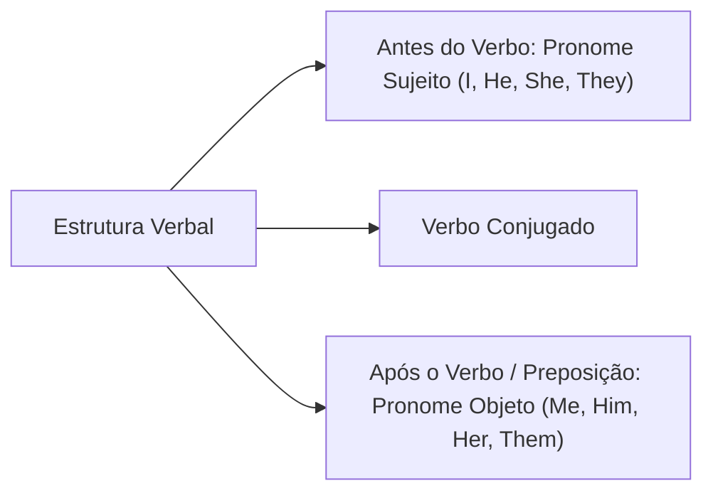
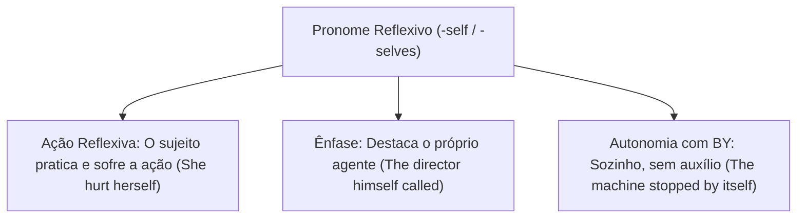
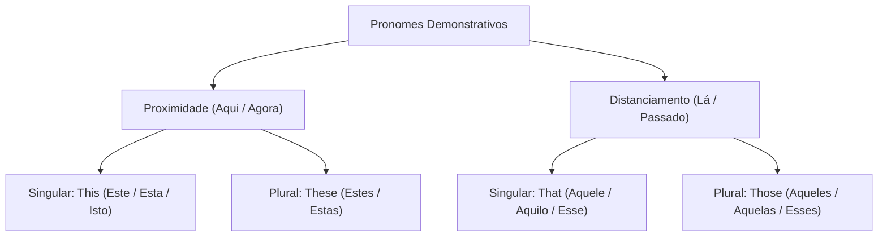
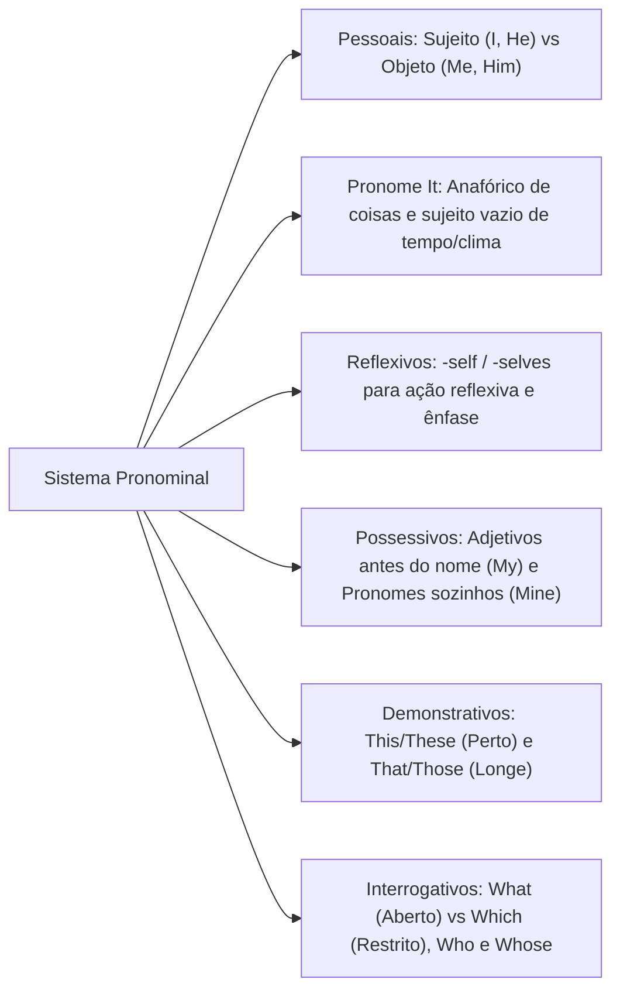

O domínio do sistema pronominal em língua inglesa constitui habilidade central para a interpretação de textos jornalísticos e documentos institucionais. As bancas examinadoras avaliam a capacidade de identificar a referência anafórica dos pronomes e resolver questões de coesão textual.

Compreender a distinção entre pronomes retos e oblíquos e dominar a flexão dos possessivos evita erros recorrentes de concordância. Este capítulo analisa a classificação e o emprego dos pronomes pessoais, reflexivos, possessivos, demonstrativos e interrogativos na norma culta contemporânea.

> [!objetivos]
> - Diferenciar pronomes pessoais do caso reto (*subject pronouns*) e do caso oblíquo (*object pronouns*).
> - Compreender os usos do pronome *it* como elemento anafórico e como sujeito vazio (*dummy subject*).
> - Dominar a formação e as funções reflexiva e enfática dos pronomes reflexivos (*reflexive pronouns*).
> - Distinguir adjetivos possessivos de pronomes possessivos substantivos na estrutura oracional.
> - Empregar com precisão os pronomes demonstrativos e interrogativos em perguntas abertas e restritas.

## Pronomes Pessoais: Sujeito e Objeto (*Personal Pronouns*)

Os pronomes pessoais desempenham papel estruturante na oração. Eles dividem-se em duas categorias morfossintáticas conforme a função desempenhada: pronomes do caso reto (*subject pronouns*) e pronomes do caso oblíquo (*object pronouns*).

Os pronomes retos funcionam obrigatoriamente como sujeito gramatical do verbo conjugado. Em inglês, a presença do pronome sujeito é imperativa, pois a conjugação verbal não explicita desinências para todas as pessoas gramaticais. Por sua vez, os pronomes oblíquos atuam como objetos diretos, objetos indiretos ou complementos regidos por preposições:

| Pessoa Gramatical | Pronome Sujeito (*Subject*) | Pronome Objeto (*Object*) | Tradução e Equivalência |
| :--- | :--- | :--- | :--- |
| **1ª pessoa do singular** | *I* | *me* | eu / me, mim |
| **2ª pessoa do singular** | *you* | *you* | você, tu / te, ti, você |
| **3ª pessoa singular masc.**| *he* | *him* | ele / o, lhe, ele |
| **3ª pessoa singular fem.** | *she* | *her* | ela / a, lhe, ela |
| **3ª pessoa singular neutra**| *it* | *it* | ele, ela (coisas e animais) / o, a, lhe |
| **1ª pessoa do plural** | *we* | *us* | nós / nos, nós |
| **2ª pessoa do plural** | *you* | *you* | vocês, vós / vos, vocês |
| **3ª pessoa do plural** | *they* | *them* | eles, elas / os, as, lhes, eles, elas |

A posição sintática orienta o emprego imediato na frase. O pronome sujeito posiciona-se antes da forma verbal: *John is a diligent worker. He arrives early.* O pronome objeto posiciona-se após o verbo transitivo ou após preposição: *The commander called him; I received a message from them.*

## O Pronome *It* e suas Particularidades Sintáticas

O pronome de terceira pessoa do singular *it* possui comportamentos gramaticais singulares que demandam atenção rigorosa do candidato.

### Função Anafórica de Coisas e Conceitos

O pronome *it* substitui termos singulares inanimados e conceitos abstratos. Ao analisar textos sobre a globalização (*globalization*), o pronome *it* retoma esse processo (*globalização*):
- *The company expanded its operations. It invested heavily in technology.* (O pronome *it* retoma o sujeito *the company*).
- *Some companies will import raw material. They will import it.* (O pronome *they* retoma *companies*, enquanto *it* retoma a matéria-prima singular *raw material*).
- *Brazil celebrated its independence. The country defended its sovereignty and the welfare of its inhabitants.* (O possessivo *its* retoma *Brazil*, qualificando sua independência (*independence*) e seus habitantes (*inhabitants*)).

### Função de Sujeito Vazio (*Dummy Subject* ou Impessoal)

Na língua inglesa não existe oração sem sujeito formal. Quando a oração expressa clima, horas ou datas, emprega-se o pronome *it* como sujeito gramatical vazio. Nessas construções impessoais, *it* não possui significado léxico e não se traduz:
- *It is raining heavily.* (Está chovendo intensamente).
- *It is twelve o'clock.* (São doze horas; meio-dia).
- *It's necessary to uphold the law.* (É necessário fazer cumprir a lei).
- *It will be a hard task.* (Será uma tarefa difícil).
- *It won't be explained today.* (Não será explicado hoje).
- *It would be defined by the director.* (Seria definido pela direção).

> [!pegadinha]
> Não confunda a contração *it's* com o possessivo *its*! 
> - *It's* contém apóstrofo e representa a contração de *it is* ou *it has* (*It's cold today*; *It's been a long day*).
> - *Its* não possui apóstrofo e é o adjetivo possessivo de coisas inanimadas (*The dog wagged its tail*; *The city changed its urban plan*).

Em provas de interpretação, perguntas sobre referência pronominal exigem localizar o antecedente mais compatível em cada segmento (*segment*) da narrativa. Em frases como "Saving teaches goal-setting. It emphasizes being prepared", o ato de economizar (*saving*) ensina (*ensina*) disciplina, e o pronome *it* retoma exatamente a prática de economizar (*saving*).

## Pronomes Reflexivos (*Reflexive Pronouns*)

Os pronomes reflexivos caracterizam-se pelo sufixo *-self* no singular e *-selves* no plural. Eles estabelecem concordância direta com a pessoa gramatical do sujeito da oração:

| Pronome Sujeito | Pronome Reflexivo | Significado em Português |
| :--- | :--- | :--- |
| *I* | *myself* | a mim mesmo, me |
| *you* (singular) | *yourself* | a ti mesmo, a você mesmo, se |
| *he* | *himself* | a si mesmo, a ele mesmo, se |
| *she* | *herself* | a si mesma, a ela mesma, se |
| *it* | *itself* | a si mesmo (neutro) |
| *we* | *ourselves* | a nós mesmos, nos |
| *you* (plural) | *yourselves* | a vocês mesmos, a vós mesmos, se |
| *they* | *themselves* | a si mesmos, a eles mesmos, se |

Os pronomes reflexivos desempenham três funções sintáticas fundamentais:

1. **Função reflexiva direta:** Indica que a ação praticada pelo sujeito recai sobre ele mesmo:
   - *When Mary cut her hand, she hurt herself.* (Quando Mary cortou a mão, machucou a si mesma).
   - *The soldier defended himself during the attack.*
2. **Função enfática:** Ressalta a identidade do agente da ação, posicionando-se logo após o sujeito ou no fim da oração:
   - *The commander himself signed the order.* (O próprio comandante assinou a ordem).
   - *I fixed the vehicle myself.* (Eu mesmo consertei o veículo).
3. **Expressão idiomática com a preposição *by*:** A estrutura *by + pronome reflexivo* expressa ação realizada sozinho, sem auxílio externo:
   - *The train stopped by itself.* (O trem parou por si só).
   - *He lives by himself.* (Ele mora sozinho).

> [!bizu]
> Observe expressões idiomáticas habituais em inglês: *Help yourself!* (Sirva-se, no singular) e *Enjoy yourselves!* (Divirtam-se, no plural). O sufixo *-selves* evidencia que o comando se dirige a mais de um interlocutor.

## Pronomes Possessivos: Adjetivos e Substantivos

A língua inglesa organiza os possessivos em duas séries com comportamentos sintáticos inteiramente distintos: **adjetivos possessivos** (*possessive adjectives*) e **pronomes possessivos substantivos** (*possessive pronouns*).

### Adjetivos Possessivos (*Possessive Adjectives*)

Os adjetivos possessivos funcionam como determinantes do substantivo. Eles posicionam-se obrigatoriamente **antes de um substantivo**, concordando com a pessoa do possuidor:
- *My wallet is black.* (Minha carteira é preta).
- *Your car is fast.* (Seu carro é veloz).
- *His brother is a firefighter.* (O irmão dele é bombeiro).
- *Her uniform is clean.* (O uniforme dela está limpo).
- *Its battery is dead.* (A bateria do aparelho está descarregada).
- *Our team achieved the target.* (Nossa equipe atingiu a meta).
- *Their house is nearby.* (A casa deles fica perto).

### Pronomes Possessivos Substantivos (*Possessive Pronouns*)

Os pronomes possessivos substantivos **substituem o substantivo**, evitando repetições desnecessárias. Eles nunca são seguidos por substantivos:
- *The dark notebook is mine.* (O caderno escuro pertence a mim; substitui *my notebook*).
- *My book is old and yours is new.* (*Yours* substitui *your book*).
- *Your car is blue, but mine is white.* (*Mine* substitui *my car*).
- *My neighbor is quiet, hers is noisy.* (*Hers* substitui *her neighbor*).
- *It is the children's room. The room is theirs.* (*Theirs* substitui *their room*).

| Pessoa Gramatical | Adjetivo Possessivo (Antes do Nome) | Pronome Possessivo (Substitui o Nome) |
| :--- | :--- | :--- |
| **1ª singular** | *my* (*my book*) | *mine* (*the book is mine*) |
| **2ª singular** | *your* (*your car*) | *yours* (*the car is yours*) |
| **3ª masc. sing.** | *his* (*his badge*) | *his* (*the badge is his*) |
| **3ª fem. sing.** | *her* (*her rank*) | *hers* (*the rank is hers*) |
| **3ª neutra sing.** | *its* (*its color*) | *(inexistente no padrão moderno)* |
| **1ª plural** | *our* (*our unit*) | *ours* (*the unit is ours*) |
| **2ª plural** | *your* (*your duties*) | *yours* (*the duties are yours*) |
| **3ª plural** | *their* (*their mission*) | *theirs* (*the mission is theirs*) |

> [!atencao]
> Observe a palavra *her*: ela pode ser pronome oblíquo ou adjetivo possessivo conforme a posição sintática na frase. Antes de um substantivo, *her* é possessivo (*her uniform*). Após verbo ou preposição, *her* é pronome oblíquo (*The officer saw her; John kissed her; We spoke to her*).

## Pronomes Demonstrativos (*Demonstrative Pronouns*)

Os pronomes demonstrativos situam seres, objetos e ideias no espaço físico, no tempo cronológico ou no próprio discurso. Eles variam quanto ao número gramatical e à distância em relação ao falante:

- **This** (este, esta, isto): Refere-se a elemento singular próximo do falante no espaço ou tempo presente: *This is my equipment.*
- **These** (estes, estas): Refere-se a elementos plurais próximos no espaço ou presente: *These are our instructions.*
- **That** (aquele, aquela, aquilo, esse, essa, isso): Refere-se a elemento singular distante no espaço ou passado: *That is a great idea.*
- **Those** (aqueles, aquelas, esses, essas): Refere-se a elementos plurais distantes no espaço ou tempo: *Those actors are very famous.*

Os demonstrativos podem atuar como pronomes autônomos (*This is my city*) ou como determinantes adjetivos colocados antes do nome (*This city is secure; Those soldiers showed bravery*).

## Pronomes Interrogativos (*Interrogative Pronouns*)

Os pronomes interrogativos introduzem perguntas diretas e indiretas, substituindo a informação desconhecida que se deseja obter:

1. **Who (quem):** Refere-se exclusivamente a pessoas na função de sujeito: *Who can speak English well?*
2. **Whose (de quem):** Pergunta sobre o proprietário de algo: *Whose radio is this?*
3. **What (o que / qual):** Emprega-se em perguntas abertas, quando o leque de respostas possíveis é ilimitado:
   - *What is your name?*
   - *What happened yesterday?*
   - *What kind of vehicle do you drive?*
4. **Which (qual / quais):** Emprega-se obrigatoriamente quando há um conjunto limitado ou restrito de opções para escolha:
   - *Which app is more secure: Telegram or WhatsApp?*
   - *Which of these two roads leads to the capital?*
   - *Which is your name: Lucas or Michael?*
5. **Advérbios interrogativos complementares:** *Where* (onde), *When* (quando), *Why* (por que), *How* (como), *How much* (quanto para incontáveis, como em *How much is a Mercedes?*), *How many* (quantos para contáveis) e *How long* (quanto tempo de duração).

> [!esquema]
> **Diferença Crucial entre What e Which:**
> - Opções Ilimitadas (Pergunta Aberta) → Use **What** (*What is your favorite book?*).
> - Opções Delimitadas (Escolha Restrita) → Use **Which** (*Which book do you want: this one or that one?*).

## Mapa do capítulo

### Para fixar

- Pronomes retos (*I, he, she, we, they*) atuam como sujeitos, e oblíquos (*me, him, her, us, them*) como objetos ou complementos.
- O pronome *it* atua na retomada de termos inanimados singulares e como sujeito vazio impessoal em orações climáticas e temporais.
- A grafia *it's* indica contração de *it is* ou *it has*, enquanto *its* é o adjetivo possessivo invariável de coisas.
- Pronomes reflexivos terminam em *-self* ou *-selves*, expressando ação reflexiva, ênfase subjetiva ou autonomia com *by*.
- Adjetivos possessivos (*my, your, our*) acompanham o substantivo, enquanto pronomes possessivos (*mine, yours, ours*) o substituem.
- O termo *her* funciona como adjetivo possessivo antes de substantivos e como pronome objeto após verbos e preposições.
- Demonstrativos expressam proximidade (*this/these*) e distanciamento (*that/those*) no singular e no plural.
- Pronomes interrogativos distinguem perguntas abertas (*what*) de escolhas limitadas entre alternativas conhecidas (*which*).
