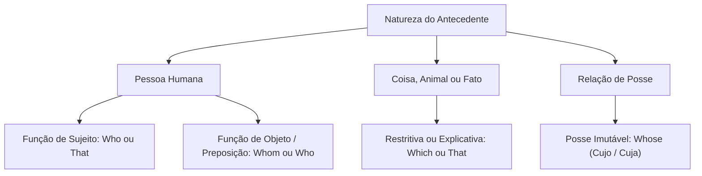
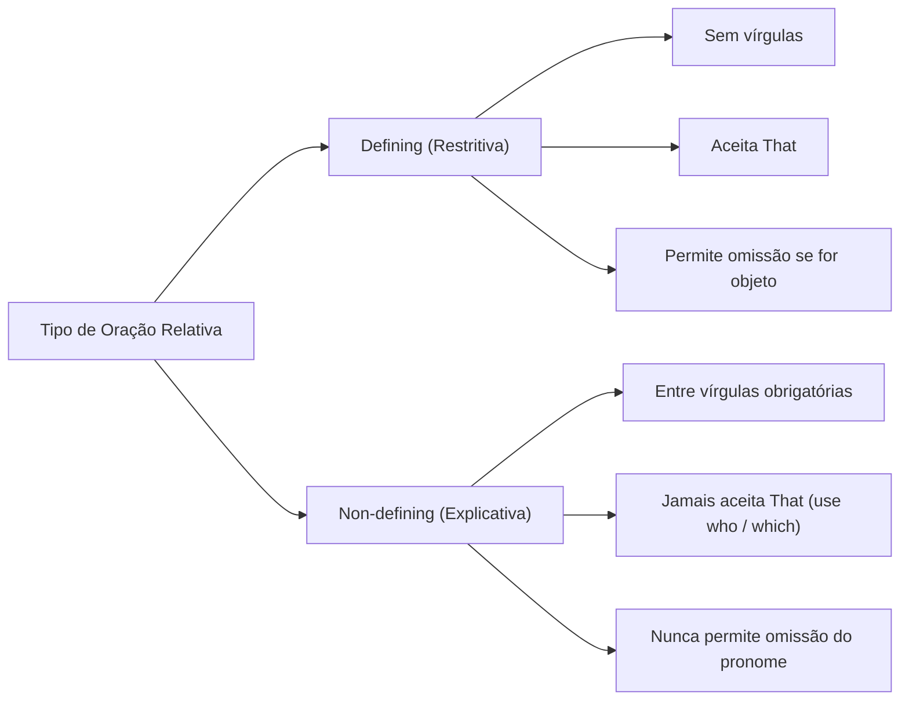
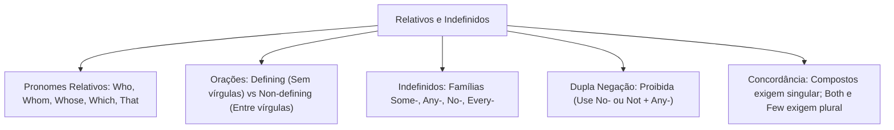

A articulação lógica de períodos complexos na língua inglesa fundamenta-se no emprego preciso dos pronomes relativos e indefinidos. Nas provas, as bancas avaliam a identificação do referente textual. Também cobram a diferenciação entre orações restritivas e explicativas.

Compreender o papel sintático do pronome relativo garante agilidade na interpretação. Além disso, dominar a concordância dos indefinidos evita erros gramaticais comuns. Este capítulo disseca os pronomes relativos e as orações *defining* e *non-defining*. Também analisa as famílias de pronomes indefinidos e a proibição da dupla negação.

> [!objetivos]
> - Diferenciar as orações relativas restritivas (*defining*) e explicativas (*non-defining*).
> - Empregar adequadamente os pronomes relativos *who, whom, whose, which* e *that*.
> - Reconhecer as hipóteses gramaticais em que o pronome relativo pode ser omitido na oração.
> - Dominar a distribuição semântica das famílias indefinidas *some-, any-, no-* e *every-*.
> - Aplicar o princípio da não ocorrência de dupla negação e as regras de concordância verbal dos indefinidos.

## Pronomes Relativos e a Estrutura da Oração Relativa

A oração relativa (*relative clause*) atua como termo dependente adjetivo. Ela modifica um substantivo ou pronome da oração principal. Esse termo modificado chama-se antecedente. O pronome relativo substitui esse antecedente na oração subordinada, posicionando-se logo após ele.

Na língua inglesa, a escolha do pronome relativo depende da natureza do antecedente. Depende se o termo é pessoa ou coisa. Depende também da função sintática exercida, como sujeito, objeto ou adjunto de posse:

| Pronome Relativo | Antecedente Referido | Função Sintática Típica | Exemplo Ilustrativo |
| :--- | :--- | :--- | :--- |
| **Who** | Pessoas | Sujeito da oração relativa | *The nurse who helped me was kind.* |
| **Whom** | Pessoas | Objeto direto ou após preposição | *The colleague whom I trust is here.* |
| **Whose** | Pessoas ou coisas | Relação de posse ("cujo / cuja") | *An official whose identity is secret.* |
| **Which** | Coisas, animais, orações | Sujeito ou objeto | *The report, which she wrote, is ready.* |
| **That** | Pessoas e coisas | Sujeito ou objeto restritivo | *The car that Jairus (Jairo) bought is fast.* |

Quanto à formalidade, a língua inglesa estabelece uma hierarquia clara. A forma *whom* situa-se no registro mais formal. A forma *who* atua no registro padrão neutro. Já a forma *that* predomina na linguagem cotidiana.

## Orações Restritivas (*Defining*) e Explicativas (*Non-defining*)

A distinção entre orações relativas restritivas e explicativas constitui tema clássico de concurso:

### Orações Restritivas (*Defining Relative Clauses*)

As orações restritivas fornecem informação indispensável para identificar o substantivo antecedente. Sem essa oração, o sentido da frase principal fica incompleto:
- Essas orações não são separadas por vírgulas.
- Elas aceitam o pronome *that* em substituição a *who* ou *which*. Observe: *The officer who arrived first secured the area* equivale a *The officer that arrived first secured the area*.
- Elas admitem a omissão do pronome relativo quando ele atua como objeto. Veja: *The tool that I bought was broken* pode ser escrita como *The tool I bought was broken*.

### Orações Explicativas (*Non-defining Relative Clauses*)

As orações explicativas trazem informação adicional sobre um antecedente já identificado:
- São grafadas obrigatoriamente entre vírgulas na frase.
- Nunca aceitam o pronome *that*. Usa-se apenas *who* para pessoas e *which* para coisas.
- Veja o exemplo: *My mother, who is 61, is an active citizen*. Dizer "My mother, that is 61" é erro grave.
- Outro exemplo com coisas: *The financial report, which she prepared, detailed the credit (crédito) lines*.
- O pronome relativo nunca pode ser omitido em orações explicativas.

## Análise de Referência e Regras Críticas dos Relativos

As bancas de concurso elaboram questões desafiadoras de referência textual. O candidato deve analisar as conexões oracionais com atenção analítica.

Em textos históricos, examine o exemplo dos lídios (*Lydians*): *The Lydians, around 600 BC, who minted the first coins, which were made of a powerful alloy of gold and silver, developed international commerce*. A oração com *who* liga a ação de produzir as primeiras (*primeiras*) moedas (*coins*) aos lídios (*Lydians*). O povo destacou-se ao fabricar (*fashioning / fabricar*) uma liga (*alloy*) metálica resistente. O pronome *who* retoma o povo e nunca a data cronológica de 600 a.C. (*600 BC*). Por sua vez, o pronome *which* retoma as moedas (*coins*). Elas eram feitas de ouro e prata, constituindo poderosas (*powerful*) ferramentas de comércio e crédito.

Em textos econômicos e notícias sobre instituições financeiras e bancos (*bancos*), considere a oração: *Modern banks in Brazil and Argentina rely on artificial intelligence and predictive analysis, which represents the central point of strategic decisions*. O pronome *which* retoma o ponto (*ponto*) central da análise preditiva vinculada à inteligência artificial (*artificial*). 

Nas provas de concurso, excertos jornalísticos premiados com o Prêmio Pulitzer (*Pulitzer*) ou análises corporativas sobre empresas como Qualcomm (*Qualcomm*) e dispositivos como *smartbooks* destacam termos em negrito (*bold*). Quando a banca pede para identificar algum (*algum*) antecedente em estruturas conhecidas (*conhecidas*), a análise do verbo e do núcleo nominal esclarece a referência exata.

### Regência Preposicional com Pronomes Relativos

Quando uma preposição precede diretamente o pronome relativo, a norma culta veda o uso de *that*. Emprega-se unicamente *whom* para pessoas ou *which* para coisas:
- *The officers, most of whom had tactical training, entered the facility.*
- *The treaty, under which the nations cooperate, was renewed.*

> [!bizu]
> Regra de ouro da omissão do pronome relativo: se após o pronome houver outro sujeito e verbo, o pronome pode ser omitido (*The house [which] they built*). Contudo, se após o relativo houver imediatamente um verbo conjugado, o pronome funciona como sujeito e não pode ser omitido (*The person who called you*).

## Pronomes Indefinidos e Famílias Derivadas

Os pronomes indefinidos referem-se a seres ou coisas de forma vaga ou indeterminada. Os compostos derivam de quatro raízes principais: *some-, any-, no-* e *every-*:

| Família Radical | Pessoas | Coisas | Lugares | Emprego Típico |
| :--- | :--- | :--- | :--- | :--- |
| **Some-** | *someone / somebody* | *something* | *somewhere* | Afirmativas e ofertas com resposta sim |
| **Any-** | *anyone / anybody* | *anything* | *anywhere* | Negativas, perguntas e sentido de qualquer |
| **No-** | *no one / nobody* | *nothing* | *nowhere* | Sentido negativo com verbo afirmativo |
| **Every-** | *everyone / everybody*| *everything*| *everywhere*| Totalidade universal com verbo singular |

O vocábulo *none* significa "nenhum" ou "nenhuma", funcionando como pronome autônomo. O pronome *all* indica a totalidade dos elementos.

### Regras de Emprego de *Some* e *Any*

A distribuição sintática de *some* e *any* orienta-se pela polaridade da frase:

1. **Some e compostos:** Empregam-se em sentenças afirmativas (*They found some evidence; Somebody knocked on the door*). Empregam-se também em perguntas de oferecimento ou solicitação (*Would you like some coffee?; Can I get some help?*).
2. **Any e compostos:** Empregam-se em três situações gramaticais claras:
   - Em orações negativas com partícula *not* ou verbo auxiliar negativo (*There aren't any errors; I didn't see anyone*).
   - Em orações interrogativas comuns de dúvida real (*Are there any questions?; Did anyone call?*).
   - Em orações afirmativas com sentido de "qualquer" (*Any soldier can volunteer; Take any route you prefer*). Usa-se também após *if* ou após palavras de carga negativa como *rarely, seldom, without*.

## O Princípio da Não Ocorrência de Dupla Negação

Na norma culta da língua inglesa, vigora o princípio estrito de que **não se admitem duas palavras negativas na mesma oração**. Uma mensagem negativa pode ser formulada por duas estruturas gramaticais legítimas:

| Estrutura com Raiz *No-* (Verbo Afirmativo) | Estrutura com *Not + Any-* (Verbo Negativo) | Tradução em Português |
| :--- | :--- | :--- |
| *He has no money.* | *He doesn't have any money.* | Ele não tem dinheiro. |
| *She talks to nobody.* | *She doesn't talk to anybody.* | Ela não fala com ninguém. |
| *There is nothing on the desk.* | *There isn't anything on the desk.* | Não há nada sobre a mesa. |
| *The suspect went nowhere.* | *The suspect didn't go anywhere.* | O suspeito não foi a lugar nenhum. |
| *The witness said no word.* | *The witness didn't say any word.* | A testemunha não disse nenhuma palavra.|

> [!pegadinha]
> Frases como "He doesn't have no money" ou "She didn't see nobody" constituem erros graves em concursos! A presença do auxiliar negativo *doesn't* ou *didn't* impede o uso de pronomes da família *no-*. A forma culta exige a família *any-* (*He doesn't have any money*).

## Concordância Verbal com Pronomes Indefinidos

A concordância verbal com termos indefinidos divide-se em três grupos objetivos:

### Pronomes que Exigem Verbo no Singular

Todos os compostos de *every-*, *some-*, *any-* e *no-* regem verbo no singular. O mesmo vale para *each, every* e *much*:
- *Everyone is ready for the mission.*
- *Everything in the room was inspected.*
- *Somebody refuses to answer.*
- *Nobody was injured.*
- *Each of the participants receives a certificate.*

### Pronomes que Exigem Verbo no Plural

Pronomes que trazem pluralidade intrínseca regem verbos no plural: *both, several, few, many, others*:
- *Both officers are present.*
- *Several witnesses were heard.*
- *Few suspects were detained.*

### Pronomes de Concordância Variável

Quando os termos *all, most, some, any* e *none* vêm acompanhados da preposição *of*, o verbo concorda com o substantivo posterior:
- Se o substantivo for singular ou incontável, o verbo fica no singular: *Most of the information is classified; Some of the fuel was lost*.
- Se o substantivo for plural contável, o verbo vai para o plural: *Most of the candidates were approved; Some of the documents were stolen*.

> [!atencao]
> A palavra *both* aplica-se rigorosamente a dois elementos e exige verbo no plural (*Both options are acceptable*). Na correlação *both... and...*, une dois núcleos aditivos com verbo no plural (*Both the captain and the sergeant were decorated*).

## Mapa do capítulo

### Para fixar

- O pronome *who* refere-se a pessoas, *which* a coisas e fatos oracionais, e *whose* expressa posse ("cujo").
- Orações restritivas (*defining*) identificam o antecedente, não usam vírgulas e aceitam o pronome *that*.
- Orações explicativas (*non-defining*) fornecem informação acessória entre vírgulas e jamais aceitam o pronome *that*.
- O pronome relativo só pode ser omitido quando funciona como objeto da oração subordinada.
- O pronome *some-* aplica-se a frases afirmativas e ofertas; *any-* a negativas e perguntas; *no-* traz sentido negativo próprio.
- A língua inglesa padrão veda a dupla negação: orações com verbos negativos exigem termos da família *any-*.
- Pronomes compostos como *everyone, somebody* e *nothing* exigem verbo conjugado no singular.
- Quantificadores como *most, some* e *all* concordam com o substantivo regido pela preposição *of*.
