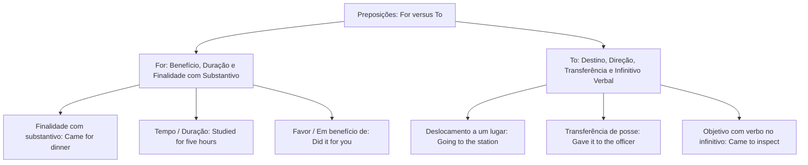
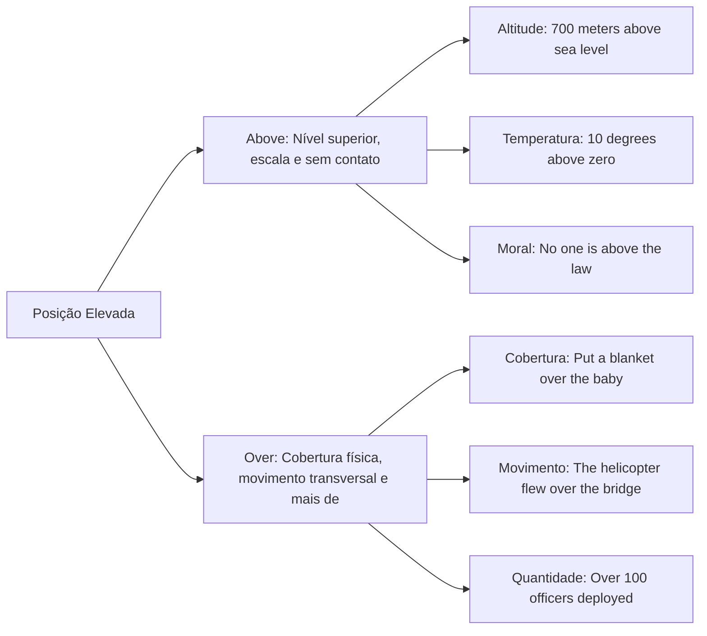
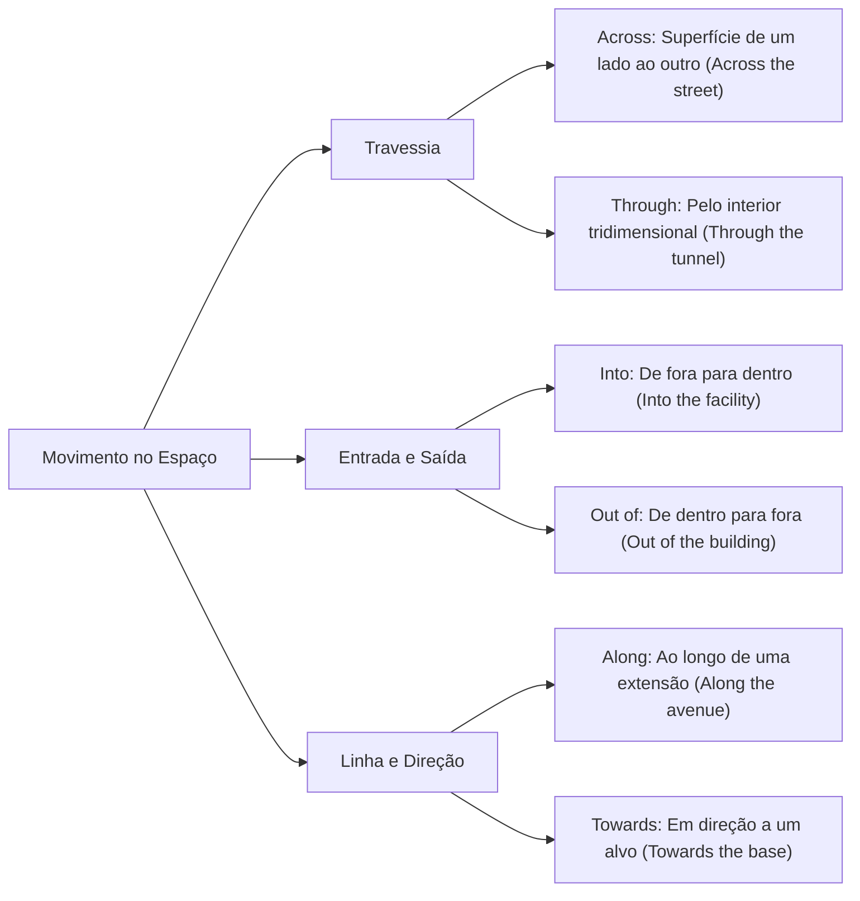
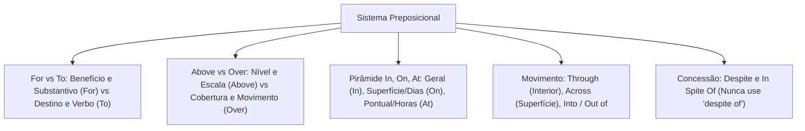

As preposições estabelecem relações sintáticas e semânticas cruciais na oração. Nas provas, as bancas avaliam a regência nominal e verbal. Também cobram o uso de conectivos de lugar e tempo e os pares contrastivos que induzem a erros de tradução.

Compreender o emprego exato das partículas preposicionais assegura precisão interpretativa. Este capítulo disseca os pares fundamentais *for* versus *to* e *above* versus *over*. Analisa também o sistema *in, on, at*, as preposições de movimento e os conectivos concessivos *despite* e *in spite of*.

> [!objetivos]
> - Distinguir o emprego das preposições *for* e *to* com base em finalidade, direção e tipo de complemento.
> - Diferenciar a posição espacial e as funções figuradas de *above* e *over*.
> - Dominar a hierarquia dimensional e temporal de *in, on* e *at* para tempo e lugar.
> - Aplicar corretamente as preposições de movimento no espaço físico.
> - Empregar os conectivos concessivos *despite* e *in spite of*, reconhecendo suas restrições sintáticas.

## Distinção entre as Preposições For e To

A escolha entre *for* e *to* gera dúvidas frequentes entre estudantes lusófonos. Ambas as partículas podem traduzir-se por "para", mas atendem a critérios funcionais distintos:

### O Emprego da Preposição For

A preposição *for* expressa finalidade, benefício, duração temporal ou objetivo associado a substantivos:
- **Finalidade com substantivo:** *He came for dinner.* (Ele veio para o jantar).
- **Propósito de um objeto:** *What is this box for? It is for tools.* (Para que serve esta caixa? Serve para ferramentas).
- **Tempo e duração:** *The soldiers trained for five hours.* (Os soldados treinaram por cinco horas).
- **Favor ou benefício:** *He cooked dinner for me.* (Ele cozinhou para mim; em meu benefício).

### O Emprego da Preposição To

A preposição *to* expressa direção, destino, transferência material ou objetivo seguido de verbo no infinitivo:
- **Destino e deslocamento no espaço:** *They are going to the library.* (Eles estão indo para a biblioteca).
- **Transferência material:** *She gave the official report to me.* (Ela entregou o relatório para mim).
- **Troca comunicativa:** *The commander will talk to you.* (O comandante falará com você em uma troca de informações).
- **Finalidade com verbo no infinitivo:** *He came to have dinner.* (Ele veio para jantar).

> [!bizu]
> Observe o contraste semântico entre envio direto e ação substitutiva:
> - *I sent a letter to him.* (Enviei uma carta a ele; o destinatário é ele).
> - *I sent a letter for him.* (Enviei uma carta por ele; agi em seu benefício porque ele não podia ir ao correio).

## Distinção Espacial e Semântica: Above e Over

Tanto *above* quanto *over* traduzem-se habitualmente por "acima" ou "sobre". Todavia, o uso de cada partícula obedece a noções geométricas específicas:

Observe o exemplo clássico do bebê (*baby / bebê*). Se colocamos um cobertor cobrindo a criança, dizemos *put a blanket over the baby*. Há contato físico direto e cobertura. Por outro lado, imagine um móbile suspenso no ar acima do berço. Dizemos *the mobile is hanging above the baby*. Não há nenhum contato físico.

| Critério de Uso | Preposição Above | Preposição Over |
| :--- | :--- | :--- |
| **Contato Físico** | Nunca há contato físico entre os corpos | Implica cobertura direta ou contato (*a sheet over the baby*) |
| **Movimento** | Estático; sem deslocamento horizontal (*hovered above*) | Movimento de um lado a outro por cima (*flew over the city*) |
| **Escala e Nível** | Ponto mais alto em escalas numéricas (*above average*) | Não expressa posições em tabelas ou escalas térmicas |
| **Quantidades** | Não expressa quantidade superior numérica | Equivale a *more than* (*over 60% of citizens; over two hours*) |
| **Altitude / Mar** | Nível absoluto (*700 meters above sea level*) | Não se usa para altitude padrão acima do nível do mar |
| **Sentido Figurado** | Superioridade moral ou legal (*above the law*) | Domínio, autoridade ou término (*game over; control over*) |

Em temperaturas atmosféricas positivas, emprega-se estritamente *above*: *ten degrees above zero*. Quando *over* surge no início de palavras compostas (*overtime, overdose*), atua como prefixo e não como preposição autônoma.

## O Sistema Dimensional e Temporal: In, On e At

A distribuição das preposições *in, on* e *at* organiza-se geometricamente. O sistema parte do geral e abrangente para o pontual e específico:

### Aplicação Espacial de Lugar

A localização física distribui-se em três níveis de precisão dimensional:
- **In (espaço tridimensional, continentes, países e cidades):** Emprega-se para interiores delimitados ou grandes áreas territoriais:
  - *In Brazil, in Pernambuco, in Recife, in Europe*.
  - *In the building, in the car, in the room, in the box*.
- **On (superfícies bidimensionais, vias públicas e transportes coletivos):** Emprega-se para contato com superfícies ou eixos viários:
  - *On the table, on the wall, on the floor*.
  - *On Main Street, on Boa Viagem Avenue*.
  - *On the bus, on the train, on the plane, on the ship* (onde se caminha de pé).
- **At (pontos geográficos específicos e endereços com número):** Emprega-se para marcos pontuais e pontos de espera:
  - *At the bus stop, waiting for the vehicle* (esperando pelo ônibus no ponto exato).
  - *At the traffic lights, at the station, at the airport*.
  - *At 100 Main Street* (endereço completo com número predial).

### Aplicação Cronológica de Tempo

A localização temporal segue a mesma hierarquia de precisão:
- **In (períodos amplos, anos, estações climáticas, meses e séculos):**
  - Meses e estações: *in September, in the spring* (na primavera).
  - Anos históricos e décadas: *in 1930, in 1962, in 1966, in 2026*.
  - Séculos e períodos: *in the 21st century, in the morning*.
- **On (dias específicos da semana e datas com dia):**
  - Dias da semana: *on Monday* (na segunda-feira), *on Saturday* (no sábado).
  - Partes de dias específicos: *on Saturday afternoon*.
  - Datas completas: *on the 15th of November, on September 7th*.
- **At (horários pontuais e momentos exatos do relógio):**
  - *At 3 p.m., at midnight, at noon, at dawn*.
  - Momentos festivos: *at the weekend, at Christmas, at Easter, at night*.

Em textos econômicos sobre variações da taxa Selic fixada pelo Copom, analisam-se índices históricos definidos em reuniões anuais. O uso de preposições adequadas garante a precisão de relatórios governamentais.

> [!bizu]
> Observe duas distinções clássicas muito cobradas em concursos:
> 1. *At night* refere-se à noite de forma habitual (*The police patrol at night*). *In the night* refere-se a uma noite específica ou ao meio de uma noite determinada.
> 2. *On time* significa pontual, rigorosamente no horário da escala (*The train arrived on time*). *In time* significa a tempo, antes que o prazo se encerre (*They arrived in time for the briefing*).

| Preposição | Dimensão Espacial | Exemplo de Lugar | Dimensão Temporal | Exemplo de Tempo |
| :--- | :--- | :--- | :--- | :--- |
| **In** | Grande área ou espaço interno | *in Brazil, in the room* | Período amplo ou mês/ano | *in 2026, in the spring* |
| **On** | Superfície ou via pública | *on the floor, on the avenue* | Dia específico ou data | *on Saturday, on May 10th* |
| **At** | Ponto específico ou endereço | *at the station, at 45 Elm St* | Horário exato ou momento | *at 7 a.m., at noon* |

## Preposições de Movimento e Posições Relativas

As preposições de movimento indicam a trajetória física de um corpo no espaço:
- **To / Towards:** *To* expressa destino definitivo (*go to the base*). *Towards* indica direção aproximada sem garantia de chegada (*walked towards the exit*).
- **Into / Out of:** *Into* indica movimento de fora para dentro (*entered into the room*). *Out of* expressa movimento de dentro para fora (*ran out of the building*).
- **Across / Through:** *Across* expressa travessia sobre superfície bidimensional de um lado a outro (*swam across the river*). *Through* indica travessia pelo interior de um espaço tridimensional cercado (*walked through the forest; passed through the tunnel*).
- **Along / Past:** *Along* indica deslocamento contínuo ao longo de uma linha (*walked along the avenue*). *Past* expressa ultrapassagem ao passar ao lado de algo (*drove past the station*).

No plano posicional estático de proximidade, as preposições indicam posição relativa junto (*junto de*) a outros elementos:
- *Beside, next to, by:* Significam ao lado de, junto a (*The officer stood next to the car*).
- *Between:* Emprega-se para indicar localização entre dois elementos individualizados (*The squad car was parked between the two ambulances*).
- *Among (ou Amid):* Emprega-se para indicar localização em meio a um grupo de três ou mais elementos (*The commander stood among the soldiers*).

## Conectivos Concessivos: Despite e In Spite Of

Os conectivos *despite* e *in spite of* expressam relação lógica de concessão ou contraste. Ambos traduzem-se por "apesar de" e possuem valor semântico idêntico:
- *Despite the rain, the firefighters continued the rescue operation.*
- *In spite of the rain, the firefighters continued the rescue operation.*

### Requisitos Sintáticos Obrigatórios

Por atuarem como preposições e locuções prepositivas, esses termos exigem complementos nominais. Eles não podem ser seguidos diretamente por uma oração inteira com verbo conjugado:
1. **Seguidos de substantivo ou pronome:** *Despite the heavy traffic, we arrived on time.*
2. **Seguidos de verbo no gerúndio (-ing):** *Despite feeling exhausted, the team completed the mission.*
3. **Seguidos da locução the fact that:** Para introduzir uma oração com sujeito e verbo, usa-se obrigatoriamente *the fact that*: *In spite of the fact that the weather was bad, the helicopter took off.*

> [!pegadinha]
> A banca examinadora costuma inventar a construção "despite of", que é um erro gramatical inexistente na língua inglesa! Lembre-se: use *despite* (sem preposição of) ou *in spite of* (com três palavras separadas). Jamais misture as duas formas em uma prova!

Outra particularidade reside na expressão idiomática *in spite of oneself*. Ela traduz-se por "involuntariamente" ou "contra a própria vontade": *He laughed in spite of himself* (ele riu contra a própria vontade).

## Mapa do capítulo

### Para fixar

- *For* expressa benefício, duração e propósito com substantivo; *to* indica direção, transferência e finalidade com verbo infinitivo.
- *Above* expressa posição mais alta sem contato físico e posições em escalas térmicas; *over* indica cobertura direta, travessia e quantias numéricas.
- *In* emprega-se para grandes áreas territoriais, meses e anos; *on* para superfícies, vias públicas e dias da semana; *at* para pontos exatos e horários.
- A locução *on time* expressa pontualidade rigorosa; *in time* indica chegada a tempo antes do encerramento de um prazo.
- O termo *between* aplica-se à relação entre dois elementos; *among* indica inserção em um conjunto ou grupo numeroso.
- A preposição *through* indica passagem pelo interior tridimensional de um corpo; *across* expressa travessia sobre superfície bidimensional.
- Os conectivos concessivos *despite* e *in spite of* possuem significado idêntico e exigem substantivo, pronome ou verbo com terminação em *-ing*.
- A forma híbrida "despite of" constitui erro gramatical absoluto, vedado pela norma culta da língua inglesa.
