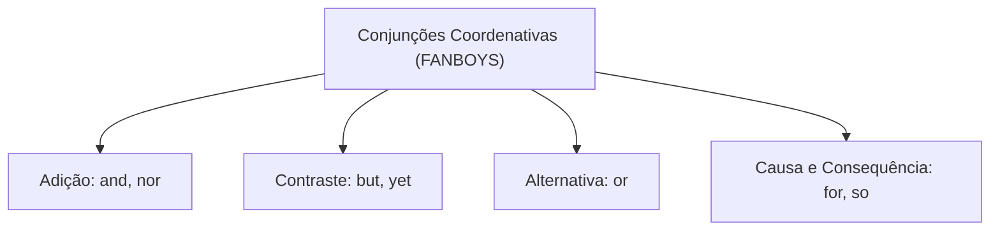
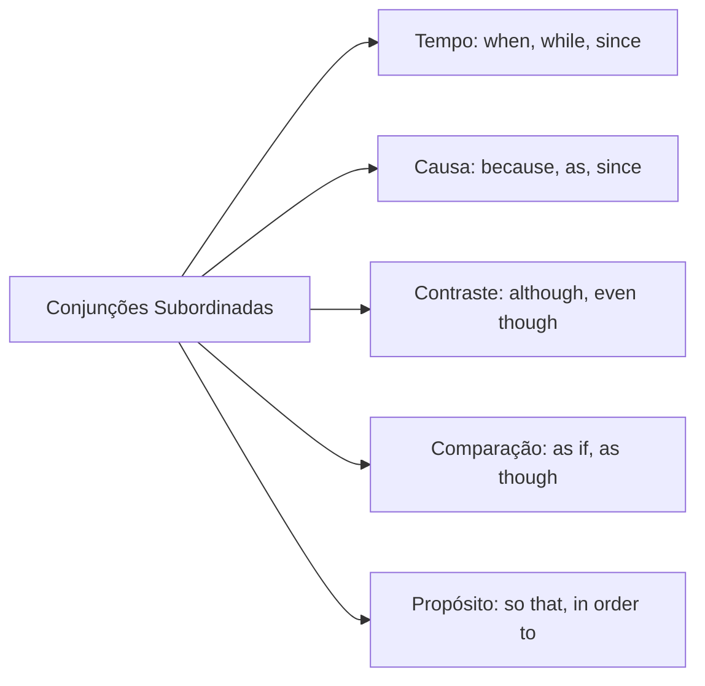
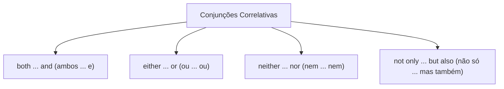
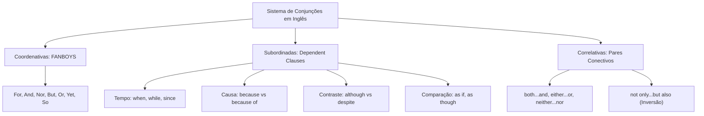

O domínio rigoroso das conjunções na língua inglesa é essencial para a interpretação de textos e a resolução de questões sobre relações lógico-semânticas em concursos públicos. Reconhecer a relação lógica exata introduzida pelo conectivo e diferenciar conjunções subordinadas de locuções preposicionadas garante precisão na interpretação das provas da banca examinadora.

> [!objetivos]
> - Identificar as conjunções coordenativas do mnemônico FANBOYS e seus papéis aditivos e adversativos.
> - Dominar a classificação semântica das conjunções subordinadas adverbiais de tempo, causa, contraste e comparação.
> - Aplicar o paralelismo sintático das conjunções correlativas e a regra da inversão com partículas negativas iniciais.
> - Diferenciar conectivos subordinados oracionais de estruturas preposicionadas equivalentes como *because of* e *despite*.

---

## Conjunções e os Mecanismos de Coesão Oracional

As conjunções (*conjunctions*) são palavras de conexão que unem vocábulos, orações independentes ou períodos complexos, estabelecendo vínculos de sentido lógico entre as proposições. A gramática inglesa divide esses conectivos em três grandes categorias funcionais:
1. **Conjunções Coordenativas (*coordinating conjunctions*)**: unem orações independentes ou termos de idêntico valor sintático.
2. **Conjunções Subordinadas (*subordinating conjunctions*)**: introduzem orações dependentes subordinadas à oração principal.
3. **Conjunções Correlativas (*correlative conjunctions*)**: operam aos pares simétricos para associar ideias paralelas.

### Conjunções Coordenativas e o Mnemônico FANBOYS

As sete conjunções coordenativas fundamentais da língua inglesa são memorizadas pelo acrônimo **FANBOYS**:
- **F** (*For*): expressa explicação ou justificativa formal (*He sat down, for he was tired*).
- **A** (*And*): expressa adição e progressão lógica (*João studied hard, and he passed the military exam*).
- **N** (*Nor*): expressa adição negativa, exigindo inversão sujeito-auxiliar (*He didn't call, nor did he send an email*).
- **B** (*But*): expressa contraste ou ressalva adversativa (*Maria wanted to go, but she was sick*).
- **O** (*Or*): expressa alternância ou exclusão disjuntiva (*You can pay now, or you can pay later*).
- **Y** (*Yet*): expressa contraste e concessão inesperada (*The weather was cold, yet they swam in the lake*).
- **S** (*So*): expressa conclusão ou resultado (*It rained heavily, so the official meeting was canceled*).

---

## Conjunções Subordinadas e Valores Semânticos

As conjunções subordinadas abrem a oração dependente (*subordinate clause*), que não possui sentido autônomo completo e subordina-se à oração principal. Nas avaliações da banca examinadora, a cobrança recai sobre o valor semântico contextual expresso pelo conectivo. As principais relações adverbiais subordinadas compreendem:
- **Tempo (*time*)**: *when* (quando), *while* (enquanto), *as soon as* (assim que), *before* (antes de), *after* (depois de), *since* (desde que), *until* (até que).
  - *When the alarm sounded, the firefighters left immediately.*
  - *He shook his head (cabeça) before asking (pedir) for assistance.*
- **Causa ou Razão (*reason*)**: *because* (porque), *since* e *as* (já que, visto que), *now that* (agora que).
  - *Because he bought meat and fresh fruits (frutos), he prepared dinner.* (Ele comprou alimentos frescos e preparou o jantar com bom gosto gastronômico.)
- **Contraste ou Concessão (*contrast*)**: *although, though, even though* (embora, ainda que), *while, whereas* (ao passo que).
  - *Although he had a severe headache (dor de cabeça), the soldier fulfilled his duty.*
- **Condição (*condition*)**: *if* (se), *unless* (a não ser que, se não), *provided that* (contanto que).
  - *You will pass the test unless you stop studying.*
- **Comparação e Modo (*comparison / manner*)**: *as if* e *as though* (como se).
  - O autor seeks (procura) harmonia social e estuda interações (interactions) urbanas cotidianas. Comparam uma situação real com uma hipótese figurada. Em tirinhas cômicas, o personagem desabafa: *"It's as if I don't exist"* (É como se eu não existisse).
- **Finalidade ou Propósito (*purpose*)**: *in order that, so that* (para que, a fim de que).
  - *He trained daily so that he could improve his physical performance.*
- **Resultado (*result*)**: *so... that, such... that* (tão... que).
  - *The fire was so intense that the structure collapsed.*

> [!atencao]
> Distinção estrutural entre conjunção e preposição:
> - ***Because*** e ***although*** são conjunções: introduzem oração completa com sujeito e verbo (*Because it rained...*; *Although he was tired...*).
> - ***Because of***, ***despite*** e ***in spite of*** são preposições: exigem substantivo, pronome ou verbo no gerúndio *-ing* (*Because of the rain...*; *Despite being tired...*).

| Conjunção Subordinada | Relação Lógica | Exemplo Contextualizado | Tradução do Conectivo |
|---|---|---|---|
| *although* | Contraste / Concessão | *Although it rained, we left.* | embora, apesar de |
| *because* | Causa / Razão | *We rested because we were exhausted.* | porque, já que |
| *as if* | Comparação hipotética | *He speaks as if he knew everything.* | como se |
| *while* | Tempo simultâneo / Contraste | *She read while he cooked.* | enquanto / ao passo que |
| *unless* | Condição negativa | *We will fail unless we train.* | a menos que, se não |
| *so that* | Propósito / Finalidade | *He called so that we could meet.* | de modo que, para que |

---

## Conjunções Correlativas e Paralelismo Sintático

As conjunções correlativas funcionam sempre aos pares conjugados. Elas unem elementos sintaticamente equivalentes na oração, preservando o paralelismo gramatical. Os principais pares correlativos são:
- ***both... and***: expressa adição enfática e inclusão simultânea (*Both dogs and cats were present in the yard* — tanto cães quanto gatos estavam no quintal).
- ***either... or***: expressa alternativa disjuntiva entre duas opções (*You can either take the bus or walk*).
- ***neither... nor***: expressa negação conjunta e exclusão simultânea (*She eats neither meat nor seafood*).
- ***not only... but also***: expressa adição enfática com gradação (*He bought not only chocolate but also books*).
- ***not... but***: expressa retificação adversativa (*The victory was not mine, but Maria's*).

> [!pegadinha]
> Inversão sintática com partículas negativas iniciais:
> Quando uma oração é iniciada pela locução correlativa negativa ***Not only***, a sintaxe da língua inglesa exige a **inversão obrigatória entre o verbo auxiliar e o sujeito**:
> - Padrão normal: *She not only passed the exam, but she also won an award.*
> - Com inversão enfática: ***Not only did she pass*** *the exam, but she also won an award.*
> O verbo auxiliar *did* antecede o sujeito *she*, espelhando a ordem estrutural de uma pergunta.

> [!bizu]
> Distinção entre *as well as* e *and*:
> - A conjunção *and* coloca os dois elementos em idêntico nível de relevância sintática (*João and Maria attended the meeting*).
> - A locução *as well as* (bem como) confere destaque prioritário ao primeiro termo da frase (*João, as well as Maria, attended the meeting*). Além disso, *as well as* pode atuar como comparação de igualdade com sentido de "tão bem quanto" (*He swims as well as she does*).

---

## Mapa do Capítulo

O mapa conceitual a seguir resume a estrutura geral das conjunções e suas divisões na língua inglesa:

---

### Para fixar

1. As conjunções coordenativas são sintetizadas pelo acrônimo FANBOYS (*for, and, nor, but, or, yet, so*).
2. O conectivo *and* expressa adição, *but* e *yet* expressam contraste, e *so* indica consequência ou resultado.
3. Conjunções subordinadas introduzem orações dependentes que exercem funções adverbiais na frase complexa.
4. A conjunção *because* introduz oração com verbo, enquanto *because of* atua como preposição antes de substantivo.
5. As formas *although*, *though* e *even though* expressam concessão e contraste contra uma ideia esperada.
6. O conectivo *as if* expressa comparação hipotética entre uma situação real e um cenário figurado.
7. Conjunções correlativas atuam aos pares: *both... and*, *either... or*, *neither... nor* e *not only... but also*.
8. Iniciar a frase com *Not only* exige a inversão obrigatória entre o verbo auxiliar e o sujeito da oração.
9. A locução *as well as* destaca o termo inicial da sentença e pode atuar como comparação com sentido de "tão bem quanto".
