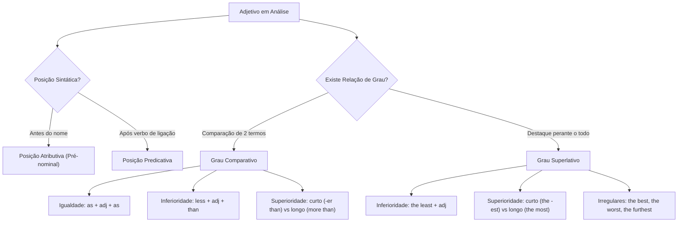

O domínio dos adjetivos e de suas flexões de grau é indispensável para a interpretação de textos autênticos e para a resolução de itens gramaticais em concursos públicos. Na língua inglesa, o adjetivo desempenha a função de caracterizar, qualificar ou delimitar substantivos e pronomes, atribuindo-lhes propriedades físicas, estados emocionais ou julgamentos de valor.

Diferente do português, o adjetivo em inglês destaca-se por sua invariabilidade morfológica em gênero e número. A mesma forma léxica qualifica termos singulares, plurais, masculinos ou femininos. Compreender a posição sintática do adjetivo na oração, seus processos de derivação por afixos e participiais, bem como as regras de formação dos graus comparativo e superlativo assegura alta performance nas questões da banca examinadora.

> [!objetivos]
> - Compreender a invariabilidade morfológica dos adjetivos em relação a gênero e número.
> - Dominar o emprego da posição atributiva pré-nominal e da posição predicativa com verbos de ligação.
> - Diferenciar adjetivos participiais causadores terminados em *-ing* daqueles que expressam reação terminados em *-ed*.
> - Aplicar as regras dos graus comparativos de igualdade, inferioridade e superioridade.
> - Construir estruturas superlativas e identificar as formas irregulares mais cobradas pelas bancas examinadoras.

---

## Natureza e Invariabilidade dos Adjetivos

Na sintaxe inglesa, o adjetivo qualifica diretamente o núcleo nominal ou atua como predicativo do sujeito. Uma das maiores simplificações morfológicas do idioma reside no fato de que os adjetivos não admitem flexão de plural nem distinção entre masculino e feminino.

Enquanto em português dizemos "soldado preparado", "soldada preparada", "soldados preparados" e "soldadas preparadas", o inglês mantém a mesma forma para todas as combinações: *prepared soldier*, *prepared soldiers*. O vocábulo permanece imutável.

Considere os pares de exemplos:
- *Vital measure* (medida vital) transforma-se em *vital measures* (medidas vitais).
- *Heavy burden* (fardo pesado) transforma-se em *heavy burdens* (fardos pesados).
- *Strict rule* (regra rigorosa) transforma-se em *strict rules* (regras rigorosas).

Essa regra abrange adjetivos simples e construções compostas. Tentar concordar o adjetivo flexionando-o no plural representa erro crasso segundo o padrão culto da língua inglesa.

> [!atencao]
> Nunca acrescente desinências de plural a adjetivos ingleses. Construções que pluralizam o modificador são categoricamente rejeitadas pelas bancas. Mantenha o adjetivo inalterado: *economic barriers* e não *economics barriers*; *crucial factors* e não *crucials factors*.

---

## Posição Sintática: Atributiva e Predicativa

Os adjetivos manifestam-se em duas posições sintáticas principais: a posição atributiva, anterior ao substantivo modificado, e a posição predicativa, posterior a verbos copulativos. O domínio dessa organização sintática é indispensável para a análise textual.

Na posição atributiva, o adjetivo antecede imediatamente o substantivo que determina. Essa é a disposição padrão no idioma inglês. Observamos construções como *global strategy* (diretriz global) e *renewable energy* (energia renovável). Quando múltiplos termos compõem um adjetivo composto antes do substantivo, emprega-se hífen para integrar a unidade semântica.

Exemplos de adjetivos compostos atributivos hifenizados:
- *Half-day shifts* (turnos de meio período)
- *Long-term projects* (projetos de longo prazo)
- *User-friendly interface (interface amigável ao usuário)* (programa orientado ao usuário)
- *Eco-friendly companies (empresas com perfil sustentável)* (organizações com consciência ecológica)
- *High-ranking officials* (oficiais de alta patente)

Na posição predicativa, o adjetivo integra o predicado da oração, surgindo após verbos de ligação (*linking verbs*) ou verbos de percepção sensorial. Os verbos mais recorrentes nessa construção incluem: *be* (ser/estar), *become* (tornar-se), *feel* (sentir-se), *get* (ficar), *look* (parecer visualmente), *seem* (parecer), *smell* (cheirar), *sound* (parecer pelo som), *appear* (aparentar), *taste* (ter sabor).

Observe as ocorrências em frases completas:
- *The proposed strategy seems plausible.* (A diretriz proposta parece plausível.)
- *Firefighters must remain calm during structural evacuations.* (Os bombeiros devem permanecer calmos durante evacuações estruturais.)
- *The engine sounds quiet under heavy operation.* (O motor soa silencioso sob operação pesada.)
- *Citizens became vigilant after the public safety alert.* (Os cidadãos tornaram-se vigilantes após o alerta de segurança pública.)

> [!bizu]
> Após verbos sensoriais como *feel*, *smell*, *taste* e *sound*, o inglês emprega adjetivos e não advérbios. Dizemos *The coffee tastes bitter* (e não *bitterly*). O modificador descreve o estado do sujeito, e não o modo como a ação verbal é executada.

Quando vários adjetivos qualificam o mesmo substantivo em posição atributiva pré-nominal, o padrão formal adota a sequência canônica *OSASCOMP*: Opinião (*Opinion*), Tamanho (*Size*), Idade (*Age*), Formato (*Shape*), Cor (*Color*), Origem (*Origin*), Material (*Material*) e Finalidade (*Purpose*). Exemplo: *a lovely small ancient round wooden vessel* (um adorável pequeno antigo vaso redondo de madeira).

---

## Substantivos Modificadores e Substantivação Coletiva com "The"

Dois aspectos de alta relevância sintática nas provas envolvem a relação funcional entre substantivos e adjetivos: o uso de substantivos na qualidade de modificadores nominais e a substantivação de adjetivos precedidos pelo artigo definido *the*.

No primeiro caso, um substantivo atua como atributo pré-nominal de outro substantivo. Ao exercer essa função caracterizadora, o substantivo atributivo comporta-se como adjetivo. Por conseguinte, ele deve permanecer rigorosamente no singular, mesmo quando expressa ideia pluralizada.

Exemplos de substantivos qualificadores no singular:
- *Emergency service* (serviço de emergência)
- *Flight attendant* (comissário de bordo)
- *Police department* (departamento de polícia)
- *Shoe store* (loja de sapatos — grafado no singular *shoe*, nunca *shoes store*)
- *Defense weapon* (arma de defesa)

O segundo caso ocorre quando o artigo definido *the* precede um adjetivo desacompanhado de substantivo. Essa estrutura substantiva o adjetivo, que passa a representar a coletividade de indivíduos portadores daquela condição ou característica social.

| Expressão Substantivada | Sentido Coletivo | Concordância Verbal Obrigatória |
| :--- | :--- | :--- |
| *The privileged* | Os privilegiados | Verbo conjugado no plural |
| *The needy* | Os necessitados | Verbo conjugado no plural |
| *The wounded* | Os feridos | Verbo conjugado no plural |
| *The homeless* | Os desabrigados / sem-teto | Verbo conjugado no plural |
| *The unemployed* | Os desempregados | Verbo conjugado no plural |
| *The vulnerable* | Os vulneráveis | Verbo conjugado no plural |
| *The brave* | Os corajosos | Verbo conjugado no plural |

Nessas formulações coletivas, o adjetivo não recebe desinência pluralizadora em *-s*, mas o verbo subordinado é conjugado obrigatoriamente na terceira pessoa do plural. Observe os exemplos contextualizados:
- *The vulnerable require targeted social interventions.* (Os vulneráveis exigem intervenções sociais direcionadas.)
- *The wounded were quickly transported to the military hospital.* (Os feridos foram rapidamente transportados ao hospital militar.)
- *The homeless face severe hardships during winter seasons.* (Os sem-teto enfrentam severas adversidades durante as estações de inverno.)

> [!pegadinha]
> A oração *The brave deserves praise* está errada perante a norma padrão. Como *the brave* designa a classe dos corajosos, o verbo deve figurar no plural: *The brave deserve praise*. Caso se deseje referir a um único sujeito individualizado, deve-se explicitar o substantivo: *a brave firefighter* ou *a brave officer*.

---

## Formação dos Adjetivos: Afixação e Particípios

A derivação sufixal enriquece o vocabulário da língua inglesa ao converter substantivos e verbos em adjetivos. Reconhecer esses moldes morfológicos facilita a inferência semântica de palavras não familiares durante a prova.

Os sufixos mais recorrentes compreendem:
- *-ful* (provido de, repleto de): *meaningful* (significativo), *resourceful* (engenhoso), *dreadful* (terrível), *doubtful* (duvidoso).
- *-less* (privativo, isento de): *flawless* (sem falhas, perfeito), *breathless* (sem fôlego), *powerless* (sem poder, impotente).
- *-able* / *-ible* (suscetível de, que pode ser): *manageable* (gerenciável), *feasible* (viável), *convertible* (conversível).
- *-ous* / *-al* / *-ic* (relativo a, com natureza de): *hazardous* (perigoso), *structural* (estrutural), *systemic* (sistêmico).

Em itens de compreensão textual e morfologia, destaca-se a oposição funcional entre particípios presentes em *-ing* e particípios passados em *-ed*. Essa contraposição estabelece a fronteira entre o polo ativo que gera o efeito e o polo passivo que sofre o estímulo emocional.

O adjetivo terminado em *-ing* refere-se ao elemento emissor ou causador da sensação. O adjetivo terminado em *-ed* retrata o estado psicológico ou o sentimento vivido pelo indivíduo receptor.

Considere as correlações semânticas centrais:
- *Interesting* (interessante, que desperta o interesse) versus *Interested* (interessado, consequência psicológica vivida pelo sujeito).
- *Exciting* (empolgante, que produz ânimo) versus *Excited* (empolgado, animado com a situação).
- *Surprising* (surpreendente, gerador de surpresa) versus *Surprised* (surpreso, impactado pela surpresa).
- No diálogo entre aves, exclama-se *you're lucky* para indicar que alguém é afortunado.
- *Fascinating* (fascinante, que desperta fascínio) versus *Fascinated* (fascinado, que experimenta encanto).
- *Exhausting* (exaustivo, que esgota as energias) versus *Exhausted* (exausto, que sente fadiga).
- *Challenging* (desafiador, que impõe desafio) versus *Challenged* (desafiado, colocado à prova).
- *Alarming* (alarmante, que suscita alarme) versus *Alarmed* (alarmado, que sente preocupação).

Em tirinhas cômicas e narrativas, o contraste entre personagens é recorrente. Por exemplo, em diálogos entre um pinguim (*penguin*) adulto e seu pintinho (*chick*, onde se ouve a expressão *you're lucky* no *fifth* quadro de uma tira), vocábulos expressivos e positivos como *beautiful* (lindo) e *lucky* (sortudo) pertencem à mesma classe gramatical dos adjetivos qualificadores, descrevendo percepções subjetivas e traços favoráveis da realidade.

---

## Grau Comparativo: Igualdade, Inferioridade e Superioridade

O grau comparativo confronta dois termos ou grupos específicos, expressando nivelamento, diminuição ou realce proporcional entre as entidades comparadas.

O comparativo de igualdade assinala paridade qualitativa. A estrutura afirmativa emprega a correlação *as + adjetivo + as*. Nas estruturas negativas, adota-se *not as + adjetivo + as* ou *not so + adjetivo + as*.
- Estrutura afirmativa: *The modernized radar system is as reliable as the satellite connection.* (O sistema de radar modernizado é tão confiável quanto a conexão via satélite.)
- Estrutura negativa: *The preliminary report was not as detailed as expected.* (O relatório preliminar não foi tão detalhado quanto o esperado.)

O comparativo de inferioridade expressa que uma entidade possui intensidade inferior à de outra na qualidade avaliada. Constrói-se universalmente com a fórmula *less + adjetivo + than*, aplicável a qualquer extensão léxica.
- *The urban zone was less populated than the coastal sector.* (A zona urbana era menos povoada que o setor litorâneo.)
- *His recent assignment proved less stressful than the earlier mission.* (Sua designação recente mostrou-se menos estressante que a missão anterior.)

O comparativo de superioridade estabelece que um dos termos supera o outro. A regra formal bifurca-se segundo o número de sílabas do adjetivo no seu grau básico (*positive degree*).

| Categoria do Adjetivo | Regra Gramatical | Exemplo no Grau Básico | Comparativo de Superioridade |
| :--- | :--- | :--- | :--- |
| Monossílabo regular | Sufixo *-er + than* | *cold* (frio), *swift* (veloz) | *colder than*, *swifter than* |
| Monossílabo CVC | Dobra da consoante final + *-er* | *hot* (quente), *big* (amplo) | *hotter than*, *bigger than* |
| Dissílabo em *-y* | Substitui *-y* por *-ier + than* | *busy* (ocupado), *early* (cedo) | *busier than*, *earlier than* |
| Polissílabo (≥ 3 sílabas) | Anteposição de *more + than* | *competent* (competente) | *more competent than* |

Na regra da dobra consoante-vogal-consoante (CVC), palavras curtas com uma única vogal tônica seguida de consoante simples exigem a duplicação ortográfica: *slim -> slimmer*, *fit -> fitter*. Se o monossílabo já termina na letra *-e*, acrescenta-se apenas a desinência *-r*: *safe -> safer*, *brave -> braver*.

---

## Grau Superlativo: Superioridade e Inferioridade

Ao passo que a comparação ocorre estritamente entre dois termos definidos, o grau superlativo posiciona um integrante no topo ou na base de todo um universo amostral de referência.

O superlativo de superioridade divide os vocábulos entre formas sintéticas breves e formas analíticas perifrásticas. Adjetivos de uma sílaba recebem o artigo definido *the* e o sufixo *-est* (ou *-iest* quando terminados em consoante mais *-y*). Adjetivos polissílabos utilizam a locução *the most + adjetivo*.

Exemplos ilustrativos de superlativo de superioridade:
- Adjetivo breve: *sharp -> the sharpest*; *safe -> the safest*; *tough -> the toughest*.
- Adjetivo dissílabo em *-y*: *heavy -> the heaviest*; *wealthy -> the wealthiest*.
- Adjetivo longo: *comfortable* (confortável) -> *the most comfortable*; *expensive* (caro) -> *the most expensive*; *easy* (fácil) -> *the easiest*; *pretty* (bonito) -> *the prettiest*. Notícia emblemática de Nova York citava um apartamento em Manhattan como o mais longe (*the farthest*) de qualquer estação de metrô.

Observe o emprego em análises geopolíticas e socioeconômicas:
- *Projections for the year 2050 suggest that the poorest nations will require global climate funds.* (Projeções para o ano de 2050 sugerem que os países mais pobres exigirão fundos climáticos globais.)
- *Technological giants consider quantum computing the most transformative innovation of the century.* (Gigantes tecnológicos consideram a computação quântica a inovação mais transformadora do século.)

O superlativo de inferioridade ressalta o elemento dotado da menor expressão de intensidade dentro de todo o conjunto. Sua construção prescinde de diferenciação silábica: aplica-se uniformemente *the least + adjetivo*.
- *This is the least destructive protocol available to our brigade.* (Este é o protocolo menos destrutivo disponível para a nossa brigada.)
- *Among all inspected vehicles, this unit was the least damaged.* (Dentre todos os veículos inspecionados, esta unidade estava a menos avariada.)

---

## Formas Irregulares e Peculiaridades de Prova

Determinados adjetivos fundamentais da língua inglesa repelem os sufixos regulares *-er/-est* e rejeitam as partículas *more/most*. Suas transformações provêm de étimos distintos, exigindo assimilação mnemônica estrita.

| Adjetivo (Grau Básico) | Comparativo de Superioridade | Superlativo de Superioridade |
| :--- | :--- | :--- |
| *good* | *better than* | *the best* |
| *bad* | *worse than* | *the worst* |
| *far* | *farther than* / *further than* | *the farthest* / *the furthest* |
| *little* | *less than* | *the least* |
| *many* / *much* | *more than* | *the most* |

A diferenciação entre as variantes de *far* desponta com frequência nos exames seletivos:

1. *Farther / Farthest*: restringe-se primariamente a mensurações de distância espacial física e palpável.
   - *The border outpost is farther than our communication post.* (O posto de fronteira é mais distante que nosso posto de comunicação.)

2. *Further / Furthest*: aplica-se a distâncias físicas e estende-se com exclusividade ao domínio abstrato, metafórico e ao sentido de "suplementar", "adicional" ou "em maior profundidade".
   - *The commander requested further clarifications.* (O comandante solicitou esclarecimentos adicionais.)
   - *We shall discuss these strategic points further.* (Discutiremos esses pontos estratégicos mais adiante.)

Além disso, *further* opera como verbo transitivo significando "promover" ou "favorecer" (*to further institutional goals*). É dessa raiz derivacional que provém o articulador discursivo *furthermore* (ademais, outrossim), recorrente em tópicos de coesão referencial e sequencial.

> [!pegadinha]
> Falsas terminações superlativas em provas: vocábulos nominais terminados em *-est* não representam necessariamente superlativos adjetivais. O substantivo comum *harvest* (colheita), muito explorado pela banca examinadora, termina nas letras *-est* mas não expressa grau comparativo, tal como o termo *fine* (ótimo ou regular em grau positivo). Outro termo enganoso é o vocábulo *earnest* (diligente, sério).

Em questões contextuais sobre artigos científicos e tecnológicos, as bancas abordam a ascensão de modelos como o *modelos de linguagem criados por laboratórios como a OpenAI*, desenvolvido por um agente relevante (*power player*) no setor de tecnologia. Os textos descrevem respostas elaboradas (*responses*) que soam artificiais ou forçadas usando o adjetivo sofisticado *stilted*, cujo sinônimo contextual legítimo é *contrived* (artificioso, pouco natural), diferenciando-se de um estilo espontâneo (*effortless*), evasivo (*evasive*) ou atencioso (*attentive*). Notar que *somewhat* atua nesses contextos como advérbio modificador de intensidade moderada ("um tanto", "relativamente").

---

## Mapa do Capítulo

O fluxograma lógico abaixo resume as etapas de identificação e flexão dos adjetivos e de suas estruturas comparativas e superlativas:

---

### Para fixar

1. **Invariabilidade essencial**: os adjetivos em inglês permanecem idênticos em gênero e número, nunca recebendo desinência plural em *-s*.
2. **Posição atributiva versus predicativa**: os adjetivos antecedem substantivos (*structural flaw*) ou seguem verbos copulativos e sensoriais (*feels confident*).
3. **Substantivo atuando como adjetivo**: quando um substantivo qualifica outro substantivo, deve figurar no singular (*emergency crew*).
4. **Substantivação coletiva com *the***: o artigo *the* seguido de adjetivo refere-se à classe de pessoas e rege verbo na terceira pessoa do plural (*The vulnerable are assisted*).
5. **Particípios *-ing* versus *-ed***: a terminação *-ing* qualifica a causa ativa do estímulo (*exhausting exercise*), ao passo que *-ed* denota a emoção sentida (*exhausted soldier*).
6. **Comparativo de superioridade**: monossílabos e dissílabos em *-y* recebem *-er than* (ou *-ier than*), enquanto adjetivos longos recebem *more than*.
7. **Superlativo de superioridade**: adjetivos breves recebem *the -est*, e vocábulos de três ou mais sílabas utilizam *the most*.
8. **Irregularidades indispensáveis**: fixe *good/better/best*, *bad/worse/worst*, e distinga *farther* (distância física) de *further* (distância abstrata e acréscimo de informações).
