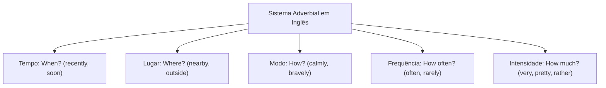
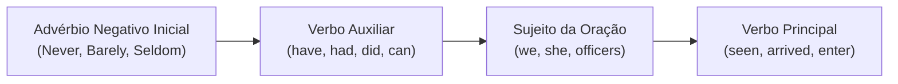
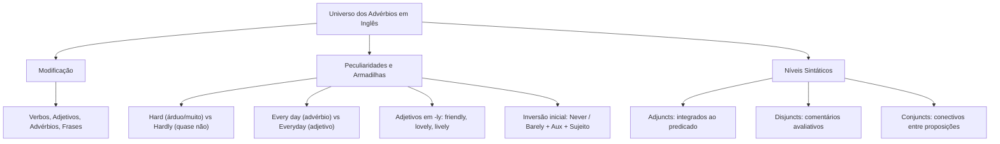

O estudo dos advérbios na língua inglesa é fundamental para a correta apreensão das circunstâncias da ação verbal. Nas provas de concurso público, o advérbio adiciona dados circunstanciais a verbos, adjetivos, particípios e outros advérbios. Ele também pode modular períodos oracionais inteiros, conferindo precisão às declarações.

Diferente dos adjetivos, que qualificam substantivos, os advérbios respondem a perguntas centrais. Eles esclarecem *How?* (Como?), *When?* (Quando?), *Where?* (Onde?) e *How often?* (Com que frequência?). Dominar a posição dos advérbios, identificar falsos cognatos e compreender a divisão entre *adjuncts*, *disjuncts* e *conjuncts* garante alto rendimento nas questões da banca examinadora.

> [!objetivos]
> - Identificar as funções modificadoras do advérbio sobre verbos, adjetivos e orações.
> - Classificar os advérbios em tempo, lugar, modo, frequência e intensidade.
> - Evitar confusões clássicas entre *hard* e *hardly*, e entre *every day* e *everyday*.
> - Aplicar a inversão sintática provocada por advérbios restritivos e reconhecer os papéis de *adjunct*, *disjunct* e *conjunct*.

---

## Natureza e Funções Modificadoras do Advérbio

A maioria dos advérbios em inglês deriva de adjetivos mediante o acréscimo do sufixo *-ly*. Esse sufixo equivale ao sufixo *-mente* em português (*prompt -> promptly*, *clear -> clearly*). Os advérbios servem a quatro funções modificadoras fundamentais:

1. **Modificação de verbos e particípios**: expressa a maneira, o momento ou o local do fato.
   - *She cleans the room carefully.* (Ela limpa o quarto de forma cuidadosa.)
   - *The official vehicle was badly washed.* (O carro foi lavado pessimamente.)
   - *Our rescue unit arrived promptly.* (Nossa equipe de resgate chegou prontamente.)

2. **Modificação de adjetivos**: quantifica a intensidade da qualidade descrita. Nesse caso, responde a *How?* no sentido de "quão".
   - *She is extremely careful in organizing files.* (Ela é extremamente cuidadosa.)
   - *The old structure was completely unsafe.* (A estrutura antiga era totalmente insegura.)

3. **Modificação de outros advérbios**: modula a graduação de outro elemento circunstancial.
   - *The fire spread remarkably fast.* (O fogo espalhou-se notavelmente rápido.)

4. **Modificação da oração inteira (*sentence adverbs*)**: no início do período, o advérbio expressa a atitude do autor.
   - *Undoubtedly, early alerts save lives.* (Indubitavelmente, alertas precoces salvam vidas.)
   - *Probably, the unit will arrive at dawn.* (Provavelmente, a guarnição chegará ao amanhecer.)

> [!atencao]
> Advérbios de lugar nunca modificam adjetivos nem outros advérbios. Eles atuam apenas sobre verbos ou sobre a oração como um todo para marcar a posição espacial do fato (*outside*, *underground*, *abroad*).

---

## Classes Semânticas dos Advérbios e Locuções Adverbiais

Os advérbios organizam-se em classes semânticas conforme a circunstância expressa:

| Categoria | Pergunta de Referência | Exemplos Fundamentais | Exemplo Aplicado |
| :--- | :--- | :--- | :--- |
| **Tempo** | *When?* | *now, yesterday, recently, soon, already* | *The squad will depart shortly.* |
| **Lugar** | *Where?* | *here, there, outside, nearby, below* | *The staff waited outside.* |
| **Modo** | *How?* | *quietly, bravely, steadily, patiently* | *He handled the crisis calmly.* |
| **Frequência** | *How often?* | *always, usually, often, seldom, never* | *They regularly inspect exits.* |
| **Intensidade** | *To what extent?* | *very, quite, pretty, rather, entirely* | *The tank was completely empty.* |
| **Interrogação** | Aberta | *why, where, how, when* | *Why was the alarm off?* |

As locuções adverbiais exercem idêntica função sintática. Elas são formadas por pares preposicionais ou sintagmas nominais: *at this moment* (neste momento), *with precision* (com precisão), *in this room* (neste quarto ou sala), *as fast as possible* (o mais rápido possível).

---

## Armadilhas Morfológicas Clássicas em Provas

As bancas examinadoras cobram distinções pontuais de vocábulos semelhantes. Três pontos exigem atenção:

### Oposição Semântica entre Hard e Hardly

O vocábulo *hard* funciona como adjetivo (árduo, rígido) e como advérbio de modo (duramente, com afinco). O vocábulo derivado *hardly*, contudo, possui sentido negativo e restritivo. Ele equivale a "quase não" ou "dificilmente".

- *He is a hard worker and works hard.* (Ele é um trabalhador esforçado e atua duramente.)
- *He hardly rested before the operation.* (Ele quase não descansou antes da operação.)

### Diferença Gramatical entre Every Day e Everyday

A grafia estabelece a classe gramatical exata:
- ***Every day*** (separado em duas palavras): locução adverbial de frequência com sentido de "todos os dias" (*They train every day*). Equivale a *each day*.
- ***Everyday*** (palavra única): adjetivo que qualifica substantivos com sentido de "cotidiano", "rotineiro" (*everyday routines*). Apresenta como sinônimos *ordinary*, *commonplace* e *usual*.

### Vocábulos em -ly com Natureza Adjetiva

Embora a terminação *-ly* caracterize advérbios de modo, certos vocábulos em *-ly* são adjetivos:
- *Friendly* (amigável): *a friendly officer*.
- *Lively* (animado): *a lively presentation*.
- *Lovely* (belo, amável): *a lovely day*.
- *Deadly* (letal): *a deadly danger*.

Para expressar modo com essas palavras, o inglês recorre a fórmulas circunstanciais: *in a friendly manner* (de maneira amistosa).

> [!pegadinha]
> Antes de adjetivos, a palavra *pretty* costuma atuar como advérbio de intensidade. Equivale a *rather* ou *quite* (bastante, razoavelmente). Na oração *The tool seems pretty knowledgeable*, *pretty* modula a intensidade do adjetivo. Não significa "bonito".

---

## Inversão Sintática Provocada por Advérbios Iniciais

Na norma padrão, quando uma oração se inicia por advérbio de sentido negativo ou restritivo, ocorre a **inversão obrigatória entre sujeito e verbo auxiliar**. Essa regra gramatical espelha a ordem das perguntas, conferindo solenidade e ênfase expressiva ao período. Trata-se de um recurso estilístico e sintático frequente em discursos formais e textos institucionais.

Os principais termos que acionam essa inversão são: *never* (nunca), *seldom* (raramente), *rarely* (raramente), *scarcely* (mal), *hardly* (mal), *barely* (apenas), *under no circumstances* (sob nenhuma circunstância) e *only then* (apenas então). Quando a oração não possui verbo auxiliar explícito no tempo simples, insere-se a forma apropriada do verbo auxiliar *do*, *does* ou *did*.

Veja os padrões clássicos de transformação sintática:
- Ordem direta no presente: *He rarely complains about duties.*
- Com inversão e auxiliar *does*: ***Rarely does he complain*** *about duties.*
- Ordem direta com tempo perfeito: *We have never seen such courage.*
- Com inversão: ***Never have we seen*** *such courage.* (O auxiliar *have* precede o sujeito *we*.)
- Ordem direta no passado: *She had barely arrived when the emergency call began.*
- Com inversão temporal: ***Barely had she arrived*** *when the emergency call began.*

---

## Funções Sintáticas: *Adjuncts*, *Disjuncts* e *Conjuncts*

Em questões de nível superior, os termos adverbiais classificam-se conforme sua relação sintática com o período:

1. ***Adjuncts* (Adjuntos Adverbiais)**: elementos integrados ao predicado verbal. Eles informam circunstâncias essenciais de tempo, lugar, modo ou grau. Podem ser suprimidos sem quebrar a estrutura nuclear da oração.
   - *The fire team advanced carefully inside the structure.* (*Carefully* e *inside the structure* atuam como adjuntos de modo e lugar.)

2. ***Disjuncts* (Disjuntos)**: termos destacados por vírgula que expressam a avaliação ou o julgamento do autor sobre todo o enunciado. Não indicam como o fato ocorreu, mas sim a perspectiva do falante.
   - *Fortunately, all occupants escaped without injury.* (*Fortunately* avalia o evento como favorável.)
   - *Honestly, the repair costs will be significant.* (*Honestly* expressa a sinceridade do autor.)

3. ***Conjuncts* (Conjuntos / Conectivos Adverbiais)**: vocábulos que articulam a transição lógica entre duas orações ou ideias antecedentes (*therefore*, *however*, *furthermore*, *then*).
   - *The storm damaged the roads; therefore, vehicles took detours.* (*Therefore* conecta causa e efeito entre as orações.)

---

## Mapa do Capítulo

O diagrama abaixo resume as classes e funções sintáticas dos advérbios na língua inglesa:

---

### Para fixar

1. **Função modificadora**: o advérbio modifica verbos, adjetivos, outros advérbios e períodos oracionais completos.
2. **Restrição locativa**: advérbios de lugar qualificam verbos e frases, mas nunca adjetivos ou advérbios.
3. ***Hard* versus *hardly***: *hard* significa com afinco ou duramente; *hardly* expressa restrição e significa "quase não".
4. ***Every day* versus *everyday***: *every day* em duas palavras é advérbio de frequência; *everyday* em palavra única é adjetivo para fatos corriqueiros.
5. **Adjetivos em *-ly***: palavras como *friendly*, *lively* e *deadly* pertencem à classe dos adjetivos.
6. **Uso de *pretty***: posicionado antes de adjetivos, *pretty* atua como advérbio de intensidade, equivalendo a "bastante".
7. **Inversão sintática**: termos restritivos no início da oração (*never, barely, seldom*) exigem a anteposição do auxiliar ao sujeito.
8. ***Adjunct*, *disjunct* e *conjunct***: *adjuncts* trazem circunstâncias integradas; *disjuncts* emitem juízos do autor; *conjuncts* ligam proposições.
