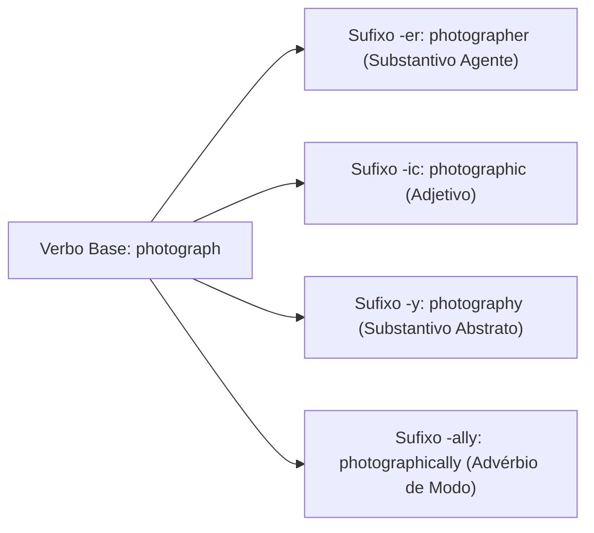
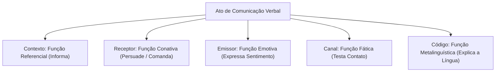
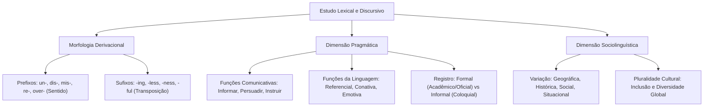

O domínio dos processos morfológicos de formação de palavras e dos mecanismos discursivos é indispensável para a interpretação de textos complexos em língua inglesa. Em certames públicos, as bancas avaliam tanto o conhecimento lexical estrito, por meio do reconhecimento de prefixos e sufixos, quanto a competência sociolinguística e comunicativa do candidato.

O estudo dos afixos permite inferir significados com agilidade. Além disso, o domínio do registro e da variação linguística orienta a leitura crítica de textos jornalísticos e institucionais.

> [!objetivos]
> - Identificar os principais prefixos da língua inglesa e seus valores semânticos de negação, tempo, oposição e intensidade.
> - Compreender o papel morfossintático dos sufixos, com destaque para as múltiplas funções de *-ing*, a privação de *-less* e a substantivação em *-ness*.
> - Analisar as funções comunicativas do discurso e as funções da linguagem aplicadas à interpretação textual.
> - Reconhecer os registros formal e informal e as vertentes de variação linguística geográfica, social, histórica e situacional.

---

## Morfologia Derivacional: Prefixos e Alteração de Sentido

Os prefixos (*prefixes*) são morfemas acrescentados ao início de uma palavra-base ou étimo radical. Na gramática inglesa, a anexação de um prefixo altera primordialmente a carga semântica do vocábulo, mantendo inalterada, na quase totalidade dos casos, sua classe gramatical original. Um verbo ao receber prefixo continua verbo, assim como um adjetivo permanece adjetivo.

A compreensão dos prefixos acelera a leitura de artigos técnicos e enunciados de prova. Eles exprimem noções lógicas de negação, reversão, temporalidade, espacialidade ou gradação de escala.

| Prefixo | Valor Semântico Central | Exemplos de Formação | Significado Prático |
| :--- | :--- | :--- | :--- |
| *un-* | Negação / Oposição | *unreliable, unlock, unfair* | não confiável, destrancar, injusto |
| *dis-* | Negação / Reversão | *disagree, disconnect, dishonest* | discordar, desconectar, desonesto |
| *mis-* | Ideia errônea ou imprópria | *misunderstand, misjudge, misbehave* | entender mal, julgar mal, portar-se mal |
| *in- / im- / il- / ir-* | Negação / Inexistência | *inadequate, impossible, illogical, irregular* | inadequado, impossível, ilógico, irregular |
| *pre-* | Anterioridade temporal | *preview, preemptive, preschool* | visualização prévia, preventivo, pré-escola |
| *re-* | Repetição / Retorno | *rebuild, rewrite, redo* | reconstruir, reescrever, refazer |
| *under-* | Insuficiência / Posição inferior | *underpaid, underestimate, underground* | mal pago, subestimar, subterrâneo |
| *over-* | Excesso / Intensidade desmedida | *overloaded, overestimate, overdue* | sobrecarregado, superestimar, atrasado |
| *counter-* | Oposição direta / Neutralização | *counterattack, counteract, counterpart* | contra-ataque, neutralizar, contraparte |
| *fore-* | Posição frontal / Antecipação | *forecast, foresee, forehead* | previsão, prever antecipadamente, testa |

Considere como os prefixos operam em orações completas:
- *The rescue personnel considered the extreme weather conditions unpredictable.* (A equipe de resgate considerou imprevisíveis as condições meteorológicas.)
- *Technicians worked continuously to reconnect the electrical grid.* (Os técnicos trabalharam continuamente para reconectar a rede elétrica.)
- *The diver remained submerged underwater for forty minutes.* (O mergulhador permaneceu submerso debaixo d'água por quarenta minutos.)

> [!bizu]
> Observe a assimilação fonética do prefixo negativo *in-*: antes de consoantes bilabiais *b* e *p*, utiliza-se *im-* (*impatient, balance -> imbalance*); antes da consoante líquida *l*, surge *il-* (*legal -> illegal*); antes do som rótico *r*, emprega-se *ir-* (*responsible -> irresponsible*). Essa regra fonológica evita ambiguidades de pronúncia.

---

## Morfologia Derivacional: Sufixos e Transposição Gramatical

Diferentemente dos prefixos, os sufixos (*suffixes*) são acoplados ao término dos vocábulos e possuem como propriedade marcante a capacidade de transposição gramatical. Isso significa que a aposição de um sufixo frequentemente altera a classe gramatical da palavra de origem, transformando verbos em substantivos, substantivos em adjetivos ou adjetivos em advérbios.

Essa dinâmica morfológica pode ser visualizada pelo desdobramento de uma raiz única: a partir do verbo *to photograph* (fotografar), a inserção do sufixo *-er* gera o substantivo agentivo *photographer* (fotógrafo); o sufixo *-ic* forma o adjetivo *photographic* (fotográfico); e o acréscimo de *-ally* produz o advérbio de modo *photographically* (fotograficamente).

Três sufixos assumem protagonismo recorrente nos certames públicos em virtude de suas nuances morfossintáticas:

### Três Dimensões Sintáticas do Sufixo -ing

O sufixo *-ing* não atua apenas como desinência verbal em tempos contínuos. Ele desempenha três papéis fundamentais na língua inglesa:
- **Forma verbal contínua (*Present Participle*)**: integra tempos progressivos (*The engine was running smoothly during tests*).
- **Gerúndio nominal (*Gerund*)**: atua substantivamente como núcleo do sujeito, após preposições obrigatórias ou após verbos específicos de regência (*Swimming is an essential survival skill*; *She succeeded by maintaining focus*). Em português, traduz-se pelo infinitivo.
- **Adjetivo qualificador**: caracteriza substantivos atribuindo-lhes uma qualidade geradora (*a time-consuming investigation*; *a demanding protocol*).

### Sufixo Privativo -less

O sufixo *-less* une-se a substantivos para convertê-los em adjetivos que transmitem a ideia inequívoca de ausência, carência ou privação completa:
- *Careless* (sem cuidado, negligente)
- *Homeless* (sem lar, desabrigado)
- *Harmless* (sem perigo, inofensivo)
- *Hopeless* (sem esperança, desesperançoso)
- *Painless* (sem dor, indolor)
- *Boundless* (sem limites, infinito)

### Sufixo Nominalizador -ness

O sufixo *-ness* vincula-se a adjetivos para convertê-los em substantivos abstratos que denotam o estado, a condição ou a qualidade inerente àquele atributo:
- *Kindness* (gentileza, qualidade de ser gentil)
- *Darkness* (escuridão, estado escuro)
- *Weakness* (fraqueza, condição de fraqueza)
- *Awareness* (consciência, estado de estar ciente)
- *Preparedness* (prontidão, estado de estar preparado)

> [!pegadinha]
> Cuidado com a oposição entre *-ful* e *-less*. Nem todo vocábulo em *-ful* possui par em *-less*. O sufixo *-ful* expressa abundância ou plenitude (*careful* = cheio de cuidado), enquanto *-less* denota ausência total (*careless* = desprovido de cuidado). Nem todo vocábulo em *-ful* possui par exato em *-less*, dependendo do uso consagrado pelo léxico padrão.

---

## Funções Comunicativas do Discurso e Funções da Linguagem

A compreensão de textos em provas de concurso demanda do candidato a percepção da função comunicativa global, que representa a finalidade pragmática do texto, ou seja, o "porquê" da mensagem. O propósito comunicativo orienta a escolha vocabular e a estruturação dos períodos.

Os propósitos pragmáticos mais recorrentes abrangem:
- **Informativo / Referencial**: visa transmitir dados objetivos, fatos e evidências neutras (*Manual de procedimentos de combate a incêndio*).
- **Persuasivo / Conativo**: busca influenciar, orientar comportamentos ou convencer o interlocutor sobre uma tese (*Campanha pública de prevenção a acidentes*).
- **Instrucional / Diretivo**: fornece comandos sequenciais e passos operacionais necessários para a execução de uma tarefa (*Protocolo de salvamento aquático*).
- **Expressivo / Emotivo**: exterioriza sentimentos, crenças e impressões subjetivas do emissor.

Dentro de um mesmo gênero discursivo, manifestam-se as consagradas funções da linguagem propostas pelos estudos linguísticos:

| Função da Linguagem | Foco Estrutural | Objetivo Predominante | Exemplo Típico |
| :--- | :--- | :--- | :--- |
| **Referencial (Denotativa)** | Contexto / Referente | Informar com clareza objetiva | *Brazil covers 8.5 million square kilometers.* |
| **Conativa (Apelativa)** | Receptor / Leitor | Persuadir, convocar à ação | *Please verify all safety valves immediately.* |
| **Emotiva (Expressiva)** | Emissor / Locutor | Exteriorizar estados subjetivos | *I am truly amazed by the crew's resilience.* |
| **Fática** | Canal de contato | Abrir, manter ou fechar o contato | *Good morning. Can everyone hear me clearly?* |
| **Metalinguística** | Código linguístico | Explicar termos da própria língua | *The term 'rescue' functions here as a verb.* |
| **Poética** | Mensagem em si | Realçar a forma estética do texto | Figuras de estilo e cadência em provérbios |

---

## Registro Discursivo e Níveis de Formalidade

Enquanto a função comunicativa responde pelo propósito substantivo da comunicação, o registro discursivo (*discursive register*) responde pelo modo como a mensagem é veiculada. O registro refere-se à gradação de formalidade ou informalidade adotada pelo falante ou autor, calibrada conforme o auditório, o meio de veiculação e o ambiente institucional.

O registro formal caracteriza-se pelo emprego de sintaxe complexa, vocabulário culto, pontuação canônica e ausência deliberada de contrações verbais e gírias. É o padrão imperativo em documentos oficiais, pareceres técnicos, artigos acadêmicos e despachos jurídicos.
- Padrão formal: *"We would like to request immediate assistance regarding the operational review."*
- Abertura institucional: *"Good morning, esteemed colleagues. Let us commence our analysis of the incident report."*

O registro informal, por outro lado, prioriza a agilidade, a proximidade empática e a economia linguística, sendo típico de trocas de mensagens pessoais, diálogos cotidianos e postagens recreativas em redes sociais.
- Padrão informal: *"Can you help me out?"*
- Abertura coloquial: *"Hey, folks! What's up? Let's check how much we spent today."*

> [!bizu]
> As bancas costumam exigir a identificação de equivalências lexicais entre registros: verbos eruditos de origem latina pertencem ao polo formal (*commence, establish, investigate, terminate*), enquanto verbos frasais polissêmicos alinham-se ao polo informal ou coloquial (*start up, set up, look into, call off*).

---

## Variação Linguística e Pluralidade Cultural

A língua inglesa não é um bloco estático ou homogêneo; ela constitui um patrimônio global vivo sujeito a contínuas variações. Os examinadores cobram a capacidade de discernir quatro eixos matriciais de variação linguística:

1. **Variação Geográfica (Diatópica)**: diferenças regionais consolidadas entre variantes nacionais do idioma, com destaque para o contraste entre o inglês americano (*American English*) e o inglês britânico (*British English*).
   - Vocabulário: *elevator* (EUA) versus *lift* (Reino Unido); *apartment* (EUA) versus *flat* (Reino Unido); *subway* (EUA) versus *underground* (Reino Unido).
   - Ortografia: simplificação gráfica americana em *-or* e *-er* contra as formas britânicas clássicas em *-our* e *-re* (*color/colour*, *center/centre*).

2. **Variação Histórica (Diacrônica)**: evolução temporal da língua, na qual termos arcaicos caem em desuso em favor de formas analíticas contemporâneas (*thou art* dando lugar a *you are*).

3. **Variação Social (Diastrática)**: diferenças no uso da linguagem entre diferentes classes socioeconômicas, faixas geracionais ou grupos ocupacionais, incluindo jargões profissionais especializados e gírias de grupos específicos (*lit* no polo jovem contra *exceptional* no polo formal).

4. **Variação Situacional (Diafásica)**: modulação do discurso segundo a conjuntura imediata, transitando de formulações protocolares em cerimônias a construções abreviadas em conversações espontâneas.

A **pluralidade cultural** reflete a convivência de múltiplas tradições entre falantes de inglês ao redor do mundo. Em metrópoles como Londres e Nova York, festivais e culinárias diversas ampliam o repertório léxico da língua franca. No Canadá, o bilinguismo oficial reconhece o inglês e o francês, promovendo inclusão e empatia cívica.

---

## Mapa do Capítulo

O diagrama abaixo sintetiza os componentes da morfologia derivacional e os pilares de variação sociolinguística na língua inglesa:

---

### Para fixar

1. **Prefixos e semântica**: prefixos unem-se ao início das raízes e modificam o significado fundamental sem trocar a classe gramatical.
2. **Sufixos e transposição**: sufixos posicionam-se ao final das raízes e possuem o poder de transformar a classe morfológica das palavras.
3. **Múltiplos papéis de *-ing***: atua como tempo progressivo, gerúndio substantivado após preposições ou adjetivo caracterizador.
4. **Sufixo privativo *-less***: converte substantivos em adjetivos indicativos de ausência absoluta (*homeless, painless*).
5. **Sufixo nominalizador *-ness***: une-se a adjetivos para forjar substantivos abstratos de estado (*darkness, kindness*).
6. **Funções do discurso e da linguagem**: a função comunicativa estabelece o objetivo pragmático, articulando as funções referencial, conativa ou fática.
7. **Registro formal versus informal**: o registro calibra o nível de formalidade; termos eruditos e sem contrações predominam no ambiente formal.
8. **Matrizes de variação linguística**: o idioma varia segundo geografia (*lift/elevator*), época histórica, grupo social e situação comunicativa.
