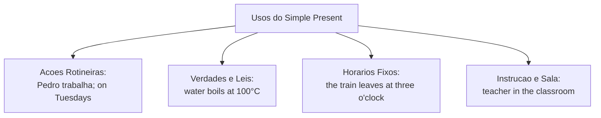
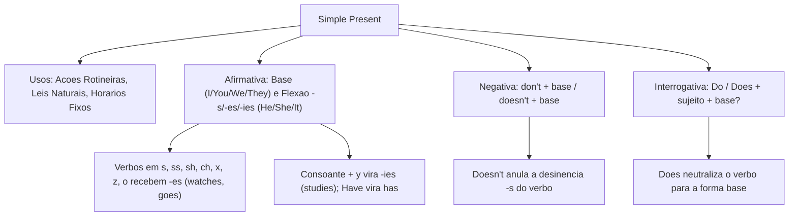

O **Simple Present** expressa ações rotineiras e regulares, verdades gerais e horários fixos. Em concursos públicos, dominar a conjugação afirmativa, negativa e interrogativa é basilar para compreender textos e instruções técnicas.

Neste capítulo, vamos examinar a flexão da terceira pessoa do singular, as regras ortográficas, os auxiliares *do* e *does* e as particularidades com sentido de haver e existir (*there is / there are*).

> [!objetivos]
> - Identificar os usos do *Present Simple* para ações rotineiras, verdades gerais e eventos fixos.
> - Aplicar as regras de terminação da terceira pessoa singular (*-s*, *-es*, *-ies*, *has*).
> - Empregar os auxiliares *do* e *does* na formulação de perguntas com o verbo na forma base.
> - Construir sentenças negativas com *don't* e *doesn't*, neutralizando a terminação verbal.

---

## Usos e Funções Semânticas do Simple Present

O presente simples abrange ações rotineiras, fatos atemporais e escalas pré-agendadas:

1. **Ações rotineiras e hábitos**: fatos cotidianos repetidos com frequência (*Pedro trabalha no centro e seus colegas trabalham no banco*; *He washes the car on Saturdays*; *He watches TV before dinner* — ele assiste à TV antes do jantar; *They study on Tuesdays* — às terças-feiras).
2. **Verdades universais e leis científicas**: leis da natureza (*Water boils at 100 degrees Celsius*; *The sun rises in the east*).
3. **Eventos futuros programados e horários fixos**: escalas e itinerários (*The train leaves at three o'clock* — o trem parte às três horas).
4. **Instruções e estados na sala de aula**: referindo-se a orientações e manuais (*The teacher explains the rules in the classroom referring to the notes*). À noitinha, ele faz anotações de estudo (*In the evening, he takes notes*).



Marcadores temporais: *always*, *usually*, *on Tuesdays* (às terças), *every day*, *at three o'clock*, *in the evening* (à noitinha). Dê uma olhada atenta nessas pistas contextuais.

---

## Regras de Flexão da Terceira Pessoa do Singular

Na forma afirmativa do *Simple Present*, os pronomes *I*, *you* (você ou vocês), *we* e *they* utilizam o verbo em sua **forma base** (*I work*, *they work* — eles trabalham). Apenas a **terceira pessoa do singular** (*he*, *she*, *it*, como Pedro) recebe terminação flexiva:

- **Regra geral**: adiciona-se o sufixo **-s** ao verbo base (*work -> works*; *speak -> speaks*; *refer -> refers*; Pedro trabalha -> *Pedro works*).
- **Verbos terminados em -s, -ss, -sh, -ch, -x, -z e -o**: recebem **-es** (*wash -> washes*; *watch -> watches*; *go -> goes*; *do -> does*). Exemplos: *He washes the car* (ele lava o carro); *He watches TV before dinner* (ele assiste à TV antes do jantar).
- **Verbos terminados em consoante + y**: elimina-se o *y* e adiciona-se **-ies** (*study -> studies*; *carry -> carries*).
- **Verbos terminados em vogal + y**: recebem apenas **-s**, sem exceção (*play -> plays*; *stay -> stays*).
- **Verbo have e o sentido de existir**: *have* torna-se **has** (*Pedro has notes*); o verbo existencial emprega **there is** (singular) e **there are** (plural) no sentido de haver e existir na sala (*in the classroom*).

| Pronome Sujeito | Verbo Regular (*work*) | Verbo em Chave (*watch*) | Consoante + y (*study*) | Verbo Irregular (*have*) |
|---|---|---|---|---|
| *I / You* (vocês) | *work* (trabalham) | *watch* (assistem) | *study* | *have* |
| *He / She / It* (Pedro) | *works* (trabalha) | *watches* (assiste) | *studies* | *has* |
| *We / They* | *work* (trabalham) | *watch* | *study* | *have* |

> [!bizu]
> Dê uma olhada: *play* vira *plays* por causa da vogal antes do *y*. Já *study* vira *studies* porque o *y* segue consoante. Não confunda essa terminação com a regra de plural dos substantivos.

---

## Estrutura Interrogativa: O Emprego de Do e Does

Para formular perguntas no *Simple Present*, utilizam-se os auxiliares **do** e **does** antes do sujeito da oração:

1. **Emprego de *Do***: utilizado para *I*, *you* (você ou vocês), *we* e *they*. Exemplo: *Do they work here?* (eles trabalham aqui?); *Do you take notes in the classroom?* (vocês fazem anotações na sala?).
2. **Emprego de *Does***: utilizado para a terceira pessoa singular (*he*, *she*, *it*). Exemplo: *Does Pedro work at three o'clock?* (Pedro trabalha às três horas?); *Does he wash the car before dinner?* (ele lava o carro antes do jantar?).

```mermaid Estrutura da Pergunta no Present Simple
flowchart LR
    A["Auxiliar:<br>Do / Does"] + B["Sujeito:<br>Pedro / they / you"] + C["Verbo Base sem -s:<br>work / wash"] + D["Complemento?<br>at three o'clock?"] --> E["Does Pedro work at three o'clock?"]
```

> [!pegadinha]
> Ao usar o auxiliar *does* na interrogação, o verbo principal volta compulsoriamente para a forma base, perdendo as terminações *-s*, *-es* ou *-ies*. Escrever *Does Pedro works?* é erro grave. O correto é *Does Pedro work?*.

Com *there is* e *there are*, não se usa auxiliar: realiza-se a inversão direta (*Is there a train at three o'clock?*; *Are there notes in the classroom?* — há anotações na sala?).

> [!atencao]
> As estruturas *there is* e *there are* expressam o sentido de haver e existir. Em perguntas, inverta para *Is there?* ou *Are there?*.

---

## Estrutura Negativa: O Emprego de Don't e Doesn't

A construção de sentenças negativas requer os operadores auxiliares **don't** (*do not*) ou **doesn't** (*does not*):

- **Para *I*, *you* (você ou vocês), *we*, *they***: utiliza-se **don't** (*They don't work on Tuesdays* — eles não trabalham às terças; *You don't take notes*).
- **Para *he*, *she*, *it* (como Pedro)**: utiliza-se **doesn't** (*Pedro doesn't wash the car at three o'clock*; *He doesn't watch TV before dinner*).

```mermaid Estrutura da Negacao no Present Simple
flowchart LR
    A["Sujeito:<br>Pedro / They"] + B["Auxiliar Negativo:<br>doesn't / don't"] + C["Verbo Base:<br>work / wash"] + D["Complemento:<br>before dinner"] --> E["Pedro doesn't work before dinner."]
```

Após o operador *doesn't*, o verbo principal permanece em sua forma base (*Pedro doesn't work*, e jamais *Pedro doesn't works*). Dê uma olhada no quadro comparativo:

| Tipo de Frase | Sujeito 1ª/2ª Pessoa e Plural (*They / You*) | Sujeito 3ª Pessoa Singular (*Pedro / He*) |
|---|---|---|
| Afirmativa | *They work on Tuesdays.* (trabalham) | *Pedro works at three o'clock.* (trabalha) |
| Negativa | *They don't work before dinner.* | *Pedro doesn't wash the car.* (não lava) |
| Interrogativa | *Do you take notes in the classroom?* | *Does Pedro watch TV at night?* (assiste) |

---

## Exercícios Práticos e Questões Comentadas

### Questão 1 (Adaptada)
Consider the sentence: "The security officer **carries** specialized equipment and **inspects** the perimeter every morning". The correct negative form of this sentence is:
A) The security officer doesn't carries specialized equipment and doesn't inspects the perimeter.
B) The security officer don't carry specialized equipment and don't inspect the perimeter.
C) The security officer doesn't carry specialized equipment and doesn't inspect the perimeter.
D) The security officer not carry specialized equipment and not inspect the perimeter.
E) The security officer isn't carry specialized equipment and isn't inspect the perimeter.

**Gabarito: C**

**Comentário detalhado:**
O sujeito "The security officer" corresponde à terceira pessoa do singular (*he* ou *she*). Na negativa do *Simple Present*, o auxiliar obrigatório é *does not* ou *doesn't*. Ao introduzir o auxiliar negativo, os verbos voltam à forma base (*carries* torna-se *carry*, e *inspects* torna-se *inspect*). A alternativa C está correta.

---

### Questão 2 (Adaptada)
Assinale a opção em que a pergunta e a resposta curta no presente simples estão gramaticalmente corretas:
A) Does they work at three o'clock? Yes, they does.
B) Do Pedro washes the car before dinner? No, he don't.
C) Does Pedro work at three o'clock? Yes, he does.
D) Do he wash the car at three o'clock? Yes, he do.
E) Does Pedro works in the evening? No, he doesn't.

**Gabarito: C**

**Comentário detalhado:**
Pedro é terceira pessoa singular (*he*), exigindo o auxiliar *does* e o verbo na forma base *work*. A resposta curta afirmativa correspondente é *Yes, he does*. A opção C é a única correta.

---

### Questão 3 (Inédita)
In the sentence "The teacher **explains** the guidelines, referring to the official notes in the classroom", the verb form "explains" represents:
A) Past Simple, expressing a concluded historical event.
B) Present Simple, 3rd person singular agreeing with "the teacher".
C) Present Continuous, describing an action occurring right now.
D) Present Perfect, connecting past experiences to the present.
E) Future Simple with will, indicating an impending duty.

**Gabarito: B**

**Comentário detalhado:**
A terminação *-s* em *explains* indica a flexão de terceira pessoa singular no *Present Simple*, concordando com o sujeito *the teacher*. A alternativa B está correta.

---

## Mapa do Capítulo



---

### Para fixar

- **Usos fundamentais**: expressa ações rotineiras, fatos gerais permanentes, leis científicas e horários agendados.
- **Forma base**: empregada para *I*, *you*, *we* e *they* sem desinência adicional (*work*, *study*).
- **Flexão de terceira pessoa**: *he*, *she* e *it* recebem **-s** na forma afirmativa regular (*works*, *refers*).
- **Terminações em -es**: aplicada a verbos terminados em *s, ss, sh, ch, x, z* e *o* (*washes*, *watches*, *goes*).
- **Troca de consoante + y**: o *y* precedido de consoante é substituído por **-ies** (*studies*, *carries*).
- **Vogal + y e verbo have**: vogal + *y* recebe apenas **-s** (*plays*); *have* vira **has**; e há sentido de existir com *there is/are*.
- **Perguntas com do e does**: posiciona-se *do* ou *does* antes do sujeito com o verbo principal na forma base.
- **Negações com don't e doesn't**: antecede o verbo principal na forma base (*Pedro doesn't work*).
- **Neutralização do verbo**: o verbo principal perde compulsoriamente a terminação flexiva após *does* e *doesn't*.
