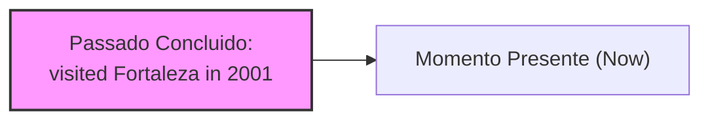
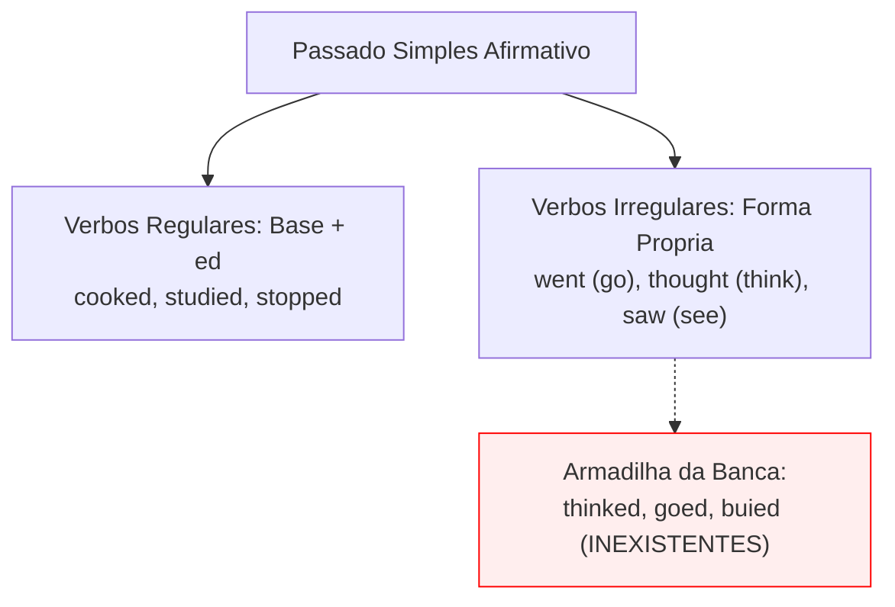
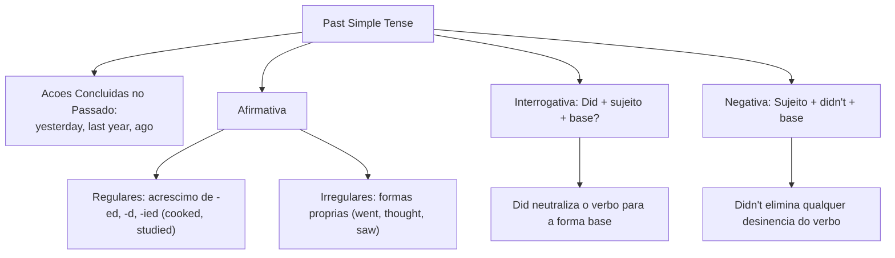

O **Past Simple** (passado simples) expressa ações e eventos inteiramente concluídos em um tempo definido no passado. Em concursos, o tempo verbal do passado simples surge rotineiramente em relatórios de ocorrência policial, investigações periciais e crônicas informativas.

Neste capítulo, estudaremos a formação dos verbos regulares, o catálogo essencial de verbos irregulares, o papel do operador auxiliar *did* nas formas interrogativa e negativa, bem como os principais marcadores temporais de pontualidade.

> [!objetivos]
> - Compreender a semântica do *Past Simple* para eventos finalizados em momento definido.
> - Aplicar as regras ortográficas do sufixo *-ed* para verbos regulares e suas variações.
> - Reconhecer os principais verbos irregulares em inglês e evitar falsas regularizações.
> - Formular sentenças interrogativas com *did* e negativas com *didn't*, restaurando a forma base verbal.

---

## Conceito e Emprego do Past Simple

O *Past Simple tense* descreve acontecimentos que se iniciaram e terminaram no passado. Não há vínculo de continuidade com o presente. A ação é um fato histórico consumado. O advérbio de tempo define o instante exato em que o evento ocorreu.

As expressões temporais mais comuns incluem *yesterday* (ontem), *yesterday morning* (ontem pela manhã), *last week* (semana passada), *two days ago* (dois dias atrás) e datas específicas como *in 2001*. Exemplos práticos: *Pamela traveled to Paris and ate escargot*; *Paige visited Fortaleza in 2001*; *Cole went to Bombinhas last summer*; *John cooked dinner yesterday morning* (John preparou o almoço ontem pela manhã).

Na página 12 da apostila, o exemplo de passado simples descreve personagens em situações concluídas. Pamela experimentou escargot na França. Phoebe conversou com os demais colegas na sala (*in the classroom*). O tempo pretérito expressa fatos que existiram em data encerrada, sem que a ação esteja em curso atualmente.



Marcadores característicos: *yesterday morning* (ontem pela manhã), *last month*, *in 2001*, *three days ago*. Dê uma olhada atenta nessas expressões que definem o tempo verbal.

---

## Verbos Regulares: Regras de Formação com -ed

Na forma afirmativa dos verbos regulares, a formação do passado simples dá-se pelo acréscimo da desinência **-ed** à forma base do verbo. Esse padrão aplica-se identicamente a todas as pessoas gramaticais (*I, you, he, she, it, we, they*):

1. **Regra geral**: acrescenta-se **-ed** ao verbo base (*cook -> cooked*; *talk -> talked*; *work -> worked*; *inspect -> inspected*).
2. **Verbos terminados em -e**: acrescenta-se apenas a letra **-d** (*arrive -> arrived*; *live -> lived*; *decide -> decided*).
3. **Verbos terminados em consoante + y**: elimina-se a letra *y* e acrescenta-se o sufixo **-ied** (*study -> studied*; *try -> tried*; *carry -> carried*).
4. **Verbos terminados em vogal + y**: mantém-se o *y* e acrescenta-se normalmente **-ed** (*play -> played*; *enjoy -> enjoyed*; *stay -> stayed*).
5. **Verbos monossílabos ou oxítonos terminados em Consoante + Vogal + Consoante (CVC)**: dobra-se a última consoante antes de receber **-ed** (*stop -> stopped*; *plan -> planned*; *prefer -> preferred*).

| Forma Base | Regra Aplicada | Forma no Passado | Exemplo Contextualizado |
|---|---|---|---|
| *cook* | Regra geral (+ed) | *cooked* | *John cooked lunch yesterday.* |
| *arrive* | Terminação em -e (+d) | *arrived* | *The squad arrived on time.* |
| *study* | Consoante + y (+ied) | *studied* | *Paige studied the whole manual.* |
| *play* | Vogal + y (+ed) | *played* | *Cole played soccer yesterday.* |
| *stop* | Regra CVC (dobra consoante) | *stopped* | *The officer stopped the vehicle.* |

> [!bizu]
> Na regra da terminação CVC, observe a tonicidade: apenas verbos com a última sílaba tônica dobram a consoante. Em *happen*, a sílaba tônica é a primeira (*HAP-pen*), logo escreve-se *happened*, sem dobrar o *n*. Já em *prefer*, a tônica é final (*pre-FER*), gerando *preferred*.

---

## Verbos Irregulares e Falsas Regularizações

Os **verbos irregulares** (*irregular verbs*) não seguem a regra de acréscimo do sufixo *-ed*. Cada verbo possui uma forma pretérita própria que deve ser memorizada pelo candidato. As bancas de concurso exploram frequentemente alternativas que inserem terminações regulares inexistentes para induzir o aluno ao erro.

Um erro recorrente na prova é tentar regularizar formas pretéritas: muitos candidatos desatentos imaginam que o passado de *think* seria a forma inexistente *thinked*, quando o passado correto e consagrado é **thought**. Da mesma forma, o passado de *go* é **went** (e não *goed*); o de *see* é **saw**; o de *buy* é **bought**; o de *write* é **wrote**; e o de *speak* é **spoke**.

A narrativa de eventos com personagens demonstra a aplicação desses verbos: *Pamela went to Paris* (e nunca *goed*); *Cole thought about the case* (e jamais *thinked*); *Prudence spoke to the chief* (e não *speaked*). A tabela abaixo consolida os verbos irregulares de maior incidência:

| Infinitivo | Passado Simples | Tradução Comum | Forma Errada Proibida |
|---|---|---|---|
| *go* | *went* | ir / foi | *\*goed* |
| *think* | *thought* | pensar / pensou | *\*thinked* |
| *buy* | *bought* | comprar / comprou | *\*buyed* |
| *take* | *took* | levar / tomou | *\*taked* |
| *see* | *saw* | ver / viu | *\*seed* |
| *make* | *made* | fazer / fez | *\*maked* |
| *write* | *wrote* | escrever / escreveu | *\*writed* |



> [!pegadinha]
> A banca examinadora adora criar verbos regulares fantasmas em opções de múltipla escolha. Se encontrar opções contendo *thinked*, *bringed*, *buyed* ou *catched*, descarte-as imediatamente. Os correspondentes corretos são *thought*, *brought*, *bought* e *caught*.

---

## Forma Interrogativa do Passado Simples com Did

Para construir perguntas no *Past Simple*, a língua inglesa emprega o operador auxiliar **did** (que é a forma passada do verbo *do/does*). O auxiliar *did* é posicionado antes do sujeito da oração:

A fórmula padrão da oração interrogativa estrutura-se da seguinte maneira:
**Did + Sujeito + Verbo na Forma Base (Infinitivo sem *to*) + Complemento?**

Exemplos práticos:
- *Did Pamela travel to Paris in 2001?* (Pamela viajou a Paris em 2001?)
- *Did John cook dinner yesterday morning?* (John cozinhou o almoço ontem pela manhã?)
- *Did Paige and Phoebe study the police report in the classroom?* (Paige e Phoebe estudaram o relatório na sala?)

```mermaid Estrutura da Pergunta no Past Simple
flowchart LR
    A["Auxiliar:<br>Did"] + B["Sujeito:<br>Pamela / you"] + C["Verbo Base:<br>go / cook"] + D["Complemento?<br>yesterday?"] --> E["Did Pamela cook dinner yesterday?"]
```

> [!atencao]
> A presença do operador auxiliar *did* já marca formalmente o tempo pretérito da frase. Por essa razão gramatical mandatória, o verbo principal volta compulsoriamente para a sua **forma base** infinitiva. Construções como *Did Pamela went?* ou *Did John cooked?* representam aberrações gramaticais. O correto é sempre *Did Pamela go?* e *Did John cook?*.

No caso do verbo *to be*, não se utiliza o auxiliar *did*. Empregam-se diretamente as formas **was** (para *I, he, she, it*) e **were** (para *you, we, they*), invertendo a posição com o sujeito: *Was Pamela in Paris?*; *Were they at the military station yesterday?*.

---

## Forma Negativa do Passado Simples com Didn't

A estruturação de sentenças negativas no pretérito simples requer a introdução do operador auxiliar negativo **did not**. Ele é frequentemente contraído como **didn't**. Fica posicionado entre o sujeito e o verbo:

A ordem estrutural da frase negativa obedece à regra:
**Sujeito + didn't + Verbo na Forma Base + Complemento**

Exemplos contextualizados:
- *Pamela didn't travel to Bombinhas yesterday morning.* (Pamela não viajou a Bombinhas ontem pela manhã.)
- *John didn't cook escargot last night.* (John não cozinhou escargot ontem à noite.)
- *Cole didn't think about that case in 2001.* (Cole não pensou naquele caso em 2001.)

```mermaid Estrutura da Frase Negativa no Past Simple
flowchart LR
    A["Sujeito:<br>Pamela / The officer"] + B["Auxiliar Negativo:<br>didn't"] + C["Verbo Base:<br>travel / visit"] + D["Complemento:<br>in 2001"] --> E["Pamela didn't travel in 2001."]
```

O uso de *didn't* neutraliza a desinência do verbo principal. O verbo volta à forma base (*didn't go*, e nunca *didn't went*; *didn't visit*, e não *didn't visited*).

Para o verbo *to be*, usa-se *not* após *was* ou *were*. Isso gera as contrações **wasn't** (*was not*) e **weren't** (*were not*). Exemplo: *Prudence wasn't in Fortaleza in 2001*; *The students weren't in the classroom*. No sentido de existir, emprega-se *there was* (singular) e *there were* (plural, indicando que existiram fatos ou pessoas no local).

| Tipo de Sentença | Verbo Regular (*cook*) | Verbo Irregular (*go*) | Verbo To Be (*be*) |
|---|---|---|---|
| Afirmativa | *John cooked yesterday.* | *Pamela went to Paris.* | *She was in Paris.* |
| Negativa | *John didn't cook yesterday.* | *Pamela didn't go to Paris.* | *She wasn't in Paris.* |
| Interrogativa | *Did John cook yesterday?* | *Did Pamela go to Paris?* | *Was she in Paris?* |

---

## Exercícios Práticos e Questões Comentadas

### Questão 1 (Adaptada)
Mark the option that correctly converts the sentence into the negative form:
"The detective **found** new evidence and **spoke** to the witness yesterday."
A) The detective didn't found new evidence and didn't spoke to the witness yesterday.
B) The detective didn't find new evidence and didn't speak to the witness yesterday.
C) The detective don't find new evidence and don't speak to the witness yesterday.
D) The detective didn't finded new evidence and didn't speaked to the witness yesterday.
E) The detective wasn't find new evidence and wasn't speak to the witness yesterday.

**Gabarito: B**

**Comentário detalhado:**
Na negativa do passado simples, utiliza-se o auxiliar *didn't*. Com esse operador, os verbos irregulares *found* e *spoke* voltam à forma base (*find* e *speak*). A alternativa B está correta. A opção A mantém os verbos flexionados; a C emprega *don't*; a D inventa sufixos inexistentes (*finded*, *speaked*); e a E usa indevidamente o verbo *to be*.

---

### Questão 2 (Adaptada)
Complete the interrogative sentence correctly:
"______ Pamela and Phoebe ______ to Paris last summer?"
A) Did / went
B) Do / went
C) Did / go
D) Were / go
E) Did / gone

**Gabarito: C**

**Comentário detalhado:**
A expressão de tempo definido no passado (*last summer*) exige o uso do auxiliar pretérito *did*. Na interrogação, o verbo principal deve figurar em sua forma base infinitiva (*go*). A combinação correta é expressa na alternativa C (*Did / go*).

---

### Questão 3 (Inédita)
Analyze the following sentence: "The patrol officer **thought** about the incident, but he didn't **mention** it in the official report yesterday."
Regarding the verbs in bold, it is correct to state that:
A) *Thought* is a regular verb with the ending -ed omitted.
B) *Thought* is the past form of *think*, and *mention* is in the base form due to *didn't*.
C) Both verbs are in the present simple tense.
D) *Mention* is an irregular verb in the past participle form.
E) The word *thought* represents an error for the standard regular form *thinked*.

**Gabarito: B**

**Comentário detalhado:**
O verbo *thought* é o passado irregular de *think* (*thinked* não existe na língua culta). Já *mention* é um verbo regular em forma base pelo uso de *didn't*. A alternativa B está correta.

---

## Mapa do Capítulo



---

### Para fixar

- **Definição de uso**: expressa ações plenamente concluídas no passado em um intervalo temporal determinado.
- **Marcadores característicos**: acompanhado comumente por *yesterday*, *last week*, *in 2021* e expressões com *ago*.
- **Verbos regulares gerais**: recebem o sufixo **-ed** na forma afirmativa para todas as pessoas (*cooked*, *talked*).
- **Variações ortográficas**: terminação *-e* recebe apenas **-d** (*arrived*); consoante + *y* vira **-ied** (*studied*).
- **Regra da dobra CVC**: dobra-se a última consoante em verbos com terminação consoante-vogal-consoante tônica (*stopped*).
- **Verbos irregulares essenciais**: possuem flexões pretéritas próprias (*went*, *thought*, *bought*, *wrote*).
- **Rejeição de falsos regulares**: formas como *thinked*, *goed* e *buyed* são gramaticalmente inexistentes.
- **Pergunta com auxiliar did**: antepõe-se *did* ao sujeito com o verbo principal rigorosamente na forma base (*Did you go?*).
- **Negação com didn't**: emprega-se *didn't* seguido pelo verbo principal na forma base (*Pamela didn't cook*).
- **Exceção do verbo to be**: utiliza *was* e *were* com inversão interrogativa e sem recurso ao operador auxiliar *did*.
