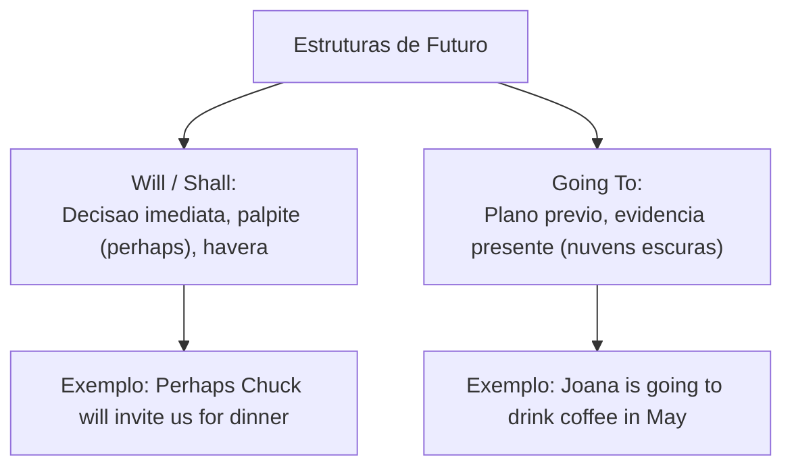
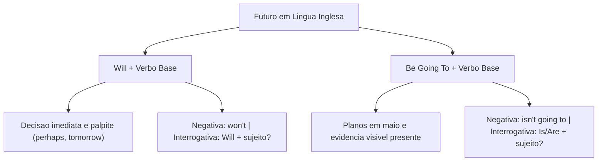

O tempo futuro em inglês estrutura-se por duas formas principais: o modal **will** e a perífrase **be going to**. Em concursos, a banca examinadora avalia as distinções entre decisões espontâneas, previsões com incerteza e planos prévios com evidência presente.

Neste capítulo, estudaremos os diferentes *future tenses*. Vamos analisar a forma afirmativa, a negativa com *won't* e as perguntas. Veremos como expressar predições para o dia de amanhã (*tomorrow*) e planejar viagens em maio.

> [!objetivos]
> - Distinguir *will* (decisão imediata e suposição) de *going to* (plano prévio e evidência).
> - Estruturar orações negativas com o auxiliar modal *won't* (*will not*).
> - Construir perguntas com *will* e *to be* na forma interrogativa.
> - Interpretar tirinhas e predições com marcadores como *tomorrow* e *perhaps*.

---

## O Futuro Simples com Will: Decisões Espontâneas e Incertezas

O auxiliar modal *will* expressa decisões tomadas no momento da fala. Também indica promessas e palpites sem certeza imediata. Quando o falante usa *perhaps* (talvez), *maybe* ou *I think*, emprega-se *will*. É possível usar também o modal arcaico *shall* com *I* e *we*:

1. **Decisão instantânea**: tomada sem plano anterior (*The bell rings. I will answer the door; I will drink coffee now*).
2. **Acontecimentos sem certeza**: opiniões sobre o amanhã (*Perhaps it will rain tomorrow* — talvez vá chover amanhã; *Maybe Joana will show the amazing report* — Joanna mostrou um trabalho incrível).
3. **Sentido existencial no futuro**: indica que haverá algo na próxima semana (*There will be a huge meeting next week* — haverá uma enorme reunião na próxima semana).



Na tirinha cômica (*comic strip*) da apostila, vemos um diálogo divertido. O pequeno pintinho (*chick*) conversa com o pinguim gordo (*fat penguin*) Chuck. Eles discutem se haverá chuva amanhã (*it will rain*). Chuck decide convidar os demais amigos para o jantar (*dinner*). Joana mostrou um projeto incrível (*she showed a huge project; you're going to love it*). É possível prever que o evento será um sucesso na próxima etapa (*it is possible to predict huge success*).

---

## Estrutura Afirmativa, Negativa e Interrogativa com Will

O modal *will* não sofre flexão de pessoa. Ele mantém a mesma grafia para todos os pronomes. O verbo principal vem sempre na forma base:

- **Afirmativa**: Sujeito + *will* ('ll) + Verbo Base (*Joana will show the project in May*; *They will invite the team*).
- **Negativa**: Sujeito + *will not* ou **won't** + Verbo Base (*He won't invite unauthorized staff*; *The chick won't leave the nest*).
- **Interrogativa**: *Will* + Sujeito + Verbo Base? (*Will Israel invite the team?*; *Will there be coffee tomorrow?*).

| Tipo de Estrutura | Fórmula Sintática | Exemplo Contextualizado |
|---|---|---|
| Afirmativa | Sujeito + *will* + Verbo Base | *Israel will coordinate the team in May.* |
| Negativa | Sujeito + *won't* + Verbo Base | *Chuck won't invite the visitors for dinner.* |
| Interrogativa | *Will* + Sujeito + Verbo Base? | *Will there be coffee tomorrow?* (haverá café?) |

> [!bizu]
> Guarde a forma negativa: *will + not* vira compulsoriamente **won't**. Não existe a forma *\*willn't*. O verbo após *won't* fica na forma base (*he won't show*).

---

## O Futuro com Be Going To: Planos e Evidências Concretas

A perífrase **be going to** expressa um futuro planejado com antecedência. Também indica predição com base em sinais visíveis no presente:

1. **Planos prévios**: a ação foi decidida antes da conversa (*Joana is going to travel in May*; *You're going to love this coffee* — você vai adorar este café).
2. **Predição com evidência física**: sinais concretos anunciam o fato (*Look at the black clouds. It is going to rain*; *The chick is going to jump*).

```mermaid Estrutura de Be Going To
flowchart LR
    A["Sujeito:<br>Joana / Chuck"] + B["Verbo To Be:<br>is / are / am"] + C["Particula Fixa:<br>going to"] + D["Verbo Base:<br>invite / travel"] --> E["Joana is going to invite friends."]
```

A estrutura sintática obedece ao seguinte modelo:
- **Afirmativa**: Sujeito + *am / is / are* + *going to* + Verbo Base (*You're going to drink an amazing coffee*).
- **Negativa**: Sujeito + *am not / isn't / aren't* + *going to* + Verbo Base (*Chuck isn't going to invite them for dinner*).
- **Interrogativa**: *Am / Is / Are* + Sujeito + *going to* + Verbo Base? (*Are you going to show the results?*).

> [!pegadinha]
> Se houver indício físico visível, use *going to* (*it is going to rain*). Se for mera suposição com *perhaps*, use *will* (*perhaps it will rain*). A banca adora trocar essas formas.

> [!atencao]
> Na fala coloquial, *going to* vira *gonna*. Em textos formais e na prova discursiva, escreva sempre a forma padrão completa *going to*.

---

## Exercícios Práticos e Questões Comentadas

### Questão 1 (Adaptada)
Choose the alternative that correctly fills in the blanks:
"Look at those black clouds! It ____________ rain this afternoon, but perhaps Joana ____________ show up in May."
A) will / is going to
B) is going to / will
C) won't / is going to
D) going to / will
E) will / will

**Gabarito: B**

**Comentário detalhado:**
As nuvens escuras constituem evidência presente, exigindo *is going to rain*. O advérbio *perhaps* indica incerteza, pedindo *will show*. A resposta correta é a B.

---

### Questão 2 (Adaptada)
Mark the sentence with a negative future prediction using a modal auxiliary:
A) Joana showed the amazing project yesterday.
B) Chuck won't invite the guests for dinner tomorrow.
C) They are not drinking coffee now.
D) The officer didn't travel in May.
E) She hasn't arrived yet.

**Gabarito: B**

**Comentário detalhado:**
A frase da alternativa B traz *won't* (*will not*) e o marcador *tomorrow*, caracterizando o futuro simples negativo. As demais opções trazem pretérito, presente contínuo ou presente perfeito.

---

## Mapa do Capítulo



---

### Para fixar

- **Emprego de will**: indicado para decisões imediatas no momento da fala, promessas e convites.
- **Incerteza com will**: expressa suposições introduzidas por *perhaps*, *maybe* ou *probably*.
- **Sentido existencial no futuro**: expressa que haverá algo com a estrutura *there will be*.
- **Contração negativa won't**: a fusão de *will* com *not* resulta sempre em *won't*.
- **Invariabilidade do modal will**: possui forma única para todas as pessoas gramaticais.
- **Emprego de be going to**: utilizado para planos deliberados antes do momento da conversa.
- **Predição com evidência visual**: aplica *going to* diante de fatos comprováveis no presente.
- **Concordância com to be**: a locução exige a correta forma de *am*, *is* ou *are* com o sujeito.
- **Verbo principal na forma base**: tanto *will* quanto *going to* exigem verbo infinitivo sem *to*.
