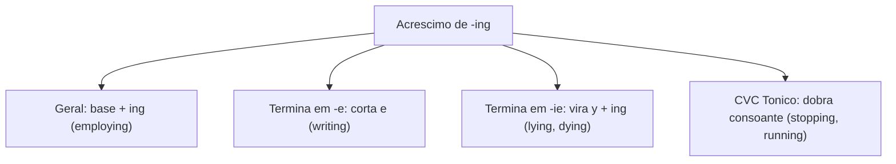
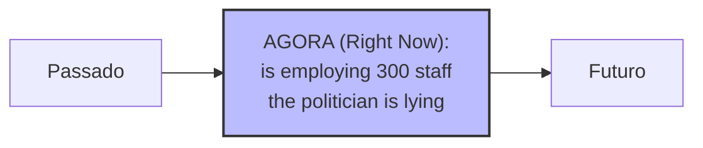
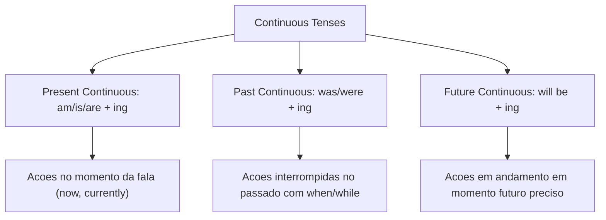

Os **tempos contínuos** (*continuous tenses*) descrevem ações em andamento em um intervalo temporal determinado. Em concursos, o domínio da composição de *to be* com *-ing* é basilar para compreender descrições operacionais e relatórios.

Neste capítulo, estudaremos a formação do *Present Continuous*, do *Past Continuous* e do *Future Continuous*, além das regras ortográficas do sufixo *-ing* e dos verbos de estado.

> [!objetivos]
> - Compreender a estrutura básica contínua (*to be* + verbo principal com terminação *-ing*).
> - Aplicar o *Present Continuous* para ações simultâneas ao momento da fala e tendências atuais.
> - Empregar o *Past Continuous* para ações em progresso no passado interrompidas por fatos pontuais.
> - Estruturar o *Future Continuous* para descrever ações em andamento em momento futuro preciso.

---

## Estrutura Geral e Regras Ortográficas do Gerúndio (-ing)

Os tempos contínuos na língua inglesa empregam o verbo auxiliar **to be** acompanhado pelo verbo principal com o sufixo **-ing**. A regra geral adiciona *-ing* à forma base (*work -> working*; *employ -> employing*). Porém, certas particularidades ortográficas exigem atenção:

1. **Terminação em -e**: corta-se a vogal antes de *-ing* (*write -> writing*). Verbos em *-ee* mantêm as vogais (*see -> seeing*).
2. **Terminação em -ie**: troca-se o grupo *-ie* pela semivogal **-y** (*lie -> lying* — mentindo ou deitando; *die -> dying*).
3. **Regra CVC**: monossílabos ou oxítonos CVC dobram a consoante final (*stop -> stopping*; *run -> running*).

| Verbo Base | Regra Ortográfica | Forma com -ing | Tradução e Exemplo |
|---|---|---|---|
| *employ* | Regra geral (+ing) | *employing* | empregando (*employing three hundred staff*) |
| *write* | Terminação em -e (corta -e) | *writing* | escrevendo (*writing an official report*) |
| *lie* | Terminação em -ie (vira -y) | *lying* | mentindo (*the suspect is lying*) |
| *stop* | Regra CVC (dobra consoante) | *stopping* | parando (*stopping the vehicle*) |

> [!bizu]
> Memorize *lie* -> *lying* (mentindo). A substituição de *-ie* por *-y* é uma pegadinha tradicional em provas de concursos para tentar induzir o candidato ao erro.

---

## Present Continuous: Ações Simultâneas e Tendências

O **Present Continuous** expressa ações que ocorrem no exato instante da fala. Serve também para indicar situações transitórias e tendências contemporâneas. A estrutura exige o presente do verbo *to be* (*am, is, are*) e o particípio presente (*-ing*).

Fórmula sintática: **Sujeito + am / is / are + Verbo com -ing + Complemento**

Emprega-se *am* com *I*, *is* com a terceira pessoa singular (*he, she, it*) e *are* com *you, we, they*.

Exemplos contextualizados em rotinas civis e militares:
- *The law firm is employing three hundred professionals in its offices.* (O escritório está empregando trezentas pessoas).
- *Citizens observe that some politicians are lying during the debate.* (Cidadãos observam que políticos estão mentindo).
- *The rescue squad is inspecting the disaster area right now.* (A equipe de resgate está inspecionando a área agora).
- *We are updating the safety guidelines at the moment.* (Estamos atualizando as diretrizes no momento).

Marcadores frequentes: *now*, *at the moment*, *currently*, *right now*, *these days*.

---

## Past Continuous: Ações Interrompidas no Passado

O **Past Continuous** expressa ações que estavam em progresso em um momento delimitado do passado. Articula-se com frequência com o *Past Simple* para retratar uma ação em andamento que acabou interrompida por um fato repentino. Esse contraste é frequente na interpretação de relatórios de ocorrência policial.

Fórmula sintática: **Sujeito + was / were + Verbo com -ing + Complemento**

Aplica-se **was** para as pessoas do singular *I, he, she, it* e **were** para *you, we, they*. A conexão temporal dá-se comumente pelos conectivos **when** (quando) e **while** (enquanto):
- *The officers were working in the offices when the alert sounded.* (Os policiais trabalhavam nos escritórios quando o alarme soou).
- *While the team was patrolling the perimeter, the storm started.* (Enquanto a equipe patrulhava o perímetro, a tempestade começou).
- *What were you doing at 22:00 yesterday? I was reading the technical guidelines.* (O que você estava fazendo às 22:00 ontem? Eu estava lendo as diretrizes técnicas).

A oração introduzida por *while* normalmente traz o verbo no tempo contínuo (*Past Continuous*). Por outro lado, a oração encabeçada por *when* geralmente traz o verbo no passado simples pontual (*Past Simple*). Guarde essa relação sintática para a prova.

---

## Future Continuous: Ações em Progresso no Futuro

O **Future Continuous** indica ações que estarão em curso em determinado ponto do futuro. Diferente do futuro simples, o aspecto contínuo evidencia a duração da atividade em momento posterior.

A fórmula sintática organiza-se com *will be* invariável e o gerúndio:
**Sujeito + will be + Verbo com -ing + Complemento**

Exemplos contextualizados de aplicação prática:
- *Tomorrow at 10:00, the chief will be interviewing candidates.* (Amanhã às 10:00, o comandante estará entrevistando candidatos).
- *Next month, the emergency agency will be employing three hundred agents.* (No próximo mês, o órgão estará empregando trezentos agentes).
- *At this time on Friday, the unit will be patrolling the southern sector.* (Neste horário na sexta-feira, a unidade estará patrulhando o setor sul).

Marcadores comuns: *at this time tomorrow*, *this time next week*, *at 8 o'clock tonight*.

> [!pegadinha]
> **Verbos de estado (*stative verbs*)**: verbos de cognição, emoção ou posse (*know, understand, believe, belong*) não admitem tempos contínuos. Escreva *I understand the rule*, e nunca *I am understanding*.

---

## Exercícios Práticos e Questões Comentadas

### Questão 1 (Adaptada)
Choose the correct verb form for the sentence below:
"The main legal offices in the capital ____________ three hundred specialists currently."
A) is employing
B) are employing
C) was employing
D) will employing
E) employing

**Gabarito: B**

**Comentário detalhado:**
O sujeito está no plural, exigindo o verbo auxiliar *are*. O advérbio *currently* indica presente contínuo, validando a opção B.

---

### Questão 2 (Adaptada)
Mark the sentence that presents the correct spelling of the continuous verb:
A) The suspect was lieing to the officers.
B) The legal office is employeing new consultants.
C) The witness was lying during the interrogation.
D) The firefighter was stoping the vehicle.
E) The officer was writeing an urgent report.

**Gabarito: C**

**Comentário detalhado:**
O verbo *lie* converte-se em *lying*. As grafias *lieing*, *employeing*, *stoping* e *writeing* são incorretas.

---

## Mapa do Capítulo

---

### Para fixar

- **Matriz contínua**: requer o auxiliar *to be* e o verbo principal com desinência *-ing*.
- **Regra de terminação -ie**: verbos como *lie* trocam *-ie* por **-y** antes de *-ing* (*lying*).
- **Corte de -e mudo**: verbos terminados em consoante + *e* perdem a vogal antes de *-ing* (*writing*).
- **Dobra de consoante CVC**: monossílabos e oxítonos CVC dobram a consoante final (*stopping*).
- **Present Continuous**: expressa ações imediatas ou tendências transitórias (*are employing*).
- **Past Continuous**: indica ações passadas em progresso conectadas com *when* e *while*.
- **Flexão de pretérito de to be**: usa *was* com *I, he, she, it* e *were* com *you, we, they*.
- **Future Continuous**: estrutura-se com *will be + ing* para atividades futuras em curso.
- **Verbos de estado**: verbos como *know* e *understand* rejeitam o aspecto contínuo.
