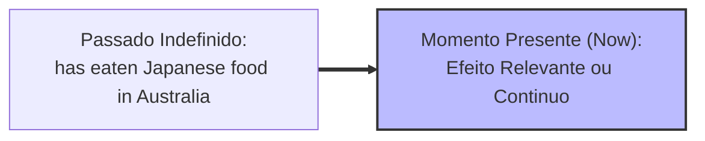
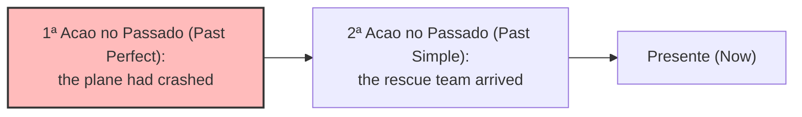
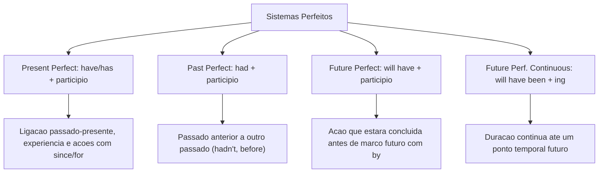
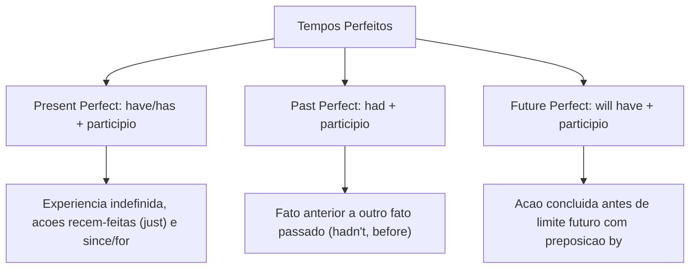

Os **tempos perfeitos** (*perfect tenses*) são frequentes nas provas de concurso. Eles não indicam apenas o momento em que uma ação ocorreu. Sua função principal é ligar dois marcos no tempo. Expressam anterioridade, continuidade e relevância no presente.

Neste capítulo, estudaremos a estrutura do *Present Perfect Simple*, do *Past Perfect Simple*, do *Future Perfect Simple* e do *Future Perfect Continuous*. Analisaremos os advérbios e preposições que definem seu uso em questões de prova.

> [!objetivos]
> - Compreender a diferença entre o *Present Perfect* e o *Past Simple*.
> - Aplicar corretamente os marcadores *since*, *for*, *already*, *yet*, *just*, *ever* e *never*.
> - Estruturar o *Past Perfect* para expressar anterioridade no passado.
> - Empregar o *Future Perfect* e o *Future Perfect Continuous* para ações com prazo no futuro.

---

## O Present Perfect Simple: Conexão Passado-Presente

O **Present Perfect Simple** é formado pelo auxiliar **have** ou **has**. O verbo principal fica no **particípio passado** (*past participle*). O tempo expressa um vínculo direto com o momento atual. A estrutura básica é:

**Sujeito + have / has + Particípio Passado + Complemento**

Usa-se **have** com *I, you, we, they*. Usa-se **has** com *he, she, it*.

Vejamos os quatro casos principais de emprego:

1. **Ação iniciada no passado que continua no presente**: muito comum com *since* e *for*. Marcos mora em Recife desde 2018 (*Marcos has lived in Recife since 2018*).
2. **Experiências de vida em tempo indefinido**: não se diz a data exata. Marcos Mion já comeu comida japonesa na Austrália (*Marcos Mion has eaten Japanese food in Australia*). O estudante já viajou para o exterior (*The student has traveled abroad*). Se a data for citada (*yesterday* ou *in 2015*), usa-se o *Past Simple*.
3. **Ações concluídas recentemente**: fato feito recentemente com efeito visível no presente (*The student has just finished his homework* — o estudante acabou de fazer o dever de casa). O militar recebeu uma promoção recente (*The officer has received a promotion*).
4. **Ações repetidas até o presente**: frequência indefinida ao longo do tempo (*We have met several times*).

> [!bizu]
> Guarde a regra de ouro: se houver data definida no passado (*yesterday, in 2020, two days ago*), use **Past Simple** (*I met him yesterday*). Se o tempo for indefinido (*already, never, just*) ou contínuo (*since, for*), use **Present Perfect** (*I have met him before*).

---

## Formas Negativa e Interrogativa e Advérbios Típicos

As frases negativas e interrogativas no presente perfeito não usam *do, does* ou *did*. O próprio *have/has* funciona como operador auxiliar:

- **Forma Negativa**: Sujeito + *haven't* ou *hasn't* + Particípio Passado (*The student hasn't finished his homework yet*; *Marcos hasn't eaten Japanese food*).
- **Forma Interrogativa**: *Have / Has* + Sujeito + Particípio Passado? (*Have you finished the homework yet?*; *Has Marcos met the team?*).

Em provas de concurso e em textos sobre educação e carreira, a distinção entre **been** e **gone** é muito explorada:
- **Have been to**: indica que o indivíduo foi a um local e já retornou (*He has been to Australia* — ele foi à Austrália e já voltou).
- **Have gone to**: indica que a pessoa viajou e ainda se encontra no destino (*The officer has gone to Karachi* — ele foi a Karachi e ainda não retornou).

Além disso, o **Present Perfect Continuous** (ou aspecto progressivo) foca na duração de uma atividade contínua iniciada no passado:
**Sujeito + have/has been + Verbo com terminação -ing**
Exemplo: *The student has been playing the guitar for two hours* (o estudante está tocando violão há duas horas). Esse aspecto progressivo enfatiza a dedicação e o processo contínuo que aconteceu e se mantém ativo.

Os advérbios possuem posições fixas na oração:
- **Already** (já): usado em afirmativas, entre o auxiliar e o particípio (*I have already finished the essay* — já terminei a redação).
- **Yet** (já ou ainda): fica sempre no final da oração (*Has he arrived yet?*; *He hasn't arrived yet*).
- **Just** (acabar de): colocado antes do particípio para indicar fato feito recentemente (*He has just arrived*).
- **Ever** (já / alguma vez): usado em perguntas sobre experiências de vida em diálogos formais (*Have you ever eaten Japanese food?*).
- **Never** (nunca): indica valor negativo com verbo na forma afirmativa (*I have never been to Australia*).
- **Since** e **For**: *since* marca a data inicial (*since 2010*). *For* indica a duração do período (*for ten years*).

| Advérbio | Posição na Frase | Sentido | Exemplo Prático |
|---|---|---|---|
| *already* | Entre auxiliar e particípio | já (afirmativa) | *The student has already done the test.* |
| *yet* | Final da oração | ainda / já | *He hasn't finished his homework yet.* |
| *just* | Entre auxiliar e particípio | feito recentemente | *The officer has just received a promotion.* |
| *ever* | Antes do particípio | alguma vez | *Have you ever been to Australia?* |
| *since* | Antes do marco inicial | desde | *Marcos has lived here since May.* |
| *for* | Antes da duração | por / há | *They have waited for two hours.* |

> [!bizu]
> Distinção crucial entre *been* e *gone*: *He has been to Paris* significa que ele visitou Paris e já voltou para casa. Já *He has gone to Paris* significa que ele partiu para Paris e ainda permanece lá. As bancas de concurso cobram frequentemente essa diferença semântica em diálogos cotidianos e questões de interpretação textual.

> [!pegadinha]
> Cuidado com o particípio de verbos irregulares. O particípio de *meet* é **met** (*encontrou / encontrado*). A forma *\*meted* não existe na língua inglesa. O particípio de *eat* é **eaten** (*has eaten Japanese food*). O particípio de *do* é **done** (*has done the homework*). O particípio de *go* é **gone** (*he has gone*). Não invente terminações regulares para esses verbos.

---

## Past Perfect Simple: Anterioridade no Passado

O **Past Perfect Simple** expressa uma ação concluída antes de outro fato passado. A gramática o define como o *passado do passado*. Ele organiza a cronologia de eventos pretéritos em crônicas, relatórios investigativos e textos de provas de concurso.

A estrutura básica utiliza o auxiliar **had** com o particípio passado do verbo principal:
**Sujeito + had + Particípio Passado + Complemento**

O auxiliar *had* é invariável para todas as pessoas do discurso (*I, you, he, she, it, we, they*). Usa-se a forma contraída **hadn't** (*had not*) para a negativa. Na interrogação, coloca-se *had* antes do sujeito da oração: *Had you seen that before?*.

Em provas de concurso, o *Past Perfect* surge habitualmente ligado a conectivos temporais de subordinação, como *before* (antes que), *after* (depois que) e *by the time* (no momento em que):
- *The plane had crashed near Karachi before the rescue squad arrived.* (O avião havia caído perto de Karachi antes que a equipe de resgate chegasse).
- *By the time the student arrived, the class had already finished.* (No momento em que o estudante chegou, a aula já tinha terminado).
- *Marcos hadn't finished the report when the manager called.* (Marcos não tinha terminado o relatório quando o gerente ligou).
- *She showed the proof of her education after the board had requested it.* (Ela apresentou o comprovante de sua formação após a banca tê-lo solicitado).

Em um diálogo sobre o que aconteceu no local da ocorrência, a ordem temporal fica nítida: primeiro o incidente aconteceu no passado anterior (*had happened*), e em seguida os socorristas chegaram no passado simples (*arrived*).

---

## Future Perfect Simple e Future Perfect Continuous

Os tempos futuros perfeitos indicam ações concluídas ou contínuas tendo como referência um marco temporal no futuro:

### Future Perfect Simple
Mostra uma ação que estará terminada antes de um ponto futuro específico. Sua fórmula é:
**Sujeito + will have + Particípio Passado + Complemento**

Usa-se muito com a preposição **by** (até):
- *By next month, the student will have finished his course.* (Até o próximo mês, o estudante terá terminado seu curso).
- *By the end of the year, Marcos will have received his promotion.* (Até o fim do ano, Marcos terá recebido sua promoção).
- *The squad won't have completed the patrol by sunrise.* (A equipe não terá completado a patrulha até o amanhecer).

### Future Perfect Continuous
Mostra a duração contínua de um fato até determinado momento no futuro:
**Sujeito + will have been + Verbo com terminação -ing + Complemento**

Exemplo contextualizado:
- *By next December, the pilot will have been flying for twenty years.* (Até o próximo dezembro, o piloto estará voando há vinte anos).

> [!atencao]
> A expressão com **by** e data futura (*by tomorrow, by next year*) é o sinal clássico do *Future Perfect* (*will have + particípio*). Não use o futuro simples comum com essa preposição de prazo.

---

## Exercícios Práticos e Questões Comentadas

### Questão 1 (Adaptada)
Complete the sentence correctly:
"When the rescue team entered the building, they noticed that the accident ____________ hours before."
A) have happened
B) had happened
C) will have happened
D) were happening
E) happening

**Gabarito: B**

**Comentário detalhado:**
A ação principal está no passado simples (*entered / noticed*). O acidente ocorreu antes dessa ação. Por isso, usa-se o *Past Perfect Simple* (*had happened*). A alternativa B é a correta.

---

### Questão 2 (Adaptada)
Mark the option in which the Present Perfect is grammatically correct:
A) Marcos has eaten Japanese food yesterday afternoon.
B) The student has finished his homework in 2021.
C) The officer has just received a promotion.
D) They haven't found the records last Sunday.
E) Did you ever eaten sushi?

**Gabarito: C**

**Comentário detalhado:**
O *Present Perfect* aceita *just* para indicar fato feito recentemente, como na alternativa C. As opções A, B e D trazem datas passadas fechadas (*yesterday*, *in 2021*, *last Sunday*), o que exige o *Past Simple*. A alternativa E mistura *did* com particípio de modo incorreto.

---

### Questão 3 (Inédita)
In the sentence: "By the end of next month, the recruit ____________ his basic training in Australia", the correct verbal form is:
A) had concluded
B) will have concluded
C) concludes
D) has concluded
E) was concluding

**Gabarito: B**

**Comentário detalhado:**
A expressão *By the end of next month* fixa um prazo no futuro. Uma ação que estará pronta antes desse prazo exige o *Future Perfect Simple* (*will have concluded*). A opção B está correta.

---

## Mapa do Capítulo

---

### Para fixar

- **Present Perfect**: usa *have* ou *has* com o verbo principal no particípio passado.
- **Conexão temporal**: expressa fatos passados com relevância direta no momento presente.
- **Tempo indefinido**: recusa marcadores fechados como *yesterday*; aceita *already, yet, since* e *for*.
- **Particípios corretos**: emprega formas como *met, eaten* e *done*, evitando falsos regulares como *\*meted*.
- **Past Perfect**: usa *had* invariável para indicar uma ação anterior a outro fato passado.
- **Forma negativa hadn't**: une o auxiliar *had* com a negação *not* para indicar anterioridade.
- **Future Perfect Simple**: usa *will have + particípio* para ações que estarão prontas antes de marco futuro.
- **Preposição by**: a presença de *by* com tempo futuro exige o *Future Perfect*.
- **Future Perfect Continuous**: enfatiza a duração ininterrupta de uma atividade até um ponto futuro.
