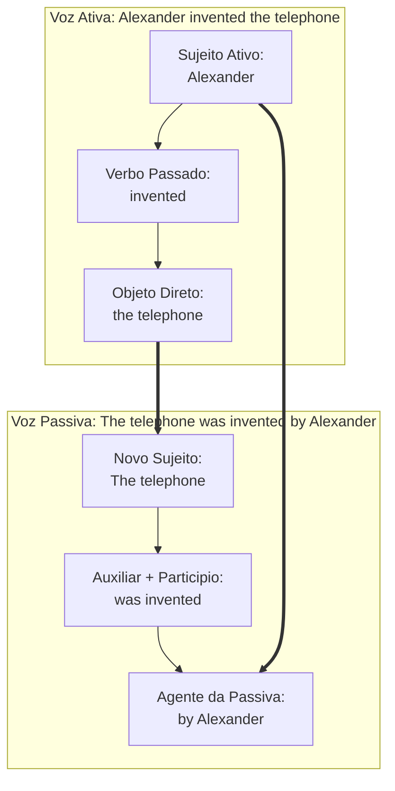
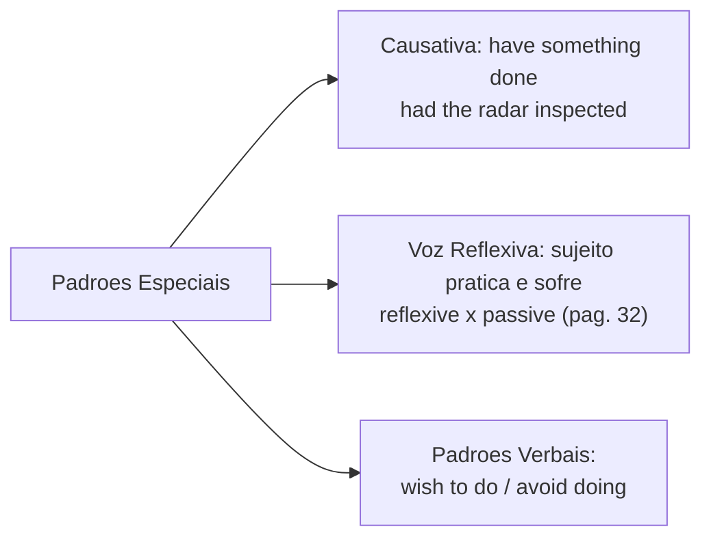
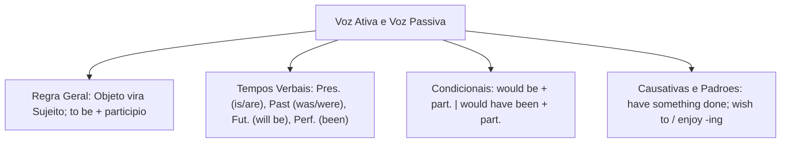

A compreensão da **voz ativa e da voz passiva** (*active and passive voice*) é um dos pilares da interpretação textual em concursos públicos. Na voz ativa, o sujeito realiza a ação expressa pelo verbo. Por outro lado, na voz passiva, o objetivo é focalizar o paciente que recebe a ação ou destacar o resultado produzido.

Neste capítulo, estudaremos as regras de transposição entre as vozes. Analisaremos a concordância de *to be* nos tempos verbais, as condicionais com *would* e *would have*, as formas causativas e a voz reflexiva tratada na página 32 da fonte teórica.

> [!objetivos]
> - Converter orações da voz ativa para a passiva preservando o tempo verbal original.
> - Identificar o agente da passiva e as hipóteses em que ele é omitido.
> - Aplicar a voz passiva com tempos simples, perfeitos e modais condicionais.
> - Compreender o funcionamento das estruturas causais (*have/get something done*) e da voz reflexiva.

---

## Princípios Gerais da Voz Passiva e Transposição Sintática

Para transformar uma oração ativa em passiva analítica, o objeto direto da ativa torna-se o sujeito paciente da passiva. O verbo principal passa para o **particípio passado**. Ele é antecedido por uma forma do verbo auxiliar **to be** no tempo exato da oração ativa original. O antigo sujeito ativo pode figurar como agente da passiva, introduzido por **by**.

A fórmula estrutural organiza-se como:
**Novo Sujeito (Paciente) + Verbo To Be + Particípio Passado + (by + Agente)**

Um exemplo clássico citado na fonte teórica ilustra essa transposição histórica:
- **Voz Ativa**: *Alexander Graham Bell invented the telephone in 1876.* (Alexander Graham Bell inventou o telefone em 1876).
- **Voz Passiva**: *The telephone was invented by Alexander Graham Bell in 1876.* (O telefone foi inventado por Alexander Graham Bell em 1876).

O agente da passiva (*by Alexander Graham Bell*) pode ser omitido quando o autor da ação é desconhecido, irrelevante ou óbvio:
- *The plants in the garden were watered yesterday.* (As plantas no jardim foram regadas ontem).
- *The bills were paid by the controller.* (As contas foram pagas pelo controlador).
- *Chess is played by experienced officers.* (Jogos de xadrez são jogados por policiais experientes).
- *All medical exams were conducted yesterday.* (Todos os exames médicos foram feitos ontem).

---

## A Voz Passiva nos Diferentes Tempos Verbais

A regra essencial da voz passiva exige que o auxiliar *to be* reproduza o tempo verbal da oração ativa. Acompanhe a aplicação nos tempos fundamentais:

1. **Present Simple**: emprega *am / is / are* + particípio passado. Exemplo ativo: *Officers inspect the vehicles*; Passivo: *The vehicles are inspected*. Em textos investigativos: *Sherlock Holmes reads the letter*; Passivo: *The letter is read by Sherlock Holmes* (o documento foi lido com atenção dada aos detalhes).
2. **Future Simple**: emprega *will be* + particípio passado. Exemplo ativo: *The mayor will invite the delegates*; Passivo: *The delegates will be invited*. Atenção aos convidados: *Special attention will be given sooner*.
3. **Present Perfect**: emprega *have been / has been* + particípio passado. Exemplo: *The report has been read*; *The bills have been paid*; *The book has been read by the new generation of students* (o livro tem sido lido pela nova geração de estudantes). O candidato foi aprovado nos exames (*The candidate has been approved in all exams*).
4. **Condicional com Would**: emprega *would be* + particípio passado. Exemplo ativo: *They would accept the terms*; Passivo: *The terms would be accepted*.
5. **Condicional Perfeito com Would Have**: emprega *would have been* + particípio passado. Exemplo ativo: *They would have paid the debt*; Passivo: *The debt would have been paid*.

| Tempo da Oração Ativa | Estrutura Passiva | Exemplo na Voz Passiva |
|---|---|---|
| *Present Simple* (*reads*) | *am/is/are + particípio* | *The letter is read by Sherlock Holmes.* |
| *Past Simple* (*invented*) | *was/were + particípio* | *The telephone was invented in 1876.* |
| *Future Simple* (*will invite*) | *will be + particípio* | *The delegates will be invited sooner.* |
| *Present Perfect* (*has paid*) | *has/have been + particípio* | *All salaries have been paid on time.* |
| *Condicional Would* (*would pay*) | *would be + particípio* | *The bill would be paid gladly.* |
| *Condicional Perfeito* (*would have paid*) | *would have been + particípio* | *The debt would have been paid sooner.* |

> [!bizu]
> Note que o particípio passado do verbo principal é fixo (*read, paid, invented, invited*). Apenas o auxiliar *to be* muda para marcar o tempo gramatical e concordar com o novo sujeito.

---

## Padrões Verbais, Voz Reflexiva e Estruturas Causativas

O edital exige o domínio de estruturas que alteram a relação entre o sujeito e a ação:

### Voz Reflexiva e Passiva (Ponto de atenção da pág. 32)
Na página 32 da fonte teórica, analisa-se a **voz reflexiva** em paralelo com a estrutura passiva. Na reflexiva, o sujeito pratica e sofre a ação ao mesmo tempo com pronomes reflexivos (*himself, herself, themselves*). Ao focalizar o fato com neutralidade e distanciamento, a língua inglesa prefere a voz passiva em vez do pronome reflexivo. Em cenas experienciadas (*experienced scenes*) em operações, diz-se *The mission was accomplished*, mantendo o foco no resultado alcançado. Pouca coisa precisa ser dita sobre o agente (*little attention is required*).

### Estruturas Causais (Causative Form)
Nas estruturas causais (*causative structures*), o sujeito não executa a tarefa diretamente sem ajuda, mas solicita, contrata ou faz com que outro a realize:
- **Have / Get something done**: Sujeito + *have / get* + Objeto + Particípio Passado.
  Exemplo: *The flight controller had the radar inspected* (O controlador de voo mandou inspecionar o radar).
- *The chief got the vehicles repaired in the garden workshop.* (O comandante conseguiu que os veículos fossem consertados na oficina do pátio).

### Padrões Verbais (Verb Patterns)
Certos verbos em inglês exigem infinitivo com *to* (*verb + to-infinitive*), infinitivo sem *to* (*bare infinitive*) ou gerúndio (*gerund* com *-ing*):
- **Verbo + to-infinitive**: verbos como *decide, want, hope, wish, plan* (*They wish to play chess*; *They decided to act sooner*).
- **Verbo + gerund (-ing)**: verbos como *enjoy, avoid, consider, finish* (*They enjoyed playing games*; *They finished reading*).
- **Bare infinitive**: verbos modais e causativos como *make* e *let* (*The officer let the visitor enter*).

> [!pegadinha]
> Verbos com dois objetos (*give, send, pay, tell*): o inglês prefere promover o objeto indireto de pessoa a sujeito passivo. Exemplo ativo: *They gave the flight controller an award*; Passivo: *The flight controller was given an award*.

> [!atencao]
> Na estrutura causativa com *make* na passiva, o verbo exige *to*: na ativa diz-se *They made him leave*; na passiva diz-se *He was made to leave*.

---

## Exercícios Práticos e Questões Comentadas

### Questão 1 (Adaptada)
Choose the option that correctly converts the sentence into the passive voice:
"Alexander Graham Bell invented the telephone in 1876."
A) The telephone is invented by Alexander Graham Bell in 1876.
B) The telephone was invented by Alexander Graham Bell in 1876.
C) The telephone has been invented by Alexander Graham Bell in 1876.
D) The telephone had invented by Alexander Graham Bell in 1876.
E) Alexander Graham Bell was invented by the telephone in 1876.

**Gabarito: B**

**Comentário detalhado:**
O verbo "invented" está no passado simples. A passiva exige o verbo auxiliar *to be* no pretérito (*was*) com o particípio passado (*invented*). O objeto direto vira sujeito paciente, validando a alternativa B.

---

### Questão 2 (Adaptada)
Analyze the passive transformation: "The flight controller has paid all expenses."
The correct passive sentence is:
A) All expenses were paid by the flight controller.
B) All expenses have been paid by the flight controller.
C) All expenses will be paid by the flight controller.
D) All expenses had been paid by the flight controller.
E) All expenses are paid by the flight controller.

**Gabarito: B**

**Comentário detalhado:**
A frase ativa está no *Present Perfect* (*has paid*). Ao passar para a passiva com sujeito no plural (*all expenses*), utiliza-se *have been paid*. A opção B está correta.

---

### Questão 3 (Inédita)
In the sentence: "The experienced commander **had the communication system inspected** sooner than expected", the bold structure expresses:
A) Passive voice with a reflexive pronoun indicating self-service.
B) Causative structure showing that a professional service was arranged.
C) Active voice in the past continuous describing an interrupted event.
D) Future conditional with would have indicating an unrealized wish.
E) Imperative command directed to the security team.

**Gabarito: B**

**Comentário detalhado:**
A construção *had + objeto + particípio* expressa a forma causativa (*causative form*), demonstrando que o comandante encomendou a realização do serviço. A alternativa B é a correta.

---

## Mapa do Capítulo

---

### Para fixar

- **Transposição passiva**: o objeto direto ativo vira sujeito paciente; o verbo *to be* assume o tempo original.
- **Particípio invariável**: o verbo principal de conteúdo figura sempre no particípio passado em qualquer tempo.
- **Agente da passiva**: introduzido pela preposição *by*; pode ser omitido quando desconhecido ou irrelevante.
- **Presente e Passado Simples**: estruturam-se respectivamente com *am/is/are + particípio* e *was/were + particípio*.
- **Tempos Perfeitos passivos**: acrescentam a forma *been* entre o auxiliar *have/has/had* e o particípio principal.
- **Condicionais com would**: formam-se com *would be + particípio* e *would have been + particípio*.
- **Estruturas causais**: utilizam *have/get something done* para indicar serviço executado por terceiros.
- **Padrões verbais**: verbos como *wish* regem infinitivo com *to*; verbos como *enjoy* regem gerúndio (*-ing*).
- **Voz reflexiva**: analisada na página 32 da fonte; expressa que o sujeito pratica e recebe o efeito da ação.
