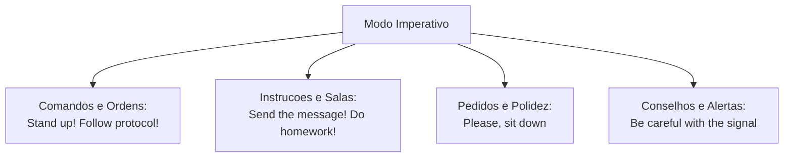
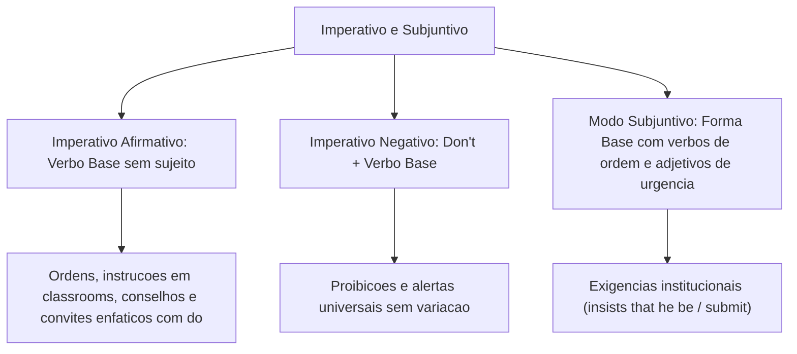

O **modo imperativo** (*imperative mood*) e as estruturas do **subjuntivo** (*subjunctive*) desempenham papel central na comunicação operacional, em manuais de segurança e em ordens diretas de serviço. Enquanto o imperativo expressa ordens, pedidos, advertências e conselhos, o subjuntivo veicula exigências formais, recomendações institucionais e condições hipotéticas.

Neste capítulo, estudaremos a formação do imperativo afirmativo e negativo, o uso do imperativo enfático com *do*, as fórmulas de cortesia com *please*, e as estruturas subjuntivas de recomendação formal em língua inglesa.

> [!objetivos]
> - Construir orações no imperativo afirmativo utilizando o verbo diretamente em sua forma base.
> - Formular comandos e advertências no imperativo negativo empregando o operador *don't*.
> - Reconhecer o uso do imperativo enfático com o auxiliar *do* para convites e insistências cordiais.
> - Compreender o emprego do modo subjuntivo formal com verbos de exigência e recomendação.

---

## O Modo Imperativo Afirmativo: Formação e Usos Semânticos

O imperativo caracteriza-se pela ausência de sujeito gramatical explícito. A oração inicia-se diretamente com o verbo em sua **forma base** (o infinitivo sem a partícula *to*). O interlocutor (*you*, singular ou plural) é o sujeito elíptico da comunicação:

1. **Ordens e comandos diretos (*commands*)**: frequentes no treinamento militar (*Stand up!*; *Follow the protocol!*; *Inspect the perimeter!*).
2. **Instruções e regras em salas de instrução (*classrooms*)**: orientações para atividades (*Open your manual*; *Do your homework*; *Send the message* — envie a mensagem imediatamente).
3. **Pedidos cordiais e convites**: acompanhados por fórmulas de polidez como *please* (*Please, sit down*; *Come in, please*).
4. **Conselhos, recomendações e advertências cotidianas**: instruções sobre rotinas e alimentação (*Eat healthy food*; *Eat the pizza while it is hot* — coma a pizza enquanto está quente; *Be careful with the signal* — cuidado com o sinal de perigo).



> [!bizu]
> **Imperativo Enfático**: para conferir maior insistência, calor humano ou ênfase a um convite educado, antepõe-se o auxiliar **do** ao verbo principal: *Do sit down!* (sente-se, por favor!); *Do come to the briefing!*. Na prova de concurso, esse *do* não indica pergunta, mas sim um reforço enfático cordial.

---

## O Imperativo Negativo com Don't

Para expressar proibições, advertências de risco ou instruções impeditivas, a língua inglesa utiliza o operador auxiliar negativo **don't** (*do not*) posicionado antes do verbo principal na forma base:

Fórmula sintática: **Don't (Do not) + Verbo na Forma Base + Complemento**

Essa estrutura aplica-se identicamente a qualquer interlocutor, inexistindo variação para terceira pessoa:
- *Don't touch the electrical equipment!* (Não toque no equipamento elétrico!).
- *Don't eat in the control room!* (Não coma na sala de controle!).
- *Do not enter without safety gear!* (Não entre sem equipamento de proteção!).
- *Don't travel to Russia during winter without proper gear.* (Não viaje à Rússia durante o inverno sem vestuário apropriado).

```mermaid Estrutura do Imperativo Negativo
flowchart LR
    A["Operador Negativo:<br>Don't / Do not"] + B["Verbo na Forma Base:<br>touch / enter / eat"] + C["Complemento:<br>the signal / equipment"] --> D["Don't touch the equipment!"]
```

> [!pegadinha]
> No imperativo negativo, o único operador auxiliar admitido é **don't** (*do not*). Jamais utilize *doesn't*, *didn't* ou a partícula *not* isolada. Escrever *\*Doesn't touch* ou *\*Not touch* constitui erro gramatical primário.

---

## O Modo Subjuntivo Formal (Subjunctive Mood)

O **modo subjuntivo** em língua inglesa expressa desejos, condições hipotéticas e, sobretudo, exigências formais em comunicações oficiais e normativas. Diferencia-se do português por utilizar o verbo principal em sua **forma base pura** (invariável) em orações subordinadas introduzidas por *that*:

O subjuntivo mandatório ocorre após verbos de comando, recomendação e exigência (*demand, insist, recommend, suggest, require, order*):
- *The chief insists that every officer **be** ready at 06:00.* (O comandante insiste que cada policial esteja pronto às 06:00; e não *is*).
- *The protocol requires that he **submit** the report immediately.* (O protocolo exige que ele envie o relatório imediatamente; e não *submits*).

Também ocorre após adjetivos de urgência e necessidade (*crucial, vital, essential, important*):
- *It is essential that she **follow** the safety rules.* (É essencial que ela siga as regras de segurança).

| Estrutura | Verbo de Comando / Adjetivo | Oração no Subjuntivo (Forma Base) |
|---|---|---|
| Exigência verbal | *The director demands that...* | *...the recruit **be** punctual.* |
| Recomendação | *The physician suggests that...* | *...he **eat** healthier meals.* |
| Necessidade formal | *It is vital that...* | *...the unit **send** the alert signal.* |

---

## Exercícios Práticos e Questões Comentadas

### Questão 1 (Adaptada)
Mark the option that correctly illustrates the negative imperative mood:
A) Doesn't touch the dangerous signal.
B) Not enter the restricted area.
C) Don't cross the yellow line.
D) You don't crossing the corridor.
E) Didn't talk during the examination.

**Gabarito: C**

**Comentário detalhado:**
A formação do imperativo negativo exige o operador *don't* seguido de verbo na forma base infinitiva sem *to*, como demonstrado na alternativa C (*Don't cross*). As opções A, B, D e E usam formas inexistentes no modo imperativo.

---

### Questão 2 (Adaptada)
In the sentence: "It is essential that the candidate **be** present at the inspection tomorrow", the bold verb is in the:
A) Indicative mood, present continuous tense.
B) Subjunctive mood, expressing formal necessity.
C) Imperative mood, giving an emphatic command.
D) Past simple tense, indicating completed action.
E) Passive voice, showing an agent action.

**Gabarito: B**

**Comentário detalhado:**
A oração subordinada com *that* regida por adjetivo de necessidade formal (*essential*) emprega a forma base *be* do modo subjuntivo (*subjunctive mood*), validando a opção B.

---

## Mapa do Capítulo



---

### Para fixar

- **Ausência de sujeito**: o imperativo afirmativo inicia-se diretamente com o verbo na forma base.
- **Funções comunicativas**: abrange comandos diretos, instruções de serviço, avisos e conselhos.
- **Imperativo enfático**: utiliza o operador *do* antes do verbo para reforçar convites cordiais.
- **Forma negativa don't**: aplica *don't* universalmente para proibições sem flexão morfológica.
- **Rejeição de doesn't**: formas com *doesn't* ou *didn't* são gramaticalmente erradas no imperativo.
- **Subjuntivo mandatório**: emprega a forma base verbal após verbos de exigência e sugestão.
- **Invariabilidade de terceira pessoa**: no subjuntivo, a terceira pessoa não recebe *-s* (*that he submit*).
- **Forma be no subjuntivo**: o verbo *to be* assume a forma pura *be* para todas as pessoas gramaticais.
