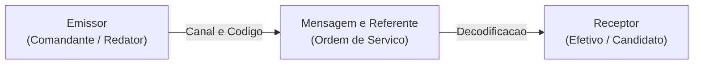
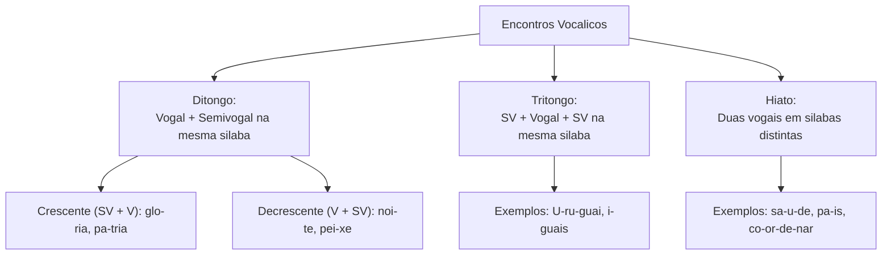
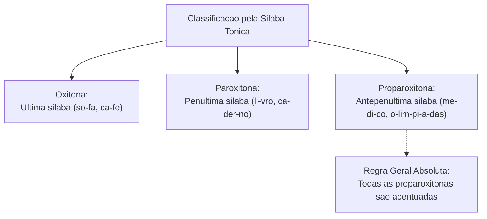
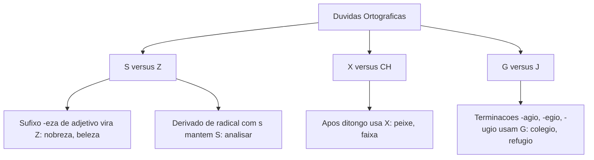
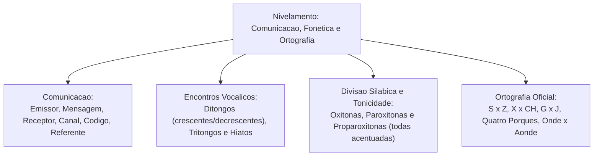

A Língua Portuguesa fundamenta toda a comunicação institucional, a compreensão de ordens operacionais e o desempenho nas provas de concurso público. Compreender os conceitos primordiais de linguagem, língua e fala permite ao estudante situar os fatos linguísticos em seu devido contexto de uso, diferenciando a norma culta padrão das variações coloquiais do dia a dia.

Neste capítulo de nivelamento, exploraremos os elementos do circuito da comunicação, a tipologia das linguagens, a morfologia dos encontros vocálicos (ditongo, tritongo e hiato), as regras de divisão silábica e tonicidade, além das principais normas ortográficas do vocabulário oficial exigidas pelas bancas examinadoras.

> [!objetivos]
> - Distinguir os conceitos de linguagem (verbal, não verbal e mista), língua e fala.
> - Identificar os elementos fundamentais da comunicação e sua relação com o texto.
> - Classificar os encontros vocálicos em ditongos (crescentes e decrescentes), tritongos e hiatos.
> - Aplicar as regras de partição silábica e classificação quanto ao número de sílabas e tonicidade.
> - Dominar o emprego correto de grafemas conflitantes (*s, z, x, ch, g, j*) e homônimos comuns (*onde / aonde*, *mau / mal*).

---

## Linguagem, Língua, Fala e Elementos da Comunicação

A **linguagem** é a capacidade exclusivamente humana de produzir, receber e interpretar sinais para interagir em sociedade e transmitir pensamentos, ordens e sentimentos. Ela se manifesta por meio de diferentes modalidades sígnicas:

1. **Linguagem verbal**: utiliza palavras faladas ou escritas como código transmissor de sentido (*leis, relatórios de ocorrência, manuais técnicos e conversas formais*).
2. **Linguagem não verbal**: emprega recursos visuais, gestuais, sonoros ou cromáticos sem o concurso da palavra (*sinais de trânsito, apitos policiais, sirenes de viatura, gestos de regulação e cores do semáforo*).
3. **Linguagem mista ou híbrida**: integra harmoniosamente elementos verbais e visuais em um único suporte enunciativo (*tirinhas de jornal, infográficos operacionais, placas de advertência com texto e símbolos gráficos*).

Por sua vez, a **língua** é um código social compartilhado por uma comunidade histórica e delimitado por um sistema de convenções gramaticais. Já a **fala** é a realização individual, concreta e momentânea desse código linguístico por cada cidadão.

O ato de comunicação envolve seis elementos essenciais: o **emissor** (quem emite a mensagem), o **receptor** (quem a decodifica), a **mensagem** (o conteúdo transmitido), o **canal** (o meio físico por onde ela circula), o **código** (o sistema linguístico utilizado) e o **referente** (o assunto ou contexto da situação).

> [!bizu]
> Nos editais de concurso, a prova avalia prioritariamente a **linguagem verbal culta na modalidade escrita**. A linguagem coloquial oral, embora legítima em situações informais cotidianas, deve ser evitada na elaboração de redações e peças administrativas formais.

---

## Encontros Vocálicos: Vogal, Semivogal, Ditongos, Tritongos e Hiatos

Na língua portuguesa, toda sílaba possui obrigatoriamente uma única **vogal** como seu núcleo fonético fundamental. Não existe sílaba sem vogal, nem sílaba com mais de uma vogal fonética plena. Quando dois ou mais sons vocálicos surgem contíguos na mesma palavra, estabelece-se um **encontro vocálico**:

A **semivogal** é um fonema vocálico fraco, pronunciado com menor intensidade acústica e duração reduzida quando apoiado sobre a vogal tônica principal da sílaba. Os fonemas correspondentes às letras *i* e *u* (e raramente *e* e *o* com som átono) desempenham comumente o papel de semivogal.

Classificação dos encontros vocálicos:
- **Ditongo**: consiste no agrupamento sonoro formado por vogal associada a semivogal na mesma sílaba emitida.
  - *Ditongo crescente*: inicia-se por semivogal fraca e culmina em vogal forte plena (*SV + V*). Exemplo: *sé-rie*, *gló-ria*, *pá-tria*, *á-gua*.
  - *Ditongo decrescente*: inicia-se por vogal forte e termina em semivogal de menor intensidade (*V + SV*). Exemplo: *noite*, *peixe*, *pau-ta*, *leite*.
  - *Ditongos orais*: o ar escapa exclusivamente pela cavidade bucal (*pai*, *ouro*).
  - *Ditongos nasais*: o fluxo sonoro ressoa pelas fossas nasais (*mão*, *mãe*, *pão*, *cantam*).
- **Tritongo**: é o agrupamento silábico constituído por uma semivogal, seguida de uma vogal central plena e finalizado por outra semivogal (*SV + V + SV*). Exemplo: *U-ru-guai*, *i-guais*, *quais-quer*, *en-xá-guem*.
- **Hiato**: é o encontro de duas vogais plenas em sequência na palavra, que, por possuírem força acústica autônoma, pertencem a sílabas distintas na partição. Exemplo: *sa-ú-de*, *pa-ís*, *ba-ú*, *co-or-de-nar*, *ci-ú-me*, *ra-iz*.

| Palavra Analisada | Divisão Silábica | Tipo de Encontro | Estrutura Fonética |
|---|---|---|---|
| *glória* | *gló-ria* | Ditongo crescente | Semivogal (*i*) + Vogal (*a*) |
| *pauta* | *pau-ta* | Ditongo decrescente | Vogal (*a*) + Semivogal (*u*) |
| *saúde* | *sa-ú-de* | Hiato | Vogal separada de Vogal |
| *iguais* | *i-guais* | Tritongo | Semivogal + Vogal + Semivogal |
| *raiz* | *ra-iz* | Hiato | Vogal separada de Vogal |

> [!pegadinha]
> Palavras paroxítonas terminadas em ditongo crescente (*gló-ria, his-tó-ria, mé-dia, sé-rie*) podem ser interpretadas gramaticalmente por algumas correntes como proparoxítonas eventuais ou relativas (*gló-ri-a*). Fique atento à banca do seu concurso: muitas bancas reconhecem expressamente a regra das paroxítonas terminadas em ditongo crescente como regra padrão.

---

## Divisão Silábica, Classificação das Palavras e Tonicidade

A **sílaba** é o fonema ou grupo de fonemas pronunciados em uma única emissão de ar expiratório. Quanto ao número de sílabas que compõem sua estrutura morfológica, as palavras dividem-se em:

1. **Monossílabas**: possuem apenas uma única sílaba (*sol, fé, mar, lei, pé, trem*).
2. **Dissílabas**: contêm exatamente duas sílabas morfológicas (*ca-sa, li-vro, noi-te, pa-pel*).
3. **Trissílabas**: são estruturadas por três sílabas sonoras (*es-co-la, ci-da-de, vi-a-gem, ca-der-no*).
4. **Polissílabas**: apresentam quatro ou mais sílabas em sua formação (*cons-ti-tu-i-ção, me-di-ca-men-to, o-lim-pí-a-das*).

Classificação quanto à tonicidade:
- **Oxítonas**: a intensidade recai sobre a última sílaba (*ca-fé, pa-pel, car-na-val, vo-vô, vo-vó*).
- **Paroxítonas**: a sílaba tônica situa-se na penúltima sílaba (*ca-der-no, li-vro, U-crâ-nia*).
- **Proparoxítonas**: a intensidade recai sobre a antepenúltima sílaba (*mé-di-co, o-lim-pí-a-das*).
Essa separação é dividida didaticamente para explicar o funcionamento sonoro da língua.

Regras fundamentais de translineação e separação silábica:
- **Não se separam**: ditongos (*pei-xe*), tritongos (*U-ru-guai*), dígrafos inseparáveis (*ch, lh, nh, gu, qu* em *chu-va, fi-lho, ni-nho, guer-ra*) e encontros consonantais perfeitos terminados em *l* ou *r* (*pra-to, cli-ma, tra-ba-lho*).
- **Separam-se compulsoriamente**: hiatos (*sa-ú-de, pa-ís, co-or-de-nar*), dígrafos repetidos (*rr, ss, sc, sç, xc* em *car-ro, pas-so, des-cer, cres-ça, ex-ce-ção*) e encontros consonantais imperfeitos na fronteira de sílaba (*ab-solu-to, af-ta, dig-no, ob-je-to*).

> [!atencao]
> As consoantes não seguidas de vogal em início ou meio de palavra permanecem atreladas à sílaba precedente na partição silábica gráfica: *ad-vo-ga-do* (e nunca *a-dvo-ga-do*), *sub-le-gen-da*, *ob-rigatório*.

---

## Ortografia Oficial e Ponto de Atenção da Página 8

A **ortografia oficial** regulamenta a representação escrita dos vocábulos segundo o Acordo Ortográfico vigente. As bancas de concurso elaboram questões focadas nas dúvidas geradas pela existência de fonemas idênticos representados por grafemas distintos no sistema alfabético.

Na página 8 da fonte teórica de nivelamento, examinam-se exemplos práticos sobre a grafia de termos problemáticos que frequentemente surgem em editais e certames públicos. Acompanhe os principais núcleos de atenção:

### Emprego de S versus Z
- **Grafa-se com S**:
  - Palavras derivadas de primitivas grafadas com *s* (*pesquisa -> pesquisar; análise -> analisar; liso -> alisar*).
  - Sufixos *-ês* e *-esa* indicadores de origem, nobreza ou título (*marquês, marquesa, baronesa, burguês, holandês*).
  - Sufixos formadores de adjetivos *-oso* e *-osa* (*corajoso, generosa, perigosa, vaidoso*).
  - Após ditongos orais decrescentes (*coisa, pouso, lousa, causa*).
  - Nas formas dos verbos *pôr* e *querer* (*pôs, pusemos, quiser, quiséssemos*).
- **Grafa-se com Z**:
  - Palavras derivadas de primitivas com *z* (*raiz -> enraizar; cicatriz -> cicatrizar; cruz -> cruzar*).
  - Sufixos formadores de substantivos abstratos *-ez* e *-eza* derivados de adjetivos primitivos (*belo -> beleza; nobre -> nobreza; rápido -> rapidez; escasso -> escassez*).
  - Sufixo verbal *-izar* adicionado a radicais que não contêm *s* na última sílaba (*atual -> atualizar; canal -> canalizar; legal -> legalizar*).

### Emprego de X versus CH
- **Grafa-se com X**:
  - Após ditongo decrescente (*faixa, peixe, frouxo, caixa*). Exceção consagrada: *caucho* e seus derivados (*recauchutar*).
  - Após a sílaba inicial *en-* (*enxada, enxame, enxoval, enxugar*). Exceção: palavras cujo radical primitivo inicia-se por *ch* (*cheio -> encher, enchente; charco -> encharcar*).
  - Após a sílaba inicial *me-* (*mexer, mexilhão, mexicano*). Exceção: *mecha* (de cabelo).
  - Em palavras de origem indígena ou africana (*xavante, xaxim, xará*).

### Emprego de G versus J
- **Grafa-se com G**:
  - Substantivos terminados em *-agem, -igem, -ugem* (*viagem, garagem, coragem, vertigem, ferrugem*). Exceção: *pajem*.
  - Palavras com terminações terminadas em *-ágio, -égio, -ígio, -ógio, -úgio* (*pedágio, colégio, prestígio, relógio, refúgio*).
- **Grafa-se com J**:
  - Formas de verbos terminados em *-jar* ou *-jear* (*viajar -> viajem eles; arranjar -> arranje; despejar -> despeje*).
  - Palavras de origem tupi, africana ou exótica (*jiboia, pajé, canjica, jenipapo*).

> [!pegadinha]
> **Viagem versus Viajem**: atente para a classe morfológica da palavra! *Viagem* com **g** é substantivo comum (*Desejo uma boa viagem a todos*). Por outro lado, *viajem* com **j** é forma flexionada do verbo *viajar* no presente do subjuntivo ou imperativo (*Espero que os policiais viajem em segurança hoje*).

---

## Homônimos, Parônimos e Emprego dos Porquês

A homonímia e a paronímia constituem temas recorrentes nas provas de concurso organizadas pela banca examinadora, exigindo rigor no reconhecimento do contexto semântico:

- **Homônimos homófonos**: palavras que possuem o mesmo som, mas grafia e significado distintos. Exemplo: *seção* (divisão, setor), *sessão* (intervalo de tempo de uma reunião ou assembleia), *cessão* (ato de ceder direitos); *senso* (juízo crítico, discernimento) versus *censo* (pesquisa demográfica de contagem populacional).
- **Parônimos**: vocábulos que possuem semelhança gráfica e sonora, mas com sentidos completamente diversos:
  - *Comprimento* (extensão métrica, dimensão física) versus *cumprimento* (saudação cordial ou execução de dever formal).
  - *Descriminar* (isentar de culpa, retirar o caráter criminoso de conduta) versus *discriminar* (diferenciar, distinguir, segregar).
  - *Eminente* (ilustre, notável, de alta hierarquia) versus *iminente* (prestes a acontecer a qualquer momento).
  - *Infligir* (aplicar castigo, penalidade ou sanção judicial) versus *infringir* (transgredir, desobedecer a norma ou lei).

### O Uso dos Quatro Porquês
1. **Por que** (separado e sem acento): empregado em frases interrogativas diretas ou indiretas (*Por que o alarme tocou?*); ou com valor relativo equivalente a *pelo qual, pela qual, pelos quais, pelas quais* (*Este é o motivo por que nos reunimos*).
2. **Por quê** (separado e com acento circunflexo): utilizado exclusivamente quando surge no final de orações ou isolado antes de pontuação enfática (*Eles não compareceram ao serviço, sabe por quê?*).
3. **Porque** (junto e sem acento): conjunção causal ou explicativa equivalente a *pois, já que, visto que* (*A equipe recuou porque a encosta estava instável*).
4. **Porquê** (junto e com acento circunflexo): substantivo masculino que significa razão, causa ou motivo, vindo antecedido por artigo, pronome ou numeral (*Não compreendi o porquê de tanta confusão no setor*).

### Onde versus Aonde
- **Onde**: indica localização espacial estática, em que algo ou alguém se encontra em permanência (*Onde fica o centro de comando?*; *A sala onde trabalhamos é ampla*).
- **Aonde**: emprega-se estritamente com verbos que regem a preposição *a*, indicando movimento, destino ou deslocamento pontual em direção a determinado local (*Aonde você vai com essa pressa?*; *Não sabemos aonde a viatura se dirigiu*).

| Estrutura | Função Gramatical | Equivalência Semântica | Exemplo Prático |
|---|---|---|---|
| *Por que* | Interrogativa ou relativo | por qual razão / pelo qual | *Por que houve atraso na escala?* |
| *Por quê* | Final de frase | por qual razão (fim) | *Eles faltaram ao treino por quê?* |
| *Porque* | Conjunção explicativa | pois / visto que | *Venci porque estudei com método.* |
| *Porquê* | Substantivo | o motivo / a razão | *Explique o porquê dessa decisão.* |
| *Onde* | Advérbio de lugar fixo | em que lugar (estático) | *Onde está o livro de registro?* |
| *Aonde* | Advérbio com regência 'a' | a que lugar (movimento) | *Aonde os soldados irão amanhã?* |

> [!bizu]
> Dica prática para *onde* e *aonde*: substitua mentalmente por *em que lugar* ou *para que lugar*. Se couber *em que lugar*, use **onde**. Se a frase pedir *para que lugar*, a resposta correta é **aonde**.

---

## Exercícios Práticos e Questões Comentadas

### Questão 1 (Adaptada)
Assinale a alternativa em que todas as palavras apresentam encontros vocálicos classificados, respectivamente, como **ditongo decrescente**, **hiato** e **tritongo**:
A) glória – saúde – Uruguai
B) noite – país – iguais
C) pauta – história – saída
D) série – lagoa – quais
E) caixa – peixe – cooperar

**Gabarito: B**

**Comentário detalhado:**
Na alternativa B, temos:
1. *noite*: apresenta o ditongo decrescente *oi* (vogal *o* seguida de semivogal *i* na mesma sílaba: *noi-te*);
2. *país*: apresenta o hiato *a-í* (duas vogais plenas que pertencem a sílabas distintas: *pa-ís*);
3. *iguais*: apresenta o tritongo *uai* (semivogal *u* + vogal *a* + semivogal *i* na mesma sílaba: *i-guais*).
A opção A erra porque *glória* traz ditongo crescente; a C traz ditongo, ditongo e hiato; a D traz ditongo, hiato e ditongo; e a E traz ditongo, ditongo e hiato. A alternativa B é a única correta.

---

### Questão 2 (Adaptada)
Observe o emprego dos termos sublinhados nas sentenças abaixo:
I. O motorista do caminhão foi multado porque **infringiu** as regras de trânsito.
II. O juiz decidiu **infligir** uma severa penalidade ao acusado.
III. O perito realizou um trabalho minucioso para **descriminar** a conduta atípica do cidadão.
Está correto o que se afirma em:
A) I, apenas.
B) I e II, apenas.
C) II e III, apenas.
D) I, II e III.
E) III, apenas.

**Gabarito: D**

**Comentário detalhado:**
Todas as frases empregam os termos parônimos com perfeição semântica:
I. *Infringir* significa desobedecer, transgredir ou violar uma regra ou norma;
II. *Infligir* significa aplicar uma pena, castigo ou sanção punitiva;
III. *Descriminar* significa descriminalizar, afastar a tipicidade criminosa de um ato. Portanto, as três proposições estão inteiramente corretas, validando a opção D.

---

### Questão 3 (Inédita)
Assinale a opção em que a grafia da palavra sublinhada e o emprego do porquê estão plenamente adequados à norma padrão da língua:
A) Não compreendemos o por que de tanta pressa na conclusão da análise pericial.
B) Os agentes viajaram ontem por quê foram convocados pelo comando central.
C) A delegacia realizou uma rigorosa pesquisa porque era preciso apurar o fato.
D) Ninguém soube explicar aonde o documento oficial estava guardado durante a blitz.
E) A nobreza da atitude policial foi reconhecida por que todos cumpriram o dever.

**Gabarito: C**

**Comentário detalhado:**
A alternativa C apresenta redação irrepreensível: o vocábulo *pesquisa* é corretamente grafado com *s* (assim como *pesquisar*), e a conjunção explicativa causal *porque* figura grafada em palavra única e sem acento, equivalendo a *pois* ou *visto que*. A opção A erra ao grafar *por que* em vez do substantivo *o porquê*; a B erra ao utilizar *por quê* no início de oração causal; a D erra ao usar *aonde* para indicar lugar estático onde algo estava guardado; e a E erra ao separar a conjunção causal *porque*.

---

## Mapa do Capítulo

---

### Para fixar

- **Linguagem verbal e não verbal**: a linguagem verbal utiliza palavras faladas ou escritas; a não verbal apoia-se em gestos, sons e símbolos visuais.
- **Estrutura silábica**: toda sílaba na língua portuguesa possui obrigatoriamente uma única vogal como seu centro fonético.
- **Ditongos**: resultam da união de vogal e semivogal na mesma sílaba; são crescentes (*SV + V*) ou decrescentes (*V + SV*).
- **Tritongos e Hiatos**: o tritongo reúne *SV + V + SV* na mesma sílaba; o hiato separa duas vogais em sílabas distintas.
- **Tonicidade**: as palavras classificam-se em oxítonas (última sílaba), paroxítonas (penúltima) e proparoxítonas (antepenúltima).
- **Regra das proparoxítonas**: todas as palavras proparoxítonas da língua portuguesa recebem compulsoriamente acento gráfico.
- **Sufixos -ez e -eza**: substantivos abstratos derivados de adjetivos primitivos são grafados com *z* (*nobreza, rapidez*).
- **Sufixos -ês, -esa e -oso**: indicativos de origem, nobreza e adjetivos relacionais recebem grafia com *s* (*marquesa, corajoso*).
- **Os quatro porquês**: *por que* (interrogativo/relativo), *por quê* (fim de frase), *porque* (conjunção causal) e *porquê* (substantivo).
- **Onde versus Aonde**: utiliza-se *onde* para localização espacial fixa e *aonde* para verbos que exigem a preposição de movimento *a*.
