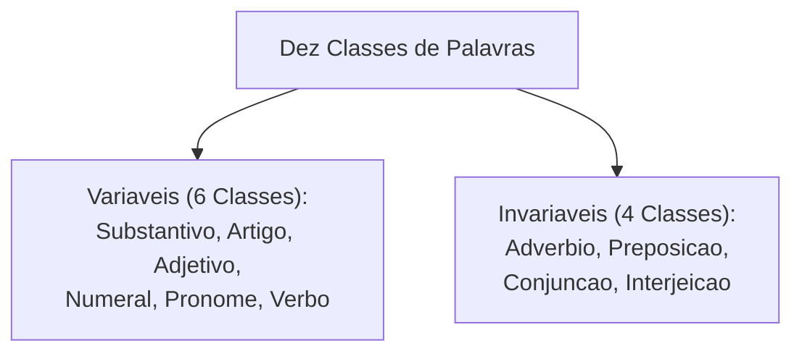
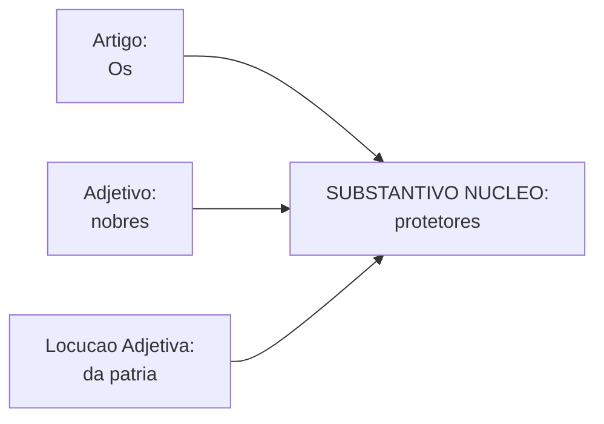
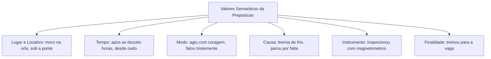
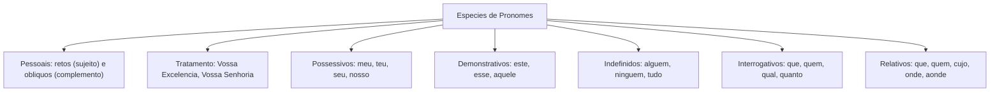
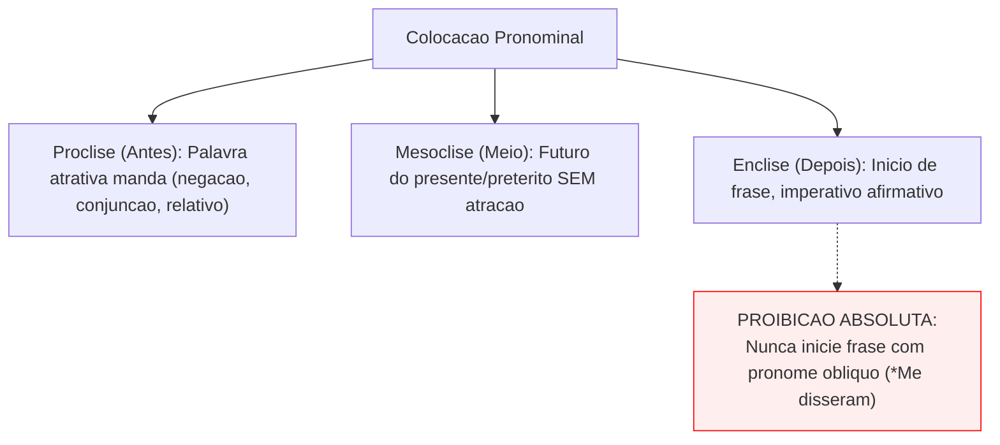
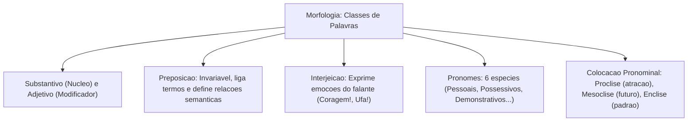

O estudo morfológico da Língua Portuguesa compreende o reconhecimento, a classificação e a análise funcional das palavras da língua. No vocabulário oficial, as centenas de milhares de vocábulos encontram-se didaticamente divididos em dez classes gramaticais, agrupadas segundo sua natureza flexiva e seu papel sintático-discursivo.

Neste capítulo de nivelamento, estudaremos cinco classes morfológicas essenciais: substantivo, adjetivo, preposição, interjeição e pronome. Investigaremos as propriedades de cada grupo, suas classificações internas e as regras de colocação pronominal (próclise, mesóclise e ênclise) exigidas pela norma culta.

> [!objetivos]
> - Reconhecer as dez classes de palavras da língua e diferenciar classes variáveis de invariáveis.
> - Compreender a função nuclear do substantivo e os papéis modificadores do adjetivo.
> - Dominar o emprego das preposições essenciais e suas relações semânticas contextuais.
> - Identificar as interjeições e sua capacidade expressiva de manifestar emoções do falante.
> - Classificar as espécies de pronomes e aplicar com precisão as normas de colocação pronominal.

---

## O Universo das Classes Gramaticais: Variáveis versus Invariáveis

Na morfologia da língua portuguesa, todas as palavras do vocabulário oficial estão agrupadas em dez classes funcionais. Essa divisão organiza-se fundamentalmente pelo critério da flexão:

1. **Classes variáveis**: são palavras que flexionam sua forma em gênero (masculino e feminino), número (singular e plural), tempo, modo ou pessoa. Integram esse conjunto:
   - **Substantivo**: nomeia os seres, objetos, ações, sentimentos e conceitos (*soldado, viatura, coragem, nobreza*).
   - **Artigo**: antecede o substantivo para determiná-lo de modo definido (*o, a, os, as*) ou indefinido (*um, uma, uns, umas*).
   - **Adjetivo**: caracteriza, qualifica ou atribui estado ao substantivo (*policial corajoso, tropa nobre, cidade linda*).
   - **Numeral**: quantifica numericamente os seres ou indica sua posição em uma série ordenada (*primeiro colocado, três viaturas*).
   - **Pronome**: acompanha ou substitui o substantivo, situando-o em relação às pessoas do discurso (*ele, este, meu, quem*).
   - **Verbo**: expressa ações, estados, mudanças de estado e fenômenos da natureza situados no tempo (*proteger, servir, chover*).

2. **Classes invariáveis**: são palavras cuja estrutura morfológica permanece imutável, não admitindo flexão de gênero ou de número:
   - **Advérbio**: modifica o sentido de um verbo, de um adjetivo ou de outro advérbio (*morou curiosamente ali; agiu muito rapidamente*).
   - **Preposição**: conecta dois termos oracionais, estabelecendo uma relação de dependência sintática e semântica (*combateu com bravura; veio de Recife*).
   - **Conjunção**: liga duas orações ou dois termos de idêntica função sintática (*estudou com afinco e foi aprovado*).
   - **Interjeição**: exprime sentimentos súbitos, estados emotivos, apelos ou reações instantâneas do falante (*Ufa!, Credo!, Coragem!*).

> [!bizu]
> Guarde a regra da variação: se a palavra puder ir para o plural ou mudar de gênero conforme o substantivo a que se refere, trata-se de classe variável. Se permanecer rígida e inalterada qualquer que seja o contexto, pertence ao grupo das invariáveis.

---

## O Substantivo e o Adjetivo: Núcleo e Caracterização

O **substantivo** atua como o grande polo gravitacional da frase nominal. É a palavra nuclear que dá nome aos seres do mundo físico e às criações do pensamento abstrato:

Classificação dos substantivos:
- **Comum versus Próprio**: o comum designa genericamente qualquer membro de uma espécie (*cidade, rio, policial*); o próprio individualiza um ser específico com letra maiúscula (*Recife, Pernambuco, Silva*).
- **Concreto versus Abstrato**: o concreto designa seres de existência própria no mundo real ou imaginário (*mesa, viatura, fantasma*); o abstrato depende de outro ser para existir, designando qualidades, sentimentos, sensações e ações (*beleza, coragem, espanto, dividendos, viagem*).
- **Simples versus Composto**: o simples possui apenas um único radical (*flor, chuva, pé*); o composto é formado por dois ou mais radicais (*couve-flor, guarda-chuva, pontapé*).
- **Primitivo versus Derivado**: o primitivo não provém de outra palavra do idioma (*livro, pedra, nobre*); o derivado é construído a partir de radical preexistente (*livraria, pedregulho, nobreza*).
- **Coletivo**: substantivo comum que, no singular, designa um conjunto estruturado de seres da mesma espécie (*batalhão, tropa, cardume, arquipélago*).

O **adjetivo** atua como modificador direto do substantivo, atribuindo-lhe características, propriedades, estados ou relações:
- Em sintagmas como *candidatos aprovados*, *homem corajoso*, *cidade linda* ou *nobres protetores*, o adjetivo concorda compulsoriamente em gênero e número com o substantivo núcleo.
- **Locução adjetiva**: é a união de preposição e substantivo que desempenha o papel de um adjetivo (*dia de chuva = dia chuvoso; homem de coragem = homem corajoso; amor de mãe = amor maternal*).

| Substantivo Núcleo | Modificador Adjetivo | Locução Adjetiva Correspondente | Efeito Semântico |
|---|---|---|---|
| *guerreiro* | *corajoso* | *de coragem* | Qualidade permanente de bravura |
| *sentimento* | *materno* | *de mãe* | Afeto originado da figura materna |
| *cidade* | *bela / linda* | *de beleza* | Característica estética destacada |
| *policiais* | *aprovados* | *com mérito* | Estado conquistado em concurso |

> [!pegadinha]
> **Posição do adjetivo e mudança semântica**: a anteposição do adjetivo ao substantivo altera frequentemente o significado do enunciado! Observe a diferença: *um homem pobre* (indivíduo sem recursos materiais ou dividendos) versus *um pobre homem* (indivíduo desafortunado, digno de compaixão); *um oficial grande* (de estatura física elevada) versus *um grande oficial* (de notável competência e nobreza funcional).

---

## A Preposição: Conexão e Relações Semânticas

A **preposição** é a classe de palavra invariável que tem por função ligar dois termos de uma oração. Ela estabelece uma relação de subordinação em que o segundo termo complementa ou esclarece o primeiro termo. O termo antecedente é o regente. O termo consequente é o regido.

O repertório das **preposições essenciais** da língua portuguesa abrange termos de ligação de uso cotidiano:
- Preposições frequentes de deslocamento e tempo: *a*, *para*, *até*, *desde*, *após*, *perante*.
- Preposições de matéria, posse e oposição: *de*, *com*, *contra*, *sem*.
- Preposições de posição espacial e limite: *em*, *entre*, *sob*, *sobre*, *trás*, *ante*.

Existem também as preposições acidentais. São vocábulos de outras classes que atuam transitoriamente como conectivos (*conforme*, *segundo*, *durante*, *mediante*, *salvo*, *exceto*).

Valores semânticos das preposições em contexto operacional:
1. **Lugar e sentido locativo**: *Moro em Recife*; *A viatura patrulhava a orla marítima*; *O perito fotografa as casas vistoriadas*.
2. **Tempo e duração**: *A instrução começará após o almoço*; *Estudou desde cedo para a vaga no concurso*.
3. **Modo e postura**: *Os policiais avançaram com coragem*; *O suspeito confessou tristemente o delito*; *A testemunha falou dando detalhes*.
4. **Causa e motivo**: *O cidadão tremia de frio*; *A viatura parou por falta de combustível*.
5. **Instrumento técnico**: *A equipe pericial operava os magnetômetros e espectrômetros com extrema precisão*; *Cortou a fita com a tesoura*.
6. **Companhia e escolta**: *O comandante viajou com a tropa, evitando indivíduos estranhos*.
7. **Assunto e conteúdo**: *Lia revistas sobre segurança pública e táticas de defesa*; *Discutiram sobre o valor cobrado*.
8. **Finalidade institucional**: *Treinou muito para a conquista da vaga*; *Serei aprovado se mantiver a dedicação*. Usamos os conectivos para dar sentido à mensagem entre o falante e o ouvinte. Enquanto o pássaro canta, a tropa cumpre o dever.

> [!bizu]
> A banca examinadora cobra frequentemente o valor semântico introduzido pela preposição *com*. Compare com atenção: *Feriu-se com a faca* (instrumento); *Saiu com os colegas* (companhia); *Trabalhava com dedicação* (modo); *Com a chuva forte, não houve aula* (causa).

---

## A Interjeição: A Expressão Imediata da Emoção

A **interjeição** é a palavra invariável que expressa sentimentos súbitos, estados psíquicos momentâneos, apelos, saudações e reações instantâneas do falante. Ela traduz de maneira concentrada aquilo que uma oração inteira muitas vezes não exprime com a mesma espontaneidade. O contexto da enunciação define com precisão a carga emotiva transmitida pelo vocábulo.

Principais valores afetivos das interjeições:
- **Espanto e surpresa**: *Caramba!, Opa!, Oh!, Nossa!*.
- **Nojo e repulsa**: *Credo!, Eca!, Que horror!*. O falante expressa forte repulsa e nojo diante de uma cena desagradável.
- **Alívio e tranquilidade**: *Ufa!, Ah!, Graças a Deus!*.
- **Ânimo, coragem e estímulo**: *Coragem!, Avante!, Força!, Eia!*.
- **Dor e aflição física**: *Ai!, Ui!*.
- **Silêncio e cessação**: *Psiu!, Silêncio!, Calada!*.
- **Advertência e alerta**: *Cuidado!, Atenção!, Alerta!*.

**Locução interjetiva**: é a combinação de duas ou mais palavras que desempenham papel idêntico ao de uma interjeição unitária: *Ora bolas!, Cruz credo!, Pelo amor de Deus!, Macacos me mordam!*.

> [!atencao]
> As interjeições e locuções interjetivas vêm acompanhadas de ponto de exclamação (!). Em redações formais de concurso e peças policiais oficiais, o uso de interjeições é severamente vedado. O texto dissertativo ou administrativo exige impessoalidade e sobriedade expressiva absoluta.

---

## Os Pronomes: Classificação, Funções e Tratamento

O **pronome** é a palavra variável que acompanha ou substitui o substantivo. Ele determina o ser e o situa em relação às três pessoas do discurso: 1ª pessoa (quem fala: *eu, nós*), 2ª pessoa (com quem se fala: *tu, vós, você*) e 3ª pessoa (de quem se fala: *ele, ela, eles, elas*).

Classificação das espécies de pronomes:
1. **Pronomes pessoais**:
   - *Pessoais do caso reto*: exercem primordialmente a função sintática de sujeito da oração (*eu, tu, ele, nós, vós, eles*). Exemplo de afirmação institucional: *Seremos aprovados com dedicação*; *Nós cumpriremos o dever*.
   - *Pessoais do caso oblíquo*: exercem funções de complemento verbal ou nominal. Dividem-se em **átonos** (sem preposição: *me, te, se, o, a, lhe, nos, vos, os, as, lhes*) e **tônicos** (preposicionados: *mim, ti, si, ele, ela, nós, vós, eles, elas*).
   - *Pronomes reflexivos*: indicam que o sujeito pratica e sofre a ação verbal (*O rapaz arrependeu-se da conduta*; *Ela feriu-se durante o treino*).
   - *Pronomes de tratamento*: são formas solenes ou cerimoniosas empregadas em expedientes e ofícios formais. Exemplos: *Vossa Excelência* (destinado a autoridades dos poderes Executivo, Legislativo e Judiciário, como governadores e magistrados); *Vossa Senhoria* (aplicado a diretores, coordenadores e oficiais superiores); *Vossa Majestade* (para reis e rainhas). Todos os pronomes de tratamento concordam com o verbo e com os pronomes em terceira pessoa (*Vossa Excelência tomou posse no cargo*).
2. **Pronomes possessivos**: indicam relação de posse em relação às pessoas gramaticais (*meu, teu, seu, nosso, vosso, seus*).
3. **Pronomes demonstrativos**: situam o ser no espaço, no tempo ou no discurso (*este, esta, isto; esse, essa, isso; aquele, aquela, aquilo*). Em notícias sobre saúde e sociedade: *Esta gravidez foi acompanhada por especialistas desde o início*; *Aquele caso já foi julgado*.
4. **Pronomes indefinidos**: referem-se à terceira pessoa de modo vago, indeterminado ou genérico (*alguém, ninguém, tudo, nada, cada, qualquer, vários, muitos*).
5. **Pronomes interrogativos**: utilizados na formulação de perguntas diretas ou indiretas (*que, quem, qual, quanto*). Exemplo: *Quem disputará a vaga no certame?*.
6. **Pronomes relativos**: resgatam um termo substantivo antecedente e inauguram orações subordinadas adjetivas (*que, quem, cujo, onde, quanto, o qual*). Exemplo: *A cidade onde moro é pacífica*; *O lugar aonde nos dirigimos fica longe*.

> [!pegadinha]
> **Entre mim e você versus entre eu e você**: preposição exige pronome oblíquo tônico! Diga *Entre mim e você não há segredos*, e jamais *\*Entre eu e você*. O pronome do caso reto *eu* só pode ser utilizado quando desempenhar o papel de sujeito de um verbo no infinitivo subsequente (*Ele entregou o relatório para eu analisar*).

---

## Colocação Pronominal: Próclise, Mesóclise e Ênclise

A **colocação pronominal** normatiza a posição do pronome pessoal oblíquo átono (*me, te, se, o, a, lhe, nos, vos, os, as, lhes*) em relação ao verbo:

1. **Próclise**: o pronome surge posicionado **antes do verbo** (*Não me diga isso*).
2. **Mesóclise**: o pronome é intercalado **no meio do verbo** (*Realizar-se-á a reunião*).
3. **Ênclise**: o pronome vem posicionado **depois do verbo** (*Apresentou-se ao comandante*).

### Casos Obrigatórios de Próclise (Palavras Atrativas)
A próclise é obrigatória sempre que houver, antes do verbo, uma palavra atrativa:
- Palavras de sentido negativo (*não, nunca, jamais, ninguém, nada*): *Ninguém me avisou sobre a escala*.
- Conjunções subordinativas (*que, quando, se, como, embora, porque*): *Quando me chamaram, compareci*.
- Pronomes relativos (*que, quem, cujo, onde*): *A lei que nos protege é clara*.
- Pronomes indefinidos e interrogativos (*alguém, tudo, quem, qual*): *Alguém me procurou?*.
- Advérbios sem pausa de vírgula (*aqui, lá, sempre, talvez, curiosamente*): *Aqui se trabalha muito; Curiosamente se calou*.
- Frases exclamativas, optativas ou interrogativas diretas: *Deus te abençoe!; Quem te falou isso?*.
- Em orações com a preposição *em* seguida de gerúndio: *Em se tratando de segurança, sejamos firmes*.

### Casos de Mesóclise
A mesóclise é privativa dos verbos flexionados no **Futuro do Presente** (*amarei, convidará*) ou no **Futuro do Pretérito** (*amaria, convidaria*), desde que **não haja palavra atrativa** que imponha a próclise:
- *Convidar-me-ão para o evento.* (Futuro do presente).
- *Apoiar-te-ia se houvesse recursos.* (Futuro do pretérito).
- Havendo palavra atrativa, a próclise prevalece: *Não me convidarão* (e nunca *\*Não convidar-me-ão*).

### Regras Mandatórias de Ênclise
A ênclise é a posição padrão em início de frase ou após pausas:
- **Início absoluto de oração**: é terminantemente proibido iniciar frases com pronome oblíquo átono na norma culta (*Disseram-me a verdade*, e jamais *\*Me disseram a verdade*).
- **Verbo no imperativo afirmativo**: *Sentem-se imediatamente!*; *Explique-me o ocorrido*.
- **Verbo no infinitivo impessoal** ou gerúndio sem preposição atrativa: *Pretendo apresentar-me*; *Entrou na sala, cumprimentando-os*.

| Situação Sintática | Posição Normativa | Exemplo Correto Culto | Construção Incorreta Proibida |
|---|---|---|---|
| Início de frase | Ênclise | *Entregaram-me os documentos.* | *\*Me entregaram os documentos.* |
| Palavra negativa | Próclise | *Nunca me informaram o motivo.* | *\*Nunca informaram-me o motivo.* |
| Futuro sem atração | Mesóclise | *Realizar-se-á o certame amanhã.* | *\*Se realizará o certame amanhã.* |
| Conjunção subordinativa | Próclise | *Espero que nos ajudem hoje.* | *\*Espero que ajudem-nos hoje.* |
| Imperativo afirmativo | Ênclise | *Diga-lhe a verdade agora!* | *\*Lhe diga a verdade agora!* |

> [!bizu]
> Regra de ouro da colocação pronominal: se houver palavra atrativa antes do verbo, a próclise atropela qualquer outra posição (inclusive a mesóclise). Só ocorre mesóclise se o verbo estiver no futuro e não existir nenhum elemento de atração anterior.

---

## Exercícios Práticos e Questões Comentadas

### Questão 1 (Adaptada)
Assinale a alternativa em que a colocação do pronome oblíquo átono obedece rigorosamente à norma padrão:
A) Me disseram que os nobres protetores da cidade foram homenageados.
B) Não convidariam-me para a solenidade militar sem motivo formal.
C) Os policiais que apresentaram-se ontem foram devidamente elogiados.
D) Jamais se esquecerão dos heróis que combateram com coragem e bravura.
E) Em tratando-se de disciplina interna, o regulamento deve ser cumprido.

**Gabarito: D**

**Comentário detalhado:**
A frase da alternativa D emprega a próclise de forma impecável: a palavra de sentido negativo *jamais* atua como fator de atração obrigatório sobre o pronome oblíquo *se*, posicionando-o legitimamente antes da forma verbal *esquecerão*. A alternativa A erra ao iniciar frase com oblíquo átono (*Me disseram*); a B erra ao tentar mesóclise com presença da palavra negativa *não* (o correto seria *Não me convidariam*); a C erra ao usar ênclise após o pronome relativo *que* (o correto seria *que se apresentaram*); e a E omite a próclise imposta pela preposição *em* com gerúndio (*Em se tratando*).

---

### Questão 2 (Adaptada)
Considere os vocábulos sublinhados: "O coronel recebeu um **nobre** reconhecimento por sua conduta **heroica** perante a tropa."
Morfologicamente, as palavras em destaque classificam-se, respectivamente, como:
A) substantivo e adjetivo.
B) adjetivo e adjetivo.
C) substantivo e substantivo.
D) advérbio e adjetivo.
E) adjetivo e substantivo.

**Gabarito: B**

**Comentário detalhado:**
Ambas as palavras desempenham papel caracterizador em relação a substantivos: *nobre* qualifica o substantivo comum *reconhecimento*, e *heroica* qualifica o substantivo *conduta*. Portanto, os dois termos exercem morfologicamente a função de **adjetivos**, validando a opção B.

---

### Questão 3 (Inédita)
Assinale a opção em que a frase apresenta perfeita harmonia quanto ao emprego e colocação dos pronomes:
A) O comando pediu para mim elaborar a nova escala de serviço do batalhão.
B) Entregou-se a premiação aos soldados aprovados com mérito na operação.
C) Caso apresentem-se novos indícios, abriremos outra investigação pericial.
D) Ninguém avisou-me sobre a chegada dos nobres protetores ao quartel.
E) Sempre cobraram-me atitudes enérgicas durante as missões operacionais.

**Gabarito: B**

**Comentário detalhado:**
A alternativa B está correta: o verbo *entregou* inicia a oração, exigindo compulsoriamente a ênclise do pronome oblíquo *se*. A opção A comete o erro clássico de usar *mim* como sujeito de verbo no infinitivo (*para eu elaborar*); a C desrespeita a próclise obrigatória imposta pela conjunção subordinativa *caso* (*caso se apresentem*); e as opções D e E violam a atração obrigatória exercida pelo pronome indefinido *ninguém* (*ninguém me avisou*) e pelo advérbio *sempre* (*sempre me cobraram*).

---

## Mapa do Capítulo

---

### Para fixar

- **Classes variáveis**: flexionam-se em gênero e número (substantivo, artigo, adjetivo, numeral, pronome e verbo).
- **Classes invariáveis**: permanecem imutáveis em qualquer contexto (advérbio, preposição, conjunção e interjeição).
- **Núcleo do sintagma**: o substantivo atua como centro semântico em torno do qual orbitam artigos e adjetivos.
- **Preposições essenciais**: ligam termos subordinados (*a, ante, após, até, com, contra, de, em, para, por, sem, sob*).
- **Interjeição**: expressa reações emocionais e sentimentos imediatos do falante (*Coragem!, Alerta!*).
- **Pronomes retos versus oblíquos**: retos funcionam como sujeito (*eu, tu*); oblíquos funcionam como complemento (*me, mim*).
- **Próclise obrigatória**: atraída por palavras negativas, pronomes relativos, indefinidos e conjunções subordinativas.
- **Vedação à ênclise no início**: nunca se inicia oração com pronome oblíquo átono na norma padrão culta.
- **Mesóclise restrita**: aplicada exclusivamente com verbos no futuro do presente ou do pretérito sem elemento atrativo.
- **Papel dos pronomes demonstrativos**: situam seres no tempo, no espaço e na tessitura interna do próprio texto.
