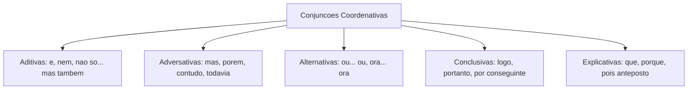
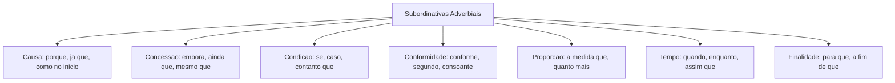
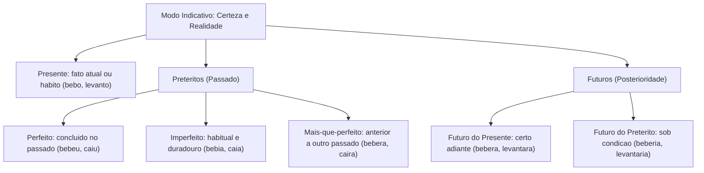
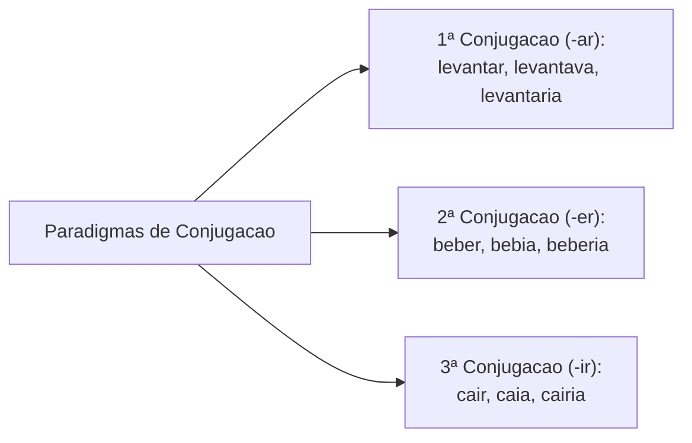
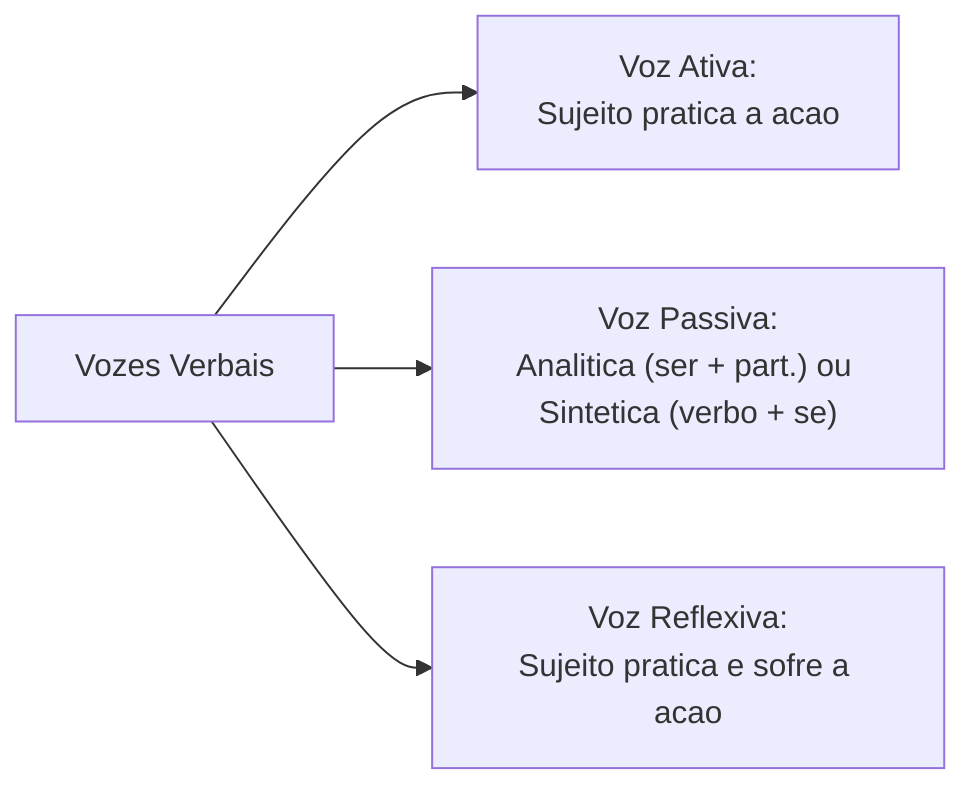
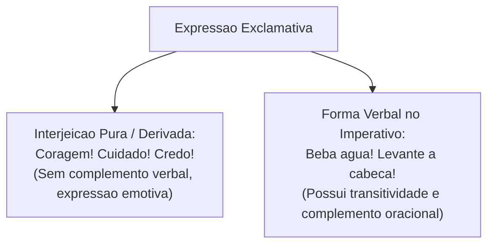
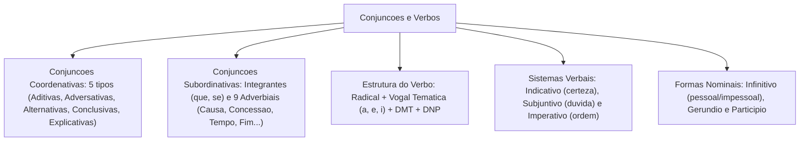

As conjunções e os verbos constituem as duas classes de palavras mais cobradas e decisivas nas provas de concurso. As conjunções respondem pela coesão interoracional, estabelecendo os nexos lógicos fundamentais entre orações. Por sua vez, os verbos funcionam como o núcleo dinâmico da oração, estruturando o tempo, o modo, o aspecto e a concordância gramatical.

Neste capítulo de nivelamento, estudaremos as cinco espécies de conjunções coordenativas, as dez espécies de conjunções subordinativas, os paradigmas de conjugação verbal das três terminações regulares (*-ar, -er, -ir*), os tempos e modos do sistema verbal e o ponto de atenção da página 39 da fonte teórica sobre a fronteira entre interjeições e formas verbais.

> [!objetivos]
> - Identificar as conjunções coordenativas (aditivas, adversativas, alternativas, conclusivas e explicativas).
> - Aplicar com precisão as conjunções subordinativas adverbiais (causais, consecutivas, comparativas, conformativas, concessivas, condicionais, proporcionais, temporais e finais) e integrantes.
> - Compreender a estrutura morfológica do verbo: radical, vogal temática, tema e desinências modo-temporais e número-pessoais.
> - Dominar os paradigmas das três conjugações regulares com os modelos *levantar*, *beber* e *cair*.
> - Diferenciar formas verbais enfáticas de interjeições conforme o alerta da página 39 da fonte teórica.

---

## Conjunções Coordenativas: Valores Semânticos e Aplicação

A **conjunção** é a palavra invariável cuja função primordial é ligar duas orações independentes ou dois termos sintaticamente equivalentes no interior da mesma oração. As conjunções coordenativas unem orações coordenadas que guardam independência sintática e autonomia estrutural entre si:

As cinco espécies de conjunções coordenativas organizam-se pelos seus valores lógicos:

1. **Aditivas**: estabelecem relação de soma, adição e acréscimo sucessivo de pensamentos. Conectivos clássicos: *e, nem* (e não), *não só... mas também, tanto... quanto*.
   - Exemplo: *Os policiais patrulharam o setor e prenderam os criminosos em flagrante*.
2. **Adversativas**: introduzem ideia de oposição, contraste, quebra de expectativa ou ressalva em relação à oração anterior. Conectivos essenciais: *mas, porém, contudo, todavia, entretanto, no entanto*.
   - Exemplo: *O alarme soou com insistência, contudo a equipe manteve a serenidade*.
3. **Alternativas**: expressam opção, alternância de eventos ou exclusão mútua. Conectivos típicos: *ou, ou... ou, ora... ora, quer... quer, seja... seja*.
   - Exemplo: *Ou a corporação treina constantemente, ou falhará na missão operacional*.
4. **Conclusivas**: exprimem dedução lógica, encerramento ou consequência necessária decorrente da proposição antecedente. Conectivos principais: *logo, portanto, por conseguinte, por isso, assim, pois* (posposto ao verbo).
   - Exemplo: *A documentação apresentava falhas graves; os fiscais recusaram, pois, o pedido*.
5. **Explicativas**: justificam, explicam ou fundamentam a razão de uma ordem, convite ou afirmação prévia. Conectivos frequentes: *porque, que, porquanto, pois* (anteposto ao verbo).
   - Exemplo: *Venha imediatamente ao posto de comando, pois precisamos do seu relatório*.



> [!bizu]
> **O emprego polissêmico de "pois"**: se o conectivo *pois* vier posicionado **antes do verbo** da sua oração (entre vírgulas ou após vírgula inicial), ele é **explicativo** (*Apresse-se, pois a viatura já vai sair*). Se vier deslocado **após o verbo**, entre duas vírgulas, passa a ser obrigatoriamente **conclusivo** (*Estudou muito; conquistou, pois, a primeira colocação*).

> [!exemplo]
> Compare os valores do conectivo "e": em *Correu muito e não se cansou*, o conectivo assume valor adversativo equivalente a *mas*. Por outro lado, em *Chegou, sentou e começou a redigir*, expressa adição sequencial pura de ações cotidianas.

---

## Conjunções Subordinativas: Integrantes e Adverbiais

As **conjunções subordinativas** conectam duas orações em que uma atua como subordinada e dependente sintática da oração principal. Elas dividem-se em integrantes e adverbiais:

### Conjunções Integrantes (Que e Se)
Introduzem orações subordinadas substantivas que funcionam como sujeito, objeto direto, objeto indireto, predicativo, complemento nominal ou aposto da oração principal. Não possuem valor semântico de circunstância, atuando como meros conectores gramaticais:
- *O comandante confirmou **que** os criminosos foram detidos na operação.*
- *Não sabemos **se** haverá prorrogação do prazo de inscrição no concurso público.*

### Conjunções Subordinativas Adverbiais
Introduzem orações que exercem o papel de adjunto adverbial, expressando circunstâncias lógicas:
1. **Causais**: indicam a causa do evento da oração principal (*porque, visto que, já que, como* no início da frase, *uma vez que*): *Como a chuva inundou a pista, a viatura desviou a rota*.
2. **Consecutivas**: indicam o resultado ou consequência decorrente de uma causa intensa na principal (*tanto que, tão... que, de sorte que, de modo que*): *O calor era tão intenso que a tropa precisou de hidratação redobrada*.
3. **Concessivas**: exprimem um obstáculo aparente que não impede a realização da ação principal (*embora, ainda que, mesmo que, se bem que, posto que*): *Embora a chuva caia forte, os policiais manterão o cerco tático*.
4. **Condicionais**: indicam uma hipótese ou condição indispensável (*se, caso, desde que, contanto que*): *Se houver autorização judicial, entraremos no recinto*.
5. **Conformativas**: exprimem conformidade com uma regra, modelo ou depoimento (*conforme, segundo, consoante, como*): *O resgate ocorreu conforme o protocolo previa*.
6. **Comparativas**: estabelecem confronto ou equiparação de qualidades (*como, mais... do que, menos... do que, assim como*): *O sargento agiu rápido como um raio*.
7. **Proporcionais**: indicam variação concomitante e proporcional (*à medida que, à proporção que, quanto mais... mais*): *À medida que subíamos a colina, a visibilidade diminuía*.
8. **Temporais**: delimitam o momento de realização da oração principal (*quando, enquanto, logo que, assim que, desde que*): *Quando a sirene tocou, todos se posicionaram*.
9. **Finais**: expressam o objetivo ou finalidade visada (*para que, a fim de que*): *Treinamos duro para que a população viva em paz*.



| Tipo de Conjunção | Conectivo Clássico | Exemplo em Contexto Militar | Valor Lógico Transmitido |
|---|---|---|---|
| *Causal* | *já que / como* | *Como o perigo era iminente, evacuamos o local.* | Causa primária motivadora |
| *Concessiva* | *embora / ainda que* | *Embora a chuva caia forte, a guarda não recua.* | Oposição sem anulação da ação |
| *Condicional* | *se / contanto que* | *Se o sinal for emitido, a equipe avançará.* | Condição básica requerida |
| *Conformativa* | *conforme / segundo* | *Agiram segundo prescreve o manual tático.* | Adequação ao modelo normativo |
| *Temporal* | *quando / assim que* | *Assim que o reforço chegou, o cerco fechou.* | Simultaneidade cronológica |
| *Final* | *para que / a fim de que* | *Treinaram a fim de que nada falhasse na missão.* | Objetivo deliberado |

> [!pegadinha]
> **Como causal versus Como conformativo versus Como comparativo**: examine a posição e o sentido de *como*!
> - No início da frase com valor de *já que*, é **causal** (*Como estava ferido, foi hospitalizado*).
> - Com valor de *conforme*, é **conformativo** (*Fizemos o relatório como o comandante determinou*).
> - Estabelecendo analogia com valor de *tal qual*, é **comparativo** (*Lutou com bravura como um leão*).

---

## Morfologia e Estrutura dos Verbos

O **verbo** é a palavra variável que expressa ações, processos, estados ou fenômenos da natureza situados no tempo. Na morfologia estrutural, a forma verbal decompõe-se nos seguintes elementos constitutivos essenciais:

1. **Radical**: é o elemento base e invariável que concentra a carga semântica nuclear do verbo (*levant- em levantar; beb- em beber; ca- em cair*).
2. **Vogal Temática**: é a vogal que se aglutina ao radical para indicar a qual das três conjugações o verbo pertence:
   - **1ª conjugação**: vogal temática **-a-** (*levantar, cantar, patrulhar*).
   - **2ª conjugação**: vogal temática **-e-** (*beber, correr, prender; e pôr, proveniente do antigo poer*).
   - **3ª conjugação**: vogal temática **-i-** (*cair, partir, fugir, cumprir*).
3. **Tema**: é a fusão harmoniosa do radical com a vogal temática (*levanta-, bebe-, ca-i-*).
4. **Desinências**: sufixos flexivos terminais agregados ao tema:
   - *Desinência modo-temporal (DMT)*: assinala o modo e o tempo da forma verbal (*levant-a-va-m: -va- indica pretérito imperfeito do indicativo; levant-a-ra-m: -ra- indica mais-que-perfeito*).
   - *Desinência número-pessoal (DNP)*: identifica a pessoa gramatical (1ª, 2ª ou 3ª) e o número (singular ou plural) do sujeito (*levant-a-va-mos: -mos indica 1ª pessoa do plural; levant-a-va-m: -m indica 3ª pessoa do plural*).

```mermaid Estrutura Morfologica do Verbo
flowchart LR
    R["Radical:<br>levant-"] + VT["Vogal Tematica:<br>-a-"] --> T["Tema:<br>levanta-"]
    T + DMT["Desinencia Modo-Temporal:<br>-va- (Preterito Imperfeito)"] + DNP["Desinencia Numero-Pessoal:<br>-mos (1ª pessoa plural)"] --> V["Forma Conjugada:<br>levantavamos"]
```

> [!exemplo]
> Decomposição morfológica de *levantávamos*:
> - Radical: *levant-* (invariável com o sentido nuclear).
> - Vogal Temática: *-a-* (identifica a 1ª conjugação).
> - Tema: *levanta-* (base para o recebimento das desinências).
> - Desinência Modo-Temporal: *-va-* (Pretérito Imperfeito do Modo Indicativo).
> - Desinência Número-Pessoal: *-mos* (1ª pessoa do plural).

---

## Modos e Tempos Verbais: O Sistema do Indicativo e Subjuntivo

O sistema verbal da língua portuguesa organiza-se em três modos que exprimem a atitude psicológica do emissor diante da mensagem comunicada:

- **Modo Indicativo**: expressa uma certeza factual, uma realidade consumada, habitual ou indubitável no tempo (*Ele levantou cedo; Os criminosos caem em contradição*).
- **Modo Subjuntivo**: veicula dúvida, incerteza, hipótese, desejo, possibilidade ou condição irrealizável (*Se a chuva caísse ou parasse; Se levantássemos a barricada*).
- **Modo Imperativo**: formula ordens, pedidos, advertências, instruções e convites (*Beba água potável!; Levante-se agora!*).

### Os Tempos do Modo Indicativo
1. **Presente**: exprime fatos simultâneos ao momento da fala, hábitos regulares ou verdades científicas (*Eu levanto a guarda; Ele bebe água*).
2. **Pretérito Perfeito**: retrata uma ação concluída inteiramente no passado em tempo definido (*Ele bebeu o remédio ontem; O galho caiu sobre a cerca*).
3. **Pretérito Imperfeito**: expressa uma ação habitual, contínua ou duradoura no passado que não foi delimitada no tempo (*Ele bebia com moderação; Enquanto a chuva caía, a tropa marchava*).
4. **Pretérito Mais-que-perfeito**: expressa uma ação passada ocorrida com anterioridade em relação a outro fato também pretérito (*Ele já bebera o líquido quando o alerta soou; O prédio caíra antes da chegada dos bombeiros*).
5. **Futuro do Presente**: projeta um acontecimento certo que ocorrerá em tempo posterior à enunciação (*Ele levantará o relatório amanhã; A barreira cairá em breve*).
6. **Futuro do Pretérito**: expressa uma ação futura dependente de condição prévia não realizada ou uma dúvida polida (*Ele beberia o café se estivesse quente; Eu levantaria a questão se houvesse oportunidade*).



> [!bizu]
> **Pretérito Perfeito versus Pretérito Imperfeito**: o perfeito retrata uma fotografia pontual de um evento acabado (*bebeu o suco e saiu*). O imperfeito pinta um filme contínuo de um hábito ou estado prolongado (*bebia chá todas as tardes quando morava no interior*). As bancas valorizam muito essa percepção aspectual.

> [!atencao]
> **Correlação verbal obrigatória**: o Futuro do Pretérito do Indicativo (*levantaria, beberia, cairia*) harmoniza-se obrigatoriamente com o Pretérito Imperfeito do Subjuntivo (*se levantasse, se bebesse, se caísse*). Diga *Eu beberia a água se ela estivesse limpa*, e jamais *\*Eu beberia se ela estava*.

---

## Conjugação dos Modelos Regulares: Levantar, Beber e Cair

Para que o candidato visualize a flexão prática das desinências verbais, analisamos os modelos regulares das três conjugações nos tempos fundamentais do modo indicativo.

### Paradigma da 1ª Conjugação: Verbo LEVANTAR (-ar)
A primeira conjugação caracteriza-se pela vogal temática *-a-*. No presente do indicativo, temos as formas singulares (*eu levanto, tu levantas, ele levanta*) e as formas plurais (*nós levantamos, vós levantais, eles levantam*). No pretérito perfeito, o evento pontual manifesta-se em *levantei*, *levantaste*, *levantou*, *levantamos*, *levantastes* e *levantaram*. No futuro do presente, a posterioridade certa expressa-se em *levantarei*, *levantarás*, *levantará*, *levantaremos*, *levantareis* e *levantarão*.

### Paradigma da 2ª Conjugação: Verbo BEBER (-er)
A segunda conjugação adota a vogal temática *-e-*. No presente do indicativo, manifestam-se *bebo*, *bebes*, *bebe*, *bebemos*, *bebeis* e *bebem*. No pretérito imperfeito, a continuidade passada expressa-se pelo sufixo *-ia-*, gerando *bebia*, *bebias*, *bebia*, *bebíamos*, *bebíeis* e *bebiam*. No futuro do pretérito condicional, temos *beberia*, *beberias*, *beberia*, *beberíamos*, *beberíeis* e *beberiam*.

### Paradigma da 3ª Conjugação: Verbo CAIR (-ir)
A terceira conjugação adota a vogal temática *-i-*. No presente, surgem *caio*, *cais*, *cai*, *caímos*, *caís* e *caem*. No pretérito perfeito, temos *caí*, *caíste*, *caiu*, *caímos*, *caístes* e *caíram*. No pretérito mais-que-perfeito, a anterioridade passada expressa-se em *caíra*, *caíras*, *caíra*, *caíramos*, *caíreis* e *caíram*. No futuro do pretérito, projeta-se *cairia*, *cairias*, *cairia*, *cairíamos*, *cairíeis* e *cairiam*.



| Pronome Pessoal | Pretérito Imperfeito (*-ar*) | Pretérito Imperfeito (*-er*) | Pretérito Imperfeito (*-ir*) | Desinência Modo-Temporal |
|---|---|---|---|---|
| *Eu* | *levantava* | *bebia* | *caía* | *-va-* / *-ia-* |
| *Tu* | *levantavas* | *bebias* | *caías* | *-va-* / *-ia-* |
| *Ele / Ela* | *levantava* | *bebia* | *caía* | *-va-* / *-ia-* |
| *Nós* | *levantávamos* | *bebíamos* | *caíamos* | *-va-* / *-ia-* |
| *Vós* | *levantáveis* | *bebíeis* | *caíeis* | *-va-* / *-ia-* |
| *Eles / Elas* | *levantavam* | *bebiam* | *caíam* | *-va-* / *-ia-* |

---

## Vozes Verbais: Ativa, Passiva e Reflexiva

A **voz verbal** expressa a relação sintática entre o sujeito da oração e o processo verbal desenvolvido. A língua portuguesa contempla três modalidades fundamentais:

1. **Voz Ativa**: o sujeito gramatical é o agente que pratica a ação verbal expressa pelo predicado.
   - Exemplo: *Os policiais resgataram as vítimas na encosta.*
2. **Voz Passiva**: o sujeito gramatical é o paciente que sofre ou recebe os efeitos da ação praticada por outrem. Desdobra-se em duas formas estruturais:
   - *Voz passiva analítica*: forma-se com o verbo auxiliar *ser* acompanhado do verbo principal no particípio passado (*As vítimas foram resgatadas pelos policiais*).
   - *Voz passiva sintética (ou pronominal)*: forma-se com o verbo transitivo direto na terceira pessoa acompanhado do pronome apassivador **se** (*Resgataram-se as vítimas da encosta; Vende-se a casa; Bebem-se líquidos potáveis*).
3. **Voz Reflexiva**: o sujeito gramatical pratica e sofre a ação concomitantemente (*O combatente feriu-se no treinamento tático*). Quando a ação é praticada por dois ou mais sujeitos entre si, temos a chamada voz reflexiva recíproca (*Os comandantes cumprimentaram-se cordialmente*).



> [!bizu]
> **Partícula apassivadora versus Índice de indeterminação do sujeito**: se o verbo for transitivo direto com pronome *se*, o termo seguinte é sujeito paciente e o verbo concorda com ele (*Apuram-se os fatos*). Se o verbo for transitivo indireto ou intransitivo com *se*, o sujeito é indeterminado e o verbo fica no singular invariável (*Precisa-se de agentes*).

---

## Formas Nominais e o Ponto de Atenção da Página 39

As **formas nominais** do verbo caracterizam-se por desempenharem funções sintáticas e morfológicas típicas de substantivos, adjetivos ou advérbios, além de não possuírem flexão de modo e tempo definidos:

1. **Infinitivo**: expressa o nome do processo verbal em potencial. Pode ser **impessoal** (*levantar, beber, cair*) ou **pessoal**, quando recebe desinências número-pessoais concordando com o sujeito (*para nós levantarmos, para eles beberem, para tu caíres*).
2. **Gerúndio**: expressa uma ação verbal em pleno curso ou andamento contínuo. Termina no sufixo **-ndo** (*levantando, bebendo, caindo*).
3. **Particípio**: expressa o resultado consumado do processo verbal, atuando comumente em tempos compostos ou como adjetivo flexionado em gênero e número (*levantado, bebido, caído; tropas levantadas, copos bebidos*).

### Fique Atento: Fronteira entre Interjeição e Forma Verbal (Página 39 da fonte)
Na página 39 da fonte teórica de nivelamento, o quadro "Fique atento" adverte sobre a sutil confusão que muitas bancas exploram entre **interjeições derivadas** e **formas verbais no imperativo**:
- Em orações como *Cuidado com o degrau!* ou *Coragem, combatente!*, os vocábulos atuam primariamente como interjeições exclamativas de estímulo ou alerta, e não como verbos transitivos.
- Por outro lado, em enunciados como *Beba água potável!*, *Levante a mão!* ou *Olhe para a pista!*, temos verdadeiras formas verbais no **modo imperativo afirmativo**, dotadas de regência e complementos oracionais definidos.
- A presença de complementação verbal transitiva (*Beba o quê? -> água potável*) é o critério decisivo para classificar a palavra como forma verbal em vez de interjeição pura.



> [!atencao]
> A fronteira entre interjeições e verbos depende sempre do critério sintático da transitividade. Se o termo reger um objeto direto ou indireto (*Beba o remédio!*), trata-se incontestavelmente de verbo. Se for uma emissão emotiva isolada sem complemento (*Coragem!*), trata-se de interjeição derivada.

---

## Exercícios Práticos e Questões Comentadas

### Questão 1 (Adaptada)
Analise o valor semântico da conjunção sublinhada na frase:
"**Embora** os criminosos tentassem fugir pelo matagal, a tropa manteve o cerco e efetuou as prisões."
A conjunção em destaque classifica-se como subordinativa:
A) causal.
B) consecutiva.
C) concessiva.
D) condicional.
E) conformativa.

**Gabarito: C**

**Comentário detalhado:**
A conjunção subordinativa *embora* introduz uma ideia de concessão: expressa um obstáculo ou fato contrário (a tentativa de fuga dos criminosos) que, contudo, não foi suficiente para impedir a realização da ação descrita na oração principal (a manutenção do cerco e a prisão). Trata-se, portanto, de conjunção subordinativa concessiva, validando a alternativa C.

---

### Questão 2 (Adaptada)
Assinale a opção em que a forma verbal está conjugada no **Pretérito Mais-que-perfeito do Modo Indicativo**:
A) O suspeito bebia o líquido antes do início da inspeção pericial.
B) Os policiais levantaram o acampamento nas primeiras horas do dia.
C) A barreira de proteção caíra minutos antes da passagem do comboio.
D) Se nós levantássemos a viatura, o resgate seria concluído rapidamente.
E) A corporação beberá da fonte do conhecimento durante as instruções.

**Gabarito: C**

**Comentário detalhado:**
A forma verbal *caíra* apresenta a desinência modo-temporal *-ra-* átona característica do Pretérito Mais-que-perfeito do Indicativo simples, indicando uma ação pretérita que ocorreu com anterioridade em relação a outro fato passado. A opção A traz pretérito imperfeito (*bebia*); a B traz pretérito perfeito (*levantaram*); a D traz pretérito imperfeito do subjuntivo (*levantássemos*); e a E traz futuro do presente (*beberá*). A opção C está correta.

---

### Questão 3 (Inédita)
Considere a frase: "Os recrutas treinavam com disciplina **para que** ninguém falhasse no atendimento de emergência."
A oração iniciada pela locução conjuntiva em destaque expressa circunstância de:
A) causa.
B) finalidade.
C) proporção.
D) consequência.
E) conformidade.

**Gabarito: B**

**Comentário detalhado:**
A locução conjuntiva subordinativa *para que* (equivalente a *a fim de que*) introduz uma oração subordinada adverbial final, cuja função é explicitar o objetivo, a intenção ou a finalidade da ação realizada na oração principal. Portanto, a resposta correta é a alternativa B.

---

## Mapa do Capítulo



---

### Para fixar

- **Conjunções coordenativas**: ligam orações sintaticamente independentes em cinco modalidades lógicas fundamentais.
- **Conjunções adversativas**: exprimem oposição e quebra de expectativa (*mas, porém, contudo, todavia, entretanto*).
- **Conjunções integrantes**: as partículas *que* e *se* introduzem orações subordinadas substantivas sem carga adverbial.
- **Conjunções concessivas**: introduzem concessão ou ressalva sem impedir a ação principal (*embora, ainda que, mesmo que*).
- **Estrutura mórfica do verbo**: decompõe-se em radical, vogal temática, desinências modo-temporais e número-pessoais.
- **Vogais temáticas**: a vogal *-a-* indica 1ª conjugação; *-e-* indica 2ª conjugação; *-i-* indica 3ª conjugação.
- **Pretérito imperfeito**: expressa continuidade e hábito no passado (*levantava, bebia, caía*).
- **Pretérito mais-que-perfeito**: expressa anterioridade em relação a outro fato pretérito (*levantara, bebera, caíra*).
- **Formas nominais**: o infinitivo nomeia o processo; o gerúndio expressa a ação contínua; o particípio indica o estado consumado.
- **Alerta da página 39**: diferenciação obrigatória entre interjeições puras (*Coragem!*) e verbos no imperativo (*Beba o remédio!*).
