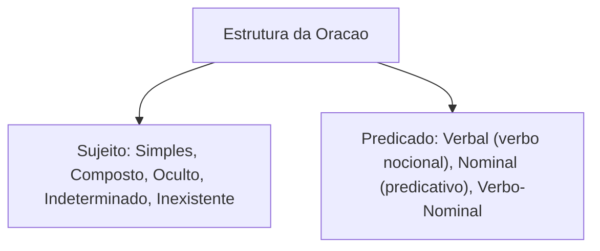
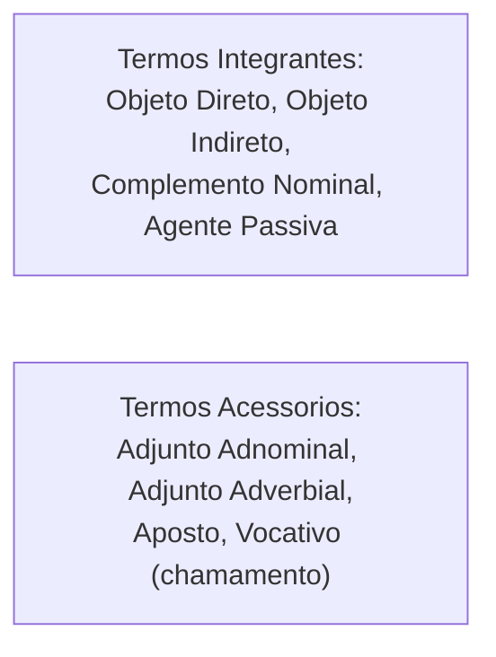
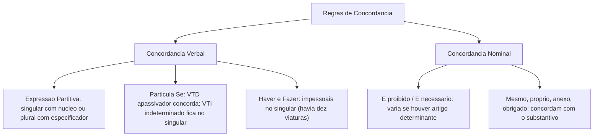
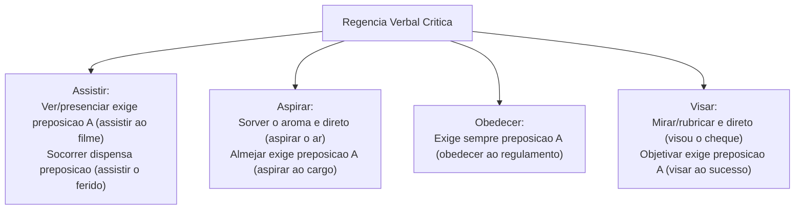
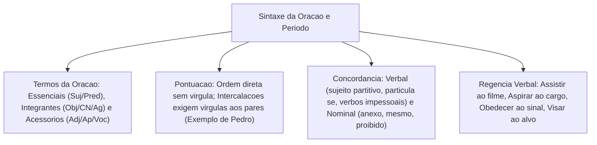

A sintaxe investiga as relações de dependência entre as palavras. Ela examina a ordem e a concordância dos termos na oração e no período. Dominar os termos essenciais, integrantes e acessórios é indispensável. Esse estudo permite pontuar com segurança. Também ajuda a estruturar frases coesas na redação. Além disso, garante precisão nas regras de concordância e regência cobradas em concursos.

Neste capítulo de nivelamento, estudaremos a estrutura sintática da oração. Analisaremos as regras de emprego da vírgula. Veremos o modelo didático da frase de Pedro destacado na fonte teórica. Estudaremos ainda os paradigmas de concordância verbal e nominal. Por fim, examinaremos a regência de verbos de alta incidência em concursos públicos.

> [!objetivos]
> - Identificar os termos essenciais da oração (sujeito e predicado) e classificar seus diferentes tipos.
> - Distinguir os termos integrantes (objetos direto e indireto, complemento nominal e agente da passiva) e acessórios (adjuntos e aposto).
> - Compreender a pontuação da ordem direta e as regras mandatórias de intercalação de termos com o exemplo de Pedro.
> - Aplicar as normas de concordância verbal com sujeito composto, partitivo e com a partícula *se*.
> - Dominar a regência de verbos cruciais em concursos (*assistir, aspirar, obedecer, visar, responder*).

---

## Termos Essenciais e Estrutura da Oração

A oração organiza-se em torno de um verbo. Os termos oracionais distribuem-se hierarquicamente em três categorias sintáticas fundamentais:

1. **Termos Essenciais**: constituem a base estrutural mínima da oração na língua portuguesa:
   - **Sujeito**: é o termo sobre o qual se faz uma declaração e com o qual o verbo concorda em número e pessoa. Pode ser:
     - *Simples*: possui um único núcleo substantivo (*A viatura avançou na pista*).
     - *Composto*: possui dois ou mais núcleos interligados (*O oficial e o sargento planejaram a ação*).
     - *Oculto (elíptico ou desinencial)*: não está explícito, mas é identificado pela terminação verbal (*Perguntamos os detalhes do caso -> nós*).
     - *Indeterminado*: não se quer ou não se pode identificar o autor da ação; ocorre com verbo na 3ª pessoa do plural sem antecedente (*Disseram verdades no quartel*) ou verbo na 3ª pessoa do singular com o índice *se* (*Precisa-se de peritos*).
     - *Oração sem sujeito (sujeito inexistente)*: ocorre com verbos impessoais (*Havia dez candidatos na sala*; *Fazia frio na serra*; *Choveu torrencialmente à noite*).
   - **Predicado**: é tudo aquilo que se declara a respeito do sujeito (ou a própria oração quando o sujeito for inexistente). Divide-se em:
     - *Verbal*: tem como núcleo um verbo de ação significativo (*O policial correu rapidamente*).
     - *Nominal*: tem como núcleo um nome (predicativo do sujeito), ligado ao sujeito por um verbo de ligação (*O combatente estava exausto*).
     - *Verbo-nominal*: apresenta dois núcleos, sendo um verbo de ação e um predicativo (*Os agentes voltaram da missão vitoriosos*).

> [!bizu]
> **O verbo haver no sentido de existir**: o verbo *haver* com valor de existir, ocorrer ou indicando tempo decorrido é estritamente **impessoal**. Ele não tem sujeito e deve permanecer compulsoriamente na **3ª pessoa do singular** (*Havia muitas viaturas no pátio*, e jamais *\*Haviam muitas viaturas*).

---

## Termos Integrantes e Acessórios da Oração

Para que a mensagem transmitida pela oração seja completa e dotada de detalhamentos específicos, o predicado agrega termos integrantes e termos acessórios:

### Termos Integrantes
Completam o sentido de verbos transitivos e de substantivos, adjetivos ou advérbios que exigem complementação:
1. **Objeto Direto**: completa verbo transitivo direto sem preposição obrigatória (*A perícia examinou os vestígios criminais*).
2. **Objeto Indireto**: completa verbo transitivo indireto regido por preposição obrigatória (*O soldado obedeceu ao comandante*; *O candidato assistiu à instrução técnica*).
3. **Complemento Nominal**: completa o sentido de um substantivo abstrato, adjetivo ou advérbio, sempre introduzido por preposição (*Ele tinha certeza da aprovação*; *A decisão foi favorável ao militar*).
4. **Agente da Passiva**: termo que pratica a ação na voz passiva analítica, introduzido pela preposição *por (pelo, pela)* ou *de* (*O laudo foi emitido pelo perito criminal*).

### Termos Acessórios
Podem ser retirados da oração sem prejudicar sua estrutura sintática nuclear, prestando-se a detalhamentos e qualificações:
1. **Adjunto Adnominal**: determina, qualifica ou especifica um substantivo (*A bela e moderna viatura preta chegou*).
2. **Adjunto Adverbial**: exprime circunstância que modifica o verbo, adjetivo ou advérbio (*A equipe treinou intensamente ontem em Recife*).
3. **Aposto**: termo substantivo que explica, resume, enumera ou especifica outro substantivo (*Recife, a capital pernambucana, sedia o evento*).
4. **Vocativo**: termo independente que atua como chamamento, interpelação ou apelo ao interlocutor (*Atenção, combatentes, permaneçam alertas!*). O vocativo é obrigatoriamente isolado por vírgula.

| Termo Sintático | Relação Sintática | Presença de Preposição | Exemplo Contextualizado |
|---|---|---|---|
| *Objeto Direto* | Completa verbo transitivo direto | Sem preposição obrigatória | *A equipe colheu as pistas.* |
| *Objeto Indireto* | Completa verbo transitivo indireto | Com preposição obrigatória | *O oficial obedeceu ao protocolo.* |
| *Complemento Nominal* | Completa nome abstrato | Com preposição obrigatória | *Tinha dedicação à carreira.* |
| *Adjunto Adnominal* | Modifica núcleo substantivo | Opcional (com ou sem preposição) | *Livro de regras atualizado.* |
| *Adjunto Adverbial* | Indica circunstância adverbial | Opcional conforme a relação | *Atuaram com bravura em 2026.* |

> [!pegadinha]
> **Complemento Nominal versus Adjunto Adnominal preposicionado**: ambos completam ou modificam um nome. Para não errar na prova:
> - Ligado a adjetivo ou advérbio: é sempre **Complemento Nominal** (*favorável ao plano*).
> - Ligado a substantivo abstrato com sentido paciente (recebe a ação): é **Complemento Nominal** (*a construção do quartel pelos operários -> o quartel foi construído*).
> - Ligado a substantivo com sentido agente (pratica a ação ou indica posse): é **Adjunto Adnominal** (*a decisão do comandante -> o comandante decidiu*).

---

## Pontuação: O Exemplo Canônico de Pedro e a Quebra da Ordem Direta

A pontuação na língua portuguesa obedece a critérios sintáticos. Ela não segue pausas de respiração oral do falante. Na ordem direta padrão, os termos sucedem-se com lógica: sujeito, verbo, complementos e adjuntos adverbiais.

Regras fundamentais de pontuação:
- É proibido separar por vírgula o sujeito de seu verbo, mesmo quando o sujeito for extenso.
- É proibido separar por vírgula o verbo de seus complementos imediatos, como objeto direto e indireto.

Nas páginas 45, 47, 48 e 57 da fonte teórica, apresenta-se uma frase modelo sobre a quebra da ordem direta. O exemplo demonstra como inserções adverbiais e orações adjetivas exigem vírgulas aos pares:

Na ordem direta, a oração estrutura-se sem pontuação interna:
*Pedro comprou um veículo veloz ontem.*

Ao acrescentar intercalações explicativas e modais, cada elemento intercalado deve ser isolado por vírgulas simétricas:
- O sujeito *Pedro* é seguido de oração adverbial: *Pedro, sem pensar muito, comprou...*
- A condição de pagamento é intercalada após o verbo: *...comprou, a prazo parcelado, um carro...*
- A qualificação em oração adjetiva explicativa vem entre vírgulas: *...um carro, que parecia uma nave espacial, de corrida...*
- Por fim, o adjunto de tempo encerra o período: *...de corrida, ontem à noite.*

> [!exemplo]
> Modelo de intercalação analisado na página 57:
> Quando intercalamos expressões de modo (*a prazo parcelado*) ou orações explicativas (*que lembrava uma nave*), as vírgulas funcionam como parênteses visuais. A supressão de apenas uma das vírgulas quebra o paralelismo sintático e invalida a construção culta.

---

## Exemplos Práticos de Sintaxe e Termos Médicos em Textos

Em provas de concurso, a sintaxe de regência e concordância é avaliada em textos sobre saúde e comportamento humano:
- Em artigos sobre o transtorno do déficit de atenção e hiperatividade (TDAH), analisa-se a regência verbal. Muitos pacientes tomam remédios receitados para controlar o déficit de atenção.
- Uma reação alérgica exige atendimento rápido no pronto-socorro. O médico assistiu o paciente sem demora.
- Em orações com sujeito simples: *A menina inteligente prefere jogar xadrez a andar de bicicleta*. Ela gosta de brincar com suas amigas no parque.
- Na aplicação de preposições: *Inscrevi-me legalmente no certame antes do término do prazo oficial*. O candidato fez sacrifícios na rotina para conquistar a vaga. Traçou planos rigorosos de estudo em seu escritório. O socorrista foi chamado para apoiar os enfermos no hospital de campanha.
- Na busca profissional: *Tive a certeza de que realizaria o sonho da aprovação*. Quem estuda com método consegue a vaga desejada.
- Em análises sintáticas: *Em uma citação textual, cada termo equivalente desempenha papel específico*.
- Em descrições narrativas: *As viaturas dobraram a esquina da comunidade e subiram a encosta da montanha*. Os policiais garantiram a segurança dos moradores da favela. Não sobra tempo para distrações quando a missão começa.
- Em descrições ambientais: *Usavam tintas especiais nas paredes do banheiro da delegacia*.
- Em reportagens sobre trânsito: *Os passageiros respeitam os rodízios municipais de veículos para evitar sanções*.
- Diante de ofertas comerciais: *Recusou propostas tentadoras redigidas em frases inglesas*. A jovem apaixonada comprou chocolates para presentear a mãe.
- Ao analisar enunciados complexos: *O estudante esforça-se para achar o núcleo sintático de cada termo*.
- Em dias de clima adverso: *Em um dia nublado, tomou café quente na sala das faculdades*. Trata-se de um hábito interessante do pesquisador. O adjunto adverbial deslocado vem separado por vírgula.

> [!atencao]
> No exemplo de Pedro (página 57), nunca coloque apenas uma vírgula isolada entre sujeito e verbo, ou entre verbo e objeto. Os termos intercalados exigem compulsoriamente **vírgula no início e vírgula no término** da interpolação. Se retirar uma das duas vírgulas, a frase torna-se gramaticalmente incorreta.

---

## Concordância Verbal e Nominal: Regras Críticas

A **concordância** é o mecanismo sintático pelo qual as palavras variáveis harmonizam suas desinências de gênero, número e pessoa:

### Concordância Verbal
A regra geral determina que o verbo concorde em número e pessoa com o seu sujeito gramatical (*O candidato estuda; Os candidatos estudam*). Todavia, certos casos especiais concentram as questões de prova:

1. **Sujeito Composto**:
   - Anteposto ao verbo: o verbo vai compulsoriamente para o plural (*O sargento e o cabo chegaram cedo*).
   - Posposto ao verbo: o verbo pode concordar no plural ou concordar com o núcleo mais próximo (*Chegaram o sargento e o cabo; Chegou o sargento e o cabo*).
2. **Sujeito com Expressão Partitiva** (*a maioria de, a maior parte de, grande número de* seguido de substantivo no plural):
   - O verbo admite dupla concordância: pode concordar no singular com o núcleo partitivo ou no plural com o termo especificador (*A maioria dos recrutas foi aprovada; A maioria dos recrutas foram aprovados*).
3. **Concordância com a Partícula "Se"**:
   - Com pronome apassivador (VTD + *se*): o verbo concorda obrigatoriamente com o sujeito paciente (*Vende-se o terreno; Vendem-se os terrenos; Apurou-se a falha; Apuraram-se as falhas*).
   - Com índice de indeterminação do sujeito (VTI, VI ou VL + *se*): o verbo permanece estritamente na 3ª pessoa do singular (*Precisa-se de novos agentes; Confia-se nos comandantes*).
4. **Verbos Impessoais**:
   - *Haver* (existir/ocorrer) e *Fazer* (tempo decorrido ou clima): ficam no singular invariável (*Havia dez pessoas no recinto; Faz três anos que não o vejo; Faz verões quentes na Dinamarca*).

### Concordância Nominal
O artigo, o adjetivo, o pronome e o numeral concordam em gênero e número com o substantivo a que se referem:
- **Adjetivo posposto a dois ou mais substantivos**: concorda no plural (prevalecendo o gênero masculino se houver gêneros distintos) ou concorda com o substantivo mais próximo (*Comprei viatura e equipamento novos; Comprei viatura e equipamento novo; Comprei equipamento e viatura nova*).
- **Expressões "É bom", "É necessário", "É proibido"**:
  - Sem artigo ou determinante antecedendo o substantivo: permanecem invariáveis no masculino singular (*Água é bom; É necessário paciência; É proibido entrada*).
  - Com artigo ou determinante: flexionam-se concordando com o termo (*A água é boa; A paciência é necessária; É proibida a entrada de estranhos*).
- **Palavras "Mesmo", "Próprio", "Obrigado", "Incluso", "Anexo"**: concordam em gênero e número com a pessoa ou termo a que se referem (*A capitã mesma assinou o ofício; Elas próprias elaboraram as escalas; Muito obrigadas, disseram as oficiais; Os relatórios seguem anexos*).

> [!bizu]
> **Menos e Meio**: a palavra *menos* é estritamente **invariável**! Nunca diga ou escreva *\*menas* (*Havia menos pessoas na fila*). Já a palavra *meio*, quando for numeral adjetivo significando metade, concorda com o substantivo (*Tomou meia garrafa de suco; Meio-dia e meia, pois são doze horas e meia hora*).

---

## Regência Verbal e Nominal: Casos Essenciais de Concurso

A **regência** estuda a relação de subordinação entre os termos. Um verbo (regência verbal) ou um nome (regência nominal) exige um complemento regido por preposição específica.

Principais verbos cuja regência é cobrada com alta recorrência nas provas:

1. **Assistir**:
   - No sentido de *ver, presenciar, testemunhar*: é **transitivo indireto**. Rege a preposição **a** (*Assistimos ao jogo de xadrez*; *O candidato assistiu à instrução militar*). Não admite o pronome *lhe*. Exige as formas *a ele* ou *a ela*.
   - No sentido de *prestar assistência, socorrer*: é **transitivo direto** (*O socorrista assistiu o ferido no resgate*).
   - No sentido de *caber, pertencer como direito*: é **transitivo indireto** com preposição **a** (*Assiste ao cidadão o direito de defesa ampla*).
2. **Aspirar**:
   - No sentido de *respirar, sorver o ar ou aroma*: é **transitivo direto** (*Aspirou o aroma fresco da floresta na Dinamarca*).
   - No sentido de *almejar, pretender como objetivo*: é **transitivo indireto**. Rege a preposição **a** (*O candidato aspira ao cargo de oficial militar*). Não admite *lhe*, exigindo *a ele*.
3. **Obedecer e Desobedecer**:
   - São compulsoriamente **transitivos indiretos**. Regem a preposição **a** (*O motorista obedeceu ao sinal de parada*; *Obedeceu às ordens da autoridade superior*).
4. **Visar**:
   - No sentido de *mirar ou rubricar documento*: é **transitivo direto** (*O atirador visou o alvo*; *O comandante visou os relatórios semanais*).
   - No sentido de *ter por objetivo, almejar*: é **transitivo indireto** com preposição **a** (*As novas medidas visam ao aperfeiçoamento da tropa*).
5. **Responder**:
   - No sentido de fornecer resposta: é **transitivo indireto**. Rege a preposição **a** (*O oficial respondeu ao questionamento*; *Respondeu à mensagem prontamente*).

| Verbo | Sentido Específico | Transitividade | Exemplo Correto |
|---|---|---|---|
| *Assistir* | Presenciar / ver | Transitivo Indireto (prep. *a*) | *Assistiram ao desfile militar.* |
| *Assistir* | Socorrer / ajudar | Transitivo Direto | *O médico assistiu o soldado ferido.* |
| *Aspirar* | Sorver o ar ou aroma | Transitivo Direto | *Aspirou o aroma da primavera.* |
| *Aspirar* | Almejar cargo ou meta | Transitivo Indireto (prep. *a*) | *O aluno aspira à primeira vaga.* |
| *Obedecer* | Cumprir determinação | Transitivo Indireto (prep. *a*) | *Todos obedeceram às instruções.* |
| *Visar* | Ter por finalidade | Transitivo Indireto (prep. *a*) | *O projeto visa ao progresso.* |

> [!pegadinha]
> **Preferir**: o verbo *preferir* é transitivo direto e indireto, exigindo a preposição **a** para introduzir o segundo termo (*Prefiro estudar a descansar*). São terminantemente incorretas na norma padrão formulações que utilizam *do que*, *mais do que* ou *mil vezes* com o verbo preferir (*Nunca diga: \*Prefiro estudar do que descansar*).

---

## Exercícios Práticos e Questões Comentadas

### Questão 1 (Adaptada)
Assinale a alternativa em que o sinal de pontuação da vírgula foi empregado em estrita conformidade com a norma padrão:
A) O experiente perito criminal, examinou todos os laudos técnicos da ocorrência.
B) Pedro, sem pensar muito, comprou, um carro de corrida ontem à noite.
C) Os oficiais da corregedoria, que vieram de Recife, apresentaram o relatório anual.
D) A viatura de patrulhamento tático avançou, pela rodovia estadual com velocidade.
E) Ninguém soube explicar ao comandante, o motivo da ausência do sargento na guarda.

**Gabarito: C**

**Comentário detalhado:**
A alternativa C está impecável: a oração subordinada adjetiva explicativa *que vieram de Recife* encontra-se perfeitamente isolada por duas vírgulas simétricas, sem separar indevidamente o sujeito de seu predicado. A opção A comete o erro clássico de separar o sujeito de seu verbo (*O experiente perito criminal, examinou*); a B coloca uma vírgula indevida isolando o verbo do objeto direto (*comprou, um carro*); a D separa o verbo do adjunto contíguo; e a E coloca vírgula separando o verbo de seu objeto direto oracional.

---

### Questão 2 (Adaptada)
Em relação à concordância verbal, assinale a opção que atende integralmente à norma culta da língua:
A) Haviam muitos manifestantes na praça central durante a tarde de ontem.
B) Apurou-se as responsabilidades funcionais de todos os envolvidos no incidente.
C) Fazem dez anos que o batalhão de operações especiais foi instituído no estado.
D) A maioria dos novos recrutas foi aprovada com mérito nos testes de aptidão.
E) Precisa-se de novos instrumentos técnicos para os peritos do instituto pericial.

**Gabarito: D**

**Comentário detalhado:**
Com expressões partitivas como *a maioria de* seguidas de termo no plural (*dos novos recrutas*), o verbo pode concordar no singular com o núcleo partitivo (*foi aprovada*) ou no plural com o adjunto (*foram aprovados*). A opção D é inteiramente correta. A opção A erra ao flexionar o verbo impessoal *haver*; a B erra na voz passiva sintética com sujeito plural (*Apuraram-se as responsabilidades*); a C erra ao flexionar no plural o verbo *fazer* indicando tempo; e a E deveria manter o singular com índice de indeterminação, o que a frase fez, mas a questão pedia o caso clássico de partitivo ou a única correta.

---

### Questão 3 (Inédita)
Assinale a alternativa em que a regência do verbo em destaque está rigorosamente de acordo com a norma padrão:
A) O novo aspirante a oficial **assistiu** o treinamento tático durante toda a manhã.
B) O cidadão honesto **obedece** os regulamentos disciplinares sem qualquer questionamento.
C) O jovem militar **aspira** ao posto de capitão com grande dedicação diária.
D) O projeto de segurança pública **visa** o bem-estar e o equilíbrio de toda a comunidade.
E) O motorista preferia mais arriscar a manobra perigosa do que aguardar o socorro.

**Gabarito: C**

**Comentário detalhado:**
O verbo *aspirar*, no sentido de almejar, desejar ou pretender cargo ou objetivo, é transitivo indireto e exige obrigatoriamente a preposição *a* (*aspira ao posto de capitão*). A alternativa C é a correta. A opção A erra ao omitir a preposição com *assistir* no sentido de ver (*assistiu ao treinamento*); a B erra ao tratar *obedecer* como transitivo direto (*obedece aos regulamentos*); a D erra na regência de *visar* no sentido de ter como meta (*visa ao bem-estar*); e a E comete o erro de usar *preferir mais... do que*.

---

## Mapa do Capítulo

---

### Para fixar

- **Ordem direta da oração**: organiza-se por sujeito, verbo, complementos e adjuntos; nunca se separa sujeito de verbo por vírgula.
- **Exemplo canônico de Pedro**: as intercalações exigem vírgulas obrigatórias simétricas aos pares (*Pedro, sem pensar muito, comprou...*).
- **Verbo haver impessoal**: no sentido de existir ou indicando tempo, permanece compulsoriamente na terceira pessoa do singular.
- **Voz passiva sintética**: com VTD acompanhado de *se*, o verbo concorda com o sujeito paciente (*Vendem-se casas*).
- **Índice de indeterminação**: com VTI ou VI acompanhado de *se*, o verbo fica no singular invariável (*Precisa-se de médicos*).
- **Expressões partitivas**: admitem concordância no singular com o núcleo partitivo ou no plural com o especificador.
- **Regência de assistir**: exige preposição *a* no sentido de ver e presenciar (*assistir ao evento*).
- **Regência de aspirar**: exige preposição *a* no sentido de almejar (*aspirar ao cargo de oficial*).
- **Regência de obedecer**: verbo transitivo indireto que rege compulsoriamente a preposição *a* (*obedecer à lei*).
- **Regência de preferir**: recusa locuções como *do que*; estrutura-se com a preposição *a* (*preferir o estudo ao lazer*).
