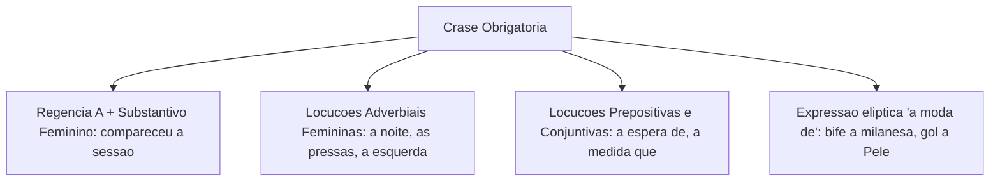
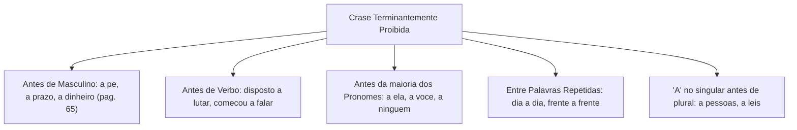
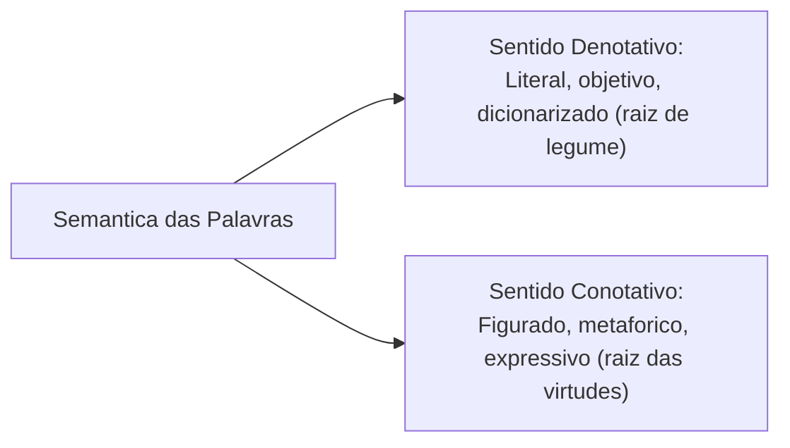
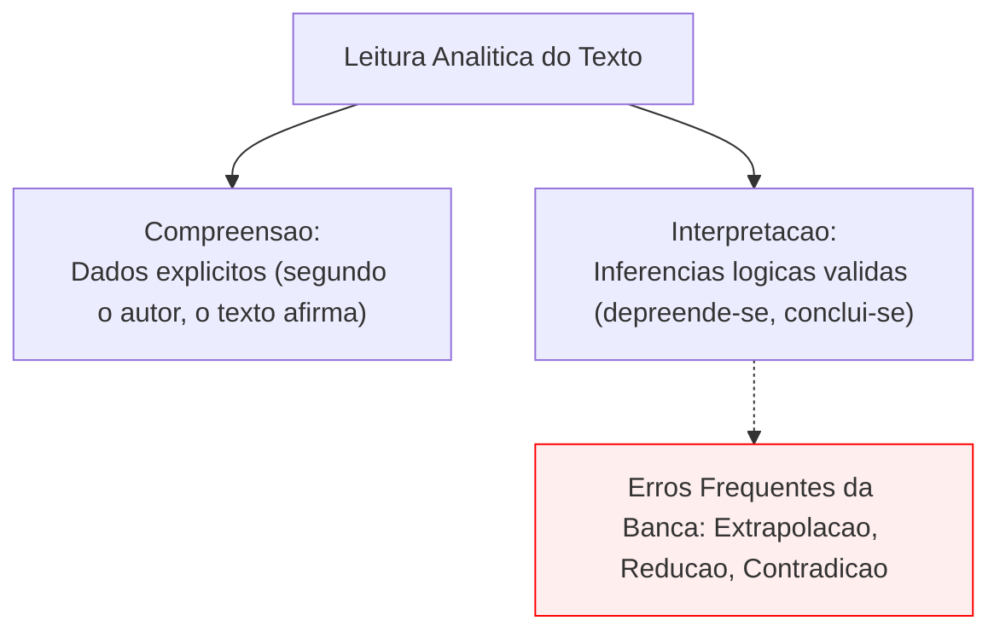
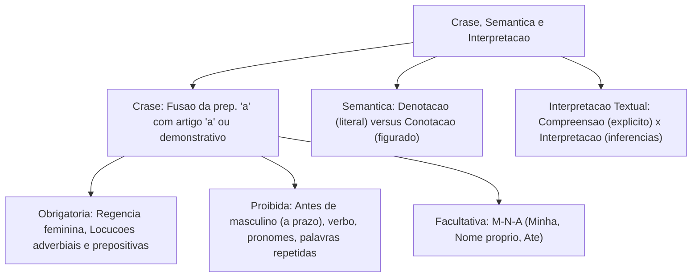

O domínio da **crase**, da **semântica** e das técnicas de **compreensão e interpretação de textos** representa o ápice da prova de Língua Portuguesa em concursos públicos. Nas avaliações da banca examinadora, as questões de interpretação textual respondem habitualmente por parcela expressiva da pontuação da disciplina, exigindo do candidato competência para decodificar sentidos implícitos, distinguir conotação de denotação e aplicar com segurança o acento grave indicativo de crase.

Neste capítulo conclusivo de nivelamento correspondente à Aula 00, estudaremos o fenômeno morfossintático da crase, seus casos obrigatórios, proibidos e facultativos, o ponto de atenção da página 65 da fonte sobre locuções masculinas, as relações semânticas de polissemia, sinonímia e antonímia, e as diretrizes operacionais para responder perguntas de compreensão e interpretação de gêneros textuais variados em provas e simulados.

> [!objetivos]
> - Compreender a natureza gramatical da crase como fusão da preposição *a* com o artigo feminino *a* ou pronomes demonstrativos.
> - Identificar os casos em que a crase é estritamente proibida, destacando a regra da expressão *a prazo*.
> - Dominar os três casos clássicos de crase facultativa na norma culta.
> - Diferenciar sentido denotativo (literal e referencial) de sentido conotativo (figurado e simbólico).
> - Desenvolver método seguro de leitura para realizar inferências válidas e interpretar textos em provas.

---

## O Fenômeno da Crase: A Fusão Prepositiva

A palavra **crase** tem origem grega e significa fusão, mistura ou junção. Em gramática da língua portuguesa, a crase não é um acento gráfico em si, mas sim o fenômeno fonético e morfológico da **fusão de duas vogais idênticas**: a preposição **a** (exigida por um termo regente antecedente) com o artigo definido feminino **a** ou **as** (admitido por um substantivo feminino regido consequente).

Na escrita padrão, a ocorrência desse fenômeno é sinalizada pelo **acento grave (`)**.

A equação sintática da crase resume-se na fórmula:
**Preposição "a" (exigida pelo regente) + Artigo "a(s)" (admitido pelo regido) = À / ÀS**

Regra prática de validação (troca da palavra feminina por masculina):
Para saber se há crase diante de uma palavra feminina, substitua-a mentalmente por um termo masculino equivalente:
- Se diante do termo masculino surgir a combinação **ao** ou **aos**, haverá crase diante do termo feminino (*Refiro-me à capitã -> Refiro-me ao capitão*).
- Se diante do masculino surgir apenas **o** ou **os**, não ocorre crase (*Elogiei a capitã -> Elogiei o capitão*).
- Se surgir apenas a preposição **a**, também não há crase (*Obedeci a ordens -> Obedeci a regulamentos*).

Além do artigo definido feminino, a crase ocorre na fusão da preposição *a* com a vogal inicial dos pronomes demonstrativos **aquele**, **aquela**, **aquilo** (*Fui àquela delegacia; Não dei atenção àquilo*).

```mermaid Mecanismo da Fusao da Crase
flowchart TD
    REG["Termo Regente:<br>Exige a preposicao 'a'"] + SUB["Termo Regido Feminino:<br>Admite o artigo 'a'"] --> CRASE["Fenomeno da Crase:<br>Sinalizado com acento grave (a + a = a)"]
    TESTE["Metodo Pratico:<br>Troca por termo masculino equivalente"] --> RES_AO["Vira 'ao' no masculino -> Tem crase (a)"]
    TESTE --> RES_O["Vira 'o' no masculino -> Nao tem crase (a)"]
```

---

## Casos Obrigatórios de Crase

A aplicação do acento grave é obrigatória em três circunstâncias normativas fundamentais:

1. **Diante de palavras femininas que exigem preposição e admitem artigo**:
   - Quando o termo regente (verbo ou nome) rege a preposição *a* e o termo seguinte é um substantivo feminino determinado (*O candidato compareceu à audiência*; *Faremos referência à legislação vigente*; *Dedicação à carreira militar*).
2. **Nas locuções adverbiais femininas de tempo, modo e lugar**:
   - Locuções adverbiais formadas por palavras femininas recebem compulsoriamente o acento grave: *à noite, à tarde, às vezes, às pressas, à vista, à toa, à beça, à esquerda, à direita, à deriva*.
   - Exemplo operacional: *A equipe posicionou-se à direita da pista às três horas da tarde*.
3. **Nas locuções prepositivas e conjuntivas femininas**:
   - *À custa de, à espera de, à procura de, à medida que, à proporção que*.
   - Exemplo: *Estudava à espera da publicação do edital no diário oficial*.
4. **Antes de nomes de lugares que admitem artigo feminino**:
   - Aplica-se a clássica regra mnemônica: *Vou a, volto da, crase no a; Vou a, volto de, crase pra quê?*.
   - Exemplos: *Vou à Bahia (volto da Bahia -> tem crase)*; *Vou a Roma ou vou a Ipanema (volto de Roma, volto de Ipanema -> sem crase)*; *Vou à Ipanema de Tom Jobim (Ipanema qualificada -> tem crase)*.
5. **Regência do verbo visar**:
   - O verbo **visar**, quando empregado no sentido de almejar ou ter em vista um objetivo, é transitivo indireto e rege a preposição *a*. Portanto, a construção *visando à aprovação* ou *visar à posse* exige crase diante de substantivo feminino determinado (*Visando à vitória no concurso*). No sentido de mirar ou apor visto, o verbo visar dispensa preposição (*O fiscal visou o passaporte*).
6. **Expressão subentendida "à moda de" ou "à maneira de"**:
   - Ocorre crase mesmo antes de palavras masculinas quando a expressão estiver elíptica (*Fez um gol à Pelé = à moda de Pelé*; *Usava sapatos à Luís XV*).



> [!bizu]
> **Locução adverbial com instrumento**: em expressões de instrumento como *escrever a máquina, ferir a faca, bater a máquina*, a gramática normativa tradicional orienta não usar crase por se tratar de instrumento, reservando o acento grave apenas diante de risco de ambiguidade (*matar à fome vs matar a fome*).

---

## Casos Proibidos de Crase e o Ponto de Atenção da Página 65

Tão importante quanto saber onde colocar o acento grave é saber identificar com rapidez onde ele é terminantemente vedado. As bancas estruturam suas pegadinhas explorando as hipóteses de proibição absoluta:

1. **Antes de palavras masculinas**: o termo masculino admite apenas o artigo *o* ou *os*, inviabilizando a fusão com o artigo feminino *a*. Exemplos: *andar a pé, pagar a prazo, andar a cavalo, viajar a negócio, escrever a lápis, pagamento a dinheiro*.
2. **Antes de verbos no infinitivo**: verbos não admitem artigo (*Começou a chover; Pôs-se a chorar; Disposto a lutar*).
3. **Antes da maioria dos pronomes**: pronomes pessoais (*a ela, a você*), pronomes de tratamento (*a Vossa Senhoria*), pronomes indefinidos (*a alguém, a qualquer*) e pronomes demonstrativos (*a esta*) recusam artigo. Exceções: pronomes de tratamento *senhora*, *senhorita* e *dona* admitem crase (*Dirigi-me à senhora*).
4. **Entre palavras repetidas em locuções**: *face a face, gota a gota, dia a dia, passo a passo, frente a frente*.
5. **Com o "a" no singular diante de palavra no plural**: a ausência do *s* comprova que há apenas a preposição pura, inexistindo artigo plural (*Refiro-me a pessoas honestas; Não dou ouvidos a postagens fúteis*). Regra prática: *A no singular diante de plural: crase nem a pau!*.
6. **Antes de nomes de mulheres célebres ou históricas sem intimidade**: *Fez alusão a Joana d'Arc*.
7. **Após preposições que não sejam a preposição "até"**: preposições como *para, perante, com, contra, desde, sob, sobre* rejeitam nova preposição (*Caminhou para a sala; Ficou perante a autoridade*).

### Ponto de Atenção da Página 65: O Exemplo de Pedro e a Compra a Prazo
Na página 65 da fonte de apoio, o autor retoma a situação didática de Pedro para alertar sobre o erro crasso do acento grave antes de substantivos masculinos:
- Considere a passagem ilustrativa: Pedro adquiriu um veículo utilitário a prazo, sem planejamento orçamentário e sem reunir condições financeiras de honrar as parcelas do financiamento.
- A locução adverbial de modo ou condição *a prazo* é estruturada com o substantivo masculino *prazo* (*o prazo*).
- A rejeição do acento grave decorre da ausência de artigo feminino. Colocar acento grave em *\*à prazo* constitui falta grave eliminatória em provas dissertativas e questões de múltipla escolha.
- Não incorra em mora interpretativa nem confunda a preposição simples com crase: o mesmo raciocínio de rejeição aplica-se a *compras a crédito*, *pagamento a dinheiro* ou *venda a domicílio*. Observe também que um candidato entrando na sala correndo às pressas cometeria deslize similar ao grafar crase antes de gerúndio ou verbo no infinitivo.



> [!atencao]
> Guarde com rigor o ponto de atenção da página 65: jamais utilize acento grave na expressão **a prazo**! O termo *prazo* é substantivo masculino, exigindo preposição simples desprovida de crase.

---

## Casos Facultativos de Crase

A crase é facultativa quando a presença do artigo definido feminino antes do substantivo for opcional segundo as normas gramaticais. Nesses casos, o candidato pode optar livremente por colocar ou não o acento grave:

Existem três casos clássicos de crase facultativa na língua culta:

1. **Antes de pronomes possessivos femininos no singular** (*minha, tua, sua, nossa, vossa*):
   - O uso do artigo antes desses pronomes é facultativo no português do Brasil (*Enviei a mensagem à minha capitã* ou *Enviei a mensagem a minha capitã*).
   - Atenção: se o pronome estiver no plural (*minhas, tuas, suas*), a regra muda! Com preposição *a* singular e termo plural (*a minhas amigas*), não há crase; se houver *às*, a crase é obrigatória (*às minhas amigas*).
2. **Antes de nomes próprios femininos de pessoas**:
   - Diante de nomes de pessoas conhecidas, o artigo feminino indica intimidade facultativa (*Entreguei o documento à Mariana* ou *Entreguei o documento a Mariana*).
   - Atenção: se o nome feminino for qualificado ou indicar figura histórica distante, a regra segue o padrão do determinante (*Fiz referência à Mariana de nossas memórias*).
3. **Após a preposição "até"**:
   - A locução prepositiva admite a forma *até* ou *até a*. Diante de palavra feminina determinada, a crase é facultativa (*Caminhou até à praia* ou *Caminhou até a praia*).

| Situação Gramatical | Construção com Crase | Construção sem Crase | Justificativa Normativa |
|---|---|---|---|
| *Pronome possessivo feminino singular* | *Dirigi-me à sua unidade.* | *Dirigi-me a sua unidade.* | Artigo facultativo com possessivo |
| *Nome próprio feminino de pessoa* | *Entregou a chave à Joana.* | *Entregou a chave a Joana.* | Artigo facultativo com antropônimos |
| *Após a preposição até* | *A viatura foi até à divisa.* | *A viatura foi até a divisa.* | Preposição até admite a partícula |

> [!bizu]
> Mnemônico dos três casos facultativos: **M-N-A** -> **M**inha (possessivo feminino singular), **N**ome próprio feminino de pessoa e **A**té (após a preposição até). Nesses três casos, a presença ou ausência do acento grave é igualmente correta.

---

## Semântica: Denotação versus Conotação e Relações de Sentido

A **semântica** estuda o significado das palavras, expressões e enunciados no contexto comunicativo. Para interpretar textos de concursos com segurança, é indispensável dominar as camadas de significação que uma palavra pode assumir:

### Denotação versus Conotação
- **Sentido Denotativo (Literal / Próprio)**: é o significado referencial básico e objetivo da palavra, aquele dicionarizado e desprovido de conotações emocionais. É a linguagem da ciência, das leis, das normas operacionais e dos relatórios periciais:
  - Exemplo: *O agricultor colheu uma raiz comestível de legume na horta fria.* (Raiz e legume em seu sentido biológico estrito).
- **Sentido Conotativo (Figurado / Simbólico)**: é o significado subjetivo, expressivo e contextual que as palavras adquirem por meio de associações imaginativas, metáforas e comparações poéticas. O sentido conotativo atribuído ao vocábulo depende inteiramente da intenção discursiva do autor:
  - Exemplo: *A coragem é a raiz de todas as virtudes militares.* (Raiz no sentido figurado de alicerce, origem fundamental atribuído à disciplina).
  - Outros exemplos: *Peguei a chave do problema; O candidato quer emagrecer o texto enxugando excessos; As postagens nas redes sociais revelaram uma reação fria do público; O cunhado ganhou chuteiras no sorteio e chutou o balde na comemoração*.



### Relações Semânticas Lexicais
1. **Sinonímia**: relação entre palavras de sentidos semelhantes no mesmo contexto (*corajoso / destemido; ordenar / mandar*).
2. **Antonímia**: relação de oposição de significados (*corajoso / covarde; legal / ilegal; frio / quente*).
3. **Polissemia**: capacidade de uma mesma palavra assumir múltiplos significados dependendo do contexto (*A chave da porta; A chave do mistério; A chave de fenda*).
4. **Homonímia**: palavras de mesma forma sonora ou gráfica com significados autônomos e origens etimológicas distintas (*manga de camisa / manga fruta; banco financeiro / banco de sentar*).

> [!pegadinha]
> **Polissemia versus Homonímia**: na polissemia, os significados derivam de uma mesma raiz conceitual compartilhada (como os sentidos de *chave* ou *raiz*). Na homonímia, as palavras coincidem apenas por acidente fonético histórico, não guardando parentesco semântico (*banco de praça* e *banco monetário*).

---

## Compreensão e Interpretação de Textos: Métodos e Inferências

A **compreensão textual** difere sutilmente da **interpretação textual**, embora ambas caminhem entrelaçadas na resolução de questões da banca examinadora:

- **Compreensão de Texto**: refere-se à decodificação das informações explícitas presentes no corpo do texto. O candidato submete sua análise àquilo que está rigorosamente escrito na superfície do documento. Uma leitura atenta e imparcial facilita a localização de dados objetivos. Os comandos de compreensão utilizam expressões como: *Segundo o texto..., De acordo com o autor..., O texto afirma expressamente que...*.
- **Interpretação de Texto**: envolve a realização de **inferências lógicas**, deduções válidas e conclusões fundamentadas a partir das pistas deixadas pelo autor. A resposta não está literalmente escrita, mas pode ser deduzida logicamente a partir do texto. Exercícios de reescritura e paráfrase exigem que o candidato identifique formulações alternativas que mantenham intacto o sentido da mensagem original. Uma argumentação robusta ampara-se nas evidências textuais, ao passo que uma hipótese frágil sucumbe diante de contradições literais. Os comandos típicos anunciam: *Depreende-se do texto que..., Infere-se do trecho..., O texto permite concluir que...*.

### Os Três Erros Clássicos de Leitura
Ao responder perguntas de compreensão e interpretação, o candidato deve vigiar para não incorrer nas armadilhas mais comuns elaboradas pelas bancas:
1. **Extrapolação**: o candidato introduz ideias e conhecimentos de mundo próprios que não possuem qualquer respaldo nas afirmações ou premissas do texto lido.
2. **Redução**: a alternativa destaca apenas um aspecto secundário ou parcial do tema, ignorando a totalidade do raciocínio exposto pelo autor.
3. **Contradição**: a proposição veicula afirmação diametralmente oposta ao que o texto expressa, frequentemente utilizando termos categóricos como *sempre, nunca, exclusivamente, totalmente*. As bancas usam esses advérbios categóricos para invalidar alternativas aparentemente atraentes.



> [!bizu]
> Ao resolver questões de interpretação, sublinhe no fragmento analisado a frase ou o parágrafo que ancora cada alternativa. Se você não conseguir apontar no texto a evidência lógica que respalda a alternativa escolhida, desconfie: você pode estar cometendo extrapolação interpretativa.

---

## Exercícios Práticos e Questões Comentadas

### Questão 1 (Adaptada)
Assinale a alternativa em que o uso do acento indicativo de crase é **facultativo**:
A) O oficial dedicou a vida inteira à carreira das armas.
B) Os socorristas prestaram socorro à população atingida pela tempestade.
C) O comandante entregou o relatório técnico à sua assessora de gabinete.
D) As equipes de busca avançaram à procura dos sobreviventes do desabamento.
E) O motorista foi multado por trafegar à esquerda da pista em alta velocidade.

**Gabarito: C**

**Comentário detalhado:**
A crase é facultativa antes de pronome possessivo feminino singular (*sua assessora*), pois o emprego do artigo definido feminino nessa posição é opcional na norma padrão (*à sua assessora* ou *a sua assessora*). A opção A traz crase obrigatória por regência nominal; a B traz crase obrigatória por regência verbal; e as opções D e E trazem crase obrigatória em locução prepositiva (*à procura de*) e locução adverbial feminina (*à esquerda*). A resposta correta é a C.

---

### Questão 2 (Adaptada)
Considerando as regras gramaticais sobre a crase, assinale a opção inteiramente correta:
A) O capitão comprou novos equipamentos à prazo para a guarnição.
B) A viatura de resgate dirigiu-se à uma ocorrência de gravidade extrema.
C) Os policiais ficaram face à face com os criminosos durante a perseguição.
D) A autoridade judiciária fez alusão às leis protetivas da infância e juventude.
E) O soldado começou à redigir o boletim de ocorrência nas primeiras horas.

**Gabarito: D**

**Comentário detalhado:**
A alternativa D está rigorosamente correta: o substantivo *alusão* rege a preposição *a*, que se funde com o artigo feminino plural *as* que determina o substantivo *leis*, configurando crase obrigatória (*às leis*). A opção A erra ao usar crase antes de palavra masculina (*a prazo*); a B erra antes do artigo indefinido *uma*; a C erra entre palavras repetidas (*face a face*); e a E erra antes de verbo no infinitivo (*a redigir*).

---

### Questão 3 (Inédita)
Analise o fragmento: "A disciplina institucional é a **raiz** que sustenta a árvore da segurança pública."
No excerto, o vocábulo em destaque foi empregado em sentido:
A) denotativo, indicando a estrutura biológica de absorção vegetal.
B) conotativo, simbolizando o alicerce fundamental de sustentação moral.
C) literal, referindo-se a produtos orgânicos cultivados no solo.
D) homônimo homófono, com grafia idêntica e sentido exclusivamente técnico.
E) metonímico imperfeito, designando a matéria pela espécie vegetal.

**Gabarito: B**

**Comentário detalhado:**
O termo *raiz* foi empregado em sentido conotativo (figurado ou metafórico), funcionando como metáfora conceitual para designar a base, o alicerce moral ou o princípio de sustentação da segurança pública. Não se trata da raiz biológica vegetal (sentido denotativo). Portanto, a alternativa B é a única correta.

---

## Mapa do Capítulo



---

### Para fixar

- **Definição de crase**: fusão morfossintática da preposição *a* com o artigo feminino *a(s)* ou pronome demonstrativo (*aquele*).
- **Método da troca**: substitua o substantivo feminino por masculino; se surgir a combinação *ao*, haverá crase.
- **Locuções femininas**: locuções adverbiais, prepositivas e conjuntivas femininas recebem acento grave (*à noite, à espera de*).
- **Proibição com masculino**: é terminantemente vedada a crase antes de substantivos masculinos, como na locução *a prazo* (página 65).
- **Proibições gerais**: recusa crase antes de verbos, antes da maioria dos pronomes e entre vocábulos repetidos (*dia a dia*).
- **Casos facultativos M-N-A**: antes de possessivo feminino singular (*minha*), antes de nome próprio feminino e após a preposição *até*.
- **Denotação versus Conotação**: denotação é o sentido literal dicionarizado; conotação é o sentido figurado e metafórico.
- **Polissemia**: capacidade de uma palavra ostentar múltiplos significados contextuais derivados da mesma raiz.
- **Compreensão textual**: busca o que está explicitamente dito no texto (*segundo o autor, o texto afirma*).
- **Interpretação e inferências**: deduz conclusões lógicas respaldadas nas premissas textuais (*depreende-se, infere-se*).
