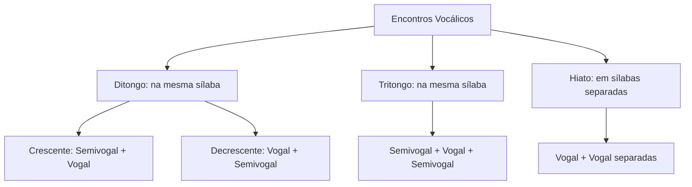
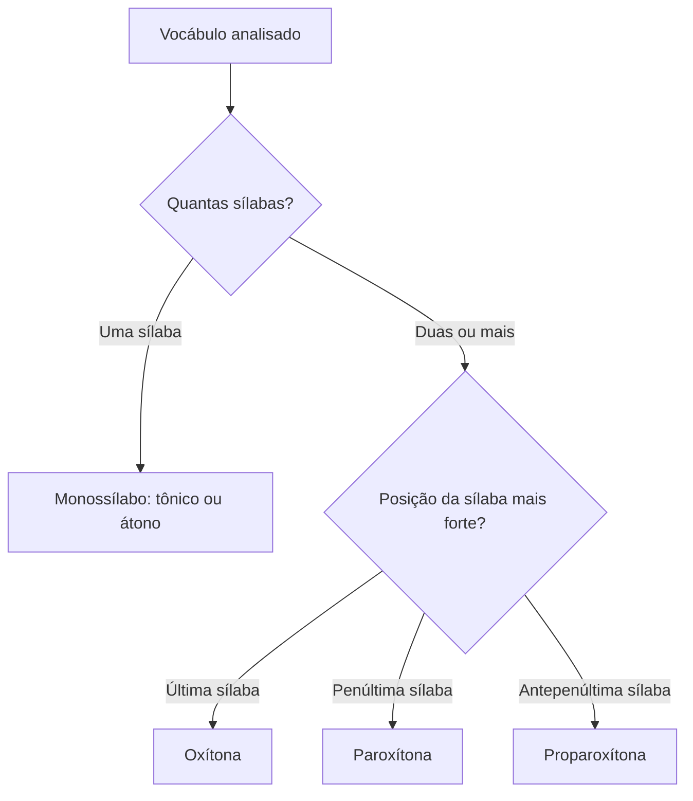
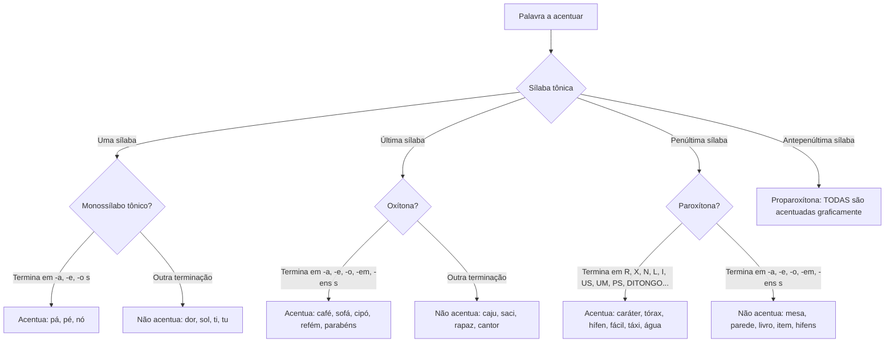

O domínio da ortografia oficial e das regras gerais de acentuação gráfica é exigência constante nas provas de concurso. Nas questões de concurso, as bancas selecionam termos extraídos de variados gêneros textuais e tipologias textuais, como textos narrativos, reportagens e artigos de opinião, para avaliar se o candidato reconhece a justificativa fonética de cada acento gráfico. Para acertar esses itens, não basta decorar regras isoladas. É indispensável compreender a estrutura sonora das palavras, distinguindo letras de fonemas, identificando encontros vocálicos e localizando com precisão a sílaba tônica. Neste capítulo, estudaremos desde a base fonética até as regras gerais de monossílabos tônicos, oxítonas, paroxítonas e proparoxítonas, incluindo a polêmica das proparoxítonas aparentes.

> [!objetivos]
> - Diferenciar fonema, letra, dígrafo e encontro consonantal, realizando a contagem exata dos sons.
> - Classificar os encontros vocálicos em ditongos, tritongos e hiatos na divisão silábica.
> - Distinguir dígrafos nasais de ditongos nasais decrescentes em final de vocábulo.
> - Aplicar com precisão as regras gerais de acentuação para monossílabos tônicos, oxítonas, paroxítonas e proparoxítonas.
> - Compreender a dupla classificação das proparoxítonas aparentes em questões de concurso.

## Fonemas, letras e dígrafos

A fala manifesta-se por sons; a escrita, por sinais visuais. Na língua portuguesa, não há correspondência exata de um para um entre as letras que escrevemos e os sons que pronunciamos.

O **fonema** é a menor unidade sonora capaz de distinguir significados entre duas palavras. Ao comparar *fogo* e *jogo*, a substituição do som inicial (/f/ por /ʒ/) produz vocábulos totalmente diferentes. A **letra** é a representação gráfica, o desenho visual do fonema. Uma mesma letra pode representar sons distintos: a letra *x* soa como /z/ em *exame*, /ks/ em *táxi*, /ʃ/ em *peixe* e /s/ em *próximo*. Do mesmo modo, o fonema /s/ pode ser grafado por *s* (*sapo*), *c* (*cedo*), *ç* (*aço*), *ss* (*massa*), *sc* (*nascer*) ou *xc* (*exceção*).

Quando duas letras unem-se para registrar um único som consonantal ou vocálico, temos um **dígrafo**. No dígrafo existem duas letras e apenas um fonema. Já no **encontro consonantal**, ocorrem duas consoantes sucessivas com sons próprios e distintos.

Os dígrafos consonantais dividem-se em inseparáveis e separáveis na divisão silábica:

| Categoria do dígrafo | Letras componentes | Exemplos na norma culta | Separação de sílabas |
| --- | --- | --- | --- |
| Inseparáveis (mesma sílaba) | ch, lh, nh, gu, qu | chave, malha, ninho, guerra, queijo | cha-ve, ma-lha, ni-nho, guer-ra, quei-jo |
| Separáveis (sílabas distintas) | rr, ss, sc, sç, xc, xs | carro, passo, nascer, desça, exceto, exsuar | car-ro, pas-so, nas-cer, des-ça, ex-ce-to, ex-su-ar |

> [!atencao] Grupo GU e QU
> Os grupos *gu* e *qu* só formam dígrafo diante de *e* ou *i* quando a letra *u* não é pronunciada (*guerra*, *guia*, *quero*, *quilo*). Se o *u* for pronunciado, como em *água*, *quase* e *cinquenta*, não há dígrafo.

O **encontro consonantal** pode ser próprio (na mesma sílaba, com consoante líquida: *prato*, *clube*, *bloco*) ou impróprio (em sílabas distintas: *ad-jun-to*, *dig-no*, *ap-to*). 

Nas questões que exigem contagem de letras e fonemas, dígrafos reduzem a quantidade de fonemas em relação às letras. A letra *h* inicial não possui som. Quando a letra *x* soa como [ks] (**dífono**), os fonemas superam as letras.

A tabela a seguir exemplifica a contagem de letras e fonemas:

| Vocábulo | Letras | Fonemas | Análise fonética |
| --- | --- | --- | --- |
| Bombeiro | 8 | 7 | Dígrafo nasal *om* (/õ/) conta como um fonema; ditongo oral *ei* |
| Resgate | 7 | 7 | Cada letra corresponde a um fonema individual |
| Chave | 5 | 4 | Dígrafo consonantal *ch* (/ʃ/) forma um som |
| Guerra | 6 | 4 | Dígrafo *gu* (/g/) e dígrafo *rr* (/r/) |
| Táxi | 4 | 5 | A letra *x* representa dois fonemas consonantais (/k/ + /s/) |
| Habilidade | 10 | 9 | O *h* inicial não possui som fonético |

> [!exemplo] Contagem fonética detalhada
> No vocábulo *quinhentos*, temos 10 letras (q-u-i-n-h-e-n-t-o-s) e divisão silábica *qui-nhen-tos*. Foneticamente, identificamos três dígrafos: *qu* antes de *i* (/k/), *nh* consonantal palatal (/ɲ/) e *en* formando vogal nasal (/ẽ/). A letra *i* é vogal oral (o *n* subsequente integra o dígrafo *nh*). Portanto, a palavra possui 7 fonemas (/k-i-ɲ-ẽ-t-u-s/).

## Encontros vocálicos e estrutura da sílaba

A estrutura da sílaba em língua portuguesa segue uma regra fixa: **toda sílaba possui uma única vogal como núcleo fonético**. Não existe sílaba sem vogal, nem sílaba com mais de uma vogal real.

Os encontros vocálicos dividem-se em três modalidades:

1. **Ditongo**: união de uma vogal e uma semivogal (sons /i/ e /u/ átonos), ou vice-versa, na mesma sílaba:
   - **Crescente**: semivogal + vogal (*pá-tria*, *á-gua*, *es-pé-cie*).
   - **Decrescente**: vogal + semivogal (*papai*, *noi-te*, *cau-sa*, *ou-ro*).
   - **Oral**: ar sai apenas pela boca (*pai*, *grau*, *céu*).
   - **Nasal**: ar sai pela boca e fossas nasais (*mãe*, *pão*, *muito*).

2. **Tritongo**: agrupamento de semivogal + vogal + semivogal na mesma sílaba. Pode ser oral (*Pa-ra-guai*, *i-guais*) ou nasal (*sa-guão*, *en-xá-guem*).

3. **Hiato**: encontro de duas vogais contíguas que pertencem a sílabas distintas (*sa-ú-de*, *pa-ís*, *ba-ú*, *ru-im*, *co-or-de-nar*). Como cada vogal exige sua própria sílaba, o hiato força a separação silábica.

O esquema abaixo sintetiza a árvore dos encontros vocálicos:

A tabela a seguir compara o comportamento dos encontros vocálicos na partição silábica:

| Encontro vocálico | Estrutura sonora | Exemplo | Divisão silábica |
| --- | --- | --- | --- |
| Ditongo crescente | Semivogal + vogal | glória | gló-ria |
| Ditongo decrescente | Vogal + semivogal | caixa | cai-xa |
| Tritongo oral | Semivogal + vogal + semivogal | Uruguai | U-ru-guai |
| Tritongo nasal | Semivogal + vogal nasal + semivogal | saguões | sa-guões |
| Hiato | Vogal + vogal em sílabas distintas | faísca | fa-ís-ca |

## Dígrafo nasal versus ditongo nasal

Uma das distinções mais cobradas em provas de ortografia é a diferença entre dígrafo nasal e ditongo nasal.

O **dígrafo vocálico nasal** ocorre no interior da sílaba quando uma vogal é seguida por *m* ou *n*, atuando essas consoantes apenas como sinal de nasalização da vogal (*canto* = /kã-tu/, *campo* = /kã-pu/, *vento* = /vẽ-tu/). Nesses casos, duas letras registram um único fonema vocálico nasal.

O **ditongo nasal decrescente** ocorre quando há uma vogal nasal associada a uma semivogal nasal na mesma sílaba. Isso ocorre com til (*mãe*, *pão*, *órgãos*) e, com frequência decisiva, em terminações ortográficas **-am**, **-em** e **-ens** em final de vocábulos (*cantam*, *falam*, *homem*, *nuvem*).

Na pronúncia culta, ao dizer *cantam*, o término soa como [kã-tãw̃]. A letra *a* é vogal nasal e a letra *m* atua como a semivogal /w̃/. Portanto, em final de palavra, a terminação *-am* não é dígrafo: trata-se de um autêntico **ditongo nasal decrescente fonético**. O mesmo ocorre em *homem*, em que a terminação *-em* soa como [õ-mẽj̃], com a vogal nasal /ẽ/ e a semivogal nasal /j̃/.

A tabela a seguir estabelece a comparação direta:

| Vocábulo | Posição do grupo | Classificação fonética | Sons representados | Contagem |
| --- | --- | --- | --- | --- |
| Canto | Interior da sílaba (*an*) | Dígrafo nasal vocálico | /kã-tu/ | 5 letras e 4 fonemas |
| Cantam | Interior (*an*) e fim (*-am*) | Dígrafo nasal + Ditongo nasal | /kã-tãw̃/ | 6 letras e 5 fonemas |
| Vento | Interior da sílaba (*en*) | Dígrafo nasal vocálico | /vẽ-tu/ | 5 letras e 4 fonemas |
| Vendem | Interior (*en*) e fim (*-em*) | Dígrafo nasal + Ditongo nasal | /vẽ-dẽj̃/ | 6 letras e 5 fonemas |

> [!pegadinha] Término verbal em -am
> As bancas costumam afirmar que a terminação verbal *-am* em *trabalham* constitui dígrafo vocálico nasal. Isso é falso. O grupo *-am* em final de palavra atua como ditongo nasal decrescente fonético (/ãw̃/), conservando a contagem de dois fonemas para duas letras. A palavra *falam* tem 5 letras e 5 fonemas.

## Fundamentos e classificação da acentuação gráfica

Acentuar graficamente uma palavra consiste em registrar um sinal diacrítico sobre a vogal da sílaba mais forte (sílaba tônica). Os sinais utilizados são o **acento agudo** (´), que assinala vogal tônica aberta ou /i/ e /u/ tônicos, e o **acento circunflexo** (^), que indica vogal tônica fechada ou nasal.

É preciso distinguir a **acentuação tônica** (propriedade fonética presente em quase todas as palavras na pronúncia) da **acentuação gráfica** (regra ortográfica que marca apenas os vocábulos determinados por convenção).

Quanto à posição da sílaba tônica, as palavras com mais de uma sílaba classificam-se em:
- **Oxítonas**: sílaba tônica na última sílaba (*ca-fé*, *re-fém*, *pa-pel*, *fe-liz*).
- **Paroxítonas**: sílaba tônica na penúltima sílaba (*li-vro*, *ca-rá-ter*, *fá-cil*, *re-lô-gio*). É o padrão de cerca de 80% do vocabulário português.
- **Proparoxítonas**: sílaba tônica na antepenúltima sílaba (*mé-di-co*, *ân-gu-lo*, *quí-mi-ca*).

Os vocábulos de uma única sílaba chamam-se **monossílabos**. Dividem-se em **átonos** (sem autonomia fonética, como preposições *de*, *em*, artigos *o*, *a* e pronomes oblíquos *me*, *se*, que nunca levam acento) e **tônicos** (com autonomia fonética e relevo sonoro próprio, como *pá*, *pé*, *nó*, *mar*, *sol*).

O diagrama abaixo sintetiza a análise da sílaba tônica:

> [!bizu] Contagem regressiva da tonicidade
> Para nunca errar em prova, identifique a sílaba tônica de trás para frente: última (oxítona), penúltima (paroxítona), antepenúltima (proparoxítona). Em português, não existem palavras cuja tonicidade recaia antes da antepenúltima sílaba.

## Regras gerais: monossílabos tônicos e oxítonas

As regras gerais de acentuação baseiam-se na economia gráfica. Como a maioria dos termos da língua é paroxítona terminada em vogais comuns, o sistema acentua os monossílabos e as oxítonas que apresentam essas terminações sonoras.

### Monossílabos tônicos

Acentuam-se os monossílabos tônicos terminados nas vogais **-a(s)**, **-e(s)** e **-o(s)**:
- Terminados em **-a(s)**: *pá*, *pás*, *chá*, *chás*, *lá*, *má*, *más*.
- Terminados em **-e(s)**: *pé*, *pés*, *fé*, *mês*, *três*, *dê*, *vê*.
- Terminados em **-o(s)**: *pó*, *pós*, *dó*, *nó*, *nós*, *só*, *sós*.

Monossílabos tônicos terminados em *-i(s)*, *-u(s)* ou consoantes não recebem acento pela regra geral (*ti*, *si*, *quis*, *tu*, *cru*, *mar*, *sol*, *dor*, *paz*, *voz*).

### Oxítonas

Acentuam-se as palavras oxítonas terminadas em:
1. **-a(s)**: *so-fá*, *so-fás*, *gu-a-ra-ná*, *a-trás*, *es-tá*.
2. **-e(s)**: *ca-fé*, *ca-fés*, *ja-ca-ré*, *vo-cê*, *a-té*.
3. **-o(s)**: *ci-pó*, *ci-pós*, *a-vô*, *a-vós*, *pa-le-tó*.
4. **-em** e **-ens** (em vocábulos de duas ou mais sílabas): *al-guém*, *tam-bém*, *re-fém*, *ar-ma-zém*, *pa-ra-béns*, *vin-téns*, *ar-ma-zéns*.

Oxítonas terminadas em *-i(s)* ou *-u(s)* não levam acento gráfico geral (*saci*, *abacaxi*, *urubu*, *caju*), salvo se incidirem na regra especial dos hiatos (*baú*, *açaí*). Oxítonas terminadas em outras consoantes também não são acentuadas (*quartel*, *rapaz*, *cantor*).

Nas formas verbais associadas a pronomes enclíticos (*-lo*, *-la*), isola-se o verbo para aplicar a regra:
- *amar* + *o* = *amá-lo* (oxítona terminada em *-a*).
- *vender* + *o* = *vendê-lo* (oxítona terminada em *-e*).
- *repor* + *o* = *repô-lo* (oxítona terminada em *-o*).
- *partir* + *o* = *parti-lo* (oxítona terminada em *-i*, sem acento).

A tabela abaixo compara monossílabos tônicos e oxítonas:

| Classe posicional | Terminações acentuadas | Terminações sem acento | Exemplos acentuados | Exemplos sem acento |
| --- | --- | --- | --- | --- |
| Monossílabos tônicos | -a(s), -e(s), -o(s) | -i(s), -u(s), consoantes | chá, fé, nó, três | ti, tu, dor, paz, sol |
| Oxítonas | -a(s), -e(s), -o(s), -em, -ens | -i(s), -u(s), consoantes | sofá, café, cipó, refém, parabéns | rubi, urubu, quartel, cantar, rapaz |

> [!pegadinha] Monossílabo tônico não é oxítona
> As bancas costumam afirmar que vocábulos como *três* e *até* recebem acento pela mesma regra. A afirmação é errada: *três* é monossílabo tônico terminado em *-es*; *até* é oxítona terminada em *-e*. São duas regras gramaticais independentes.

## Regras gerais: paroxítonas

A acentuação das paroxítonas funciona como regra inversa e residual das oxítonas. Como a maior parte das palavras do português é paroxítona terminada em *-a(s)*, *-e(s)*, *-o(s)*, *-em* e *-ens*, tais terminações comuns **não recebem acento**. Acentuam-se somente as paroxítonas que possuem terminações diferenciadas:

1. **-r**: *re-pór-ter*, *ca-dá-ver*, *a-çú-car*, *lí-der*, *ca-rá-ter*.
2. **-x**: *tó-rax*, *fê-nix*, *clí-max*, *cór-tex*.
3. **-n**: *pó-len*, *hí-fen*, *é-den*, *ab-dô-men*, *cá-non*.
4. **-l**: *fá-cil*, *di-fí-cil*, *a-má-vel*, *in-crí-vel*, *fós-sil*.
5. **-i** e **-is**: *jú-ri*, *tá-xi*, *lá-pis*, *tê-nis*, *grá-tis*.
6. **-us**: *ví-rus*, *vê-nus*, *hú-mus*, *â-nus*.
7. **-ps**: *bí-ceps*, *trí-ceps*, *fór-ceps*.
8. **-um** e **-uns**: *ál-bum*, *ál-buns*, *fó-rum*, *fó-runs*.
9. **-on** e **-ons**: *í-on*, *í-ons*, *pró-ton*, *pró-tons*, *nêu-tron*.
10. **-ã(s)** e **-ão(s)**: *ór-fã*, *ór-fãs*, *ím-ã*, *ím-ãs*, *ór-gão*, *ór-gãos*, *só-tão*, *bên-ção*.
11. **Ditongo oral** (crescente ou decrescente, seguido ou não de s): *á-gua*, *má-goa*, *sê-rie*, *his-tó-ria*, *ví-cio*, *fá-ceis*, *tú-neis*, *jó-quei*.

A tabela a seguir organiza as terminações das paroxítonas:

| Terminação | Exemplos representativos | Justificativa |
| --- | --- | --- |
| R, X, N, L | açúcar, tórax, pólen, amável | Consoantes do mnemônico R-O-U-X-I-N-O-L |
| I, IS, US | júri, lápis, bônus, vírus | Vogais fechadas e plurais |
| UM, UNS, ON, ONS | fórum, álbuns, próton, elétrons | Terminações eruditas |
| Ã, ÃS, ÃOS | órfã, ímãs, sótão, bênçãos | Vogais e ditongos nasais acentuados na penúltima |
| PS | bíceps, tríceps, fórceps | Consoante muda final |
| Ditongo oral | glória, série, vácuo, móveis | Encontro vocálico final |

Dois pontos exigem alerta rigoroso: a terminação em *-en* e os ditongos abertos.

### O caso de hífen e pólen no plural

No singular, *hí-fen*, *pó-len* e *ab-dô-men* terminam na consoante *-n*, recebendo acento como paroxítonas em *-n*. No plural regular, terminam em **-ens**: *hi-fens*, *po-lens*, *ab-do-mens*. Como paroxítonas em *-ens* não são acentuadas (como *itens*, *nuvens*, *homens*), o plural perde o acento.

> [!atencao] Hífen tem acento; hifens não tem
> - *Hí-fen* (singular em -n): **tem acento**.
> - *Hi-fens* (plural em -ens): **não tem acento**.
> - *Pó-len* (singular em -n): **tem acento**.
> - *Po-lens* (plural em -ens): **não tem acento**.
> - *I-tem* e *i-tens*: nenhum recebe acento, pois paroxítonas em *-em* e *-ens* não levam acento.

### Ditongos abertos em paroxítonas

Pelo Acordo Ortográfico vigente (Decreto nº 6.583/2008), foi eliminado o acento agudo nos ditongos abertos **-ei-** e **-oi-** em **paroxítonas**:
- *ideia*, *plateia*, *colmeia*, *estreia*, *assembleia*, *coreia*.
- *jiboia*, *heroico*, *boia*, *joia*, *paranoico*, *androide*, *asteroide*.

> [!atencao] Oxítonas com ditongo aberto mantêm acento
> A supressão do acento ocorreu apenas em palavras **paroxítonas**. Nas **oxítonas** e nos **monossílabos tônicos**, o acento permanece obrigatório: *herói*, *corrói*, *destrói*, *pastéis*, *anéis*, *troféus*, *céu*, *réu*, *véu*, *dói*.

## Regras gerais: proparoxítonas

A regra das proparoxítonas é a mais simples e não possui exceções: **todas as palavras proparoxítonas são acentuadas graficamente**.

Basta que a sílaba tônica recaia na antepenúltima sílaba para que o acento gráfico seja imperativo, independentemente da terminação:
- Com acento agudo (vogal aberta ou /i/, /u/): *mé-di-co*, *pá-gi-na*, *fí-si-ca*, *quí-mi-ca*, *ár-vo-re*, *ú-ni-co*, *pú-bli-co*.
- Com acento circunflexo (vogal fechada ou nasal): *lâm-pa-da*, *câ-ma-ra*, *ân-gu-lo*, *es-tô-ma-go*, *fô-le-go*.

A regra da proparoxítona prevalece sobre qualquer outra consideração estrutural.

> [!exemplo] Termos operacionais e militares
> O vocabulário de segurança pública e defesa civil traz diversas proparoxítonas acentuadas: *bé-li-co*, *tá-ti-co*, *e-xér-ci-to*, *quí-mi-co*, *pâ-ni-co*.

## Proparoxítonas aparentes ou eventuais

Vocábulos terminados em encontros vocálicos átonos pós-tônicos (-ia, -ie, -io, -oa, -ua, -uo), como *his-tó-ria*, *po-lí-cia*, *in-fân-cia*, *sé-rie*, *relógio*, *água* e *vácuo*, suscitam dupla análise:
1. **Ditongo crescente**: as duas letras finais integram a mesma sílaba (*his-tó-ria*, *po-lí-cia*). A sílaba tônica é a penúltima, configurando **paroxítona terminada em ditongo oral crescente**.
2. **Hiato atenuado**: a vogal final constitui sílaba própria na emissão pausada (*his-tó-ri-a*, *po-lí-ci-a*). A sílaba tônica recai na antepenúltima, comportando-se como **proparoxítona eventual ou aparente**.

O Acordo Ortográfico prevê a acentuação dessas palavras reconhecendo a possibilidade de serem tidas como proparoxítonas relativas por terminarem em encontros vocálicos pós-tônicos. Gramáticos como Domingos Paschoal Cegalla apontam que, embora ambas as pronúncias ocorram, é preferível classificá-las como paroxítonas terminadas em ditongo.

A tabela abaixo compara as duas interpretações:

| Vocábulo | Análise 1 (Regra geral) | Análise 2 (Teoria aparente) | Classificação posicional |
| --- | --- | --- | --- |
| História | his-tó-ria (ditongo crescente) | his-tó-ri-a (hiato atenuado) | Paroxítona / Proparoxítona aparente |
| Polícia | po-lí-cia (ditongo crescente) | po-lí-ci-a (hiato atenuado) | Paroxítona / Proparoxítona aparente |
| Série | sé-rie (ditongo crescente) | sé-ri-e (hiato atenuado) | Paroxítona / Proparoxítona aparente |
| Relógio | re-ló-gio (ditongo crescente) | re-ló-gi-o (hiato atenuado) | Paroxítona / Proparoxítona aparente |
| Vácuo | vá-cuo (ditongo crescente) | vá-cu-o (hiato atenuado) | Paroxítona / Proparoxítona aparente |

Nas provas de concurso:
- Em regra, classifique esses vocábulos como **paroxítonas terminadas em ditongo oral**, que é a posição predominante em provas.
- Vocábulos desse grupo (*memória*, *notícia*, *glória*) recebem acento pela mesma regra sob qualquer das perspectivas teóricas.
- Em confronto com proparoxítonas puras (*médico*, *lâmpada*), considere regras diferentes, a menos que a questão mencione expressamente a teoria das proparoxítonas eventuais.

> [!pegadinha] Confronto entre regras distintas
> É armadilha comum em provas agrupar palavras que parecem semelhantes na terminação ou extensão gráfica, mas que obedecem a regras diferentes. Por exemplo, em uma assertiva que reúna *práticas*, *críticas* e *urgências*, a afirmação de que todas compartilham a mesma regra de acentuação é incorreta: *práticas* e *críticas* são proparoxítonas autênticas (sílaba tônica na antepenúltima), ao passo que *urgências* é paroxítona terminada em ditongo oral crescente (*ur-gên-cia*).

## Mapa do capítulo

O diagrama a seguir sintetiza o sistema de regras gerais de acentuação:

A tabela abaixo resume as regras gerais de acentuação:

| Posição tônica | Terminações acentuadas | Terminações sem acento | Alertas para a prova |
| --- | --- | --- | --- |
| Monossílabo tônico | -a(s), -e(s), -o(s) | -i(s), -u(s), consoantes | Monossílabos átonos (*de*, *me*, *se*) nunca levam acento |
| Oxítona | -a(s), -e(s), -o(s), -em, -ens | -i(s), -u(s), consoantes em geral | Em verbos com enclise (*amá-lo*), examine a terminação verbal sem o pronome |
| Paroxítona | R, X, N, L, I(s), U(s), PS, UM(ns), ON(s), ÃO(s), Ã(s), ditongos | -a(s), -e(s), -o(s), -em, -ens | *Hífen* leva acento, mas *hifens* não leva. Ditongos abertos (*ideia*) perderam acento |
| Proparoxítona | Todas são acentuadas | Nenhuma exceção | Termos como *polícia* e *história* são cobrados como paroxítonas em ditongo |

### Para fixar

- Fonema é unidade sonora distintiva; letra é sua representação gráfica.
- Dígrafo reúne duas letras para representar um único som; encontro consonantal preserva dois sons consonantais distintos.
- Verbos terminados em *-am* (*falam*, *cantam*) possuem ditongo nasal decrescente fonético final (/ãw̃/), e não dígrafo vocálico.
- Monossílabos tônicos são acentuados nas terminações *-a(s)*, *-e(s)* e *-o(s)*.
- Oxítonas são acentuadas nas terminações *-a(s)*, *-e(s)*, *-o(s)*, *-em* e *-ens*.
- Paroxítonas são acentuadas nas terminações que não coincidem com as oxítonas: R, X, N, L, I(s), U(s), PS, UM(ns), ÃO(s), ditongos orais.
- *Hífen* e *pólen* recebem acento no singular (terminação -n), mas perdem o acento no plural *hifens* e *polens* (terminação -ens).
- Ditongos abertos *-ei-* e *-oi-* perderam o acento em paroxítonas (*ideia*, *jiboia*), mantendo-o em oxítonas e monossílabos (*herói*, *pastéis*, *céu*).
- Todas as proparoxítonas são acentuadas sem exceção.
- Vocábulos com ditongo crescente final (*polícia*, *história*) são classificados pelas bancas como paroxítonas terminadas em ditongo oral, sendo proparoxítonas aparentes apenas alternativamente.
