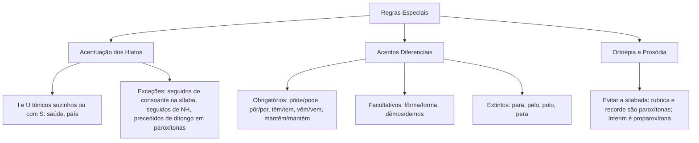

O domínio pleno da acentuação gráfica exige ir além das regras gerais das oxítonas, paroxítonas e proparoxítonas. As bancas de concursos públicos cobram frequentemente esse tema. Essas questões integram as provas de compreensão e interpretação de texto. Nelas, o examinador avalia itens extraídos de diferentes gêneros textuais e tipologias textuais, como reportagens e crônicas. O candidato deve justificar por que palavras de pronúncia semelhante recebem ou não sinal diacrítico. Essas cobranças envolvem a acentuação dos hiatos tônicos, os acentos diferenciais e os problemas de ortoépia e prosódia. Neste capítulo, estudaremos a regra dos hiatos e suas restrições, o sistema de acentos diferenciais e a prosódia correta para a sua prova.

> [!objetivos]
> - Aplicar a regra especial de acentuação dos hiatos tônicos formados por I e U.
> - Reconhecer as exceções em que as vogais I e U em hiato não recebem acento gráfico.
> - Dominar os acentos diferenciais obrigatórios, facultativos e os casos extintos pelo Acordo Ortográfico.
> - Identificar a prosódia e a sílaba tônica exata de vocábulos comuns em provas.

## Acentuação gráfica dos hiatos

A regra do hiato é muito cobrada em concursos. Sua finalidade fonética é sinalizar que as letras *i* e *u* formam o ápice silábico. Elas não formam ditongo com a vogal anterior.

A regra prescreve que se acentuam com acento agudo as vogais **i** e **u** tônicas em **hiato** com a vogal precedente. Para isso, devem estar **sozinhas na sílaba** ou **acompanhadas unicamente da consoante s**.

Exemplos clássicos de aplicação direta:
- *Sa-ú-de*: a letra *u* é tônica, forma hiato com a vogal *a* anterior e figura isolada na sílaba.
- *Pa-ís*: a letra *i* é tônica, forma hiato com *a* e está acompanhada de *s*.
- *Sa-í-da*, *ba-ú*, *ci-ú-me*, *fa-ís-ca*, *re-ú-ne*, *ju-í-zo*, *ca-fe-í-na*, *gra-ú-do*.

Para que o acento seja colocado, todos os requisitos precisam coexistir. Existem quatro situações restritivas em que o *i* ou o *u* tônico em hiato **não recebe acento gráfico**:

1. **Quando o I ou U tônico vem seguido na mesma sílaba de outra consoante diferente de S**:
   Se a vogal tônica estiver com consoantes como *l*, *m*, *n*, *r* ou *z* na mesma sílaba, o acento não é empregado.
   Exemplos: *ju-iz* (o *i* divide a sílaba com *z*), *ru-im* (divide a sílaba com *m*), *Ra-ul* (com *l*), *ca-ir* (com *r*), *a-in-da* (com *n*). 
   Ao flexionar *juiz* no plural, temos *ju-í-zes*. A letra *i* fica sozinha na sílaba e recebe acento obrigatoriamente.

2. **Quando o I tônico é seguido pelo dígrafo NH na sílaba seguinte**:
   O dígrafo *nh* projeta uma ressonância nasal sobre o *i* anterior. Isso torna desnecessário o acento gráfico.
   Exemplos: *ra-i-nha*, *mo-i-nho*, *ba-i-nha*, *cam-pa-i-nha*, *ta-i-nha*.

3. **Quando o I ou U tônico é precedido de ditongo decrescente em palavras paroxítonas**:
   Esta foi uma alteração relevante do Acordo Ortográfico (Decreto nº 6.583/2008). O acento foi abolido quando o *i* ou *u* tônico em hiato surge após ditongo decrescente em palavra paroxítona.
   Exemplos: *fei-u-ra*, *bai-u-ca*, *bo-cai-u-va*, *sau-i-pe*, *chei-i-nho*.
   Atenção: essa exceção atinge somente palavras paroxítonas. Na palavra **oxítona**, o *i* ou *u* final após ditongo mantém o acento: *Piauí* (Pi-au-í), *tuiuiú* (tui-ui-ú), *teiú* (tei-ú). Se o ditongo for crescente, o acento também é mantido: *Guaíba* (Gua-í-ba), *Guaíra* (Gua-í-ra).

4. **Hiatos formados por vogais dobradas EE e OO**:
   O Acordo Ortográfico extinguiu o acento circunflexo nos hiatos com as vogais repetidas *ee* e *oo*:
   - Formas verbais com *ee*: *leem*, *creem*, *deem*, *veem*, *releem*, *descreem*, *preveem*.
   - Substantivos e verbos com *oo*: *voo*, *enjoo*, *zoo*, *perdoo*, *abençoo*, *magoo*.

A tabela a seguir consolida a regra dos hiatos e suas restrições:

| Estrutura fonética | Condição de acentuação | Exemplos com acento | Exemplos sem acento |
| --- | --- | --- | --- |
| I ou U tônico isolado ou com S | Regra geral dos hiatos | saída, baú, faísca, país | juiz, ruim, Raul, cair, ainda |
| I tônico seguido de NH | Restrição por nasalização | — | rainha, moinho, bainha |
| I ou U após ditongo decrescente | Sem acento em paroxítona; acento em oxítona | Piauí, tuiuiú (oxítonas) | feiura, baiuca, sauipe (paroxítonas) |
| Vogais idênticas repetidas (EE, OO) | Acento extinto pelo Acordo | — | leem, creem, voo, enjoo |

> [!pegadinha] Juiz versus juízes e raiz versus raízes
> Uma armadilha clássica de prova consiste em afirmar que *juiz* e *juízes* recebem o mesmo tratamento gráfico. Em *ju-iz*, o *i* divide a sílaba com a consoante *z*, ficando sem acento. Em *ju-í-zes*, a divisão silábica isola o *i* tônico, que passa a receber acento pela regra do hiato. O mesmo fenômeno ocorre no par *ra-iz* (sem acento) e *ra-í-zes* (com acento).

## Acentos diferenciais vigentes

O **acento diferencial** é um sinal diacrítico empregado para distinguir palavras homógrafas (que possuem a mesma grafia). Ele diferencia o significado léxico, a classe gramatical ou o tempo verbal.

Com o Acordo Ortográfico, a maioria dos acentos diferenciais foi extinta. O objetivo foi simplificar a ortografia. Foram eliminados sinais que não provocavam ambiguidade real no contexto. Restam poucos casos obrigatórios e facultativos. Eles devem ser dominados rigorosamente para a prova.

### Acentos diferenciais obrigatórios

Permanecem como acentos diferenciais de uso estritamente obrigatório:

1. **Pôde versus pode**:
   Distingue a forma verbal no tempo passado do tempo presente:
   - **Pôde** (com acento circunflexo, vogal fechada /o/): 3ª pessoa do singular do pretérito perfeito do indicativo. Exemplo: *O militar não pôde comparecer à chamada ontem*.
   - **Pode** (sem acento, vogal aberta /ɔ/): 3ª pessoa do singular do presente do indicativo. Exemplo: *O candidato pode realizar a prova agora*.

2. **Pôr versus por**:
   Distingue a forma verbal da preposição monossilábica:
   - **Pôr** (verbo no infinitivo, com acento circunflexo): sinônimo de colocar, depositar, aplicar. Exemplo: *É necessário pôr os equipamentos em ordem*.
   - **Por** (preposição átona, sem acento): indica meio, causa, caminho. Exemplo: *O comboio seguiu por estradas secundárias*.

3. **Verbos ter e vir (e formas primitivas)**:
   Marcam a concordância de número entre a terceira pessoa do singular e a terceira pessoa do plural do presente do indicativo:
   - Singular (sem acento): *Ele tem paciência*; *Ela vem ao quartel*.
   - Plural (com acento circunflexo): *Eles têm paciência*; *Elas vêm ao quartel*.

4. **Derivados de ter e vir**:
   Verbos derivados como *manter*, *conter*, *obter*, *reter*, *intervir*, *convir* e *provir* possuem duas ou mais sílabas e são palavras oxítonas na terceira pessoa do indicativo:
   - No singular, recebem acento agudo por serem oxítonas terminadas em *-em*: *ele mantém*, *ele intervém*, *o laudo contém*, *a decisão convém*.
   - No plural, recebem acento circunflexo como marca diferencial de número: *eles mantêm*, *eles intervêm*, *os laudos contêm*, *as decisões convêm*.

### Acentos diferenciais facultativos

O Acordo Ortográfico prevê dois casos específicos em que o emprego do acento diferencial é facultativo, ficando a critério do redator:
- **Fôrma / forma**: pode-se grafar *fôrma* (com circunflexo) para o substantivo que indica molde ou vasilha de preparo, a fim de diferenciá-lo de *forma* (feitio, modo ou verbo formar). Exemplo: *A fôrma do bolo estava torta*. O uso do acento é opcional.
- **Dêmos / demos**: pode-se utilizar acento circunflexo em *dêmos* (1ª pessoa do plural do presente do subjuntivo: *oxalá dêmos o nosso melhor*) para distinguir de *demos* (pretérito perfeito do indicativo: *ontem nós demos início ao treinamento*).

### Acentos diferenciais extintos pelo Acordo

Constitui erro grave na prova grafar com acento as palavras cujos diferenciais foram abolidos pelo Acordo Ortográfico:
- **Para** (verbo parar): não leva acento. Exemplo: *A viatura não para no semáforo*.
- **Pela** e **pelo** (formas verbais ou substantivos): não levam acento (*pelo* de animal, *pela* do verbo pelar).
- **Polo** (o jogo esportivo ou extremidade geográfica): não leva acento. Exemplo: *Polo Norte*, *polo de desenvolvimento*.
- **Pera** (o fruto): não leva acento.

A tabela a seguir sintetiza o panorama dos acentos diferenciais:

| Modalidade | Vocábulos e grafias | Função gramatical | Exemplo na norma culta |
| --- | --- | --- | --- |
| Obrigatório | pôde / pode | Distinção temporal (pretérito perfeito x presente) | Ele pôde agir ontem; hoje não pode |
| Obrigatório | pôr / por | Distinção de classe (verbo infinitivo x preposição) | Convém pôr atenção ao passar por ali |
| Obrigatório | têm / tem | Diferencial de número (eles têm x ele tem) | O oficial tem voz ativa; eles têm disciplina |
| Obrigatório | vêm / vem | Diferencial de número (eles vêm x ele vem) | O socorrista vem cedo; eles vêm juntos |
| Obrigatório | mantêm / mantém | Diferencial de número em oxítonas derivadas | O comandante mantém; os oficiais mantêm |
| Facultativo | fôrma / forma | Distinção semântica entre molde e feitio | Coloque a massa na fôrma correta |
| Extinto | para, pelo, polo, pera | Acentos eliminados pelo Acordo Ortográfico | O tráfego para no cruzamento do polo |

> [!atencao] Singular e plural nos derivados de ter e vir
> Não confunda verbos primitivos (*tem* sem acento / *têm* com circunflexo) com derivados (*manter*, *reter*, *intervir*). Os derivados possuem duas sílabas e terminam em *-em*. Por isso, o singular leva **acento agudo** pela regra geral das oxítonas (*mantém*, *retém*, *intervém*). O plural leva **acento circunflexo** como diferencial de número (*mantêm*, *retêm*, *intervêm*).

## Ortoépia e prosódia em concursos

A acentuação correta pressupõe o conhecimento prévio da sílaba tônica real na norma culta. Muitas questões exploram vocábulos de pronúncia vacilante no cotidiano. O examinador verifica se o candidato sabe onde recai a tonicidade.

A **ortoépia** cuida da pronúncia correta dos fonemas e da articulação dos sons. A **prosódia** cuida da exata localização da sílaba tônica. O erro na posição da sílaba tônica chama-se **silabada**. Por exemplo, pronunciar *rúbrica* como proparoxítona em vez de *ru-bri-ca* (paroxítona) é uma silabada muito comum.

A seguir, organizamos os vocábulos de maior relevância em concursos, conforme sua tonicidade culta:

### Oxítonas frequentes em provas

Palavras oxítonas que costumam ser erradamente pronunciadas como paroxítonas:
- *aloés*, *cateter*, *Cister*, *Gibraltar*, *harém*, *mister* (necessário), *Nobel*, *novel* (principiante), *recém*, *refém*, *ruim*, *sutil*, *ureter*.

### Paroxítonas frequentes em provas

Palavras paroxítonas que muitos candidatos pronunciam como proparoxítonas:
- *acórdão*, *âmbar*, *avaro* (sovina), *aziago*, *cânon*, *caracteres* (o plural de caráter é *ca-rac-te-res*, sem acento), *ciclope*, *edito* (ordem judicial), *epifania*, *exegese*, *filantropo*, *ibero*, *inaudito*, *látex*, *misantropo*, *necropsia*, *pudico*, *recorde* (sem acento), *rubrica* (sem acento).

Atenção aos vocábulos com o ditongo oral decrescente **ui**:
- *gratuito* (gra-tui-to): o encontro *ui* forma ditongo, não hiato. A sílaba tônica é *tui*, sem acento.
- *fortuito* (for-tui-to): ditongo decrescente, sem acento.
- *circuito* (cir-cui-to): ditongo decrescente, sem acento.
- *fluido* (flui-do): substantivo ou adjetivo com ditongo, sem acento.

### Proparoxítonas frequentes em provas

Palavras cuja sílaba tônica recai na antepenúltima e que recebem acento obrigatório:
- *aeródromo*, *aerólito*, *álcool*, *álibi*, *âmago*, *amálgama*, *antídoto*, *arquétipo*, *autóctone*, *brâmane*, *crisântemo*, *década*, *êxodo*, *fac-símile*, *ídolo*, *ímprobo*, *ínclito*, *ínterim*, *máxime*, *protótipo*, *vândalo*.

### Palavras com dupla prosódia aceita

Palavras que admitem na norma culta duas pronúncias e grafias legítimas:
- *acróbata* (proparoxítona) ou *acrobata* (paroxítona).
- *projétil* (paroxítona) ou *projetil* (oxítona).
- *réptil* (paroxítona) ou *reptil* (oxítona).
- *xérox* (paroxítona) ou *xerox* (oxítona).
- *zângão* (paroxítona) ou *zangão* (oxítona).
- *homilia* (paroxítona) ou *homília* (proparoxítona).
- *oceânia* (proparoxítona) ou *oceania* (paroxítona).

A tabela abaixo organiza o guia rápido de prosódia para consulta:

| Tonicidade padrão | Vocábulos cobrados em prova | Erro comum a evitar (silabada) |
| --- | --- | --- |
| Oxítonas | cateter, mister, ruim, Nobel, ureter | Pronunciar como paroxítonas (*catéter*, *míster*) |
| Paroxítonas | rubrica, recorde, pudico, gratuito, avaro | Pronunciar como proparoxítonas (*rúbrica*, *récorde*, *púdico*) |
| Proparoxítonas | ínterim, arquétipo, autóctone, aerólito | Pronunciar como paroxítonas (*interim*, *arquetipo*) |
| Dupla prosódia | projétil/projetil, réptil/reptil, acrobata/acróbata | Considerar errada a forma variante aceita |

> [!bizu] O quarteto dos falsos hiatos com UI
> Fixe o quarteto *gratuito*, *fortuito*, *circuito* e *fluido*. Nenhuma dessas palavras recebe acento gráfico. O grupo *ui* é ditongo decrescente fonético pronunciado junto. A pronúncia correta rima com *muito* (gra-tui-to).

## Confronto entre regras e questões de prova

Em provas de concurso, a banca reúne palavras de categorias distintas e indaga se compartilham a mesma justificativa gramatical.

Observe as justificativas corretas de cada caso:
- Vocábulos como *saúde* e *país* justificam-se pela **regra especial do hiato tônico**.
- Vocábulos como *café* e *parabéns* justificam-se pela **regra geral das oxítonas**.
- Vocábulos como *amável* e *tórax* justificam-se pela **regra geral das paroxítonas**.
- Vocábulos como *médico* e *analítica* justificam-se pela **regra das proparoxítonas**.
- Vocábulos como *pôde* e *têm* justificam-se pela **regra dos acentos diferenciais**.

> [!exemplo] Análise de questão comentada
> Observe a análise de quatro vocábulos extraídos de um texto oficial:
> 1. *Países*: acentuado pela regra dos hiatos tônicos (*pa-í-ses*).
> 2. *Pôde*: acentuado por acento diferencial de tempo verbal em relação a *pode*.
> 3. *Analíticas*: acentuado pela regra das proparoxítonas.
> 4. *Língua*: acentuado pela regra geral das paroxítonas terminadas em ditongo oral crescente.
> Caso a banca pergunte se *analíticas* e *língua* recebem acento pela mesma regra, a resposta é negativa. As bancas examinadoras tratam paroxítonas terminadas em ditongo como regra autônoma, sem confundi-las com proparoxítonas puras.

## Mapa do capítulo

O esquema visual abaixo consolida as regras especiais estudadas:

A tabela abaixo resume os pontos determinantes para a prova:

| Assunto | Regra principal | Atenção à prova |
| --- | --- | --- |
| Hiato tônico | Acentuam-se I e U tônicos em hiato sozinhos ou com S | *Juiz* e *raiz* não levam acento; *juízes* e *raízes* levam. *Feiura* perdeu o acento |
| Hiatos EE e OO | Não se acentuam hiatos com vogais dobradas | *Leem*, *veem*, *creem*, *voo*, *enjoo* perderam o circunflexo |
| Acentos diferenciais | Obrigatórios em *pôde*, *pôr*, *têm*, *vêm* e derivados no plural | Não confunda *tem* (sem acento) com *mantém* (oxítona singular com agudo) |
| Acentos extintos | Extintos em *para* (verbo), *pelo*, *polo*, *pera* | Bancas cobram formas desatualizadas para induzir a erro |
| Falsos hiatos com UI | *Gratuito*, *fortuito*, *circuito*, *fluido* são ditongos | Nunca acentue esses vocábulos na norma culta |

### Para fixar

- Acentuam-se as vogais I e U tônicas que formam hiato com a vogal anterior, isoladas na sílaba ou acompanhadas unicamente de S (*saúde*, *país*).
- Não se acentuam I e U tônicos seguidos na mesma sílaba de outra consoante (*juiz*, *ruim*, *Raul*).
- O I tônico seguido do dígrafo NH na sílaba subsequente não recebe acento gráfico (*rainha*, *moinho*).
- Vocábulos paroxítonos com I e U tônicos precedidos de ditongo decrescente perderam o acento (*feiura*, *sauipe*), mas oxítonas mantêm o acento (*Piauí*).
- Hiatos com vogais repetidas EE e OO não recebem acento gráfico (*leem*, *veem*, *voo*, *enjoo*).
- O acento circunflexo diferencial é obrigatório em *pôde* (pretérito), *pôr* (verbo), *têm* e *vêm* (plurais de ter e vir).
- Formas derivadas de ter e vir recebem acento agudo no singular (*mantém*, *intervém*) e circunflexo no plural (*mantêm*, *intervêm*).
- Foram extintos os acentos diferenciais de *para* (verbo), *pelo*, *polo* e *pera*.
- Vocábulos como *rubrica*, *recorde*, *pudico* e *gratuito* são paroxítonos sem acento gráfico.
- *Ínterim*, *arquétipo* e *aerólito* são proparoxítonos com acento obrigatório.
