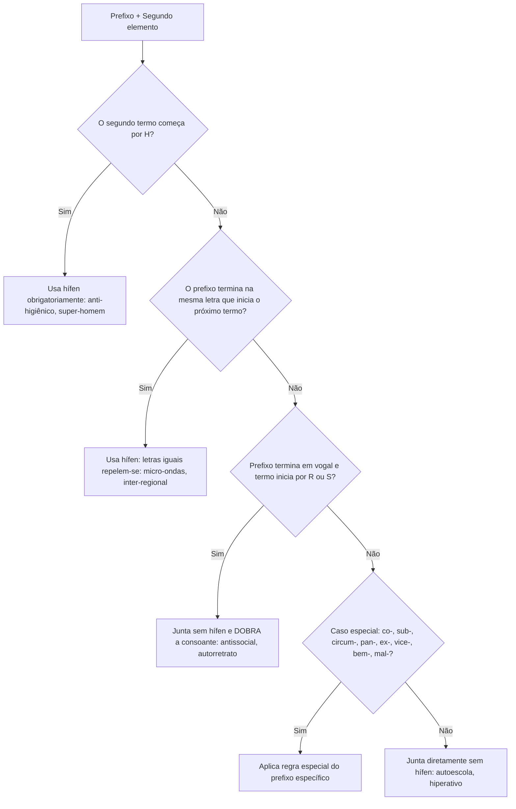

O emprego do hífen constitui um dos temas mais alterados pelo Acordo Ortográfico vigente (Decreto nº 6.583/2008). Por essa razão, figura com frequência nas provas de concurso. O domínio da ortografia oficial é cobrado em questões de compreensão e interpretação de texto. Os enunciados extraem vocábulos de variados gêneros textuais e tipologias textuais para avaliar a precisão do candidato. Nessas questões, examinam-se os processos de formação de palavras e a grafia de termos compostos e derivados. Para acertar os itens de prova, é preciso compreender a lógica morfofonológica da união de prefixos e radicais. Neste capítulo, abordaremos a derivação prefixal e a composição, as regras gerais do hífen, as locuções e os compostos que perderam a noção de composição.

> [!objetivos]
> - Compreender a distinção entre derivação prefixal e composição na formação de vocábulos.
> - Aplicar o princípio geral do hífen em prefixos: letras iguais se repelem com hífen; letras diferentes se unem.
> - Dominar a regra da duplicação de R e S após prefixos terminados em vogal.
> - Conhecer as regras específicas dos prefixos sub-, circum-, pan-, bem-, mal- e dos prefixos com hífen fixo.
> - Identificar as locuções que perderam o hífen e as exceções consagradas pela norma culta.

## Processos de formação de palavras e a função do hífen

Para compreender o emprego do hífen, convém analisar como as palavras se formam no idioma. Existem dois processos fundamentais que utilizam o hífen: a **derivação prefixal** e a **composição**.

Na **derivação prefixal**, adiciona-se um afixo (prefixo) antes de um radical primitivo. O prefixo não possui autonomia vocabular isolada. Ele apenas agrega valor semântico de oposição, repetição, intensidade ou posição (*re-fazer*, *anti-inflamatório*, *sub-região*).

Na **composição**, unem-se dois ou mais radicais com sentido próprio no léxico para formar um novo vocábulo com significado único. A composição pode ocorrer por:
1. **Justaposição**: os radicais juntam-se sem perda de elementos fonéticos nem alteração em sua pronúncia individual. Exemplos: *guarda-chuva*, *arco-íris*, *pé-de-meia*, *passatempo*, *pontapé*. Quando os elementos mantêm individualidade morfológica e fonética, emprega-se o hífen.
2. **Aglutinação**: os radicais fundem-se com perda ou alteração de fonemas, havendo subordinação a um único acento tônico principal. Exemplos: *planalto* (plano + alto), *lobisomem* (lobo + homem), *vinagre* (vinho + acre), *petróleo* (pedra + óleo). Palavras aglutinadas nunca utilizam hífen.

O **hífen** é um sinal gráfico que atua como separador mórfico. Sua função é delimitar fronteiras entre unidades mórficas. Ele facilita a identificação fonética e evita ambiguidades de pronúncia.

A tabela abaixo compara os processos de formação de palavras que envolvem ou dispensam o hífen:

| Processo formativo | Mecanismo de união | Comportamento fonético | Exemplos com ou sem hífen |
| --- | --- | --- | --- |
| Derivação prefixal | Prefixo + Radical | Ajusta-se conforme a letra de contato | anti-inflamatório (com hífen) / autoescola (sem hífen) |
| Composição por justaposição | Radical + Radical | Cada termo mantém sua estrutura | tenente-coronel, guarda-roupa, porta-voz (com hífen) |
| Composição com perda de noção | Radical + Radical | Sentido unificado e perda de autonomia | mandachuva, girassol, paraquedas (sem hífen) |
| Composição por aglutinação | Radical + Radical | Perda ou fusão de fonemas | planalto, aguardente, pernalta (sem hífen) |

> [!atencao] Prefixo não é radical livre
> Não confunda prefixo com substantivo de composição. Vocábulos como *guarda-chuva* e *força-tarefa* são substantivos compostos por justaposição de radicais livres. Eles recebem hífen por formarem unidade semântica. Já em *antiviral* e *micro-ondas*, temos o prefixo associado a um radical. A análise da letra final e inicial aplica-se principalmente aos prefixos.

## Regras gerais do hífen com prefixos

O Acordo Ortográfico unificou o emprego do hífen na derivação prefixal em torno de um princípio intuitivo: **os iguais se repelem; os diferentes se atraem**.

### Encontro de letras iguais e uso do hífen

Sempre que a letra final do prefixo for **idêntica** à letra inicial do segundo elemento, o uso do hífen é obrigatório. Essa separação impede a fusão visual e fonética de sons duplicados.

Vogal igual diante de vogal igual:
- *micro-ondas* (o + o)
- *anti-inflamatório* (i + i)
- *contra-ataque* (a + a)
- *arqui-inimigo* (i + i)
- *semi-internato* (i + i)
- *auto-observação* (o + o)

Consoante igual diante de consoante igual:
- *inter-regional* (r + r)
- *super-resistente* (r + r)
- *hiper-requintado* (r + r)
- *sub-base* (b + b)

### Encontro de letras diferentes sem hífen

Quando o prefixo termina em letra diferente daquela que inicia o segundo elemento, os termos juntam-se diretamente em uma única palavra, sem hífen.

Vogal diferente diante de vogal diferente:
- *autoescola* (o + e)
- *autoestima* (o + e)
- *infraestrutura* (a + e)
- *extraoficial* (a + o)
- *semianalfabeto* (i + a)
- *coeducação* (o + e)

Vogal diante de consoante diferente:
- *antiprojeto* (i + p)
- *autopeça* (o + p)
- *geopolítica* (o + p)
- *semicírculo* (i + c)
- *telecomunicação* (e + c)

Consoante diante de vogal:
- *hiperativo* (r + a)
- *intermunicipal* (r + m)
- *superinteressante* (r + i)
- *subentendido* (b + e)

### Prefixo em vogal diante de R ou S

Quando o prefixo termina em vogal e a palavra seguinte inicia-se pelas consoantes **r** ou **s**, não se utiliza hífen. Em vez disso, **duplica-se a consoante** (*rr* e *ss*). Isso preserva o som forte original entre vogais. Se a consoante não fosse duplicada, a letra *s* soaria como /z/ e a letra *r* soaria fraca.

Exemplos com duplicação do R:
- *antirrugas* (anti + rugas)
- *autorretrato* (auto + retrato)
- *contrarregra* (contra + regra)
- *ultrarrápido* (ultra + rápido)
- *biorreator* (bio + reator)
- *microrregião* (micro + região)

Exemplos com duplicação do S:
- *antissocial* (anti + social)
- *autossuficiente* (auto + suficiente)
- *minissaia* (mini + saia)
- *ultrassom* (ultra + som)
- *geossistema* (geo + sistema)
- *cosseno* (co + seno)

A tabela abaixo sintetiza os casos gerais da prefixação:

| Estrutura de contato mórfico | Regra gráfica | Exemplos de grafia correta | Justificativa |
| --- | --- | --- | --- |
| Vogal igual + Vogal igual | Usa-se hífen | anti-inflacionário, micro-ondas | Letras idênticas repelem-se com hífen |
| Consoante igual + Consoante igual | Usa-se hífen | inter-relação, super-revista | Evita acúmulo gráfico de consoantes idênticas |
| Vogal + Vogal diferente | Junta sem hífen | autoajuda, extraescolar, aeroespacial | Os diferentes atraem-se sem espaço |
| Vogal + Consoante diferente | Junta sem hífen | anteprojeto, autopeça, semicírculo | Termos unem-se em bloco único |
| Vogal + R ou S | Dobra-se a consoante | antisséptico, minissaia, autorretrato | Consoantes dobram-se para manter o fonema forte |

> [!bizu] O princípio magnético do hífen
> Lembre-se do ímã da física: pólos iguais repelem-se; pólos opostos atraem-se. No hífen:
> - Letras iguais se repelem com traço (*micro-ondas*, *inter-regional*).
> - Letras diferentes se unem sem traço (*autoescola*, *hiperativo*).
> - Se o prefixo terminar em vogal e encontrar R ou S, as consoantes dobram-se (*antissocial*, *contrarregra*).

## O emprego do hífen diante da letra H

A letra *h* não representa som articulado no início de palavras em língua portuguesa. Para evitar anomalias fonéticas e preservar a integridade visual do vocábulo original, o sistema estabelece que **todo prefixo exige hífen quando o segundo elemento inicia-se por H**.

Essa regra é geral e aplica-se a qualquer prefixo:
- *anti-higiênico* (anti + higiênico)
- *super-homem* (super + homem)
- *sobre-humano* (sobre + humano)
- *contra-harmônico* (contra + harmônico)
- *extra-humano* (extra + humano)
- *pré-história* (pré + história)
- *sub-hepático* (sub + hepático)
- *geo-história* (geo + história)
- *neo-helênico* (neo + helênico)
- *pan-helenismo* (pan + helenismo)
- *semi-hospitalar* (semi + hospitalar)

### A exceção etimológica com des- e in-

A única exceção a essa regra ocorre nas formações antigas com os prefixos **des-** e **in-**. Nesses vocábulos, a letra *h* inicial da palavra base foi definitivamente eliminada da grafia ao longo da evolução da língua:
- *desumano* (des + humano: o h foi suprimido).
- *desumanizar* e *desumanidade*.
- *inábil* (in + hábil: o h foi suprimido).
- *inabilidade*.
- *inumano* (in + humano).

> [!pegadinha] Sub-humano e desumano
> Atente para o confronto entre *sub-humano* e *desumano*. Em *desumano*, o prefixo *des-* fundiu-se com a base e eliminou a letra *h*. Já com o prefixo *sub-*, a regra geral impera: grafa-se *sub-humano* com hífen. O Vocabulário Ortográfico da Língua Portuguesa (VOLP) também registra a variante aglutinada *subumano*, mas as bancas exigem a forma regular *sub-humano*.

## Prefixos com regras particulares

Alguns prefixos obedecem a normas particulares que independem da regra das letras iguais ou diferentes. Vejamos os casos essenciais:

### Prefixo co-

O prefixo *co-* une-se diretamente ao termo seguinte sem hífen, mesmo quando o segundo elemento inicia-se pela vogal idêntica **o**:
- *cooperar*, *cooperação*, *coobrigado*, *coocupante*.
- *coautor*, *coedição*, *coexistir*, *coerdeiro* (o *h* é suprimido na aglutinação: co + herdeiro = *coerdeiro*).
- Diante de *r* ou *s*, dobram-se as consoantes: *corréu*, *corresponsável*, *cosseno*.

### Prefixo re-

O prefixo *re-* segue comportamento idêntico ao de *co-*, unindo-se sem hífen mesmo diante de vogal *e* idêntica:
- *reeditar*, *reescrever*, *reestruturar*, *reexaminar*, *reeleição*.

### Prefixos sub- e sob-

O prefixo *sub-* exige hífen diante de palavras iniciadas pela consoante **r**, pela consoante **b** ou pela letra **h**:
- Diante de R: *sub-reino*, *sub-região*, *sub-reitor*.
- Diante de B: *sub-base*, *sub-bloco*.
- Diante de H: *sub-hepático*, *sub-humano*.
- Diante de outras letras, junta-se sem hífen: *subtenente*, *suboficial*, *subchefe*, *subdelegado*, *submarino*, *subentendido*.

O prefixo *sob-* segue a mesma lógica diante de R: *sob-roda*.

### Prefixos circum- e pan-

Os prefixos *circum-* e *pan-* terminam em som nasal. Por isso, exigem hífen quando associados a palavras iniciadas por **vogal**, **m**, **n** ou **h**:
- *pan-americano* (diante de vogal).
- *pan-africano* (diante de vogal).
- *circum-navegação* (diante de n).
- *circum-murado* (diante de m).
- *pan-helenismo* (diante de h).
- Diante de outras consoantes, unem-se sem hífen: *panturco*, *circumpolar*, *circunferência*.

### Prefixos sempre com hífen

Determinados prefixos exigem hífen em quaisquer circunstâncias, independentemente da letra inicial da palavra seguinte:
- **Ex-** (com sentido de anterioridade, que deixou de ser): *ex-governador*, *ex-prefeito*, *ex-comandante*, *ex-aluno*.
- **Sem-**: *sem-terra*, *sem-teto*, *sem-vergonha*, *sem-cerimônia*.
- **Além-**, **aquém-** e **recém-**: *além-mar*, *aquém-fronteira*, *recém-nascido*, *recém-casado*, *recém-formado*.
- **Vice-** e **vizo-**: *vice-presidente*, *vice-governador*, *vice-prefeito*, *vice-reitor*.
- **Pós-**, **pré-** e **pró-** (quando tônicos e acentuados): *pós-graduação*, *pré-vestibular*, *pró-reitoria*, *pré-militar*, *pós-operatório*. Se forem átonos e ágrafos, unem-se sem hífen: *prever*, *pospor*, *progredir*, *predizer*.

### Emprego de bem e mal

A regra de *bem* e *mal* exige atenção meticulosa:
- O prefixo **bem** exige hífen diante de palavras iniciadas por **vogal**, **h** ou **consoante**: *bem-vindo*, *bem-estar*, *bem-aventurado*, *bem-humorado*, *bem-nascido*, *bem-sucedido*, *bem-criado*.
  Exceção: salvo em formas oriundas dos verbos querer ou fazer, nas quais ocorre aglutinação com *n*: *benquerer*, *benquerença*, *benfeitor*, *benfeito*, *benfazejo*.
- O prefixo **mal** só exige hífen diante de **vogal** ou **h**: *mal-educado*, *mal-estar*, *mal-humorado*, *mal-afortunado*, *mal-intencionado*.
  Diante de consoante, aglutina-se diretamente sem hífen: *malcriado*, *malditoso*, *malfalante*, *malpassado*, *malfeito*, *malvisto*.

A tabela abaixo compara o emprego de bem e mal:

| Prefixo | Segundo elemento iniciado por | Emprego do hífen | Exemplos corretos | Exceções relevantes |
| --- | --- | --- | --- | --- |
| Bem | Vogal, H ou Consoante | Sempre com hífen | bem-vindo, bem-estar, bem-humorado | benquerer, benfeitor, benfeito |
| Mal | Vogal ou H | Com hífen | mal-educado, mal-estar, mal-humorado | — |
| Mal | Consoante em geral | Sem hífen (aglutina) | malcriado, malfeito, malfalante | — |

> [!atencao] O contraste entre bem-vindo e malcriado
> Fixe este contraste clássico: *bem* não se junta a consoantes sem hífen (*bem-vindo*, *bem-criado*). Por outro lado, *mal* se aglutina a consoantes sem hífen (*malcriado*, *malpassado*). Diante de vogal, ambos utilizam hífen (*bem-estar*, *mal-estar*).

## Palavras compostas, locuções e encadeamentos

Além da prefixação, o hífen desempenha papel decisivo na ortografia de palavras compostas e locuções.

### Composição por justaposição sem elemento de ligação

Substantivos e adjetivos compostos em que os termos conservam sua individualidade fonética e formam uma unidade de sentido particular são grafados com hífen:
- *guarda-chuva*, *porta-malas*, *segunda-feira*, *tenente-coronel*, *boa-fé*, *arco-íris*, *bate-boca*, *corre-corre*, *pega-pega*, *pingue-pongue*.

### Fim do hífen nas locuções com elemento de ligação

Uma das maiores mudanças do Acordo Ortográfico foi a abolição do hífen nas **locuções substantivas, adjetivas, pronominais ou adverbiais** que trazem elemento conector (preposição ou conjunção). Como a própria preposição já atua interligando os termos, dispensou-se o sinal gráfico:
- *mão de obra* (não mais *mão-de-obra*)
- *dia a dia* (não mais *dia-a-dia*)
- *fim de semana* (não mais *fim-de-semana*)
- *café com leite*
- *cão de guarda*
- *ponto e vírgula*
- *camisa de força*
- *pé de moleque*
- *cara de pau*
- *corpo a corpo*
- *face a face*

### As exceções consagradas que mantêm hífen

O próprio Acordo Ortográfico ressalvou duas categorias fundamentais que **mantêm o hífen mesmo possuindo elemento de ligação**:

1. **Expressões de uso consagrado**:
   - *cor-de-rosa*
   - *arco-da-velha*
   - *mais-que-perfeito*
   - *água-de-colônia*
   - *pé-de-meia* (no sentido de economia acumulada)
   - *ao deus-dará*
   - *à queima-roupa*
   - *gota-d'água*

2. **Nomes de espécies botânicas e zoológicas**:
   Todos os nomes compostos que designam animais ou plantas preservam obrigatoriamente o hífen, independentemente da presença de preposição:
   - *bem-te-vi*, *leão-marinho*, *andorinha-do-mar*, *tamanduá-bandeira*, *erva-doce*, *couve-flor*, *pimenta-do-reino*, *castanha-do-pará*, *canela-de-velho*.

### Encadeamentos vocabulares e expressões com não

- **Encadeamentos de termos**: utiliza-se hífen para associar palavras que marcam itinerários, rotas ou pólos de relacionamento: *ponte Rio-Niterói*, *eixo Rio-São Paulo*, *percurso quartel-residência*.
- **Expressões com "não" e "quase"**: dispensam o uso do hífen, grafando-se as palavras separadamente: *não agressão*, *não fumante*, *não violência*, *quase delito*, *quase acidente*.

A tabela a seguir contrasta o uso do hífen em compostos e locuções:

| Estrutura vocabular | Regra do Acordo Ortográfico | Exemplos corretos | Justificativa |
| --- | --- | --- | --- |
| Compostos sem ligação | Mantêm hífen | guarda-roupa, tenente-coronel | Formam unidade semântica justa |
| Locuções com preposição | Abolido o hífen | mão de obra, dia a dia, fim de semana | A preposição já atua como conector |
| Locuções consagradas | Exceção: mantêm hífen | cor-de-rosa, arco-da-velha, pé-de-meia | Registro consagrado pelo uso histórico |
| Espécies biológicas | Exceção: mantêm hífen | bem-te-vi, leão-marinho, erva-doce | Identificação taxonômica da espécie |
| Prefixos não e quase | Sem hífen | não fumante, quase delito | Advérbio e palavra conectora soltos |

## Palavras que perderam a noção de composição

O Acordo Ortográfico introduziu a regra segundo a qual determinados vocábulos compostos em que se perdeu a percepção dos termos primitivos devem ser grafados por **aglutinação direta, sem hífen**.

Nessas palavras, o falante já não identifica os dois radicais isolados como termos independentes, percebendo o vocábulo como um objeto ou ser indivisível. A lista consolidada pelo Acordo e cobrada em prova reúne:
- *mandachuva* (substantivo que indica quem tem poder de mando).
- *paraquedas* e *paraquedista* (substantivos associados ao equipamento de salto).
- *girassol* (a planta e flor, com duplicação do s).
- *madressilva* (espécie vegetal).
- *pontapé* (golpe com a ponta do pé).
- *passatempo* (divertimento).

> [!pegadinha] Mandachuva versus guarda-chuva
> As bancas adoram contrapor *mandachuva* e *guarda-chuva*. Em *mandachuva*, o Acordo considerou que houve perda da noção de composição, determinando a grafia unida sem hífen. Em *guarda-chuva*, a relação entre o verbo guardar e o substantivo chuva continua nítida, permanecendo o hífen obrigatório. Outro contraste frequente é *paraquedas* (sem hífen) e *para-brisa* (com hífen).

## Mapa do capítulo

O fluxograma a seguir esquematiza as decisões práticas para o emprego do hífen na prefixação:

A tabela abaixo resume as diretrizes definitivas sobre o emprego do hífen:

| Contexto gramatical | Regra sintética | Exemplos de destaque | Alerta para concursos |
| --- | --- | --- | --- |
| Prefixos regulares | Letras iguais usam hífen; diferentes unem-se | micro-ondas, autoestrada | Se encontrar R ou S após vogal, dobre a consoante: *antirrugas*, *minissaia* |
| Diante de H | Todos os prefixos exigem hífen | super-homem, sobre-humano | Exceção para *desumano* e *inábil* (perda da letra h) |
| Prefixos específicos | Co- e re- sempre juntos; ex-, vice-, pós-, pré- com hífen | cooperar, vice-rei, pós-graduação | *Sub-* usa hífen diante de B, R e H (*sub-base*, *sub-reitor*) |
| Bem e Mal | Bem com hífen em geral; mal com hífen diante de vogal/H | bem-vindo, mal-educado, malcriado | *Benquerer* e *benfeitor* são aglutinados com n |
| Locuções prepositivas | Dispensam hífen na regra geral | mão de obra, dia a dia | Espécies botânicas/zoológicas e consagradas mantêm (*bem-te-vi*, *cor-de-rosa*) |
| Perda de composição | Aglutinam-se sem hífen | mandachuva, paraquedas, girassol | Não confunda *paraquedas* (sem hífen) com *para-raios* (com hífen) |

### Para fixar

- Prefixos com a mesma letra final da inicial da palavra seguinte exigem hífen (*micro-ondas*, *inter-regional*).
- Prefixos com letras diferentes juntam-se sem hífen (*autoescola*, *infraestrutura*, *hiperativo*).
- Prefixo terminado em vogal seguido de R ou S exige a duplicação da consoante (*antissocial*, *autorretrato*).
- Todo prefixo diante de palavra iniciada por H exige hífen (*anti-higiênico*, *super-homem*), salvo exceções consagradas como *desumano*.
- O prefixo *co-* aglutina-se sem hífen mesmo diante de O (*cooperar*, *coobrigado*).
- Os prefixos *ex-*, *vice-*, *sem-*, *além-*, *recém-* e os tônicos *pós-*, *pré-*, *pró-* sempre exigem hífen.
- *Bem* exige hífen diante de vogal e consoante (*bem-vindo*), exceto em derivados de querer e fazer (*benquerer*); *mal* só usa hífen diante de vogal ou H (*mal-estar*, *malcriado*).
- Locuções com elemento de ligação perderam o hífen (*mão de obra*, *dia a dia*, *fim de semana*).
- Nomes de espécies biológicas (*bem-te-vi*, *erva-doce*) e expressões consagradas (*cor-de-rosa*, *pé-de-meia*) mantêm o hífen.
- Vocábulos que perderam a noção de composição escrevem-se sem hífen (*mandachuva*, *paraquedas*, *girassol*).
