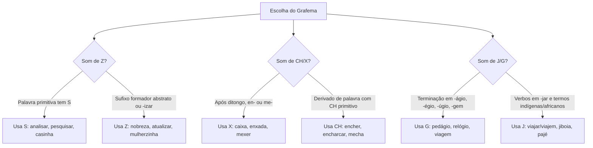

O emprego correto das letras constitui um dos temas de maior peso na prova de Língua Portuguesa. Em concursos públicos, as questões sobre domínio da ortografia oficial avaliam a precisão gráfica do candidato. Essas cobranças inserem-se no contexto de compreensão e interpretação de texto em variados gêneros textuais e tipologias textuais. O examinador explora vocábulos de grafia concorrente, em que letras distintas representam o mesmo fonema sonoro. O candidato deve dominar os critérios morfológicos e etimológicos que determinam o uso de S, Z, SS, Ç, J, G, X e CH. Além disso, as regras de maiúsculas, minúsculas, siglas e abreviações evitam erros frequentes na prova objetiva. Neste capítulo, estudaremos de forma sistemática as regras que regem a grafia das letras e convenções ortográficas oficiais.

> [!objetivos]
> - Aplicar as regras morfológicas que definem o emprego das letras S e Z em sufixos e derivações.
> - Dominar a correlação de verbos que geram substantivos grafados com SS, Ç e SC.
> - Diferenciar o emprego de J e G com base na etimologia e em terminações padronizadas.
> - Identificar as regras de uso de X e CH após ditongos e após as sílabas iniciais en- e me-.
> - Empregar com exatidão maiúsculas, minúsculas, siglas e abreviações conforme o padrão culto.

## O emprego das letras e a concorrência gráfica

A ortografia oficial da língua portuguesa baseia-se em critérios etimológicos e fonético-morfológicos. Como o alfabeto possui menos caracteres do que a totalidade de sons articulados, ocorrem os chamados **grafemas concorrentes**. Trata-se de situações em que letras diferentes disputam o registro do mesmo fonema sonoro.

O fonema /s/, por exemplo, pode ser grafado por *s*, *ss*, *c*, *ç*, *sc*, *sç* ou *xc*. O fonema /z/ pode ser grafado por *z*, *s* intervocálico ou *x*. O fonema /ʒ/ divide-se entre *j* e *g* (antes de *e* ou *i*). O fonema /ʃ/ manifesta-se por *x* ou pelo dígrafo *ch*.

Para não errar na prova, o candidato deve apoiar-se na **derivação morfológica**. Como regra geral do idioma, a palavra derivada preserva a consoante básica da palavra primitiva. Se a palavra primitiva possui *s* em seu radical (*análise*), seus derivados mantêm a letra *s* (*analisar*, *analisador*). Se a primitiva não possui *s* (*economia*), o sufixo formador de verbos é grafado com *z* (*economizar*).

A tabela abaixo compara os principais pontos de concorrência gráfica no vocabulário oficial:

| Concorrência sonora | Fonema em disputa | Grafemas possíveis | Exemplos comparativos na norma padrão |
| --- | --- | --- | --- |
| S versus Z | Fonema /z/ | s, z, x | mesa, pesquisa (s) / riqueza, nobreza (z) / exame (x) |
| S, SS, Ç e SC | Fonema /s/ | s, ss, ç, sc | pretensão (s) / concessão (ss) / retenção (ç) / ascensão (sc) |
| J versus G | Fonema /ʒ/ | j, g (diante de e, i) | pajé, jiboia, trajeto (j) / tigela, pedágio, colégio (g) |
| X versus CH | Fonema /ʃ/ | x, ch | caixa, peixe, enxada (x) / chave, chaminé, encharcar (ch) |

> [!atencao] A força da palavra primitiva
> Em regra ortográfica, a família de palavras conserva a matriz etimológica. Observe os pares derivados: *pesquisa* gera *pesquisar*; *cruz* gera *cruzeiro*; *ferro* gera *ferrugem*; *laranja* gera *laranjeira*. Conhecer a palavra de origem resolve grande parte das questões de ortografia.

## O emprego das letras S e Z

A disputa entre as letras *s* e *z* para representar o som /z/ entre vogais obedece a regras morfológicas precisas.

### Vocábulos de alta incidência e armadilhas frequentes

Determinadas palavras surgem com insistência nas questões de prova por apresentarem pronúncia ou grafia suscetíveis a equívocos:
- **Espontâneo**: grafa-se com *s* e acento circunflexo.
- **Frugal**: grafa-se com *u* e *l* final, significando simples ou comedido.
- **Empecilho**: grafa-se com *e* inicial e terminação *-lho*, sendo incorreta a forma com *i*.
- **Privilégio**: grafa-se com *i* na segunda sílaba, e nunca com *e*.
- **Subsídio**: grafa-se com *s* medial. Na pronúncia culta, a letra *s* soa como /s/ surdo (como em *sapo*), e não com som de /z/.
- **Ascensão**: grafa-se com *sc* inicial e terminação *-são*.

### Quando empregar a letra S

Escrevem-se com a letra **s**:
1. Substantivos derivados de verbos com as terminações **-nder** e **-ndir**:
   - *pretender* -> *pretensão*, *pretensioso*
   - *defender* -> *defesa*, *defensivo*
   - *despender* -> *despesa*
   - *compreender* -> *compreensão*, *compreensivo*
   - *fundir* -> *fusão*
   - *expandir* -> *expansão*, *expansivo*
2. Termos formados a partir de verbos que contêm as terminações **-erter**, **-ertir** ou **-ergir**:
   - *converter* -> *conversão*
   - *perverter* -> *perversão*
   - *divertir* -> *diversão*
   - *aspergir* -> *aspersão*
   - *imergir* -> *imersão*
3. Substantivos derivados de verbos terminados em **-pelir** (com terminação *-puls-*) e **-correr** (com terminação *-curs-*):
   - *expelir* -> *expulsão*
   - *impelir* -> *impulso*, *impulsivo*
   - *concorrer* -> *concurso*
   - *discorrer* -> *discurso*
   - *percorrer* -> *percurso*
4. Sufixos **-ês** e **-esa** que indicam nacionalidade, origem, títulos de nobreza ou nomes próprios:
   - *português*, *francesa*, *norueguês*, *chinês*, *marquês*, *duquesa*, *baronesa*, *Teresa*, *Inês*.
5. Sufixos adjetivais **-oso** e **-osa** (indicadores de abundância) e sufixos **-ense**, **-isa**:
   - *saboroso*, *corajosa*, *horroroso*, *paranaense*, *poetisa*, *profetisa*.
6. Conjugação dos verbos **pôr**, **querer** e **usar**:
   - *eu pus*, *ele quis*, *nós quisemos*, *se eles pusessem*, *quando usarmos*.

### Quando empregar a letra Z

Escrevem-se com a letra **z**:
1. Substantivos abstratos terminados em **-ez** e **-eza** derivados de adjetivos (indicam qualidade ou estado):
   - *embriagado* -> *embriaguez*
   - *lúcido* -> *lucidez*
   - *limpo* -> *limpeza*
   - *nobre* -> *nobreza*
   - *ácido* -> *acidez*
   - *pobre* -> *pobreza*
   - *válido* -> *validez*
2. Verbos terminados no sufixo **-izar** quando a palavra primitiva não possui a letra *s* no radical:
   - *economia* -> *economizar*
   - *terror* -> *aterrorizar*
   - *frágil* -> *fragilizar*
   - *útil* -> *utilizar*
   - *atual* -> *atualizar*
   Se a palavra primitiva já possuir *s*, recebe apenas a terminação verbal *-ar*: *análise* -> *analisar*; *pesquisa* -> *pesquisar*; *paralisia* -> *paralisar*.
   Exceções com *z*: *catequese* -> *catequizar*; *síntese* -> *sintetizar*; *hipnose* -> *hipnotizar*; *batismo* -> *batizar*.
3. Diminutivos terminados em **-zinho** e **-zito** quando a palavra primitiva não possui *s* na última sílaba:
   - *mulherzinha*, *aviãozinho*, *pincelzinho*, *arvorezinha*, *cãozinho*.
   Se a palavra de origem já tiver *s*, preserva o *s* com o sufixo *-inho*: *casa* -> *casinha*; *asa* -> *asinha*; *mesa* -> *mesinha*.

A tabela a seguir consolida o contraste entre S e Z:

| Função morfológica | Emprego de S | Emprego de Z | Exemplo distintivo |
| --- | --- | --- | --- |
| Origem e nobreza vs Qualidade abstrata | Sufixos -ês e -esa | Sufixos -ez e -eza | duquesa, francês (s) / nobreza, lucidez (z) |
| Formação de verbos | Palavra base com S no radical | Palavra base sem S no radical | analisar (de análise) / atualizar (de atual) |
| Formação de diminutivos | Base terminada em S | Base terminada sem S | casinha (de casa) / florzinha (de flor) |
| Conjugação de formas verbais | Verbos pôr e querer | Verbo fazer e derivados | quisemos, puseram (s) / fizeram, traduzem (z) |

> [!pegadinha] Analisar versus sintetizar
> A cobrança do sufixo *-isar* ou *-izar* é recorrente. *Analisar* e *pesquisar* grafam-se com *s* porque os substantivos primitivos (*análise* e *pesquisa*) contêm *s*. Já *sintetizar* e *catequizar* escrevem-se com *z*, atuando como exceções consagradas aos substantivos *síntese* e *catequese*.

## Grafias com SS, Ç e SC

O som /s/ surdo é registrado por diferentes grafemas dependendo da matriz verbal da palavra.

### Palavras grafadas com SS

Grafam-se com **ss** os substantivos derivados de:
- Verbos terminados em **-ceder** (geram *-cess-*): *anteceder* -> *antecessor*; *conceder* -> *concessão*; *exceder* -> *excesso*, *excessivo*.
- Verbos terminados em **-primir** (geram *-press-*): *imprimir* -> *impressão*; *comprimir* -> *compressa*; *deprimir* -> *depressão*.
- Verbos terminados em **-gredir** (geram *-gress-*): *agredir* -> *agressão*; *progredir* -> *progresso*; *transgredir* -> *transgressor*.
- Verbos terminados em **-meter** (geram *-miss-* ou *-mess-*): *comprometer* -> *compromisso*; *remeter* -> *remessa*; *omitir* -> *omissão*.

### Palavras grafadas com Ç e SC

- A letra **ç** é utilizada após ditongos quando houver som de /s/ (*eleição*, *traição*, *louça*). Também aparece em palavras de origem indígena, árabe ou africana (*açúcar*, *paçoca*, *miçanga*). Aparece ainda nos derivados de verbos em *-ter* (*conter* -> *contenção*; *reter* -> *retenção*).
- O grupo **sc** surge em vocábulos de tradição latina: *ascensão*, *consciência*, *crescer*, *descender*, *discernimento*, *disciplina*, *imprescindível*, *piscina*, *nascer*, *obsceno*, *oscilar*, *plebiscito*, *rescisão*, *ressuscitar*, *seiscentos*, *suscitar*, *transcender*. Na conjugação, mantém-se **sç** diante de *a* e *o*: *nasço*, *nasça*, *cresço*, *desça*.

## O emprego de J e G

As letras *j* e *g* disputam o fonema /ʒ/ diante das vogais *e* e *i*.

### Quando empregar a letra J

Emprega-se a letra **j**:
1. Em palavras derivadas de verbos terminados em **-jar**: *trajar* -> *traje*, *trajei*; *encorajar* -> *encorajem*; *viajar* -> *que eles viajem*.
2. Em palavras derivadas de primitivos com *j*: *loja* -> *lojista*; *gorja* -> *gorjeta*; *canja* -> *canjica*; *laranja* -> *laranjeira*.
3. Em termos de origem tupi, africana ou popular e aportuguesamentos: *jiboia* (sem acento no Acordo), *jiló*, *pajé*, *manjericão*, *jipe* (do inglês *jeep*), *jequitibá*, *jegue*.
4. Em vocábulos destacados da norma culta: *ojeriza*, *pajem*, *lambujem*.

### Quando empregar a letra G

Emprega-se a letra **g**:
1. Em palavras terminadas em **-ágio**, **-égio**, **-ígio**, **-ógio**, **-úgio**: *pedágio*, *colégio*, *prestígio*, *relógio*, *refúgio*.
2. Em substantivos terminados em **-gem**: *viagem* (o substantivo: "boa viagem"), *coragem*, *ferrugem*, *origem*, *garagem*, *vertigem*, *folhagem*.

> [!pegadinha] Viagem com G versus viajem com J
> Esta é uma das pegadinhas mais tradicionais das bancas. Grafa-se com **g** o substantivo feminino (*a viagem*, *as viagens*). Grafa-se com **j** a forma flexionada do verbo viajar no presente do subjuntivo (*espero que eles viajem em paz*).

## O emprego de X e CH

A escolha entre *x* e *ch* para registrar o som /ʃ/ orienta-se por quatro regras principais.

### Regras gerais para o emprego da letra X

Usa-se a letra **x**:
1. **Após ditongo**: *caixa*, *peixe*, *frouxo*, *ameixa*, *faixa*, *baixo*.
   Exceção: o verbo *recauchutar* e seus derivados, pois provêm da palavra estrangeira *caucho*.
2. **Após a sílaba inicial EN-**: *enxada*, *enxame*, *enxaqueca*, *enxaguar*, *enxofre*.
   Exceção decisiva: palavras formadas pelo prefixo *en-* sobre vocábulos primitivos que já possuem *ch*. Exemplos: *cheio* -> *encher*, *enchente*, *enchimento*; *charco* -> *encharcar*; *chiqueiro* -> *enchiqueirar*; *chapéu* -> *enchapelar*.
3. **Após a sílaba inicial ME-**: *mexer*, *mexilhão*, *mexerica*, *mexicano*.
   Exceção: o substantivo *mecha* (porção de cabelo) e palavras derivadas de *mefistofélico*.
4. **Palavras de origem indígena ou africana e termos ingleses aportuguesados**: *xavante*, *orixá*, *xará*, *xampu* (do inglês *shampoo*).

A tabela abaixo sintetiza o emprego de X e as exceções com CH:

| Contexto gráfico | Regra do X | Exceções grafadas com CH | Justificativa da exceção |
| --- | --- | --- | --- |
| Após ditongo oral | caixa, peixe, frouxo | recauchutar, caucho | Família etimológica do termo caucho |
| Após sílaba inicial EN- | enxame, enxada, enxoval | encher, encharcar, enchiqueirar | Derivação de palavras com CH primitivo (*cheio*, *charco*) |
| Após sílaba inicial ME- | mexer, mexilhão, mexerica | mecha | Substantivo de origem etimológica francesa |
| Vocábulos indígenas/africanos | orixá, xavante, capixaba | — | Consoante fricativa palatal própria |

> [!atencao] A família de encher e encharcar
> Grave este ponto de atenção essencial: *enxoval* e *enxada* escrevem-se com *x* por estarem após a sílaba *en-*. Por outro lado, *encher*, *enchente*, *preenchimento* e *encharcar* grafam-se com *ch* porque derivam de termos que já possuem *ch* (*cheio* e *charco*).

## Uso de letras maiúsculas e minúsculas

A letra maiúscula assinala a individualização, o valor solene ou a notoriedade de um vocábulo na frase.

### Casos de emprego de maiúscula

Emprega-se letra maiúscula:
- Nos nomes próprios de pessoas, locais e instituições: *Pernambuco*, *Recife*, cidades estrangeiras como *Lisboa*, marcas como *Petrobras*, além de órgãos oficiais como o *Corpo de Bombeiros Militar*.
- Nos substantivos comuns em caso de personificação: *A Morte rondava o acampamento*, em que a personificação atribui traços humanos ao termo.
- Nos nomes de logradouros públicos: *Avenida Brasil*, *Rua da Aurora*, *Praça do Carmo*.
- No início de períodos, parágrafos e citações diretas.
- Em datas oficiais, nomes de fatos e épocas históricas solenes: *Sete de Setembro*, *Proclamação da República*, *Idade Média*, *Natal*.
- Em títulos de publicações e obras artísticas: *Os Lusíadas*, *Memórias Póstumas de Brás Cubas*, *Jornal do Comércio*. Conjunções e preposições internas nesses títulos ficam em minúscula.
- Em nomes de pontos cardeais quando designam grandes regiões geopolíticas: *o Nordeste*, *o Sul do país*, *o Oriente Médio*.
- Nos nomes de disciplinas científicas e ramos do saber: *Língua Portuguesa*, *Matemática*, *Direito Constitucional*.

### Casos de emprego de minúscula

O Acordo Ortográfico pacificou o uso de minúsculas em termos anteriormente conflitantes:
- Nomes dos meses do ano (*janeiro*, *outubro*, *dezembro*) e dos dias da semana (*segunda-feira*, *domingo*).
- Nomes das estações do ano (*primavera*, *verão*, *outono*, *inverno*).
- Pontos cardeais quando indicam simples direção física ou orientação: *caminhou rumo ao norte*; *vento do sul*; *zona leste*.

## Siglas e abreviações

As siglas e abreviações seguem normas gramaticais de concisão e uniformidade.

### Regras das siglas

1. **Siglas de até três letras**: grafam-se em maiúsculas (*PM*, *CBM*, *PC*, *ONU*, *CPF*).
2. **Siglas com mais de três letras**:
   - Pronunciadas letra por letra: todas maiúsculas (*UFRPE*, *BNDES*, *ICMS*).
   - Pronunciadas como palavras (acrônimos): apenas a inicial maiúscula (*Detran*, *Sudene*, *Unesco*).
3. **Plural das siglas**: recebe um *s* minúsculo sem apóstrofo (*as PMs*, *os CPFs*, *as UPAs*).

### Regras das abreviações e símbolos

A abreviação regular traz a primeira sílaba e a primeira letra da sílaba seguinte com ponto abreviativo (*gramática* -> *gram.*; *século* -> *séc.*; *página* -> *pág.*). Se a segunda sílaba iniciar por duas consoantes, ambas permanecem (*construção* -> *constr.*).

Os símbolos do Sistema Internacional (SI) são notações científicas universais. Por isso, **não levam ponto nem s de plural**: *h* (hora), *min* (minuto), *s* (segundo), *km* (quilômetro), *kg* (quilograma). Grafa-se: *10 h 30 min*, e não *10:30h* ou *10 hrs*.

## Mapa do capítulo

O diagrama a seguir resume as principais escolhas gráficas estudadas:

A tabela abaixo sintetiza os pontos centrais de ortografia oficial:

| Assunto | Critério principal | Alerta para concursos |
| --- | --- | --- |
| S e Z | Sufixos -ês/-esa com S; -ez/-eza com Z. Primitivo com S mantém S | Exceções: *sintetizar* e *catequizar* escrevem-se com Z |
| SS, Ç e SC | Derivações verbais: -ceder gera -cess-; -gredir gera -gress- | *Excesso* é com SS; *exceção* é com Ç |
| J e G | Verbos em -jar mantêm J; terminações -ágio e -gem levam G | *A viagem* (substantivo) é com G; *que eles viajem* (verbo) é com J |
| X e CH | X após ditongo, en- e me- | Exceções: *recauchutar*, *encher* (de cheio), *encharcar* (de charco) e *mecha* |
| Maiúsculas | Nomes próprios, instituições e títulos solenes | Meses, dias da semana e direções geográficas usam minúscula |
| Siglas e símbolos | Acrônimos usam só inicial maiúscula; plural leva s minúsculo | Símbolos do SI não levam ponto nem plural (*10 h*, *5 km*) |

### Para fixar

- Palavras primitivas com S no radical mantêm S nos derivados (*análise* -> *analisar*; *pesquisa* -> *pesquisar*).
- Substantivos abstratos que indicam qualidade derivados de adjetivos grafam-se com Z (*nobreza*, *lucidez*).
- Verbos derivados de primitivos sem S recebem o sufixo -izar com Z (*economia* -> *economizar*), com exceções como *sintetizar*.
- Verbos em -gredir geram substantivos em -gress- (*progresso*); verbos em -ceder geram -cess- (*concessão*).
- O substantivo feminino é *viagem* (com G); a flexão verbal correspondente é *viajem* (com J).
- Palavras de origem tupi, africana ou popular recebem a letra J (*jiboia*, *jiló*, *pajé*).
- Grafa-se X após ditongo (*caixa*), após en- (*enxada*) e após me- (*mexer*).
- Vocábulos derivados de primitivos com CH mantêm o dígrafo CH (*encher*, *encharcar*).
- Meses do ano, dias da semana e estações grafam-se com inicial minúscula na norma culta.
- Símbolos de unidade do Sistema Internacional não recebem ponto abreviativo nem letra de plural (*2 h*, *15 min*, *80 km*).
