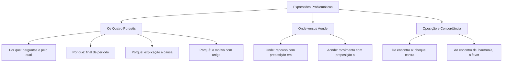

O domínio da ortografia oficial envolve também as expressões problemáticas. Nas provas de concurso, esses termos aparecem em itens de compreensão e interpretação de texto. Os enunciados selecionam trechos de variados gêneros textuais e tipologias textuais para avaliar o candidato. Dúvidas sobre os quatro porquês, a oposição entre onde e aonde, e o uso de de encontro a e ao encontro de são frequentes. O mesmo ocorre com parônimos como eminente e iminente, ou consertar e concertar. Para acertar as questões, o estudante deve aplicar critérios objetivos de substituição. Neste capítulo, estudaremos de forma prática cada uma dessas expressões e seus pares correlatos.

> [!objetivos]
> - Distinguir e aplicar com exatidão os quatro tipos de porquê.
> - Empregar corretamente onde e aonde conforme a regência verbal.
> - Diferenciar expressões como a fim/afim, trás/traz, de encontro a/ao encontro de.
> - Aplicar as regras de senão e se não em orações coordenadas e subordinadas.
> - Dominar parônimos e homônimos frequentes em concursos públicos.

## O emprego dos quatro porquês

A grafia dos porquês depende da classe morfológica e da função sintática da palavra na frase.

### Emprego de por que

A forma separada e sem acento ocorre em duas situações essenciais:
1. **Em frases interrogativas diretas e indiretas**:
   Atua como a preposição *por* seguida do pronome *que*. Equivale a "por qual razão" ou "por qual motivo".
   - *Por que você não realizou a inscrição no concurso?*
   - *O instrutor indagou por que a equipe atrasou.*
   - *Não sabemos por que motivo as diretrizes mudaram.*
2. **Como pronome relativo precedido de preposição**:
   Liga orações e equivale a "pelo qual", "pela qual", "pelos quais" ou "pelas quais".
   - *A causa por que lutamos é de interesse público.* (pela qual lutamos)
   - *As dificuldades por que passou foram superadas.* (pelas quais passou)
   - *Por que amamos tanto os carboidratos? É uma causa por que devemos nos mobilizar.*

### Emprego de por quê

Emprega-se a forma separada com acento circunflexo quando o termo surge **imediatamente antes de pausa pontuada** ou em final de período. A posição final torna o monossílabo foneticamente tônico.
- *Eles abandonaram o serviço sem autorização prévia. Por quê?*
- *Você não realizou o treinamento por quê?*
- *O candidato foi reprovado e não entendeu por quê.*

### Emprego de porque

A forma aglutinada sem acento atua como **conjunção subordinativa causal** ou **conjunção coordenativa explicativa**. Introduz uma causa ou justificativa, equivalendo a "pois", "já que" ou "visto que".
- *O militar foi promovido porque agiu com bravura.* (já que agiu)
- *Apresse o passo, porque a formatura começará logo.* (pois começará)
- *Em preenchimento de lacuna de resposta: Estudei muito porque queria vencer.*

### Emprego de porquê

A forma aglutinada e com acento circunflexo atua como **substantivo comum masculino**. É sinônimo direto de "o motivo", "a razão" ou "a causa". Exige a presença de um termo determinante (artigo, pronome, numeral ou adjetivo).
- *Ninguém compreendeu o porquê de tanta inquietação.* (o motivo)
- *Existem vários porquês para essa decisão operacional.* (várias razões)

A tabela abaixo compara o emprego dos quatro porquês:

| Forma gráfica | Papel gramatical | Equivalência prática | Exemplo de prova |
| --- | --- | --- | --- |
| Por que | Interrogativo ou relativo | Por qual razão, pelo qual | Por que faltou? / O ideal por que luto |
| Por quê | Pronome tônico de fim de período | Por qual razão (antes de ponto) | Ele desistiu do certame por quê? |
| Porque | Conjunção causal ou explicativa | Pois, já que, visto que | Venceu porque treinou com afinco |
| Porquê | Substantivo comum | O motivo, a razão | Não entendi o porquê de sua recusa |

> [!pegadinha] O por que relativo em textos oficiais
> Observe a oração: "A crise por que passou a corporação trouxe lições". O termo *por que* não é conjunção explicativa. Ele equivale a *pela qual passou a corporação*. Por isso, deve ser grafado separadamente.

## Onde versus aonde

A distinção entre *onde* e *aonde* baseia-se na regência verbal e na noção de movimento:
- **Onde**: indica permanência, repouso ou localização estática. Combina-se com verbos que regem a preposição *em* (*estar em*, *morar em*, *ficar em*).
  Exemplo: *Onde fica o centro de treinamento do corpo de bombeiros?*
- **Aonde**: expressa movimento, direção ou destino em deslocamento. Resulta da junção da preposição *a* (exigida por verbos como *ir a*, *chegar a*, *dirigir-se a*) com o advérbio *onde*.
  Exemplo: *Aonde o socorrista se dirigiu após o toque de alarme?*

Na norma culta, *onde* e *aonde* aplicam-se unicamente a **espaços físicos concretos**. Não devem ser usados para se referir a tempo, conceitos, textos ou reuniões. Nesses casos, prefira *em que*, *no qual* ou *na qual*.

A tabela abaixo resume essa distinção:

| Vocábulo | Regência do verbo | Sentido expresso | Exemplo na norma culta |
| --- | --- | --- | --- |
| Onde | Preposição EM | Repouso, lugar estático | Onde estão guardados os equipamentos? |
| Aonde | Preposição A | Movimento, destino | Aonde as viaturas seguirão em socorro? |

> [!atencao] Onde aplicado a conceitos abstratos
> É incorreto escrever: "Na reunião onde foi aprovada a escala". Reunião é evento, não espaço físico. O correto é grafar: "Na reunião **em que** (ou **na qual**) foi aprovada a escala".

## A fim versus afim, trás versus traz

Pares homófonos exigem atenção aos sentidos e classes gramaticais:

### A fim de versus afim

- **A fim de**: locução prepositiva que expressa finalidade, propósito ou objetivo. Equivale a "para" ou "com o intuito de". Grafa-se separadamente.
  Exemplo: *O pelotão treinou duro a fim de alcançar a meta estabelecida.*
- **Afim**: adjetivo que significa semelhante, análogo ou com afinidade. Admite plural *afins*.
  Exemplo: *Matemática e física são disciplinas afins.*
  Exemplo: *O policial reuniu familiares e afins na formatura.*

### Trás versus traz

- **Traz**: flexão do verbo *trazer* no presente do indicativo. Grafa-se com **z** e sem acento.
  Exemplo: *O comandante traz orientações claras para a missão.*
- **Trás**: advérbio de lugar que indica retaguarda ou parte posterior. Grafa-se com **s** e acento agudo. Surge com preposições (*para trás*, *por trás*, *de trás*).
  Exemplo: *O motorista olhou para trás antes de manobrar.*

> [!bizu] Dica de substituição rápida
> Troque a expressão por **para**: se der certo, use **a fim de** (separado). Se equivaler a **semelhante**, use **afim** (junto). Se significar **conduz**, use **traz** com z; se indicar **traseira**, use **trás** com s.

## Ao invés de versus em vez de, de encontro a versus ao encontro de

As relações de oposição e concordância orientam a escolha dessas locuções:

- **Ao invés de**: indica oposição estrita, contradição ou antítese absoluta. Aplica-se apenas entre termos antônimos.
  Exemplo: *Ao invés de subir o barranco, a patrulha desceu com cautela.*
- **Em vez de**: indica simples substituição ou troca de uma opção por outra. Não exige antônimos.
  Exemplo: *Em vez de redigir o relatório hoje, o sargento o fará amanhã.*
  Exemplo: *Em vez de suco, preferiu beber água gelada.*
- **De encontro a**: expressa colisão, choque mecânico, discordância ou oposição. Significa ir **contra**.
  Exemplo: *A viatura colidiu de encontro ao poste da avenida.*
  Exemplo: *As medidas propostas vão de encontro aos interesses da classe.*
- **Ao encontro de**: expressa conformidade, harmonia, aproximação ou concordância. Significa ir **a favor**.
  Exemplo: *A decisão do tribunal veio ao encontro dos pedidos formulados.*
  Exemplo: *O filho correu alegre ao encontro dos pais.*

A tabela a seguir compara essas locuções:

| Locução | Sentido nuclear | Equivalência de troca | Exemplo correto |
| --- | --- | --- | --- |
| Ao invés de | Oposição exata | Ao contrário de (com antônimos) | Ao invés de calar, protestou com firmeza |
| Em vez de | Substituição simples | No lugar de (serve para qualquer troca) | Em vez de descansar, continuou a ler |
| De encontro a | Choque e oposição | Contra, colisão, divergência | O carro foi de encontro ao muro |
| Ao encontro de | Concordância e união | A favor, em harmonia | A escala veio ao encontro da tropa |

> [!pegadinha] Troca indevida de encontro a por ao encontro de
> O examinador costuma escrever: "A atitude heroica foi de encontro aos anseios da sociedade". O erro é grave. *De encontro a* significa contrariar ou bater contra. A atitude foi **ao encontro dos anseios**, pois gerou aplausos e aprovação.

## Senão versus se não, de mais versus demais

A distinção entre as formas unidas e separadas fundamenta-se na gramática funcional:

### Senão versus se não

- **Senão** (aglutinado):
  1. Conjunção com sentido de "caso contrário", "do contrário": *Dedique-se aos estudos, senão será reprovado.*
  2. Conjunção com sentido de "mas sim": *Não era soberbo, senão humilde.*
  3. Preposição com sentido de "a não ser", "exceto", "salvo": *Ninguém, senão o juiz, poderia autorizar a diligência.*
  4. Substantivo que indica falha ou defeito: *O laudo não apresenta nenhum senão.*
- **Se não** (separado):
  1. Conjunção condicional *se* + advérbio de negação *não* (equivale a "caso não"): *Se não treinar com disciplina, não superará a prova física.*
  2. Conjunção integrante *se* + negação *não*: *Perguntou se não haveria reforço policial.*
  3. Com verbo elíptico em orações alternativas: *Havia dezenas de feridos, se não centenas.*

### De mais versus demais

- **De mais** (separado): locução adverbial oposta a "de menos".
  Exemplo: *Não encontramos nada de mais no procedimento adotado.*
- **Demais** (junto): advérbio de intensidade (sinônimo de "muito", "excessivamente") ou pronome indefinido (sinônimo de "os outros").
  Exemplo: *A equipe trabalhou demais durante o plantão.*
  Exemplo: *O capitão permaneceu; os demais foram dispensados.*

## Baixo, abaixo, debaixo e suas variantes

As expressões formadas com a palavra *baixo* suscitam frequentes dúvidas na escrita formal. A distinção depende da classificação morfológica e do papel sintático na oração.

Quando grafadas em palavra única, as formas **abaixo**, **debaixo** e **embaixo** atuam tipicamente como advérbios de lugar. Elas expressam posição inferior ou subordinação espacial, surgindo frequentemente associadas à preposição *de*:
- *Abaixo*: expressa situação em nível inferior ou posterior (*O rio corre vale abaixo*; *A temperatura permaneceu abaixo do limite previsto*).
- *Debaixo* e *Embaixo*: expressam localização direta sob uma superfície ou objeto (*O relatório estava debaixo dos processos*; *O soldado abrigou-se embaixo da viatura*).

Por outro lado, quando ocorrem em palavras separadas, temos a junção de uma preposição independente com o adjetivo ou substantivo *baixo*:
- *A baixo*: preposição *a* associada ao adjetivo na correlação de direção (*Examinou o suspeito de cima a baixo*).
- *De baixo*: preposição *de* indicando procedência, nível ou qualidade modesta em oposição a "de cima" (*O pavimento de baixo foi isolado pela perícia*; *Adquiriram uniformes de baixo custo*).
- *Em baixo*: preposição *em* com o adjetivo qualificando a intensidade acústica (*O instrutor falou em baixo tom durante a chamada*).
- *Por baixo*: locução adverbial que denota passagem ou ação encoberta (*O socorrista rastejou por baixo dos escombros*).

A tabela abaixo compara as formas unidas e separadas:

| Grafia | Classe morfológica | Significado contextual | Exemplo na norma culta |
| --- | --- | --- | --- |
| Abaixo | Advérbio de lugar | Em posição inferior, sob | A pressão caiu abaixo do normal |
| Debaixo / Embaixo | Advérbios de lugar | Sob a base de algo | Guarde o equipamento embaixo da bancada |
| De baixo | Preposição + Adjetivo | Oposto a de cima, modesto | As ordens partiram do escalão de baixo |
| De cima a baixo | Locução correlativa | De uma ponta a outra | A vistoria conferiu o prédio de cima a baixo |
| Em baixo | Preposição + Adjetivo | Em volume ou tom reduzido | Conversavam em baixo tom no corredor |

## Parônimos e homônimos de alta incidência

Diversos vocábulos exigem atenção rigorosa em provas de concurso:

### Há versus A de tempo

- **Há** (verbo haver): marca tempo decorrido no passado ou ideia de existência.
  Exemplo: *O soldado atua no socorro há dez anos.*
  Exemplo: *Há vagas abertas para o concurso.*
- **A** (preposição): marca tempo futuro ou distância física.
  Exemplo: *A formatura ocorrerá daqui a quinze dias.*
  Exemplo: *O quartel dista a dois quilômetros da praia.*

Atenção: nunca escreva "há anos atrás". A locução constitui redundância condenada pela norma culta. Use apenas *há dez anos* ou *dez anos atrás*.

### Acerca de, a cerca de e há cerca de

- **Acerca de**: equivale a "sobre" ou "a respeito de" (*Debateram acerca da escala de plantão*).
- **A cerca de**: indica distância aproximada ou tempo futuro (*O comboio está a cerca de dez minutos do local*).
- **Há cerca de**: indica tempo decorrido aproximado com o verbo haver (*O sinistro ocorreu há cerca de duas horas*).

### Parônimos fundamentais em provas

A tabela a seguir consolida os pares parônimos mais frequentes em concursos:

| Par de vocábulos | Grafia e significado 1 | Grafia e significado 2 |
| --- | --- | --- |
| Eminente / Iminente | Eminente = nobre, ilustre, elevado | Iminente = prestes a acontecer |
| Consertar / Concertar | Consertar (com S) = reparar, corrigir | Concertar (com C) = harmonizar, compor música |
| Cozer / Coser | Cozer (com Z) = cozinhar alimentos | Coser (com S) = costurar tecido |
| Cessão / Sessão / Seção | Cessão = ato de ceder / Sessão = reunião | Seção = corte, departamento, repartição |
| Tampouco / Tão pouco | Tampouco = também não, nem | Tão pouco = muito pouco (intensidade) |
| Mas / Mais | Mas = porém, contudo (oposição) | Mais = oposto de menos (quantidade) |
| Mal / Mau | Mal = oposto de bem; advérbio | Mau = oposto de bom; adjetivo |
| Desprezível / Enxergar | Desprezível (com Z) = sem valor | Enxergar (com X) = ver com clareza |

Atenção especial ao verbo **intervir**: seus derivados oxítonos recebem acento gráfico conforme o número (*o comando intervém* no singular; *as forças intervêm* no plural). Além disso, o **trema** foi inteiramente abolido na língua portuguesa pelo Acordo Ortográfico. Palavras como *linguiça*, *tranquilo*, *cinquenta* e *sequestro* escrevem-se sem sinal diacrítico.

## Mapa do capítulo

O diagrama a seguir sintetiza as expressões problemáticas estudadas:

A tabela abaixo resume as regras para rápida memorização:

| Expressão | Regra definitiva | O que a banca explora |
| --- | --- | --- |
| Por que / Porque | Por que = pergunta ou pelo qual; Porque = causa | Usa porque junto em orações relativas |
| Onde / Aonde | Onde = lugar fixo; Aonde = movimento com a | Aplica onde para tempo ou conceitos abstratos |
| A fim de / Afim | A fim de = finalidade; Afim = semelhante | Grafa afim de junto ao indicar propósito |
| Trás / Traz | Traz = verbo trazer; Trás = retaguarda | Troca a grafia em contextos verbais |
| De encontro a / Ao encontro de | De encontro a = contra; Ao encontro de = a favor | Inverte os sentidos em ações com resultado positivo |
| Senão / Se não | Senão = do contrário, exceto; Se não = caso não | Separa senão conjuntivo ou junta se não condicional |
| Há / A de tempo | Há = passado com haver; A = futuro ou distância | Cria expressões pleonásticas como há anos atrás |

### Para fixar

- *Por que* emprega-se em perguntas diretas ou indiretas e quando equivale a "pelo qual".
- *Por quê* surge imediatamente antes de ponto de final de período ou pausa forte.
- *Porque* atua como conjunção explicativa ou causal (pois, já que).
- *Porquê* é substantivo sinônimo de motivo, vindo acompanhado de termo determinante.
- *Onde* indica permanência em espaço físico; *aonde* indica destino e deslocamento.
- *A fim de* expressa finalidade; *afim* é adjetivo que significa semelhante ou correlato.
- *Traz* é conjugação do verbo trazer; *trás* é advérbio de lugar referente à retaguarda.
- *Ao invés de* exige antônimos; *em vez de* expressa substituição em qualquer contexto.
- *De encontro a* significa choque mecânico ou desacordo; *ao encontro de* significa concordância e harmonia.
- *Senão* significa do contrário ou exceto; *se não* equivale a caso não em orações condicionais.
