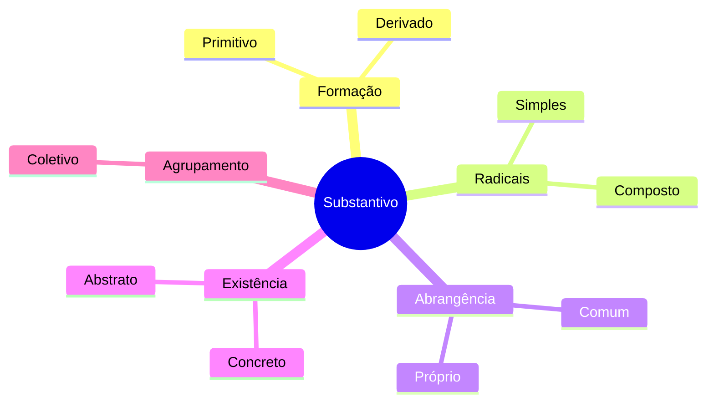
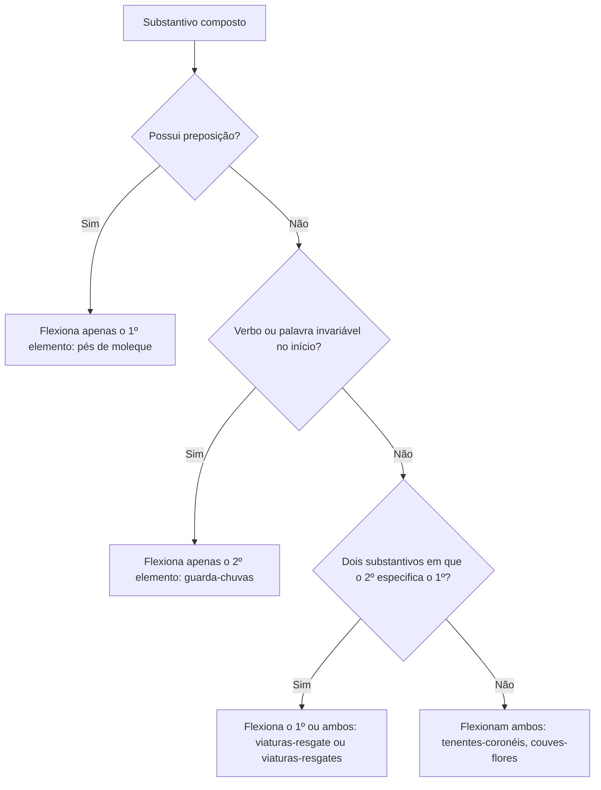
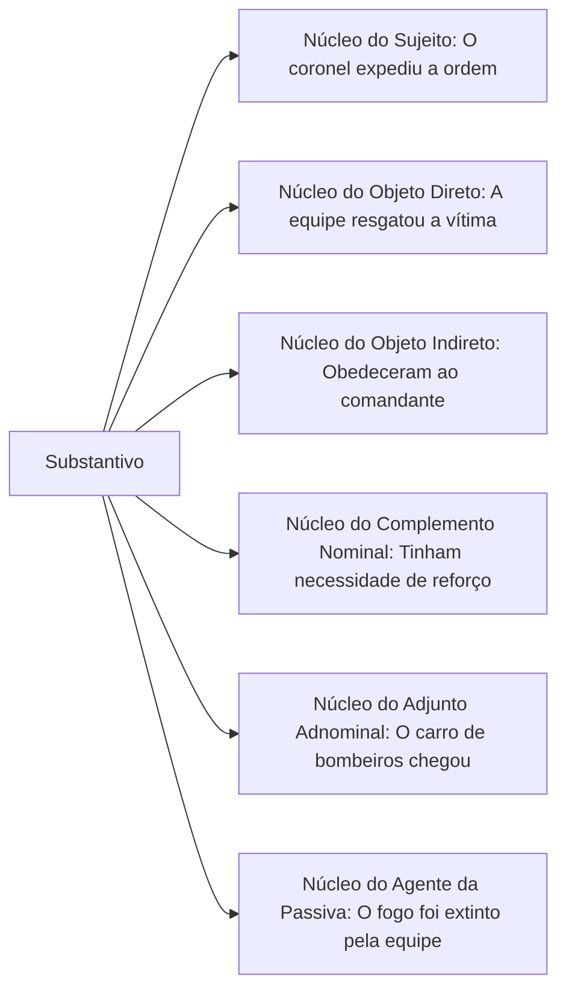
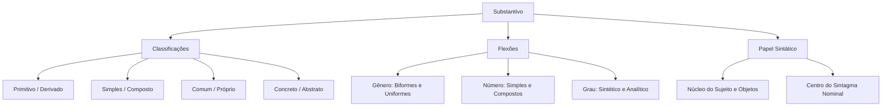

A morfologia estuda a estrutura, a formação e a classificação das palavras na língua portuguesa. Dentre as dez classes gramaticais reconhecidas pela tradição normativa, o substantivo ocupa posição central, funcionando como elemento nuclear em torno do qual orbitam outras classes nominais. Compreender o comportamento dessa classe é decisivo para resolver questões de prova, pois as bancas exploram tanto as regras de flexão quanto a distinção entre classes gramaticais e suas respectivas funções sintáticas no período.

> [!objetivos]
> - Distinguir as classes de palavras variáveis das invariáveis no padrão culto.
> - Classificar substantivos quanto à origem, estrutura, abrangência e natureza.
> - Aplicar corretamente as regras de flexão de gênero, número simples e plural dos substantivos compostos.
> - Identificar o papel sintático do substantivo como núcleo dos termos nominais da oração.

## Visão geral das classes e distinção morfossintática

A gramática normativa organiza o léxico da língua portuguesa em dez classes de palavras. Cada vocábulo pertence primitivamente a uma classe pelo que representa no sistema linguístico e pela forma como se articula na oração. Além dessas dez classes fundamentais, existem ainda termos que não se enquadram perfeitamente em nenhuma categoria tradicional por não exercerem função sintática nem modificarem termos específicos, conhecidos como palavras denotativas.

A primeira grande divisão separa as palavras de acordo com a sua capacidade de sofrer flexão morfológica:

| Grupo | Classes | Capacidade de flexão | Comportamento sintático |
| --- | --- | --- | --- |
| Variáveis | Substantivo, adjetivo, artigo, numeral, pronome, verbo | Flexionam-se em gênero, número, pessoa, tempo, modo ou grau | Estabelecem concordância nominal e verbal na oração |
| Invariáveis | Advérbio, preposição, conjunção, interjeição | Mantêm forma fixa e não aceitam flexões de gênero ou número | Atuam como conectivos, modificadores ou expressões emotivas |

É fundamental não confundir classe gramatical com função sintática. A classe gramatical é a natureza morfológica da palavra, verificada muitas vezes no dicionário ou pelo contexto imediato. A função sintática é o papel dinâmico que a palavra ou expressão exerce nas relações com outros termos dentro da frase. Por exemplo, em uma ocorrência operacional, o vocábulo *urgente* pertence à classe dos adjetivos; na oração *O chamado urgente mobilizou a guarnição*, exerce a função de adjunto adnominal, enquanto em *A situação era urgente*, desempenha o papel de predicativo do sujeito.

Da mesma forma, duas ou mais palavras podem se unir para desempenhar o papel de uma única classe gramatical, constituindo uma locução. Quando essa reunião equivale a um adjetivo, temos uma locução adjetiva (*homem de coragem* equivale a *homem corajoso*); quando equivale a um advérbio, temos uma locução adverbial (*agiu com cautela* equivale a *agiu cautelosamente*).

> [!bizu] Memorização das classes
> As classes nominais variáveis formam a base da oração: **S**ubstantivo (o chefe), acompanhado pelos satélites **A**rtigo, **A**djetivo, **N**umeral e **P**ronome (o mnemônico **SAANP**). O **V**erbo rege a oração. Já as quatro invariáveis são **P**reposição, **A**dvérbio, **C**onjunção e **I**nterjeição (**PACI**).

## Substantivo: conceito, classificação e formação

O substantivo é a classe de palavras variável que nomeia os seres em geral, reais ou imaginários, materiais ou conceituais. Ele dá nome a pessoas, animais, objetos, lugares, sentimentos, sensações, ações, estados e qualidades. Por ser o centro do sintagma nominal, o substantivo projeta suas marcas de gênero e número sobre os determinantes que o acompanham.

### Classificação quanto a critérios estruturais e semânticos

Os substantivos são agrupados conforme quatro pares fundamentais de oposição e uma categoria coletiva:

1. **Primitivo e derivado**: o substantivo primitivo não procede de nenhuma outra palavra da língua portuguesa (*fogo*, *viatura*, *ferro*). Já o derivado provém de outro termo preexistente por acréscimo de afixos (*fogueira*, *viaturinha*, *ferragem*).
2. **Simples e composto**: o substantivo simples é constituído por um único radical (*guarda*, *soldado*, *resgate*). O composto possui dois ou mais radicais associados por justa posição ou aglutinação (*guarda-vidas*, *salva-vidas*, *passatempo*).
3. **Comum e próprio**: o substantivo comum designa genericamente todos os elementos de uma mesma espécie (*militar*, *cidade*, *quartel*). O substantivo próprio individualiza um ser específico no interior de sua espécie, sendo grafado com inicial maiúscula (*Pernambuco*, *Recife*, *Aguiar*).
4. **Concreto e abstrato**: o substantivo concreto nomeia seres de existência autônoma e independente, pertençam ao mundo físico ou ao universo imaginário e mitológico (*bombeiro*, *água*, *viatura*, *fantasma*, *anjo*). O substantivo abstrato designa noções cuja existência depende de outro ser para se manifestar, correspondendo a ações (*salvamento*, *combate*), estados (*vida*, *vigília*), qualidades (*bravura*, *agilidade*) e sentimentos (*medo*, *esperança*).

> [!atencao] Distinção entre concreto e abstrato
> O erro mais frequente em provas é considerar abstrato tudo o que não pode ser tocado. Seres imaginários ou espirituais (*bruxa*, *alma*, *fada*, *divindade*) são substantivos **concretos**, pois subsistem por si mesmos no plano do pensamento. Abstratos são aqueles que decorrem de verbos ou adjetivos indicando ação, sentimento, estado ou qualidade, como *combate* (de combater) e *lealdade* (de leal).

### Processos de formação e derivação regressiva

A formação de substantivos pode ocorrer por derivação sufixal (*brav-ura*, *socorr-ista*), prefixal (*in-certeza*, *re-começo*) ou parassintética (*a-noit-ecer*). Entre os processos mais cobrados pelas bancas destaca-se a **derivação regressiva** (ou deverbal), que dá origem a substantivos abstratos indicadores de ação mediante a redução da terminação verbal:

- O verbo *resgatar* gera o substantivo *resgate*.
- O verbo *atacar* gera o substantivo *ataque*.
- O verbo *debater* gera o substantivo *debate*.
- O verbo *embarcar* gera o substantivo *embarque*.

Se a palavra derivada for maior ou mantiver sufixo nominal indicador de agente ou instrumento, o processo será derivação sufixal comum (*âncora* gera *ancorar*; *martelo* gera *martelar*). Quando o substantivo é indicador de ação e surge mais curto que o verbo primitivo, ocorre derivação regressiva.

### Substantivação e derivação imprópria

Qualquer palavra da língua pode ser convertida contextualmente em substantivo, mesmo pertencendo originalmente a outra classe gramatical. Esse fenômeno denomina-se **derivação imprópria** ou conversão. O mecanismo mais frequente de substantivação é a anteposição de um artigo ou de outro determinante (pronome, numeral, adjetivo):

- *O cantar dos pássaros rompeu o silêncio da manhã.* (Verbo transformado em substantivo pelo artigo *o*).
- *Não admito um porém nesta decisão disciplinar.* (Conjunção transformada em substantivo).
- *O azul do mar de Boa Viagem impressionou os turistas.* (Adjetivo transformado em substantivo).
- *Queremos saber o porquê de sua ausência na escala de serviço.* (Conjunção/advérbio transformado em substantivo).

## Flexão de gênero dos substantivos

Na língua portuguesa, os substantivos distribuem-se nos gêneros masculino e feminino. Não existe gênero neutro sob a perspectiva morfológica formal. Quanto às formas de manifestação do gênero, os substantivos classificam-se em biformes e uniformes.

### Substantivos biformes e heterônimos

Os substantivos biformes apresentam duas formas distintas para indicar o gênero gramatical, geralmente com a oposição das terminações *-o* e *-a* (*soldado/soldada*, *aluno/aluna*, *instrutor/instrutora*). Em alguns casos, a distinção é feita por radicais completamente diferentes, denominando-se substantivos **heterônimos**:

| Masculino | Feminino | Tipo de distinção |
| --- | --- | --- |
| homem | mulher | Radicais distintos (heterônimo) |
| cavalo | égua | Radicais distintos (heterônimo) |
| bode | cabra | Radicais distintos (heterônimo) |
| carneiro | ovelha | Radicais distintos (heterônimo) |
| capitão | capitã | Desinência / terminação específica |
| cônsul | consulesa | Sufixo feminino específico |

### Substantivos uniformes

Os substantivos uniformes possuem uma única forma para ambos os sexos, subdividindo-se em três categorias obrigatórias para provas:

1. **Epicenos**: aplicam-se a animais e designam machos e fêmeas com o mesmo vocábulo. A distinção de sexo é feita adicionando-se as palavras *macho* ou *fêmea* (*a cobra macho*, *a cobra fêmea*, *o jacaré macho*, *o jacaré fêmea*).
2. **Sobrecomuns**: aplicam-se a pessoas e possuem um único gênero gramatical para referir-se tanto a homens quanto a mulheres. O artigo que os acompanha não se altera (*a vítima*, *a testemunha*, *a criança*, *o cônjuge*, *o carrasco*). Dizer *o vítima* constitui erro grave.
3. **Comuns de dois gêneros**: possuem forma única para o substantivo, mas admitem a flexão dos determinantes (artigos, pronomes, adjetivos) para apontar o sexo do indivíduo (*o tenente / a tenente*, *o motorista / a motorista*, *o paciente / a paciente*, *o colega / a colega*).

> [!pegadinha] Troca de significado pela mudança de gênero
> Certos substantivos mudam completamente de sentido quando flexionados em gênero. A banca costuma explorar pares como:
> - *o cabeça* (o líder, o comandante) e *a cabeça* (parte do corpo);
> - *o guia* (a pessoa que conduz) e *a guia* (o documento, o formulário ou a pedra de meio-fio);
> - *o capital* (patrimônio financeiro) e *a capital* (cidade-sede administrativa);
> - *o moral* (ânimo, disposição) e *a moral* (ética, conduta virtuosa);
> - *o grama* (unidade de massa) e *a grama* (relva, capim). Dizer *duzentas gramas de queijo* é incorreto; o padrão culto exige *duzentos gramas*.

## Flexão de número dos substantivos simples

A regra básica para o plural dos substantivos simples consiste no acréscimo do morfema *-s* à forma singular terminada em vogal ou ditongo oral (*viatura/viaturas*, *batalhão/batalhões*). Contudo, regras especiais incidem sobre as diversas terminações consonantais e nasais.

### Plural dos vocábulos terminados em -ão

Os substantivos oxítonos ou monossilábicos terminados em *-ão* formam o plural por três vias distintas:

- Terminação em **-ões** (a terminação mais comum na língua): *operação/operações*, *patrulhão/patrulhões*, *canhão/canhões*, *leão/leões*.
- Terminação em **-ães**: *capitão/capitães*, *escrivão/escrivães*, *tabelião/tabeliães*, *alemão/alemães*, *charlatão/charlatães*.
- Terminação em **-ãos** (regra comum aos paroxítonos e a certos oxítonos): *cidadão/cidadãos*, *órgão/órgãos*, *bênção/bênçãos*, *irmão/irmãos*, *cristão/cristãos*.

Diversos substantivos admitem mais de uma forma correta de plural no padrão culto:

| Vocábulo | Plurais aceitos | Observação |
| --- | --- | --- |
| vilão | vilãos, vilões, vilães | Três formas |
| aldeão | aldeãos, aldeões, aldeães | Três formas |
| ancião | anciãos, anciões, anciães | Três formas |
| ermitão | ermitãos, ermitões, ermitães | Três formas |
| charlatão | charlatães, charlatões | Duas formas |
| guardião | guardiões, guardiães | Duas formas |
| corrimão | corrimãos, corrimões | Duas formas |

> [!atencao] O plural de cidadão e capitão
> Lembre-se de que *cidadão* admite unicamente a forma *cidadãos* (as variantes *cidadões* e *cidadães* não existem na norma padrão). Por sua vez, *capitão* faz exclusivamente *capitães*. O VOLP fixa para *tabelião* a forma preferencial *tabeliães*.

### Plural das demais terminações consonantais e casos especiais

1. **Terminados em -r e -z**: recebem *-es* (*oficial-general/oficiais-generais*, *líder/líderes*).
2. **Terminados em -m**: trocam *-m* por *-ns* (*homem/homens*, *origem/origens*).
3. **Terminados em -al, -el, -ol, -ul**: trocam *-l* por *-is* (*quartel/quarteis*, *farol/faróis*). Exceções: *cônsul/cônsules* e *mal/males*.
4. **Terminados em -il**: oxítonos trocam por *-is* (*fuzil/fuzis*); paroxítonos trocam por *-eis* (*projétil/projéteis*).
5. **Terminados em -s**: oxítonos recebem *-es* (*país/países*); paroxítonos são invariáveis (*o lápis/os lápis*, *o vírus/os vírus*).
6. **Terminados em -x**: paroxítonos como *tórax* e *ônix* são invariáveis (*os tórax*, *os ônix*).
7. **Usados apenas no plural**: *férias*, *arredores*, *núpcias*, *pêsames*, *fezes*.

## Plural dos substantivos compostos

A formação do plural dos substantivos compostos segue uma diretriz elementar: **elementos de natureza variável flexionam-se; elementos de natureza invariável permanecem no singular**. As classes que flexionam são substantivo, adjetivo, numeral e pronome. As classes invariáveis (verbos, advérbios, preposições, interjeições) não mudam de forma.

### Casos em que ambos os elementos variam

Flexionam-se os dois termos quando o composto é formado por:
- **Substantivo + substantivo**: *couve-flor* vira *couves-flores*; *tenente-coronel* vira *tenentes-coronéis*.
- **Substantivo + adjetivo**: *bombeiro-militar* vira *bombeiros-militares*.
- **Adjetivo + substantivo**: *baixo-relevo* vira *baixos-relevos*.
- **Numeral + substantivo**: *quarta-feira* vira *quartas-feiras*.

### Casos em que apenas o primeiro elemento varia

Flexiona-se unicamente o primeiro elemento quando:
- Substantivos unidos por preposição: *pés de moleque*, *mãos de obra*, *pores do sol*, *comandantes-em-chefe*.
- Segundo substantivo delimitador (tipo ou finalidade). A tradição prescreve a flexão do primeiro, mas bancas admitem ambas:
  - *viatura-resgate* vira *viaturas-resgate* (ou *viaturas-resgates*);
  - *pombo-correio* vira *pombos-correio* (ou *pombos-correios*);
  - *peixe-espada* vira *peixes-espada* (ou *peixes-espadas*);
  - *salário-família* vira *salários-família* (ou *salários-famílias*).

> [!pegadinha] Duplo plural com segundo termo especificador
> Em provas de concurso, é comum perguntar se a substituição de *decretos-lei* por *decretos-leis* ou de *cidades-dormitório* por *cidades-dormitórios* acarreta incorreção gramatical. A resposta é **não**: ambas as flexões são válidas segundo a moderna gramática e a jurisprudência das bancas.

### Casos em que apenas o segundo elemento varia

Flexiona-se unicamente o segundo elemento quando o composto é formado por:
- **Verbo + substantivo**: *o guarda-roupa* vira *os guarda-roupas*; *o beija-flor* vira *os beija-flores*.
- **Advérbio + adjetivo**: *alto-falante* vira *alto-falantes*; *abaixo-assinado* vira *abaixo-assinados*.
- **Palavras repetidas**: *reco-reco* vira *reco-recos*; *tique-taque* vira *tique-taques*.

### O caso específico do vocábulo guarda

O comportamento da palavra *guarda* exige cautela redobrada nas provas:

| Estrutura de formação | Função do vocábulo guarda | Exemplo no singular | Flexão correta no plural |
| --- | --- | --- | --- |
| Guarda + substantivo | Verbo (guardar) | guarda-costas | os guarda-costas (invariável) |
| Guarda + substantivo | Verbo (guardar) | guarda-chuva | os guarda-chuvas |
| Guarda + adjetivo | Substantivo (a pessoa / profissional) | guarda-civil | os guardas-civis |
| Guarda + adjetivo | Substantivo (a pessoa / profissional) | guarda-noturno | os guardas-noturnos |
| Guarda + adjetivo | Substantivo (a pessoa / profissional) | guarda-florestal | os guardas-florestais |

Quando *guarda* designa o indivíduo que vigia, trata-se de um substantivo comum; associado a um adjetivo, ambos se flexionam (*guardas-noturnos*). Quando atua como forma verbal do verbo *guardar*, permanece estático (*guarda-vidas*, *guarda-roupas*).

## Grau do substantivo e formação do plural dos diminutivos

O substantivo pode flexionar-se em grau para expressar dimensões de grandeza (grau aumentativo) ou pequenez (grau diminutivo). Além da indicação puramente dimensional, o grau assume com frequência relevantes valores discursivos e estilísticos no texto.

### Processos sintético e analítico

A gradação opera por dois processos morfológicos:
- **Analítico**: quando a noção de tamanho é transmitida pelo acréscimo de um adjetivo modificador (*viatura enorme*, *prédio pequeno*, *chuva torrencial*).
- **Sintético**: quando a indicação dimensional ocorre por sufixação aumentativa (*carrão*, *batalhona*, *casarão*) ou diminutiva (*gotícula*, *riacho*, *casebre*, *viaturinha*).

No discurso cotidiano e em textos de interpretação cobrados pelas bancas, o diminutivo e o aumentativo frequentemente expressam **afetividade** (*meu irmãozinho querido*), **ironia e depreciação** (*aquele sujeitinho arrogante*, *um livreco sem fundamento*, *politiqueiro barato*) ou **admiração** (*um golaço*, *um filmaço de ação*). O contexto é que define a carga semântica do vocábulo.

### Regra prática para o plural dos diminutivos em -zinho e -zito

A formação do plural dos substantivos no diminutivo sintético com o sufixo *-zinho* (ou *-zito*) costuma derrubar muitos candidatos descuidados. Aplica-se uma regra mecânica em três etapas sucessivas:

1. Coloca-se a palavra original no plural comum.
2. Elimina-se a terminação consonantal *-s*.
3. Acrescenta-se o sufixo de plural *-zinhos* (ou *-zinhas* / *-zitos*).

Veja a aplicação passo a passo:

- *fuzil* → *fuzis* → sem -s: *fuzi-* → mais *-zinhos*: **fuzizinhos**
- *papel* → *papéis* → sem -s: *papéi-* → mais *-zinhos*: **papeizinhos**
- *coração* → *corações* → sem -s: *coraçõe-* → mais *-zinhos*: **coraçõezinhos**
- *animal* → *animais* → sem -s: *animai-* → mais *-zinhos*: **animaizinhos**

> [!atencao] Perda do acento gráfico no plural do diminutivo
> Note que palavras como *papéis* perdem o acento agudo ao formarem *papeizinhos*, pois a sílaba tônica se desloca para a terminação *-zi-*.

## Papel sintático do substantivo

O substantivo exerce a função de **núcleo de qualquer função sintática nominal** na oração. Ao redor dele reúnem-se os termos determinantes (satélites), que com ele concordam em gênero e número.

### O sintagma nominal e seus satélites

No sintagma nominal, o substantivo funciona como centro organizador, enquanto artigos, numerais, pronomes e adjetivos atuam como adjuntos adnominais modificadores. Veja o exemplo:

> *As duas bravas guarnições resgataram os sobreviventes.*

No sujeito (*As duas bravas guarnições*), o substantivo **guarnições** é o núcleo. O artigo *as*, o numeral *duas* e o adjetivo *bravas* são adjuntos adnominais subordinados ao núcleo. O verbo *resgataram* concorda diretamente com esse núcleo.

### Funções sintáticas nucleadas por substantivos

O substantivo pode figurar como núcleo nas seguintes estruturas fundamentais:

Outras classes gramaticais podem exercer **papel de substantivo** quando assumem contextualmente a função de núcleo sintático de um termo nominal. Observe a frase:

> *Nossa guarnição está atenta; a **sua** precisa dobrar a guarda.*

Na segunda oração, o pronome possessivo *sua* assume papel substantivo, pois ocupa a posição de núcleo do sujeito no lugar do substantivo omitido *guarnição*. Essa capacidade de alternância funcional é intensamente cobrada nas provas para testar a sensibilidade gramatical do estudante.

## Mapa do capítulo

| Tópico essencial | Regra de ouro para a prova | Exemplo de aplicação |
| --- | --- | --- |
| Concreto vs. Abstrato | Concreto independe de outro ser; abstrato decorre de ação, sentimento, estado ou qualidade | *Fada* é concreto; *bravura* e *resgate* são abstratos |
| Derivação regressiva | Substantivo abstrato de ação formado pela redução do verbo | *Alcançar* → *alcance*; *combater* → *combate* |
| Uniformes de gênero | Sobrecomum (um gênero para pessoas); Comum de dois (artigo diferencia) | *A vítima* (sobrecomum); *o/a policial* (comum de dois) |
| Plural dos diminutivos | Plural da palavra base sem o -s, mais sufixo *-zinhos* | *Corações* → *coraçõezinhos*; *animais* → *animaizinhos* |
| Plural dos compostos | Variáveis variam; verbos e invariáveis não mudam de forma | *Tenentes-coronéis*; *guarda-roupas*; *pés de moleque* |
| Compostos com segundo delimitador | O segundo substantivo especifica o tipo: admite singular ou ambos no plural | *Viaturas-resgate* ou *viaturas-resgates* |
| Papel sintático | O substantivo atua sempre como núcleo do termo nominal | *O bravo bombeiro* → núcleo: *bombeiro* |

### Para fixar
- As classes dividem-se em seis variáveis (substantivo, adjetivo, artigo, pronome, numeral, verbo) e quatro invariáveis (advérbio, preposição, conjunção, interjeição).
- O substantivo é a classe nominal que dá nome aos seres e serve de núcleo para o sintagma nominal.
- Substantivos concretos subsistem por si mesmos, incluindo seres fantásticos e imaginários; abstratos expressam ações, sentimentos, qualidades e estados.
- A derivação regressiva gera substantivos abstratos indicadores de ação com redução do radical verbal.
- Substantivos sobrecomuns mantêm um único artigo e forma para homens e mulheres, enquanto os comuns de dois gêneros distinguem o sexo pelo determinante.
- O plural de substantivos terminados em -ão pode ocorrer em -ões, -ães ou -ãos, admitindo vocábulos com dupla ou tripla flexão como *aldeão* e *vilão*.
- No plural dos substantivos compostos, elementos variáveis flexionam-se, enquanto verbos, advérbios e preposições permanecem invariáveis.
- Quando o segundo substantivo especifica a finalidade ou tipo do primeiro, é gramaticalmente correto flexionar apenas o primeiro ou ambos os elementos.
- No plural dos diminutivos com -zinho, retira-se o -s da forma plural primitiva antes de acrescentar a terminação *-zinhos*.
- O substantivo funciona como o núcleo legítimo de funções sintáticas nominais como sujeito, objeto direto, objeto indireto e predicativo.
