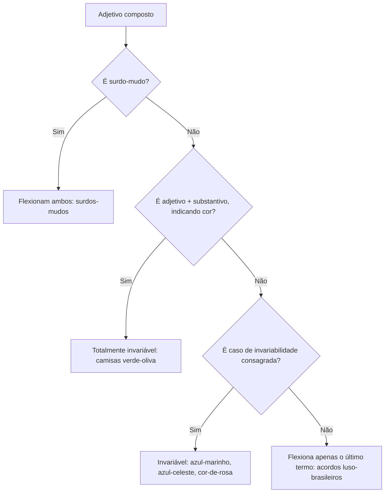
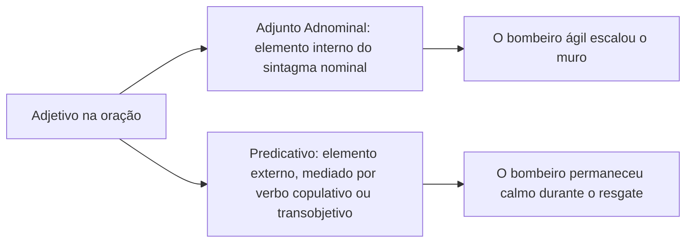
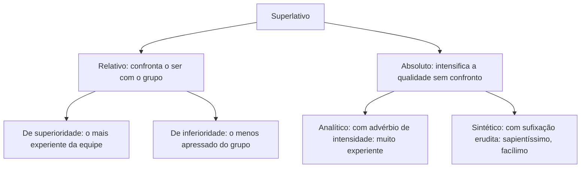
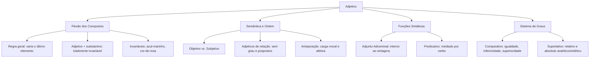

O adjetivo é a classe de palavras responsável por caracterizar, qualificar ou delimitar o substantivo. Ele confere ao nome traços particulares de estado, qualidade, condição ou procedência. Por atuar como modificador nominal, o adjetivo concorda em gênero e número com o termo referido. Essa concordância assume papel estratégico na coesão textual e na progressão temática. Em concursos públicos, a cobrança desse conteúdo é constante. As bancas exigem a flexão dos compostos e a ordem dos termos. Também exploram com frequência os adjetivos de relação e a distinção entre adjunto adnominal e complemento nominal.

> [!objetivos]
> - Classificar os adjetivos de acordo com sua estrutura, origem, valor semântico e referencialidade.
> - Aplicar as regras de flexão de número dos adjetivos compostos, reconhecendo as hipóteses de invariabilidade total.
> - Identificar as funções sintáticas de adjunto adnominal e predicativo, distinguindo classe morfológica de papel adjetivo.
> - Analisar os efeitos semânticos da anteposição e da posposição do adjetivo em relação ao substantivo.
> - Empregar as locuções adjetivas e reconhecer os graus comparativo e superlativo no padrão culto.

## Conceito, características e classificações do adjetivo

O adjetivo integra o grupo dos modificadores que compõem o sintagma nominal. Sua existência funcional depende diretamente de um substantivo. Ele também pode se ligar a palavras com valor substantivo, como pronomes ou numerais.

Quando dizemos *viatura rápida*, *soldado atento* ou *ocorrência complexa*, os adjetivos operam como satélites. Eles concordam em gênero e número com os substantivos nucleares. Essa concordância é obrigatória no padrão culto: *viaturas rápidas*, *soldados atentos*, *ocorrências complexas*.

O adjetivo pode ser substantivado quando vem acompanhado de determinante (*O azul do céu encantou os banhistas*). Ele também pode ser substituído por uma locução adjetiva (*cidadão do Recife* = *recifense*). Da mesma forma, pode equivaler a uma oração adjetiva (*cidadão que nasceu no Recife*).

```mermaid Classificação dos adjetivos segundo seus critérios morfológicos e semânticos
flowchart TD
  ADJ[Adjetivo] --> RAD[Estrutura de Radicais]
  ADJ --> ORIG[Origem Lexical]
  ADJ --> SEM[Valor Semântico]
  ADJ --> PÁT[Origem Geográfica]
  RAD --> SIMP[Simples: um radical: claro]
  RAD --> COMP[Composto: dois ou mais: luso-brasileiro]
  ORIG --> PRIM[Primitivo: não deriva de outra: leal]
  ORIG --> DERIV[Derivado: provém de outra: desleal, bondoso]
  SEM --> EXPL[Explicativo: traço inerente ao ser: fogo quente]
  SEM --> RESTR[Restritivo: particulariza o ser: homem valente]
  PÁT --> PATR[Pátrio: cidades, estados e países: pernambucano]
  PÁT --> GENT[Gentílico: povos, etnias e raças: israelita]
```

### Classificações estruturais e semânticas

As gramáticas normativas dividem os adjetivos nos seguintes grupos fundamentais:

| Critério | Classificação | Definição gramatical | Exemplo de aplicação |
| --- | --- | --- | --- |
| Estrutura | Simples | Possui apenas um único radical | *oficial leal*, *relatório claro* |
| Estrutura | Composto | Formado por dois ou mais radicais | *treinamento técnico-operacional* |
| Formação | Primitivo | Não deriva de nenhuma outra palavra da língua | *água pura*, *homem bom* |
| Formação | Derivado | Forma-se a partir de substantivo, verbo ou outro adjetivo | *terreno montanhoso*, *atitude bondosa* |
| Sentido | Explicativo | Expressa qualidade inerente e inseparável da natureza do ser | *fogo ardente*, *mortal homem* |
| Sentido | Restritivo | Atribui característica particular que distingue o ser dos demais | *soldado experiente*, *viatura blindada* |
| Geografia | Pátrio | Indica o local de nascimento como país, estado ou município | *praia pernambucana*, *bairro recifense* |
| Etnia | Gentílico | Refere-se a raças, tribos, povos ou etnias | *povo israelita*, *cultura eslava* |

Os adjetivos pátrios e gentílicos devem ser grafados com **letra inicial minúscula** (*cidadão brasileiro*, *costume recifense*, *música francesa*). As terminações mais recorrentes na língua são: *-ense* (*fluminense*, *amazonense*), *-ano* (*goiano*, *peruano*), *-ês* (*português*, *francês*), *-eiro* (*mineiro*, *brasileiro*), *-ino* (*argentino*, *nordestino*), *-ista* (*paulista*, *nortista*), *-ita* (*vietnamita*, *israelita*) e *-enho* (*panamenho*, *porto-riquenho*).

### Adjetivos biformes e uniformes

Quanto à flexão de gênero, os adjetivos classificam-se em duas categorias:
- **Biformes**: possuem duas formas distintas para marcar o masculino e o feminino (*oficial disciplinado / oficial disciplinada*; *soldado corajoso / soldada corajosa*).
- **Uniformes**: apresentam uma única forma para ambos os gêneros. Eles concordam tanto com termos masculinos quanto femininos (*instrutor exemplar / instrutora exemplar*; *procedimento constante / conduta constante*; *homem simples / mulher simples*). Terminam geralmente em *-e* (*forte*, *grave*), *-z* (*capaz*, *veloz*), *-l* (*fácil*, *leal*), *-m* (*comum*, *ruim*) e *-s* (*simples*).

## Flexão dos adjetivos compostos e formas invariáveis

A regra geral para o plural dos adjetivos compostos é simples. **Apenas o último elemento varia em gênero e número**. O primeiro elemento permanece na sua forma reduzida ou invariável:

- *acordo luso-brasileiro* → *acordos luso-brasileiros*
- *operação médico-cirúrgica* → *operações médico-cirúrgicas*
- *instituição político-social* → *instituições político-sociais*
- *manifestação sociocultural* → *manifestações socioculturais*
- *questão econômico-financeira* → *questões econômico-financeiras*



### Exceções fundamentais e regras especiais

A memorização das exceções ao plural dos adjetivos compostos é exigida em provas:

1. **Surdo-mudo**: os dois elementos sofrem flexão de gênero e número (*menino surdo-mudo*, *menina surda-muda*, *meninos surdos-mudos*, *meninas surdas-mudas*).
2. **Adjetivo composto por adjetivo + substantivo (indicação de cor)**: quando o segundo termo da composição cromática for um substantivo que empresta seu nome à cor, **nenhuma das partes varia**. Ambos os elementos permanecem no singular:
   - *camisa verde-oliva* → *camisas verde-oliva* (oliva é substantivo)
   - *tecido amarelo-ouro* → *tecidos amarelo-ouro* (ouro é substantivo)
   - *farda vermelho-sangue* → *fardas vermelho-sangue* (sangue é substantivo)
   - *veículo cinza-chumbo* → *veículos cinza-chumbo* (chumbo é substantivo)
   - *tinta verde-esmeralda* → *tintas verde-esmeralda* (esmeralda é substantivo)

> [!atencao] Substantivo empregado sozinho com valor de cor
> Quando um substantivo que designa um objeto ou elemento for usado isoladamente para indicar cor, ele funciona como palavra invariável: *camisas rosa*, *paredes gelo*, *gravatas vinho*, *olhos esmeralda*, *tecidos cinza*. Nesses casos, não se deve flexionar o vocábulo.

### Adjetivos compostos totalmente invariáveis

Existem construções adjetivas compostas que a norma padrão consagrou como plenamente invariáveis:

| Termo adjetivo | Exemplo no singular | Exemplo no plural | Justificativa gramatical |
| --- | --- | --- | --- |
| azul-marinho | terno azul-marinho | ternos azul-marinho | Composto tradicional invariável |
| azul-celeste | farda azul-celeste | fardas azul-celeste | Composto tradicional invariável |
| cor-de-rosa | laço cor-de-rosa | laços cor-de-rosa | Locução adjetiva lexicalizada invariável |
| sem-terra | trabalhador sem-terra | trabalhadores sem-terra | Composto preposicionado invariável |
| zero-quilômetro | veículo zero-quilômetro | veículos zero-quilômetro | Expressão adjetiva invariável |
| verde-musgo | cortina verde-musgo | cortinas verde-musgo | Segundo elemento é substantivo |
| ultravioleta | raio ultravioleta | raios ultravioleta | Adjetivo científico invariável |

> [!pegadinha] O plural de azul-celeste e azul-marinho
> A banca examinadora costuma sugerir opções como *olhos azuis-marinhos* ou *camisas azuis-celestes*. Trata-se de erro evidente. As formas cultas e consagradas pelo VOLP são rigorosamente invariáveis: *olhos azul-marinho*, *camisas azul-celeste*.

## Valores semânticos: adjetivos objetivos, subjetivos e de relação

Os adjetivos podem transmitir fatos concretos ou juízos de valor. As bancas exploram com frequência essa distinção semântica.

### Adjetivos objetivos e adjetivos subjetivos

- **Objetivos (ou descritivos)**: registram características empíricas e factuais. Esses traços podem ser comprovados de forma neutra pelo observador (*mesa de madeira*, *viatura branca*, *relatório trimestral*, *policial fardado*). Possuem sentido denotativo e estabilidade semântica.
- **Subjetivos (ou valorativos)**: expressam opiniões pessoais, julgamentos éticos ou estéticos do enunciador (*intervenção brilhante*, *oficial exemplar*, *atitude abominável*, *clima agradável*). Podem ser retirados da frase sem prejuízo sintático. Sua exclusão altera apenas a carga opinativa do texto.

### Adjetivos de relação

Os adjetivos de relação formam uma subclasse de adjetivos objetivos com presença constante em concursos. Eles possuem quatro características obrigatórias:

1. Derivam diretamente de substantivos (*mês* → *mensal*; *governo* → *governamental*; *bispado* → *episcopal*; *aluno* → *discente*).
2. Estabelecem vínculo objetivo de tempo, espaço, instrumento, matéria, procedência, posse ou finalidade (*eleição presidencial* = eleição do presidente; *política salarial* = política de salários).
3. **Não admitem variação de grau**: não é gramaticalmente aceito dizer *decreto muito presidencial* ou *reunião superpedagógica*.
4. **Colocam-se obrigatoriamente após o substantivo**: a ordem natural não pode ser invertida. Não dizemos *mensal relatório*, mas unicamente *relatório mensal*.

> [!bizu] Como identificar um adjetivo de relação
> Aplique dois testes rápidos para reconhecer o adjetivo de relação na questão:
> 1. Tente antepor a palavra *muito*. Se a frase soar estranha (*contrato muito patronal*), o adjetivo é de relação.
> 2. Transforme o adjetivo em uma locução iniciada por *de* (*energia solar* = *energia do sol*). Se a correspondência for direta e objetiva, trata-se de adjetivo de relação.

## Papel sintático do adjetivo e valor adjetivo de outras classes

Na análise sintática da oração, o adjetivo desempenha apenas duas funções básicas: **adjunto adnominal** ou **predicativo** (do sujeito ou do objeto).

### Adjunto adnominal versus predicativo

A diferença entre essas duas funções reflete a relação sintática do adjetivo com o substantivo determinado:



- **Adjunto adnominal**: integra diretamente o sintagma nominal. Ele qualifica o substantivo de maneira estável, sem mediação de verbo de ligação. Forma um bloco coeso com o nome (*O militar experiente coordenou a equipe*). Se o sujeito for deslocado na frase, o adjunto adnominal acompanha o substantivo.
- **Predicativo do sujeito**: situa-se fora do sintagma do sujeito. Ele se liga ao nome por meio de um verbo de ligação, explícito ou implícito. Atribui ao sujeito um estado circunstancial ou passageiro (*A guarnição estava atenta*; *O oficial parecia calmo*).
- **Predicativo do objeto**: atribui uma qualidade temporária ao objeto direto ou indireto, em virtude do processo verbal (*O tribunal declarou o réu culpado*).

> [!exemplo] Teste prático de distinção sintática
> Compare os dois enunciados:
> 1. *Os policiais cansados retornaram ao batalhão.* (O termo *cansados* atua como adjunto adnominal; caracteriza especificamente os policiais daquele grupo).
> 2. *Os policiais retornaram ao batalhão cansados.* (O vocábulo *cansados* é predicativo do sujeito; expressa o estado dos policiais naquele momento).

### Ser adjetivo versus ter papel adjetivo

Não se deve confundir a classe gramatical adjetivo com o **papel adjetivo** exercido na oração. Outras classes de palavras podem funcionar como determinantes do substantivo, exercendo função adjetiva:

- **Artigos**: *As ocorrências foram registradas.* (Artigo com função de determinante adjetivo).
- **Pronomes possessivos**: *Nosso quartel passou por reformas.* (Pronome possessivo adjetivo, acompanhando o substantivo).
- **Pronomes demonstrativos**: *Esta decisão foi revogada.* (Pronome demonstrativo adjetivo).
- **Numerais**: *Três bombeiros entraram no edifício.* (Numeral adjetivo, determinando o substantivo *bombeiros*).

Quando esses vocábulos substituem o substantivo em vez de acompanhá-lo, desempenham **papel substantivo** (*Três militares chegaram; **dois** descansam agora* → numeral substantivo). Se a banca perguntar qual palavra "exerce papel adjetivo", procure termos que funcionem como adjuntos adnominais de um substantivo.

## Posição do adjetivo em relação ao substantivo

A posição habitual do adjetivo em língua portuguesa é após o substantivo. No entanto, a anteposição do adjetivo é um recurso expressivo frequente. Essa inversão pode acarretar mudanças de estilo ou transformações profundas de sentido e classe morfológica.

### Alterações semânticas provocadas pela inversão

A anteposição do adjetivo tende a destacar valores subjetivos, morais ou conotativos. Já a posposição preserva o sentido literal, físico ou objetivo:

| Adjetivo antes do substantivo | Adjetivo após o substantivo | Efeito semântico da mudança |
| --- | --- | --- |
| *pobre homem* (coitado, digno de compaixão) | *homem pobre* (sem recursos financeiros) | Passa de sentido emotivo para econômico |
| *grande oficial* (ilustre, de conduta honrada) | *oficial grande* (de elevada estatura física) | Passa de julgamento moral para dimensão física |
| *velho companheiro* (amigo de longa data) | *companheiro velho* (indivíduo idoso) | Passa de tempo de convivência para idade |
| *simples soldado* (mero soldado, sem pretensões) | *soldado simples* (soldado humilde, comedido) | Passa de quantificador restritivo para traço moral |
| *novo regulamento* (outro regulamento, substituto) | *regulamento novo* (recém-elaborado, sem uso) | Passa de sucessão para antiguidade cronológica |
| *alto comandante* (ocupante de patente superior) | *comandante alto* (indivíduo de grande estatura) | Passa de posição hierárquica para porte corporal |
| *falso perito* (impostor, charlatão) | *perito falso* (perito não genuíno, inverídico) | Passa de desvio de conduta para inautenticidade |
| *único candidato* (somente este concorrente) | *candidato único* (candidato singular, ímpar) | Passa de quantidade exclusiva para distinção qualitativa |

### Mudança simultânea de classe e sentido

Quando duas palavras substantiváveis aparecem juntas, a ordem dos termos define a função de cada uma. O primeiro vocábulo atua como substantivo (núcleo), e o segundo opera como adjetivo qualificador. A troca de posição provoca **mudança de classe gramatical e mudança de sentido**:

- *militar brasileiro* (substantivo *militar* + adjetivo *brasileiro*): trata-se de um membro da corporação cuja nacionalidade é brasileira.
- *brasileiro militar* (substantivo *brasileiro* + adjetivo *militar*): trata-se de um cidadão do Brasil cuja ocupação profissional é a carreira militar.
- *alemão comunista* (substantivo *alemão* + adjetivo *comunista*): cidadão alemão que é comunista.
- *comunista alemão* (substantivo *comunista* + adjetivo *alemão*): membro comunista com nacionalidade da Alemanha.
- *médico perito* (substantivo *médico* + adjetivo *perito*): profissional de medicina especializado em perícias.
- *perito médico* (substantivo *perito* + adjetivo *médico*): perito técnico com formação na área médica.

O exemplo clássico da literatura aparece nas *Memórias Póstumas de Brás Cubas*, de Machado de Assis. O narrador define-se como um **defunto autor** (um homem morto que começou a escrever) e recusa o título de **autor defunto** (um escritor de profissão que faleceu). O substantivo encabeça o sintagma e define a essência do indivíduo.

> [!pegadinha] Inversão de classe e sentido em provas de certo ou errado
> Um item típico de prova: *"A substituição da expressão 'político preso' por 'preso político' mantém o sentido e a classe das palavras."* O item está incorreto. Em *político preso*, a palavra *político* é substantivo e *preso* é adjetivo. Em *preso político*, ocorre o inverso: *preso* é substantivo e *político* é adjetivo. O sentido altera-se substancialmente.

## Locuções adjetivas e distinção com complemento nominal

A **locução adjetiva** é a combinação de duas ou mais palavras que desempenha papel de adjetivo. Em regra, compõe-se de uma preposição seguida de substantivo:

- *dor de estômago* = *dor estomacal* ou *gástrica*
- *amor de pai* = *amor paterno*
- *atitude de irmão* = *atitude fraternal*
- *resgate de noite* = *resgate noturno*
- *força de leão* = *força leonina*

As bancas examinadoras gostam de confrontar locuções adjetivas e seus respectivos adjetivos eruditos:

| Locução adjetiva | Adjetivo culto ou erudito correspondente |
| --- | --- |
| de chuva | pluvial |
| de rio | fluvial |
| de chumbo | plúmbeo |
| de ferro | férreo |
| de ouro | áureo |
| de prata | argênteo |
| de vidro | vítreo |
| de neve | níveo |
| de vento | eólico |
| de sonho | onírico |
| de bispo | episcopal |
| de ovelha | ovino |
| de porco | suíno |
| de serpente | viperino |
| de aluno | discente |
| de mestre | magistral |
| de orelha | auricular |
| de nuca | occipital |

### Adjunto adnominal versus complemento nominal em termos preposicionados

Nem toda expressão iniciada por preposição e ligada a um nome é locução adjetiva. A distinção entre **adjunto adnominal** e **complemento nominal** segue três regras seguras:

1. Ligado a adjetivo ou advérbio, o termo preposicionado será **sempre complemento nominal** (*favorável à decisão*; *perto do quartel*).
2. Ligado a substantivo concreto, será **sempre adjunto adnominal** (*barco de madeira*, *viatura da polícia*).
3. Ligado a **substantivo abstrato derivado de ação**:
   - Se o termo preposicionado for **agente** (praticar a ação), será **adjunto adnominal**: *O elogio do capitão animou a tropa* (o capitão elogiou = agente).
   - Se o termo preposicionado for **paciente** (sofrer a ação), será **complemento nominal**: *O elogio ao capitão foi justo* (o capitão foi elogiado = paciente).

## Graus do adjetivo e aspectos de acentuação gráfica

O adjetivo varia em grau para expressar a intensidade com que uma característica se manifesta. O sistema divide-se em grau comparativo e superlativo.

### Grau comparativo

O comparativo confronta uma mesma qualidade entre seres distintos, ou duas qualidades em um mesmo ser:

- **Comparativo de igualdade**: *O cabo é tão eficiente quanto o sargento.*
- **Comparativo de inferioridade**: *A ocorrência foi menos complexa do que a de ontem.*
- **Comparativo de superioridade**: *A nova viatura é mais rápida (do) que a anterior.*

O termo *do* antes de *que* nas construções comparativas é **facultativo**. Dizer *mais rápido que* ou *mais rápido do que* é igualmente correto na norma culta.

Certos adjetivos possuem formas comparativas sintéticas de superioridade herdadas do latim:

| Positivo | Comparativo sintético | Uso analítico especial |
| --- | --- | --- |
| bom | melhor | mais bom (correto ao comparar duas qualidades do mesmo ser) |
| mau | pior | mais mau (correto ao comparar duas qualidades do mesmo ser) |
| grande | maior | mais grande (correto ao comparar duas qualidades do mesmo ser) |
| pequeno | menor | mais pequeno (correto ao comparar duas qualidades do mesmo ser) |

> [!atencao] Uso legítimo das formas analíticas
> Ao comparar **duas qualidades de um mesmo sujeito**, usam-se as formas analíticas *mais bom*, *mais mau*, *mais grande* e *mais pequeno*:
> - *O soldado é mais bom que inteligente.* (Correto; confrontam-se duas qualidades do militar).
> - *O terreno é mais grande que seguro.* (Correto; comparam-se dois atributos do imóvel).

### Grau superlativo e acentuação gráfica

O superlativo expressa a qualidade no seu nível máximo:



1. **Superlativo relativo**: situa a qualidade do indivíduo em confronto com um grupo:
   - De superioridade: *O coronel é o mais antigo do regimento.*
   - De inferioridade: *Aquele procedimento é o menos arriscado do protocolo.*
2. **Superlativo absoluto**: exprime a qualidade em intensidade máxima sem comparação externa:
   - **Analítico**: formado com o apoio de um advérbio de intensidade (*extremamente dedicado*, *muito veloz*, *bastante rigoroso*).
   - **Sintético**: formado pela junção de sufixos eruditos ao radical (*-íssimo*, *-érrimo*, *-ílimo*).

As regras de **acentuação gráfica** merecem atenção especial nos superlativos sintéticos. A terminação *-ílimo* gera vocábulos proparoxítonos. Pela regra de acentuação gráfica da língua portuguesa, todas as palavras proparoxítonas recebem acento gráfico obrigatoriamente:

- *fácil* → *facílimo* (proparoxítona acentuada graficamente)
- *difícil* → *dificílimo* (proparoxítona acentuada graficamente)
- *doce* → *dulcíssimo* (proparoxítona acentuada graficamente)
- *pobre* → *paupérrimo* (proparoxítona acentuada graficamente)
- *magro* → *macérrimo* (proparoxítona acentuada graficamente)
- *livre* → *libérrimo* (proparoxítona acentuada graficamente)
- *sábio* → *sapientíssimo* (proparoxítona acentuada graficamente)
- *amigo* → *amicíssimo* (proparoxítona acentuada graficamente)

A acentuação gráfica incide de forma idêntica sobre as formas oxítonas e paroxítonas primitivas. Quando essas palavras formam o superlativo sintético, a sílaba tônica desloca-se para a antepenúltima sílaba, tornando o vocábulo proparoxítono e exigindo o acento gráfico cabível.

## Mapa do capítulo



| Tópico chave | Diretriz para resolução de questões | Exemplo de prova |
| --- | --- | --- |
| Plural composto comum | Apenas o último termo flexiona-se | *acordos luso-brasileiros* |
| Adjetivo + substantivo | Totalmente invariável quando envolve nome de cor derivado de coisa | *camisas verde-oliva*; *paredes amarelo-ouro* |
| Invariáveis fixos | Formas consagradas que nunca variam | *azul-marinho*, *azul-celeste*, *cor-de-rosa*, *sem-terra* |
| Adjetivos de relação | Derivam de substantivo, não admitem grau e vêm pospostos | *decreto presidencial*; *reunião mensal* |
| Inversão de posição | Muda sentido estilístico ou inverte classe gramatical e foco | *pobre homem* (coitado) vs. *homem pobre* (sem dinheiro) |
| Adjunto vs. Predicativo | Adjunto é interno ao sintagma nominal; predicativo liga-se por verbo | *soldado atento* (adjunto) vs. *soldado estava atento* (predicativo) |
| Locução adjetiva | Preposição + substantivo equivalendo a adjetivo; agente ou posse | *amor de mãe* (materno); *resgate de noite* (noturno) |
| Superlativo sintético | Formado por sufixação erudita com alteração do radical latino | *paupérrimo* (pobre), *facílimo* (fácil), *dulcíssimo* (doce) |

### Para fixar
- O adjetivo concorda em gênero e número com o substantivo determinado, classificando-se em simples, composto, primitivo, derivado, explicativo, restritivo, pátrio e gentílico.
- No plural dos adjetivos compostos, a regra geral determina a flexão apenas do último elemento.
- Em adjetivos compostos indicadores de cor formados por adjetivo mais substantivo, nenhuma das partes se flexiona no plural.
- As formas compostas *azul-marinho*, *azul-celeste*, *cor-de-rosa* e *sem-terra* são inteiramente invariáveis no padrão culto.
- Adjetivos de relação originam-se de substantivos, estabelecem conexões objetivas, não admitem variação de grau e posicionam-se após o substantivo.
- A anteposição do adjetivo confere-lhe sentido conotativo, moral ou afetivo, enquanto a posposição preserva o sentido denotativo e físico.
- A inversão da ordem entre dois vocábulos substantiváveis provoca troca de classe e alteração substantiva de sentido.
- Sintaticamente, o adjetivo desempenha unicamente as funções de adjunto adnominal ou predicativo do sujeito ou do objeto.
- Nem toda expressão preposicionada é locução adjetiva: se o termo exercer papel de paciente em relação a um substantivo abstrato transitivo, funcionará como complemento nominal.
- O superlativo absoluto sintético emprega sufixos eruditos que geram palavras proparoxítonas, exigindo acentuação gráfica obrigatória.
