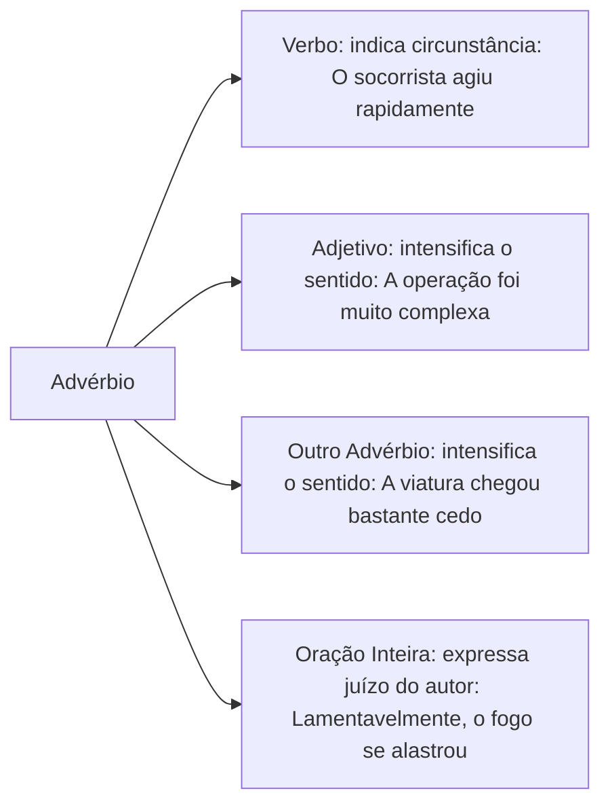
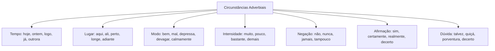
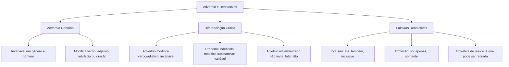

O advérbio é a classe gramatical invariável responsável por expressar as diversas circunstâncias que cercam o processo verbal. Ele também atua como modificador intensificador de adjetivos e de outros advérbios. Em provas de concursos públicos, a cobrança recai sobre a distinção entre advérbio e pronome indefinido. As bancas também exigem o reconhecimento dos valores semânticos contextuais, o uso de adjetivos com valor adverbial e a correta identificação das palavras e locuções denotativas.

> [!objetivos]
> - Definir o advérbio e identificar os elementos que ele pode modificar na oração.
> - Diferenciar advérbios de pronomes indefinidos a partir do termo determinado.
> - Reconhecer as principais circunstâncias adverbiais e seus efeitos de sentido no texto.
> - Compreender o emprego de adjetivos adverbializados e classificar as palavras denotativas.

## Conceito, alcance e propriedades morfológicas do advérbio

O advérbio é uma classe morfológica fundamentalmente invariável. Isso significa que ele não possui flexão de gênero nem de número. Sua função primordial é ligar-se a um verbo para indicar as circunstâncias de realização do fato.

Além de modificar verbos, o advérbio pode desempenhar dois outros papéis. Ele pode intensificar o sentido de um adjetivo (*uma tarefa extremamente complexa*, *uma experiência muito excitante* ou *uma menina bastante engraçadinha*). Ele também pode intensificar o sentido de outro advérbio (*agiu bastante cedo*). Em relação ao verbo, expressa circunstâncias diversas, como em uma manobra tática que mobiliza os bombeiros:

Quando o advérbio incide sobre a oração inteira, ele é chamado de advérbio oracional ou modalizador discursivo. Nesses casos, expressa uma avaliação crítica do próprio enunciador sobre o conteúdo declarado (*Infelizmente, a ocorrência gerou danos materiais*).

Os advérbios interrogativos introduzem perguntas diretas ou indiretas. Eles dividem-se em quatro circunstâncias fundamentais:
- Lugar: *Onde fica o quartel central?* / *Não sei onde fica o quartel.*
- Tempo: *Quando começará o treinamento?* / *Perguntei quando começaria.*
- Modo: *Como foi controlada a situação?*
- Causa: *Por que a guarnição recuou?* (locução adverbial interrogativa de causa).

> [!pegadinha] A aparente flexão do vocábulo todo
> Em construções coloquiais e literárias, o advérbio *todo* pode concordar expressivamente com o adjetivo que modifica: *O militar chegou todo sujo da ocorrência*; *A testemunha ficou toda nervosa*. Embora sofra flexão externa, o termo atua como advérbio de intensidade (equivalendo a *completamente* ou *inteiramente*). Trata-se de uma anomalia expressiva consagrada pela norma culta.

## Distinção entre advérbio e pronome indefinido

Uma das armadilhas mais comuns em provas consiste em confundir advérbios de intensidade com pronomes indefinidos quantificadores. Vocábulos como *muito*, *pouco*, *bastante*, *mais*, *menos* e *demais* pertencem a ambas as categorias.

O critério definitivo para identificar a classe gramatical reside no termo a que a palavra se refere:

| Palavra refere-se a... | Classe gramatical | Comportamento morfológico | Exemplo de aplicação |
| --- | --- | --- | --- |
| Verbo | Advérbio | Invariável (sem gênero nem plural) | *O tenente trabalhou bastante.* |
| Adjetivo | Advérbio | Invariável (intensificador) | *A equipe estava bastante preparada.* |
| Outro advérbio | Advérbio | Invariável (intensificador) | *Eles chegaram muito cedo.* |
| Substantivo | Pronome indefinido | Variável (concorda com o nome) | *Havia bastantes ocorrências na escala.* |

Observe com cuidado o comportamento do vocábulo *bastante*. Quando modifica o verbo *trabalhar* ou o adjetivo *preparada*, permanece invariável como advérbio. Quando determina o substantivo *ocorrências*, atua como pronome indefinido adjetivo. Por isso, vai ao plural concordando com o substantivo (*bastantes problemas*, *bastantes pessoas*). Da mesma forma, em *O militar teve muito prazer* (pronome indefinido associado ao substantivo *prazer*, de sentido prazeroso), o termo quantifica o nome, enquanto em *Ele ficou muito satisfeito*, o advérbio intensifica o adjetivo *satisfeito*. Em um contexto de hiperconsumo, quem adquire bens compulsivamente não desiste com facilidade de novas compras.

> [!bizu] O teste prático da palavra bastante
> Substitua mentalmente a palavra *bastante* por *muito*:
> - Se *muito* variar para *muitos* ou *muitas*, a palavra original é pronome indefinido e deve ir ao plural: *bastantes viaturas* (= muitas viaturas).
> - Se *muito* permanecer invariável, a palavra original é advérbio e fica no singular: *bastante rápidas* (= muito rápidas).

As formas *mais*, *menos* e *demais* são sempre invariáveis. Elas não mudam de forma mesmo quando atuam como pronomes indefinidos junto a substantivos (*menos ocorrências*, *mais viaturas*). Dizer *menas* constitui erro inaceitável no padrão culto.

## Circunstâncias adverbiais e valor semântico contextual

Na análise sintática, o advérbio e as locuções adverbiais desempenham a função de **adjunto adverbial**. O sentido dessa circunstância depende sempre da relação estabelecida com o contexto da oração.

A circunstância pode manifestar-se por meio de três estruturas formais:
1. **Advérbio simples**: uma única palavra (*O alarme tocou cedo* → tempo).
2. **Locução adverbial**: duas ou mais palavras iniciadas por preposição com valor de advérbio (*O alarme tocou às pressas* → modo; *Chegou de repente* → tempo).
3. **Oração subordinada adverbial**: estrutura oracional com verbo próprio (*O alarme tocou assim que o fogo começou* → tempo).

Abaixo estão listadas as circunstâncias adverbiais mais frequentes em provas:

| Circunstância | Principais advérbios e locuções | Exemplo de aplicação contextual |
| --- | --- | --- |
| Tempo | hoje, ontem, amanhã, cedo, tarde, logo, já, nunca, jamais, outrora, às vezes, de repente | *A equipe retornará amanhã ao batalhão.* |
| Lugar | aqui, ali, acolá, perto, longe, dentro, fora, acima, além, em casa, à direita | *Os bombeiros posicionaram a escada à direita.* |
| Modo | bem, mal, assim, depressa, devagar, calmamente, às pressas, em silêncio | *O socorrista agiu com cautela e calma.* |
| Causa | por isso, de medo, de fome, por motivo de força maior | *O motorista tremeu de frio durante a noite.* |
| Finalidade | para isso, a fim de salvar, com o propósito de alertar | *Treinamos duro para a aprovação.* |
| Instrumento | a faca, com o machado, com a mangueira | *A guarnição cortou o galho com o machado.* |
| Companhia | com o capitão, com a equipe, juntamente com o instrutor | *O soldado viajou com o comandante.* |
| Meio | de carro, por terra, via rádio, por helicóptero | *A mensagem foi transmitida via rádio.* |

> [!atencao] A polissemia dos advérbios no contexto
> O valor semântico de um advérbio não é fixo. A palavra *mais* indica intensidade em *Ele correu mais rápido*. Por outro lado, indica tempo em *Nunca mais pretendo faltar ao serviço*. O vocábulo *já* expressa tempo em *Já cheguei*, mas indica conformação discursiva em *Já que você pediu, vou atender*. Avalie sempre o contexto antes de classificar a circunstância.

### Formação de advérbios em -mente

A maior parte dos advérbios de modo é formada pelo acréscimo do sufixo *-mente* à forma feminina do adjetivo primitivo (*rápida* → *rapidamente*; *atenta* → *atentamente*; *fiel* → *fielmente*).

Entretanto, nem todo advérbio terminado em *-mente* expressa circunstância de modo:
- *Atualmente* indica tempo.
- *Certamente* e *realmente* expressam afirmação.
- *Possivelmente* e *provavelmente* indicam dúvida.

Quando dois ou mais advérbios em *-mente* coordenam-se modificando o mesmo verbo, o sufixo pode ser omitido nos primeiros elementos: *O comandante falou clara e objetivamente*. Nesse caso, a forma reduzida *clara* permanece como advérbio de modo, e não adjetivo. De modo semelhante, em *um dever vivido cotidiana e intensamente*, a palavra *cotidiana* é advérbio. Da mesma forma, a flor que murcha rápida e silenciosamente ilustra essa regra de omissão sufixal.

A acentuação gráfica do adjetivo primitivo costuma desaparecer na formação com *-mente*. Palavras como *rápida* e *fácil* perdem o acento gráfico ao formarem *rapidamente* e *facilmente*. Nesses vocábulos derivados, a sílaba tônica desloca-se para a terminação *-men-*, passando a constituir vocábulos paroxítonos com acentuação própria. Essa regra de acentuação gráfica é frequentemente lembrada para evitar erros ortográficos no texto.

## Advérbio com aparência de adjetivo

Na linguagem expressiva contemporânea, é comum o emprego de formas adjetivas masculinas singulares no lugar de advérbios de modo. Esse fenômeno denomina-se adjetivação adverbializada.

Analise os exemplos:
- *A cerveja desce redondo.* (equivale a *redondamente*).
- *Eles beberam o suco direto da garrafa.* (locução com valor adverbial).
- *Os manifestantes falaram alto durante o ato.* (equivale a *altamente* ou *em voz alta*).
- *O produto custou caro aos cofres públicos.* (equivale a *a preço elevado*).
- *Eles jogaram limpo durante a competição.* (equivale a *limpamente*).

O teste definitivo para confirmar a natureza adverbial desses termos é verificar a **invariabilidade morfológica**:

> [!exemplo] Teste de flexão para o adjetivo com valor de advérbio
> Flexione a frase para o plural:
> - *Os policiais falaram alto.* (O termo *alto* não varia para *altos*; trata-se de advérbio de modo).
> - Se dissermos *Os policiais eram altos*, a palavra *altos* varia em número e atua como predicativo do sujeito (adjetivo genuíno).
> - *As testemunhas responderam rápido.* (O vocábulo *rápido* permanece no singular masculino; logo, é advérbio de modo ligado ao verbo *responderam*).

## Palavras e expressões denotativas

A Nomenclatura Gramatical Brasileira (NGB) não enquadra as palavras denotativas em nenhuma das dez classes tradicionais. Embora guardem semelhança formal com os advérbios por serem invariáveis, elas não modificam verbos, adjetivos ou outros advérbios. Elas atuam como marcadores discursivos, introduzindo noções semânticas de relevo.

As bancas examinadoras cobram essas palavras associando-as ao seu valor contextual:

| Sentido denotativo | Vocábulos típicos | Exemplo no padrão culto |
| --- | --- | --- |
| Inclusão | até, inclusive, também, mesmo, ainda | *Até o comandante elogiou a prontidão.* |
| Exclusão | só, apenas, somente, salvo, exceto, sequer | *Apenas dois candidatos foram aprovados.* |
| Designação | eis | *Eis a solução adequada para o impasse.* |
| Realce (expletiva) | é que, cá, lá, só, que | *Nós é que tomamos a iniciativa.* |
| Retificação | aliás, ou seja, isto é, digo, ou melhor | *O prazo encerra amanhã, aliás, hoje.* |
| Situação | então, afinal, agora, mas | *Afinal, quem coordenará o resgate?* |

### O valor expletivo ou de realce

A locução expletiva ou partícula de realce é aquela que pode ser integralmente suprimida da oração sem provocar nenhum prejuízo sintático ou semântico à mensagem. Sua finalidade no enunciado é puramente expressiva, conferindo ênfase ao pensamento:

- *Esta cólica é que incomoda o paciente.* → *Esta cólica incomoda o paciente.*
- *A guarnição é que apagou as chamas.* → *A guarnição apagou as chamas.*
- *Ele lá sabe o que está dizendo!* → *Ele sabe o que está dizendo!*

Com palavras de inclusão, a posição do termo altera o foco do enunciado:
- *Até o padre elogiou a prontidão dos socorristas.* (inclui o padre entre os que elogiaram).
- *O padre até elogiou a ação.* (inclui a ação de elogiar).

Um tipo frequente de item pergunta: *"A eliminação da expressão 'é que' no segmento manteria a correção gramatical e o sentido original do texto?"* A resposta é quase invariavelmente afirmativa quando se trata de locução de realce.

### O papel da posição da palavra só

O vocábulo *só* pode transitar entre diferentes classes gramaticais e sentidos dependendo da sua posição no período:

1. *Só o tenente fuma charutos.* (Palavra denotativa de exclusão, delimitando o sujeito).
2. *O tenente só fuma charutos.* (Advérbio de exclusão, restringindo o processo verbal de fumar).
3. *O tenente fuma só charutos.* (Palavra denotativa de exclusão, restringindo o complemento *charutos*).
4. *O tenente permaneceu só no gabinete.* (Adjetivo, com sentido de *sozinho*, variável no plural: *Eles permaneceram sós*).

A acentuação gráfica do vocábulo *só* decorre da regra dos monossílabos tônicos terminados em *-o*. Por ser monossílabo tônico, recebe acento gráfico obrigatório, diferenciando-se das formas átonas. Essa regra de acentuação gráfica aplica-se a formas semelhantes como *dó*, *nó* e *pó*.

## Mapa do capítulo

| Tópico essencial | Diretriz prática para a prova | Exemplo de aplicação |
| --- | --- | --- |
| Natureza morfológica | Classe invariável que acrescenta circunstância | *O militar agiu prontamente.* |
| Advérbio vs. Pronome | Se referir a substantivo, é pronome; se referir a verbo, é advérbio | *Bastantes homens* (pronome) vs. *Trabalham bastante* (advérbio) |
| Menas não existe | A forma *menos* é invariável em qualquer hipótese | *Menos viaturas* (correto); jamais usar *menas* |
| Adjetivo adverbializado | Palavra com forma de adjetivo ligada a verbo que não flexiona | *Elas falaram grosso* (advérbio de modo) |
| Partícula de realce | Pode ser suprimida sem incorreção sintática | *Eles é que sabem* = *Eles sabem* |
| O vocábulo só | Pode ser denotativa de exclusão, advérbio ou adjetivo (*sozinho*) | *Eles estão sós* (adjetivo flexionado no plural) |

### Para fixar
- O advérbio é uma classe invariável que modifica verbos, adjetivos, outros advérbios e até orações inteiras.
- Ligado a verbos, o advérbio indica circunstâncias; ligado a adjetivos e advérbios, expressa intensidade.
- O advérbio *todo* apresenta concordância expressiva anômala em enunciados poéticos e coloquiais (*ela ficou toda feliz*).
- As palavras *muito*, *pouco* e *bastante* atuam como advérbios quando ligadas a verbos ou adjetivos, e como pronomes indefinidos quando associadas a substantivos.
- O termo *menos* é rigorosamente invariável na norma culta, independentemente do gênero ou número do substantivo que acompanha.
- Os advérbios interrogativos introduzem indagações sobre lugar (*onde*), tempo (*quando*), modo (*como*) e causa (*por que*).
- Nem todo advérbio terminado em -mente exprime modo: *atualmente* indica tempo e *certamente* expressa afirmação.
- Quando dois advérbios em -mente modificam o mesmo verbo, o sufixo pode ser retirado do primeiro termo sem perda de sua natureza adverbial.
- Adjetivos empregados com valor de advérbio de modo permanecem invariáveis no singular masculino (*eles falaram baixo*).
- As palavras denotativas não exercem função sintática, e a locução expletiva de realce (*é que*) pode ser suprimida da frase sem prejuízo gramatical.
